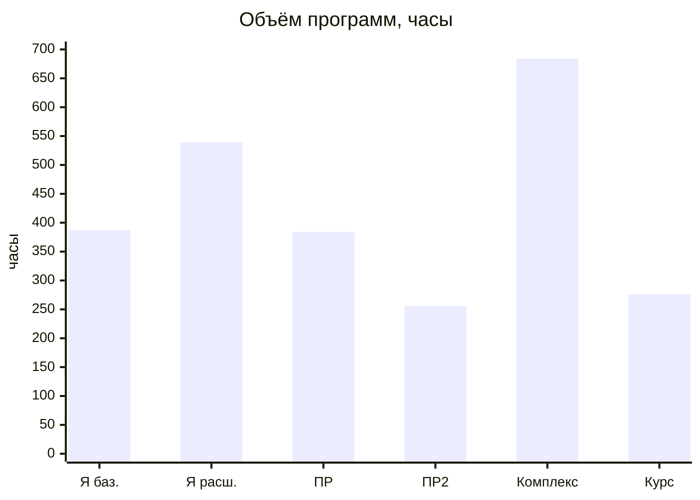
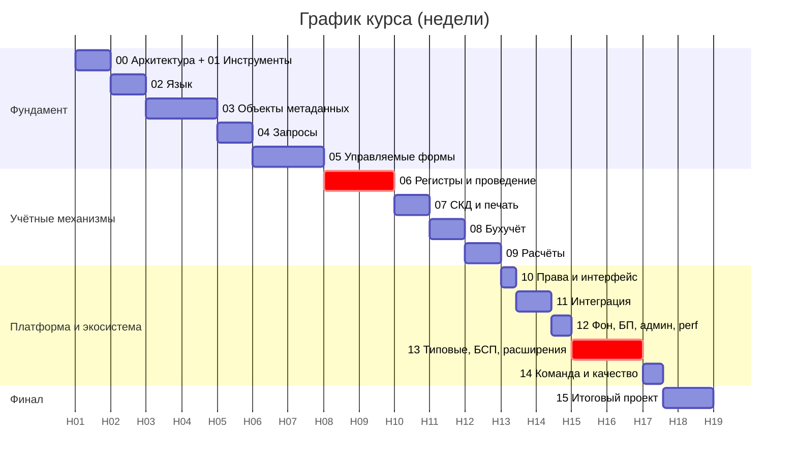
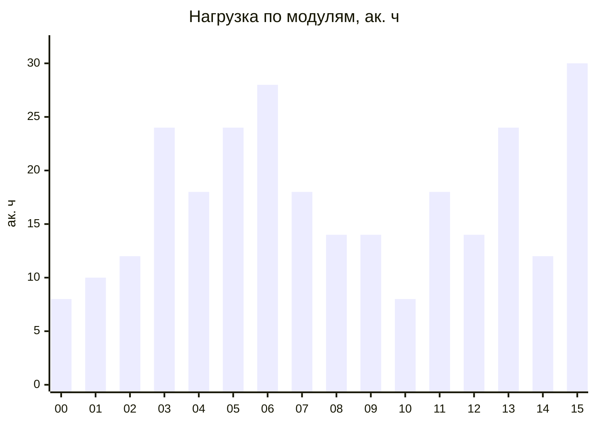
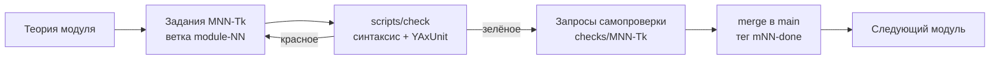

# 1С-разработчик для ABAP-разработчика

Интенсивный курс переподготовки опытного SAP/ABAP-разработчика в разработчики на платформе «1С:Предприятие 8.3». Курс собран из пяти учебных программ (см. [`sources/`](sources/)) и сокращён за счёт того, что ABAP-разработчик уже знает: программирование, SQL, транзакции и блокировки, бизнес-процессы MM/SD/FI/HCM. Материал строится на сопоставлении «как это в SAP → как это в 1С» и на одном сквозном проекте.

## Ключевые параметры

| Параметр | Значение |
|---|---|
| Аудитория | ABAP-разработчик от 3–5 лет опыта (DDIC, Open SQL/CDS, ALV, Dynpro/Fiori, BAdI/enhancements, RFC/IDoc/OData) |
| Цель | самостоятельная разработка и доработка конфигураций 1С уровня middle; готовность к экзамену «1С:Специалист по платформе» (с факультативом) |
| Длительность | **18 недель, 276 ак. ч** (≈ 15 ч/нед. без отрыва от работы) |
| Формат | теория в модулях → задания в сквозном проекте → автотесты → итоговый проект |
| Практика | локальный стенд: платформа с комьюнити-лицензией, файловая ИБ, git, YAxUnit ([lab/](lab/README.md)) |

### Почему 18 недель

Исходные программы рассчитаны на людей «с нуля» или с начальными навыками программирования. Из них убрано то, что ABAP-разработчик уже знает: основы алгоритмизации, «что такое SQL-соединение», двойную запись, карьерный трек. Устаревшие механизмы (обычные формы, Xbase, ActiveX) вынесены в справку. Механика платформы (регистры, проведение, СКД, клиент-сервер, расширения) не сокращалась: её объём сопоставим с ядром исходных программ.

*Я — Яндекс Практикум, ПР/ПР2/Комплекс — программы «1С-Образования». У Практикума указаны часы нагрузки по спринтам, у «1С-Образования» и этого курса — академические часы (45 мин). Факультатив (мобильная платформа, 1С:Исполнитель, 1С:Элемент, подготовка к «Специалисту») сюда не входит, он ещё 60–120 ч.*

## Учебный план

| № | Модуль | ак. ч | Недели |
|---|---|---:|---|
| 00 | [Архитектура платформы глазами SAP-разработчика](modules/00-architecture.md) | 8 | 1 |
| 01 | [Инструменты: Конфигуратор, EDT, отладчик, выгрузка в файлы](modules/01-tools.md) | 10 | 1 |
| 02 | [Встроенный язык 1С для ABAP-разработчика](modules/02-language.md) | 12 | 2 |
| 03 | [Прикладные объекты и объектная модель](modules/03-metadata-objects.md) | 24 | 3–4 |
| 04 | [Язык запросов](modules/04-queries.md) | 18 | 5 |
| 05 | [Управляемые формы и клиент-серверная архитектура](modules/05-managed-forms.md) | 24 | 6–7 |
| 06 | [Регистры накопления и проведение документов](modules/06-registers-posting.md) | 28 | 8–9 |
| 07 | [Отчёты на СКД и печатные формы](modules/07-reports-skd-print.md) | 18 | 10 |
| 08 | [Бухгалтерский учёт: планы счетов, регистры бухгалтерии](modules/08-accounting.md) | 14 | 11 |
| 09 | [Периодические расчёты: ПВР, регистры расчёта](modules/09-periodic-calculations.md) | 14 | 12 |
| 10 | [Права доступа, RLS, функциональные опции, интерфейс](modules/10-security-interface.md) | 8 | 13 |
| 11 | [Интеграция: файлы, HTTP/REST, SOAP/XDTO, обмен данными](modules/11-integration.md) | 18 | 13–14 |
| 12 | [Фоновые задания, бизнес-процессы, администрирование, производительность](modules/12-jobs-bp-admin-performance.md) | 14 | 14 |
| 13 | [Типовые конфигурации, БСП, расширения](modules/13-typical-configs-bsp-extensions.md) | 24 | 15–16 |
| 14 | [Командная разработка и качество: git, стандарты, тесты](modules/14-team-dev-quality.md) | 12 | 17 |
| 15 | [Итоговый проект](modules/15-final-project.md) | 30 | 17–18 |
| 90 | [Факультатив и сознательно исключённое](modules/90-optional.md) | — | после курса |
| | **Итого** | **276** | **18** |

Распределение нагрузки по модулям:

Самые тяжёлые модули — 06 (регистры и проведение) и 13 (типовые и расширения). Они ближе всего к повседневной работе 1С-разработчика, и в них сильнее всего расходятся привычки SAP и 1С.

## Как устроен каждый модуль

1. **Карта понятий SAP → 1С.** С неё начинается каждый модуль, чтобы привязать новое к знакомому и сразу показать, где аналогия ломается.
2. **Теория.** Только механика платформы, со схемами (Mermaid рендерится прямо на GitHub) и параллельными примерами ABAP ↔ 1С.
3. **Ловушки для ABAP-разработчика.** Типовые ошибки «человека из SAP».
4. **Практика.** Задания `MNN-Tk` в сквозном проекте [«УчебнаяТорговля»](project/README.md) с критериями приёмки и способом самопроверки.
5. **Контрольные вопросы** уровня собеседования и сертификации.

## С чего начать

1. Разверните стенд по [lab/README.md](lab/README.md): уровни L1–L2 обязательны, на это уходит около часа.
2. Прочитайте спецификацию [сквозного проекта](project/README.md).
3. Начните с [модуля 00](modules/00-architecture.md).

## Источники и покрытие

* [`sources/`](sources/) — исходные программы (PDF и TXT).
* [`docs/verification-notes.md`](docs/verification-notes.md) — что в коде и фактах проверено, а что стоит сверить с синтакс-помощником (код писался без доступа к платформе).
* [`docs/sources-coverage.md`](docs/sources-coverage.md) — матрица «тема источника → модуль курса» и **явный список тем, которых нет в предоставленных материалах**.

Важно: все пять источников — это **учебные программы (перечни тем)**, а не учебники. Содержательная теория, примеры кода, схемы и задания написаны заново по документации платформы. Источники определили состав и полноту тем.
