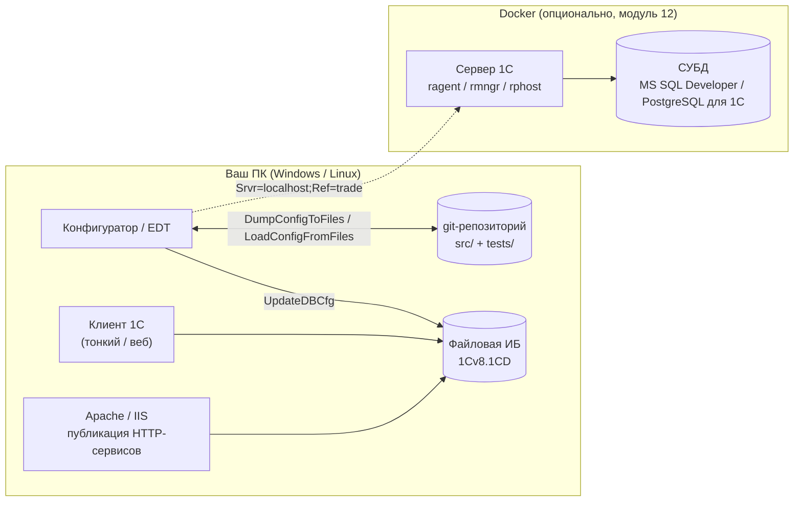
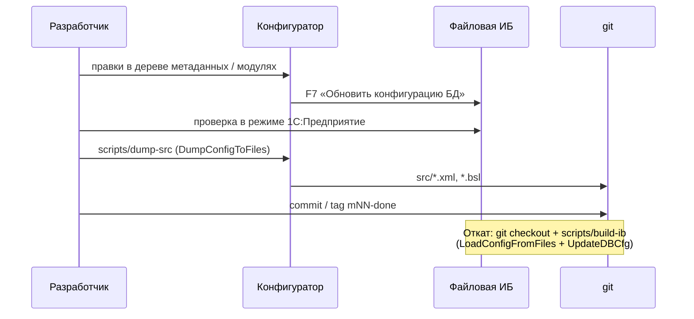
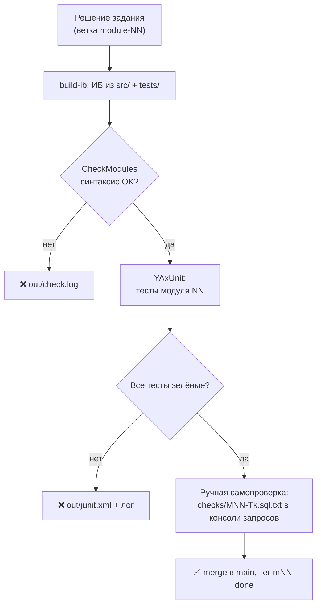

# Локальный стенд для практики

Цель стенда — воспроизвести у себя то, что в SAP даёт «песочница» DEV-системы: место, где можно сломать, откатить и проверить. В 1С это проще: информационная база — это каталог с одним файлом (`1Cv8.1CD`), а исходники конфигурации выгружаются в XML и живут в git.



Уровни стенда, от обязательного к опциональному:

| Уровень | Что даёт | Когда нужен | Время на установку |
|---|---|---|---|
| **L1. Платформа + файловая ИБ** | 95 % заданий курса | с модуля 01 | 30 мин |
| **L2. git + скрипты сборки ИБ из исходников** | версионирование, откат, сравнение решений | с модуля 01 | 30 мин |
| **L3. Веб-сервер (Apache)** | HTTP-/Web-сервисы, веб-клиент | модуль 11 | 30 мин |
| **L4. EDT** | современная IDE, git-ориентированная разработка | модуль 14 (можно сразу) | 1 ч |
| **L5. Автотесты (YAxUnit, Vanessa-Automation)** | автоматическая проверка заданий | с модуля 06 (рекомендуется), обязательно в модуле 14 | 1 ч |
| **L6. Клиент-серверный стенд (сервер 1С + СУБД)** | кластер, консоль администрирования, ТЖ, блокировки СУБД | модуль 12 | 2–3 ч |

---

## L1. Платформа и лицензия

### Вариант A (рекомендуется): полная платформа + комьюнити-лицензия разработчика

С версии платформы **8.3.23** фирма «1С» выдаёт бесплатную **комьюнити-лицензию** для физических лиц — только для разработки, отладки, тестирования и обучения (вести реальный учёт на ней запрещено).

| Параметр | Значение |
|---|---|
| Где получить | регистрация на портале разработчиков **developer.1c.ru** |
| Ограничения | не более 3 сеансов с прямым подключением и 1 сеанс через веб-сервер / мобильный клиент |
| Функциональность | полная, включая клиент-серверный режим |
| Активация | Конфигуратор → *Администрирование → Лицензирование → Получить лицензию → тип «Комьюнити»* → логин/пароль портала. Требуется интернет. На Linux-сервере — от root, файл лицензии в `/var/1C/licenses/`, права на чтение для `usr1cv8` |

> ⚠ Условия лицензии и способ получения дистрибутива меняются — перед установкой сверьтесь со страницей лицензии на developer.1c.ru / v8.1c.ru. Рекомендуемая версия платформы для курса — актуальная 8.3.2x (или 8.5, если она у вас есть); всё, что описано в курсе, работает начиная с 8.3.23.

**Установка (Windows):** запустить `setup.exe` из дистрибутива «Технологическая платформа», компоненты: *1С:Предприятие*, *Тонкий клиент*, *Модули расширения веб-сервера* (для L3), *Сервер 1С:Предприятия* — только для L6.

**Установка (Linux, deb-пакеты 8.3.2x):**

```bash
# дистрибутив setup-full-8.3.xx.xxxx-x86_64.run из личного кабинета
chmod +x setup-full-*.run
sudo ./setup-full-*.run --mode unattended --enable-components client_full,ws,ru
# платформа ставится в /opt/1cv8/x86_64/8.3.xx.xxxx/
```

### Вариант B: «1С:Предприятие 8.3. Версия для обучения программированию»

Бесплатная учебная поставка с сайта 1С (анкета → ссылка на загрузку), включает платформу и мобильную платформу. Работает только с файловыми базами и имеет ограничения, из-за которых в ней нельзя вести реальную работу. Для курса её хватает **до модуля 11 включительно**. Для модулей 12–14 (сервер, СУБД, CI) нужен вариант A.

### Вариант C: облако edu.1cfresh.com

Учебный облачный тренажёр (упомянут в программах «1С-Образования»). Не подходит для заданий с git, автотестами и сервером, поэтому в курсе используется только как запасной вариант.

### Создание учебной ИБ

```text
1cv8.exe CREATEINFOBASE File="C:\1c\ib\trade" /Out "C:\1c\logs\create.log"
```

или из лаунчера: *Добавить → Создание новой ИБ → Создание ИБ без конфигурации → На данном компьютере*. В `C:\1c\ib\trade` появится `1Cv8.1CD`. Это и есть вся база: копирование файла = бэкап, удаление каталога = drop.

---

## L2. git и сборка ИБ из исходников

Принцип: **источник истины — XML-исходники в git**, а ИБ можно в любой момент пересобрать. Аналогия с SAP: git-репозиторий ≈ транспортная система + версия объектов (SE80 *Versions*), а ИБ ≈ одноразовая DEV-система.



Структура рабочего репозитория (отдельный репозиторий ученика, не этот):

```text
trade/
├── src/            # выгрузка конфигурации (DumpConfigToFiles, иерархический формат)
├── tests/          # выгрузка расширения с тестами YAxUnit (модуль 14)
├── checks/         # MNN-Tk.sql.txt — запросы самопроверки
├── testdata/       # обработка заполнения тестовыми данными (M03-T6)
└── scripts/        # копия lab/scripts из этого репозитория
```

Готовые скрипты — в [`lab/scripts/`](scripts/):

| Скрипт | Что делает |
|---|---|
| `env.ps1` / `env.sh` | пути к платформе, ИБ, исходникам (отредактируйте один раз) |
| `build-ib.ps1` / `build-ib.sh` | пересоздаёт ИБ с нуля из `src/` (+ расширение `tests/`, если есть) |
| `dump-src.ps1` / `dump-src.sh` | выгружает конфигурацию из ИБ в `src/` |
| `check.ps1` / `check.sh` | синтаксический контроль модулей + запуск тестов YAxUnit, итог в `out/` |

Под капотом — пакетный режим Конфигуратора (параметры стабильны с 8.3.x):

```text
1cv8 DESIGNER /F <ИБ> /DisableStartupDialogs /Out <log> /DumpConfigToFiles <src> -Format Hierarchical
1cv8 DESIGNER /F <ИБ> /DisableStartupDialogs /Out <log> /LoadConfigFromFiles <src> /UpdateDBCfg
1cv8 DESIGNER /F <ИБ> /DisableStartupDialogs /Out <log> /LoadConfigFromFiles <tests> -Extension Tests /UpdateDBCfg -Extension Tests
1cv8 DESIGNER /F <ИБ> /DisableStartupDialogs /Out <log> /CheckModules -ThinClient -Server
1cv8 ENTERPRISE /F <ИБ> /DisableStartupDialogs /C "RunUnitTests=<путь к yaxunit.json>"
```

Альтернатива без GUI-платформы — утилита автономного сервера `ibcmd` (`ibcmd infobase create … --load=… --apply --force`, `ibcmd infobase config import …`, `ibcmd infobase config export objects …`). Синтаксис ключей различается между версиями — сверяйтесь с `ibcmd <команда> --help` вашей версии. В курсе по умолчанию используется `1cv8 DESIGNER`.

> **Важно про формат:** выгрузка Конфигуратора (`DumpConfigToFiles`) и проект EDT — **разные** XML-форматы. Выберите один на весь курс. Рекомендация: начать с Конфигуратора (модули 01–13), в модуле 14 сконвертировать в EDT (*Файл → Импорт → Конфигурация из информационной базы*).

---

## L3. Веб-сервер для HTTP- и Web-сервисов (модуль 11)

**Windows:** Apache 2.4 (сборка Apache Lounge) или IIS. **Linux:** `apache2` из пакетов. Компонент платформы «Модули расширения веб-сервера» должен быть установлен.

Публикация из Конфигуратора: *Администрирование → Публикация на веб-сервере* (отметить HTTP-сервис `API`, Web-сервисы). Или командой:

```bash
sudo /opt/1cv8/x86_64/8.3.xx.xxxx/webinst -publish -apache24 \
  -wsdir trade -dir /var/www/trade \
  -connstr 'File="/home/me/1c/ib/trade";' \
  -confpath /etc/apache2/apache2.conf
sudo systemctl restart apache2
# проверка (после модуля 11):
curl -u Администратор: http://localhost/trade/hs/api/stock
```

Пользователь ОС, под которым работает Apache (`www-data`), должен иметь права на запись в каталог файловой ИБ. Комьюнити-лицензия допускает 1 сеанс через веб-сервер: не держите открытым веб-клиент во время вызова сервисов.

---

## L4. 1C:Enterprise Development Tools (EDT)

* Дистрибутив — с портала разработчиков / releases.1c.ru, установщик `1c-edt-*-x86_64` (содержит JDK). Версия EDT должна поддерживать вашу версию платформы.
* Выделите EDT ≥ 6–8 ГБ RAM (`-Xmx` в `1cedt.ini`).
* Импорт: *Файл → Импорт → 1C:Enterprise → Конфигурация из информационной базы* (или проект из XML-выгрузки).
* Связать проект с ИБ (вкладка *Информационные базы*) — EDT сам выполняет обновление конфигурации БД при запуске отладки.
* Git встроен (EGit); проект EDT кладите в тот же репозиторий в каталог `src/` вместо выгрузки Конфигуратора.

---

## L5. Автоматическая проверка заданий

Механизм проверки, используемый в курсе:



1. **Синтаксис/компиляция** — `CheckModules` (аналог проверки активации в SE80).
2. **Модульные тесты — YAxUnit** (github.com/bia-technologies/yaxunit). Устанавливается как расширение `YAXUNIT.cfe` (из релизов на GitHub). Тесты пишутся в **вашем** расширении `Tests` — общие модули с префиксом `ОМ_…`. Пример теста для контроля остатков (модуль 06) — [`lab/tests-example/`](tests-example/). Аналог в SAP — ABAP Unit.
3. **Сценарные тесты — Vanessa-Automation** (github.com/Pr-Mex/vanessa-automation) — Gherkin-сценарии «как пользователь»: открыть документ, заполнить, провести, проверить сообщение. Используется в модулях 05, 06, 14 и в итоговом проекте. Запускается как внешняя обработка `vanessa-automation.epf` в режиме *TestManager* (клиент запускается с ключом `/TESTMANAGER`, тестируемый — с `/TESTCLIENT`).
4. **Запросы самопроверки** — в каждом модуле у заданий указан запрос/сценарий для ручной проверки. Запускайте их в консоли запросов (*Функции для технического специалиста → Консоль запросов* в новых версиях платформы или внешняя обработка «Консоль запросов» с ИТС).

Для тех, кто хочет CI: тот же `check.sh` запускается в GitLab CI / GitHub Actions на self-hosted runner с установленной платформой. Готовые решения сообщества — vanessa-runner (`vrunner`, OneScript) и образы onec-docker; в 2026 г. вышел vrunner 3.0, где команды переименованы (`infobase`, `validate`, `test`…), поэтому инструкции для 2.x к нему не подходят.

---

## L6. Клиент-серверный стенд (модуль 12)

Нужен, чтобы своими руками увидеть кластер, рабочие процессы, сеансы, управляемые блокировки на уровне СУБД и технологический журнал.

### Рекомендуемая схема (самая простая)

* **СУБД — в Docker:** Microsoft SQL Server Developer Edition (бесплатна для разработки/тестирования, поддерживается 1С). Альтернатива — PostgreSQL в сборке для 1С (обычный PostgreSQL без патчей 1С не подходит).
* **Сервер 1С — нативно** на том же ПК (компонент «Сервер 1С:Предприятия» из дистрибутива платформы, служба `1C:Enterprise 8.3 Server Agent`). Комьюнити-лицензия активируется на сервере.

```bash
cd lab/docker
cp .env.example .env      # задайте пароль SA
docker compose up -d mssql
```

На хосте с сервером 1С под Windows нужен клиентский драйвер Microsoft OLE DB Driver for SQL Server (сервер 1С подключается через него). Затем в «Администрирование серверов 1С» (или `rac`): *Кластер → Информационные базы → Создать*: тип СУБД `MSSQLServer`, сервер `localhost,1433`, пользователь `sa`, база `trade`, «Создать базу данных в случае её отсутствия». Перенос учебной ИБ: в Конфигураторе файловой базы *Администрирование → Выгрузить ИБ (.dt)*, затем в серверной — *Загрузить ИБ*.

### Полностью контейнерный вариант (для продвинутых)

Публичных образов сервера 1С нет (дистрибутив лицензируется). Образ собирается локально проектом сообщества **onec-docker** (github.com/firstBitMarksistskaya/onec-docker, MIT): заполнить `.onec.env` (`ONEC_USERNAME`, `ONEC_PASSWORD` — учётная запись releases.1c.ru, `ONEC_VERSION`) и выполнить `./build-server.sh`. После сборки раскомментируйте сервис `onec-server` в [`docker/docker-compose.yml`](docker/docker-compose.yml). Типовые грабли: клиент должен резолвить `hostname` контейнера (пропишите `onec-server` в `hosts` на 127.0.0.1); должны быть проброшены порты 1540, 1541 и диапазон 1560–1591; лицензия хранится в томе `/var/1C/licenses`.

---

## Чек-лист готовности стенда

- [ ] Платформа запускается, лицензия получена (Конфигуратор → *Справка → О программе* показывает лицензию).
- [ ] Создана пустая ИБ `trade`, открывается в Конфигураторе и в режиме 1С:Предприятие.
- [ ] Создан git-репозиторий, `scripts/env.*` настроен, `dump-src` и `build-ib` отрабатывают без ошибок.
- [ ] (модуль 06+) Установлено расширение YAxUnit, пример из `tests-example` проходит.
- [ ] (модуль 11) `curl …/hs/api/…` отвечает.
- [ ] (модуль 12) Серверная ИБ создана, в консоли администрирования видны сеансы.

## Если что-то не так

| Симптом | Причина / решение |
|---|---|
| «Не обнаружено свободной лицензии» | Лицензия не получена или превышен лимит сеансов комьюнити-лицензии (3). Закройте лишние клиенты/Конфигураторы. |
| `LoadConfigFromFiles` падает на формате | Выгрузка сделана другой версией платформы или это проект EDT. Выгрузку и загрузку делайте одной версией. |
| HTTP-сервис отдаёт 404 | Сервис не отмечен при публикации или не перезапущен Apache; проверьте `default.vrd` в каталоге публикации. |
| HTTP 500 «Ошибка доступа к ИБ» из Apache | У пользователя веб-сервера нет прав на каталог файловой ИБ. |
| Сервер 1С в Docker: клиент не подключается | Не резолвится имя контейнера или не проброшен диапазон 1560–1591. |
