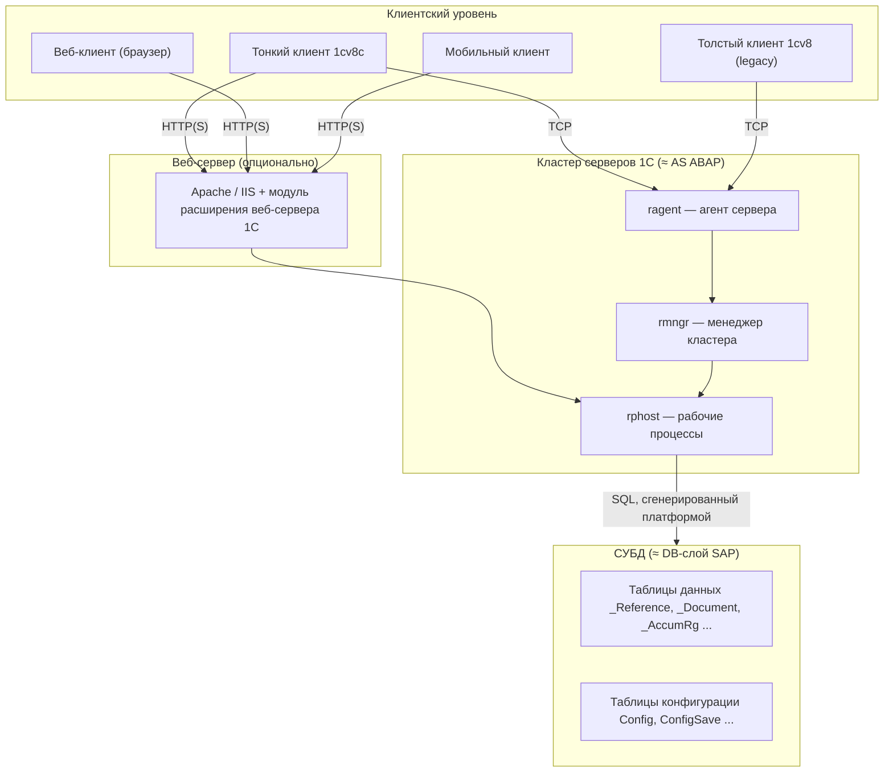
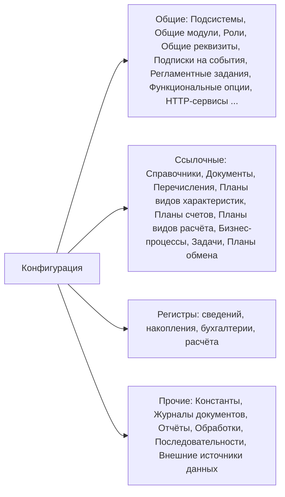
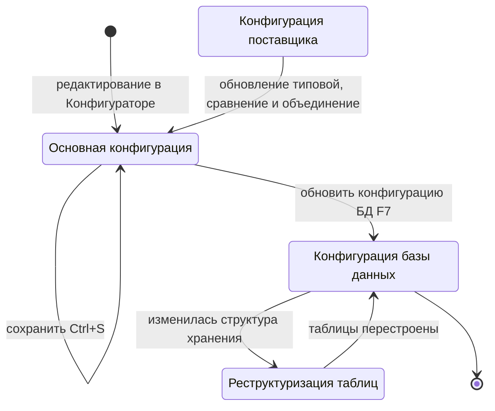
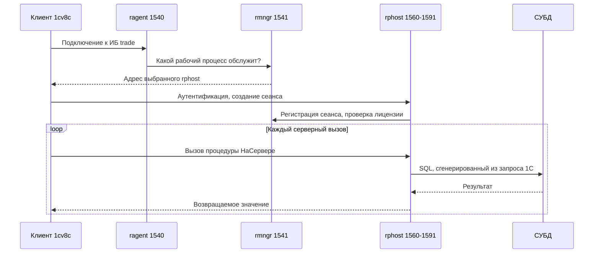
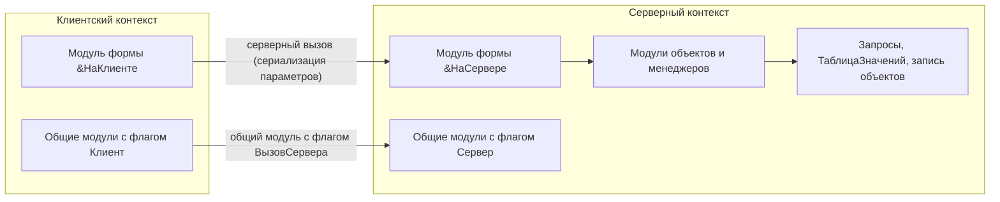
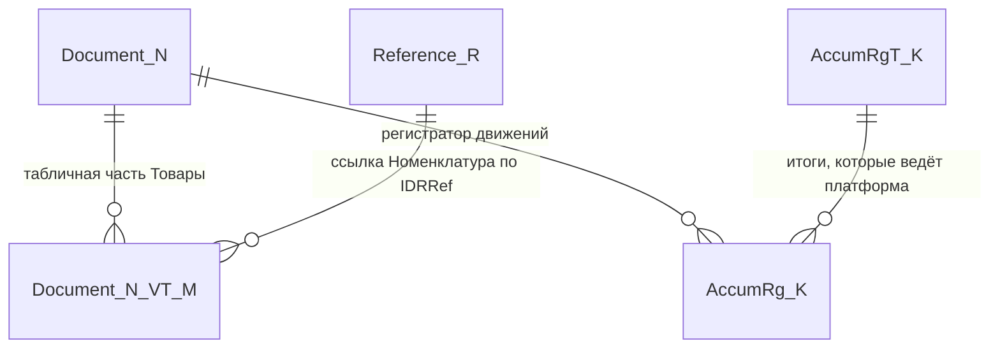
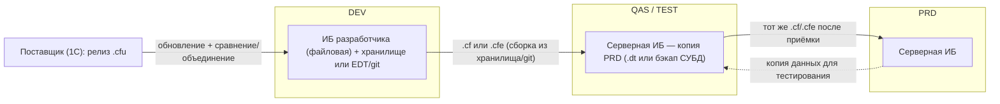

# Модуль 00. Архитектура платформы глазами SAP-разработчика

> **Объём:** 8 ак. ч · **Неделя:** 1 · **Источники:** [Я] спринт 00 («Устройство платформы 1С»), спринт 03 («Хранение таблиц в базах данных»), спринт 09 (СУБД MS SQL, консоль администрирования серверов, создание серверной базы), спринт 11 (устройство типовых решений), спринт 13 (релизный цикл, сертификация); [ПР] «Введение. Экосистема 1С», модуль 1 (основы администрирования, установка, аппаратная защита), модуль 2 (тонкий/толстый клиент, клиент-сервер); [ПР2] «Введение. Экосистема 1С»; [К] «Введение. Экосистема 1С», модули 1, 2, 6; [Т] модуль 1 (общие принципы платформы, объекты конфигурации), модуль 5 (поставка, поддержка, мобильная платформа)
> **Нет в источниках (написано по документации платформы/опыту):** внутреннее устройство кластера (процессы ragent/rmngr/rphost, сервисы менеджера кластера, утилиты ras/rac); правила именования таблиц СУБД (`_Reference`, `_Document`, `_AccumRg`…, поля `_IDRRef`, `_Fld`, составные типы) и функция `ПолучитьСтруктуруХраненияБазыДанных`; смещение дат 2000 в MS SQL; автономный сервер; веб-клиент и публикация на веб-сервере; построение ландшафта DEV/QAS/PRD и маршрута поставки изменений; сопоставление типовых конфигураций с модулями S/4HANA; разделение данных как аналог мандантов SAP.

## Результат модуля

- Умеете объяснить, из чего состоит система на 1С (платформа, конфигурация, информационная база) и чем это отличается от связки NetWeaver AS ABAP + репозиторий + DDIC.
- Умеете выбрать вариант работы (файловый / клиент-серверный) и назвать роли процессов кластера `ragent`, `rmngr`, `rphost` в терминах SAP.
- Умеете по объекту метаданных предсказать, какие таблицы СУБД создаст платформа, и найти их фактические имена программно.
- Умеете различать тонкий, толстый, веб- и мобильный клиент, понимаете, где исполняется код в каждом случае.
- Умеете спроектировать ландшафт DEV → QAS → PRD без транспортной системы и сопоставить типовые конфигурации 1С с модулями S/4HANA.

## Карта понятий SAP → 1С

| SAP | 1С | Ключевое отличие |
|---|---|---|
| SAP NetWeaver AS ABAP (ядро + ABAP-рантайм) | Технологическая платформа «1С:Предприятие 8.3» | Платформа — один продукт для всех решений; версия платформы и версия прикладного решения независимы |
| Репозиторий ABAP + DDIC | Конфигурация (дерево объектов метаданных + модули + формы + макеты) | Конфигурация — единое целое, хранится **внутри** базы данных ИБ; нет пакетов и объектов «вне» конфигурации (кроме расширений и внешних обработок) |
| Система (SID) с одной БД | Информационная база (ИБ) | Одна ИБ = одна БД = одна конфигурация; на одном кластере живут десятки ИБ |
| Мандант (MANDT) | Нет по умолчанию; эмулируется **общим реквизитом-разделителем** (разделение данных) | Типовые решения без разделителей — одна организация-группа на ИБ; мульти-тенантность только в «сервисном» режиме (1cfresh) |
| Активация объекта DDIC | Обновление конфигурации базы данных (F7) | Применяется вся конфигурация сразу, с реструктуризацией таблиц; нет поштучной активации |
| Message server + dispatcher | `ragent` + `rmngr` (менеджер кластера) | Клиент один раз проходит через агент и затем работает с рабочим процессом напрямую |
| Work process (DIA/BTC/UPD) | Рабочий процесс `rphost` | Один `rphost` многопоточный и обслуживает много сеансов; нет деления на типы процессов |
| Enqueue server | Сервис управляемых блокировок в менеджере кластера | Блокировки задаются из кода (`БлокировкаДанных`), а не объектами блокировки в DDIC |
| SAP GUI / Fiori Launchpad | Тонкий клиент / веб-клиент | Интерфейс генерируется по метаданным, Dynpro-программирования экранов почти нет |
| TMS, транспортные запросы | Файлы `.cf`/`.cfu`/`.cfe`, хранилище конфигурации, git (EDT) | Транспортной системы нет: переносится конфигурация целиком или расширение |
| SPDD/SPAU (modification adjustment) | Поддержка + «Сравнение/объединение» при обновлении типовой | Трёхстороннее слияние на уровне объектов и модулей |
| SAP Notes, Support Packages | Релизы на портале 1С:ИТС (releases.1c.ru), файлы `.cfu` | Обновляется сразу вся типовая конфигурация до релиза |
| S/4HANA (MM/SD/FI/CO/PP/HCM) | Типовые: 1С:ERP, КА, УТ, БП, ЗУП | Разные продукты на одной кодовой базе (БСП), а не модули одного продукта |

## Теория

### 1. Три сущности: платформа, конфигурация, информационная база

В SAP вы привыкли к разделению «ядро (kernel) — ABAP-рантайм — репозиторий — данные». В 1С слоёв меньше, и они жёстче связаны:

- **Платформа** — исполняемые файлы (`1cv8.exe`, `1cv8c.exe`, `ragent`, `rmngr`, `rphost`, модули веб-сервера). Содержит интерпретатор встроенного языка, транслятор языка запросов в SQL, ORM, генератор форм, механизмы регистров, СКД, блокировок, прав. Аналог — ядро + ABAP-рантайм + значительная часть того, что в SAP является «приложением» (BOPF/RAP, ALV, SAPscript).
- **Конфигурация** — описание прикладного решения: объекты метаданных (справочники, документы, регистры…), их реквизиты, формы, макеты, роли и **программные модули**. Аналог — репозиторий ABAP + DDIC + все Z-объекты, но собранные в одно дерево с одним корнем.
- **Информационная база (ИБ)** — база данных, в которой лежат и данные, и сама конфигурация. Файл `1Cv8.1CD` в файловом варианте или база в MS SQL Server / PostgreSQL / IBM Db2 / Oracle в клиент-серверном.



Следствия, которые меняют привычки ABAP-разработчика:

1. **Нет «объекта вне конфигурации».** Нельзя создать отдельную программу в пакете `$TMP` и запустить её на продуктиве. Внешние обработки (`.epf`) и расширения (`.cfe`) — единственные способы подключить код без изменения основной конфигурации (подробно — [модуль 13](13-typical-configs-bsp-extensions.md)).
2. **Нет поштучной активации.** Изменили один реквизит — обновляется конфигурация базы данных целиком (платформа сама вычисляет, какие таблицы реструктурировать).
3. **Код и данные едины по версии.** Конфигурация хранится в той же БД, что и данные; бэкап СУБД = бэкап и кода, и данных.
4. **Версия платформы ≠ версия решения.** Платформа 8.3.x обновляется независимо; совместимость регулирует свойство конфигурации «Режим совместимости» (близко по смыслу к release-зависимым ограничениям синтаксиса ABAP, но управляется разработчиком решения).

### 2. Конфигурация как метаданные: «репозиторий + DDIC в одном дереве»

Каждый **объект метаданных** описывает сразу несколько вещей, которые в SAP разнесены по разным инструментам:

| Что описывает объект «Справочник Номенклатура» | Где это в SAP |
|---|---|
| Структура таблицы (реквизиты, типы, индексирование) | SE11 (прозрачная таблица + элементы данных) |
| Табличные части (подчинённые таблицы) | Ещё одна таблица SE11 + внешний ключ |
| Программный интерфейс (`Справочники.Номенклатура`, `СправочникОбъект.Номенклатура`) | Класс BO / RAP behavior definition |
| Обработчики событий записи (`ПередЗаписью`, `ОбработкаПроверкиЗаполнения`) | BAdI / determinations / validations |
| Формы (элемента, списка, выбора) | Dynpro / Fiori Elements app |
| Права (через роли) | PFCG + объекты полномочий |
| Представление в интерфейсе, поиск, ввод по строке | Search help (SE11), F4 |

Платформа на основании метаданных **генерирует** таблицы, ORM-классы, формы «по умолчанию», команды интерфейса и проверку прав. Разработчик дописывает поведение в модулях. Ближайшая аналогия в мире SAP — managed RAP BO + Fiori Elements, только доведённая до того, что так устроено **всё** приложение, включая учётные регистры.

Виды объектов метаданных (детально — [модуль 03](03-metadata-objects.md)):



Ключевая мысль: **ссылочные объекты** имеют суррогатный ключ — `УникальныйИдентификатор` (GUID), а ссылка на них — отдельный тип данных (`СправочникСсылка.Номенклатура`). В SAP внешние ключи — это значения бизнес-ключей (MATNR, KUNNR); в 1С поле «Номенклатура» в документе хранит GUID, а код и наименование — просто реквизиты, которые можно менять без каскадного обновления.

**Регистры** не имеют собственной ссылки: их записи идентифицируются набором измерений (регистр сведений) или регистратором + номером строки (регистры накопления/бухгалтерии/расчёта). Это аналог таблиц документов движения (MSEG, ACDOCA), но с платформенными итогами — см. [модуль 06](06-registers-posting.md).

### 3. Информационная база и жизненный цикл конфигурации в ней

В ИБ одновременно хранятся до трёх конфигураций:

- **Основная конфигурация** — то, что вы редактируете в Конфигураторе и сохраняете (Ctrl+S). Аналог — неактивная версия объектов DDIC/репозитория.
- **Конфигурация базы данных** — то, по чему реально работают пользователи и по чему построены таблицы СУБД. Аналог — активная версия.
- **Конфигурация поставщика** (одна или несколько) — эталон типовой конфигурации, если основная «стоит на поддержке». Нужна для трёхстороннего сравнения при обновлении.



Внутри СУБД конфигурация лежит в служебных таблицах (`Config`, `ConfigSave`, `Params`, `Files` и др.). Это внутренняя кухня платформы: читать и тем более менять их напрямую нельзя, но знать, что «код живёт в БД», полезно для бэкапов и копирования баз.

> **Важно:** изменение конфигурации БД на работающей системе требует монопольного режима, если нужна реструктуризация. Платформа поддерживает динамическое обновление (без монопольного режима) и фоновое обновление в клиент-серверном варианте, но для продуктива это осознанное решение администратора — см. [модуль 01](01-tools.md).

### 4. Файловый и клиент-серверный вариант

| Критерий | Файловый вариант | Клиент-серверный вариант |
|---|---|---|
| Хранилище данных | Файл `1Cv8.1CD` в каталоге ИБ | БД в MS SQL Server, PostgreSQL, IBM Db2, Oracle |
| Где исполняется серверный код | В процессе клиента (тонкий клиент загружает серверную часть платформы в свой процесс) или в процессе веб-сервера | В рабочих процессах `rphost` кластера |
| Блокировки | Таблица целиком (гранулярность — таблица) | Уровень записей; управляемые блокировки в менеджере кластера |
| Пользователи | Единицы–десятки | Сотни–тысячи |
| Администрирование | Копирование каталога, выгрузка `.dt` | Консоль кластера, `ras`/`rac`, средства СУБД |
| Аналог в SAP | Нет (ближе всего — локальная «песочница» разработчика) | Обычная система SAP |

Строка соединения ИБ отражает вариант: `File="C:\Bases\Trade";` или `Srvr="srv1c";Ref="trade";`. Код должен работать одинаково в обоих вариантах — это базовое требование стандартов 1С. Различия в поведении (гранулярность блокировок, параллелизм, производительность) проявятся в [модуле 06](06-registers-posting.md) и [модуле 12](12-jobs-bp-admin-performance.md).

```bsl
// Определяем вариант работы ИБ (в БСП есть готовая функция ОбщегоНазначения.ИнформационнаяБазаФайловая)
&НаСервереБезКонтекста
Функция ЭтоФайловаяИБ()
	Возврат СтрНайти(ВРег(СтрокаСоединенияИнформационнойБазы()), "FILE=") = 1;
КонецФункции
```

Отдельно существует **автономный сервер** (`ibsrv`) и утилита `ibcmd`: они позволяют запустить одну ИБ как сервер без полного кластера и администрировать ИБ из командной строки (создание, выгрузка/загрузка, операции с конфигурацией). Для курса это вспомогательный инструмент; детали — в документации платформы.

### 5. Кластер серверов: ragent, rmngr, rphost в терминах SAP



| Процесс | Назначение | Ближайший аналог в SAP | Где аналогия ломается |
|---|---|---|---|
| `ragent` (агент сервера, порт 1540 по умолчанию) | Точка входа на сервер, запуск/контроль остальных процессов, реестр кластеров | `sapstartsrv` + первичная точка входа (message server для логона) | Не маршрутизирует каждый запрос, только первичное подключение |
| `rmngr` (менеджер кластера, 1541) | Реестр ИБ и сеансов, сервисы кластера: блокировки, журнал регистрации, сеансовые данные, лицензии, регламентные задания | Message server + enqueue server + часть функций Central Instance | Сервисы можно распределять между несколькими `rmngr` (требования назначения функциональности) |
| `rphost` (рабочий процесс, диапазон 1560–1591) | Исполнение серверного кода, обращения к СУБД, фоновые задания | Work process DIA/BTC/UPD | Многопоточный, обслуживает много сеансов; нет фиксированного числа процессов по типам, нет понятия «roll-in/roll-out» |
| `ras` + `rac` | Сервер администрирования + CLI | `sapcontrol`, SM50/SM66/SM04 | Консоль MMC — только Windows; `rac` работает везде |

Ещё два отличия, которые важно усвоить сразу:

- **Нет update-задач (V1/V2).** Запись объекта и движения документа происходят синхронно в транзакции СУБД в момент вызова `Записать()`. Аналог асинхронного обновления — фоновые задания, которые вы запускаете явно.
- **Сеанс ≠ соединение.** Сеанс пользователя живёт на сервере, а соединение с `rphost` может переназначаться. Состояние между серверными вызовами (переменные общих модулей, локальные переменные) не сохраняется — проектируйте вызовы как stateless (детально — [модуль 05](05-managed-forms.md)).

Пример диагностики кластера из командной строки (требуется запущенный `ras`):

```text
rac cluster list
rac infobase summary list --cluster=<uuid-кластера>
rac session list --cluster=<uuid-кластера>
```

### 6. Клиенты: где исполняется код

| Клиент | Исполняемый файл / среда | Режим приложения | Что выполняется на клиенте | Аналог SAP |
|---|---|---|---|---|
| Тонкий клиент | `1cv8c` | Управляемое приложение | Только код `&НаКлиенте`; объекты БД, запросы, `ТаблицаЗначений` недоступны | SAP GUI, но с клиентской логикой |
| Веб-клиент | Браузер + публикация ИБ на веб-сервере | Управляемое приложение | Тот же клиентский код, транслированный в JavaScript | Fiori / Web GUI |
| Толстый клиент | `1cv8` | Обычное (legacy) или управляемое | Может исполнять серверный код у себя (в обычном приложении) | Нет хорошего аналога |
| Мобильный клиент | Приложение для Android/iOS | Управляемое приложение | Клиентский код, онлайн-подключение к серверной ИБ | Fiori Client |
| Мобильная платформа | Отдельное приложение с локальной ИБ | Мобильное приложение | Всё, включая собственную ИБ на устройстве; обмен с центральной базой | Нет прямого аналога (ближе SAP Mobile Platform offline) |
| Внешнее соединение / COM | `V83.COMConnector` (Windows) | Серверный контекст | Код модуля внешнего соединения | RFC-клиент (JCo, NCo) |



Важно: «обычное приложение» с обычными формами — наследие 8.1/8.2. Все актуальные типовые конфигурации — управляемое приложение (интерфейс «Такси»). Курс работает только с управляемым приложением.

### 7. Как объекты метаданных отображаются в таблицы СУБД

Платформа сама создаёт и именует таблицы; имена — служебные, с числовым суффиксом, назначаемым при создании объекта. Для ABAP-разработчика это непривычно: в SAP имя таблицы SE11 и есть имя в БД. В 1С имя `Номенклатура` существует только в метаданных, а в СУБД будет, например, `_Reference42`.

| Объект метаданных | Основная таблица | Дополнительные таблицы |
|---|---|---|
| Справочник | `_Reference<N>` | `_Reference<N>_VT<M>` — табличные части; `_Reference<N>ChngR` — регистрация изменений для планов обмена |
| Документ | `_Document<N>` | `_Document<N>_VT<M>` — табличные части |
| Перечисление | `_Enum<N>` | — |
| Константа | `_Const<N>` (каждая константа — своя таблица) | — |
| План видов характеристик | `_Chrc<N>` | табличные части |
| План счетов | `_Acc<N>` | `_Acc<N>_ExtDim<M>` — виды субконто |
| Регистр сведений | `_InfoRg<N>` | `_InfoRgSL<N>` / `_InfoRgSF<N>` — срезы последних/первых (если включено) |
| Регистр накопления (остатки) | `_AccumRg<N>` — движения | `_AccumRgT<N>` — итоги |
| Регистр накопления (обороты) | `_AccumRg<N>` | `_AccumRgTn<N>` — итоги оборотов, `_AccumRgAgg…` — агрегаты |
| Регистр бухгалтерии | `_AccRg<N>` | `_AccRgED<N>` — значения субконто, `_AccRgAT…`/`_AccRgCT…` — итоги |
| Регистр расчёта | `_CalcRg<N>` | таблицы фактического периода, перерасчётов |
| Журнал документов | `_DocumentJournal<N>` | — |
| Бизнес-процесс / Задача | `_BPr<N>` / `_Task<N>` | — |
| План обмена | `_Node<N>` | — |

Типовые служебные поля:

| Поле | Назначение | Аналог в SAP |
|---|---|---|
| `_IDRRef` (binary(16)) | GUID ссылки — первичный ключ | Суррогатный ключ (как `DB_KEY` в BOPF) |
| `_Version` | Версия строки для оптимистической блокировки объекта | Нет (в SAP — enqueue) |
| `_Marked` | Пометка удаления | Флаг LOEKZ |
| `_Code`, `_Description` | Код и наименование справочника | Бизнес-ключ и текст (в SAP — часто отдельная текстовая таблица) |
| `_Date_Time`, `_Number`, `_Posted` | Дата, номер, признак проведения документа | BUDAT, BELNR, статус |
| `_Fld<K>` / `_Fld<K>RRef` | Реквизит примитивного / ссылочного типа | Поле таблицы |
| `_Fld<K>_TYPE`, `_Fld<K>_N`, `_Fld<K>_S`, `_Fld<K>_T`, `_Fld<K>_L`, `_Fld<K>_RTRef`, `_Fld<K>_RRRef` | Реквизит **составного типа**: тип значения + по колонке на каждый возможный вид значения + код таблицы ссылки + GUID | Нет аналога |
| `_Period`, `_RecorderTRef`/`_RecorderRRef`, `_LineNo`, `_Active`, `_RecordKind` | Период, регистратор (составная ссылка), номер строки, активность, вид движения (приход/расход) | Поля MSEG/ACDOCA |



Фактические имена получают программно — это нужно при анализе планов запросов и трассировок СУБД:

```bsl
&НаСервере
Процедура ПоказатьТаблицыХранения()
	ОбъектыМетаданных = Новый Массив;
	ОбъектыМетаданных.Добавить(Метаданные.Справочники.Номенклатура);
	
	// Второй параметр Истина — имена в терминах СУБД (с учётом регистра и особенностей конкретной СУБД)
	Структура = ПолучитьСтруктуруХраненияБазыДанных(ОбъектыМетаданных, Истина);
	
	Для Каждого ОписаниеТаблицы Из Структура Цикл
		Сообщение = Новый СообщениеПользователю;
		Сообщение.Текст = СтрШаблон("%1 (%2) -> %3",
			ОписаниеТаблицы.ИмяТаблицы, ОписаниеТаблицы.Назначение, ОписаниеТаблицы.ИмяТаблицыХранения);
		Сообщение.Сообщить();
		Для Каждого Поле Из ОписаниеТаблицы.Поля Цикл
			Сообщение = Новый СообщениеПользователю;
			Сообщение.Текст = "    " + Поле.ИмяПоля + " -> " + Поле.ИмяПоляХранения;
			Сообщение.Сообщить();
		КонецЦикла;
	КонецЦикла;
КонецПроцедуры
```

Правила, которые следуют из этого устройства:

- **Не пишите SQL против таблиц ИБ.** Доступ к данным — только через объекты и язык запросов 1С (аналог Open SQL), который платформа транслирует в диалект СУБД. Изменение данных средствами СУБД в обход платформы лицензионным соглашением не допускается и ломает итоги регистров и версии объектов.
- **Числовые суффиксы не стабильны между базами.** `_Reference42` в DEV может быть `_Reference57` в PRD (если объекты создавались в другом порядке или ИБ загружалась из `.dt`). Скрипты мониторинга строите через `ПолучитьСтруктуруХраненияБазыДанных`.
- **Смещение дат.** При создании ИБ на MS SQL Server обычно задаётся смещение дат 2000: дата `2025-01-31` хранится как `4025-01-31`. Учитывайте при чтении трассировок.
- **Индексы** создаются платформой по метаданным (свойство «Индексировать» у реквизита, измерения регистров). Аналог secondary index SE11, но без ручного контроля имени и состава.

### 8. Экосистема: типовые конфигурации ↔ S/4HANA

| Типовая конфигурация 1С | Сокращение | Покрытие | Ближайший аналог в SAP |
|---|---|---|---|
| 1С:ERP Управление предприятием 2 | ERP | Полный контур: закупки, продажи, склад, производство, ремонты, бюджетирование, регламентированный и международный учёт | S/4HANA (MM, SD, PP, PM, FI/CO, частично EWM) |
| 1С:Комплексная автоматизация 2 | КА | Как ERP, но упрощённое производство и управленческий учёт | S/4HANA для среднего бизнеса / SAP Business ByDesign |
| 1С:Управление торговлей 11 | УТ | Торговля, склад, CRM, казначейство, без регламентированного бухучёта | MM + SD + частично TR |
| 1С:Бухгалтерия предприятия 3.0 | БП | Регламентированный (РСБУ) и налоговый учёт, отчётность в ФНС/СФР | FI (RU-локализация) + SAP Document and Reporting Compliance |
| 1С:Зарплата и управление персоналом 3 | ЗУП | Кадры, расчёт зарплаты, НДФЛ, страховые взносы | HCM PA/OM/PY (RU) |
| 1С:Документооборот | ДО | СЭД, согласования | SAP DMS / OpenText |
| 1С:Управление нашей фирмой | УНФ | Малый бизнес «всё в одном» | SAP Business One |

Особенности, которых нет в SAP-мире:

- **УТ → КА → ERP** — одна линейка с общей кодовой базой: КА и ERP «включают» УТ. Знание одной типовой хорошо переносится на другие.
- Все типовые построены на **БСП** (Библиотека стандартных подсистем) — общий «basis-слой» прикладного уровня: пользователи, права, печать, обмены, обновление ИБ. Ближайшая аналогия — SAP Basis + BC-SRV, но в виде исходного кода внутри конфигурации ([модуль 13](13-typical-configs-bsp-extensions.md)).
- **Интеграция между продуктами** (БП ↔ ЗУП, УТ ↔ БП) — через планы обмена и универсальный формат EnterpriseData, а не через общую БД. В SAP это одна система; в 1С типовой ландшафт малого и среднего бизнеса — несколько связанных ИБ ([модуль 11](11-integration.md)).
- Разработчики-партнёры («франчайзи») массово дорабатывают типовые у клиентов; отсюда культура расширений и сравнения/объединения.

### 9. Поставка и поддержка вместо транспортной системы

В SAP изменения переносятся транспортными запросами объект за объектом. В 1С единица переноса — **конфигурация целиком** (или расширение целиком):

| Артефакт | Содержимое | Аналог SAP |
|---|---|---|
| `.cf` | Конфигурация (метаданные + код), без данных | «Весь репозиторий» одним файлом |
| `.cfu` | Файл обновления типовой (дельта от предыдущих релизов) | Support Package |
| `.cfe` | Расширение конфигурации | Enhancement + собственный пакет |
| `.epf` / `.erf` | Внешняя обработка / внешний отчёт | Отчёт в `$TMP`, загружаемый пользователем |
| `.dt` | Выгрузка ИБ (конфигурация + данные, независимо от СУБД) | Client copy + system copy одновременно |
| Хранилище конфигурации | Версионирование, захват объектов (check-out) | Version management + блокировка объектов в транспортном запросе |
| Проект EDT + git | Конфигурация в виде файлов | abapGit |

**Поддержка.** Если основная конфигурация получена из поставки поставщика, она «на поддержке». Для каждого объекта задаются правила: «объект поставщика не редактируется», «редактируется с сохранением поддержки», «снят с поддержки». При обновлении типовой платформа выполняет трёхстороннее сравнение «старая поставка — новая поставка — ваша конфигурация», аналогично SPDD/SPAU, но для всего: метаданных, модулей, форм, макетов. Именно поэтому в современных проектах доработки типовых делают расширениями, а не изменением основной конфигурации.



Сопоставление процессов ландшафта:

| Шаг в SAP | Шаг в 1С | Комментарий |
|---|---|---|
| Создать транспортный запрос (SE09) | Захватить объекты в хранилище / ветка git | Детали — [модуль 14](14-team-dev-quality.md) |
| Release транспорта | Поместить изменения в хранилище / merge в main | |
| Импорт в QAS (STMS) | «Загрузить конфигурацию из файла» или «Сравнить, объединить» в QAS + обновление конфигурации БД | Переносится конфигурация целиком, а не дельта |
| Импорт в PRD в окно обслуживания | То же в PRD; при реструктуризации — монопольный режим | Нужен регламент окна обслуживания |
| Обработчики после импорта (XPRA/AIM) | Обработчики обновления ИБ (механизм БСП «ОбновлениеИнформационнойБазы») | Платформенного аналога нет, это прикладной механизм БСП |
| System copy PRD → QAS | Выгрузка `.dt` или бэкап/восстановление СУБД | `.dt` переносим между СУБД |

### 10. Лицензирование, сопровождение, сертификация

- **Клиентские лицензии** ограничивают число одновременных сеансов (на рабочее место). **Серверная лицензия** нужна для клиент-серверного варианта; редакция «КОРП» требуется для ряда возможностей масштабирования кластера. Типы ключей: программные (пин-код, привязка к оборудованию) и аппаратные (USB HASP).
- Прикладная конфигурация лицензируется отдельно от платформы (покупается коробка/поставка типового решения).
- Для обучения существует «Версия для обучения программированию» (только файловый вариант, с ограничениями), для разработчиков — бесплатные варианты лицензий для разработки; выбор для стенда описан в [lab](../lab/README.md).
- **1С:ИТС** — подписка на сопровождение: доступ к обновлениям (releases.1c.ru), документации (its.1c.ru) и стандартам. Аналог SAP Support Portal + Enterprise Support.
- **Сертификация:** 1С:Профессионал (компьютерный тест по платформе или решению), 1С:Специалист по платформе (практический экзамен: задача в конфигураторе + собеседование с экзаменатором; это ориентир для курса), 1С:Эксперт по технологическим вопросам (производительность, архитектура). Аналогия: SAP Certified Associate → Professional.

## Ловушки для ABAP-разработчика

1. **Искать «транспорт одного объекта».** Его нет. Если на QAS выкатить `.cf` из DEV, вы перенесёте всё, включая чужие незавершённые изменения. Дисциплина хранилища/веток обязательна с первого дня.
2. **Думать, что сохранение = активация.** Ctrl+S сохраняет основную конфигурацию; пользователи её не видят до «Обновить конфигурацию базы данных» (F7). И наоборот: F7 применяет **все** сохранённые изменения, не только ваши.
3. **Проектировать ключи как в SE11.** В 1С первичный ключ ссылочных объектов — GUID. «Код» справочника не обязан быть уникальным и не является ключом связи. Проверку уникальности бизнес-ключа пишут сами (или включают контроль уникальности кода).
4. **Писать SQL к таблицам `_Reference…`.** Нельзя ни читать в коде (нет нативного SQL), ни менять из СУБД. Для отладки — только `ПолучитьСтруктуруХраненияБазыДанных` и трассировки.
5. **Ждать асинхронного обновления (V1/V2) или COMMIT WORK.** Запись объекта — синхронная транзакция при вызове `Записать()`; явного COMMIT WORK нет, вложенные транзакции «сворачиваются» во внешнюю ([модуль 02](02-language.md), [модуль 06](06-registers-posting.md)).
6. **Ожидать мандантов.** Нет поля MANDT; «тестовый мандант» = отдельная ИБ. Многоорганизационность в типовых — через справочник `Организации`, а не через клиента.
7. **Тестировать блокировки на файловой базе.** В файловом варианте блокируется таблица целиком, конкурентные сценарии там не воспроизводятся. Нагрузочные и параллельные тесты — только на клиент-серверной ИБ.
8. **Хранить состояние между серверными вызовами** в переменных модулей (как в глобальных данных функциональной группы). На сервере между вызовами они не сохраняются; кеш — через модули с повторным использованием возвращаемых значений или параметры сеанса.
9. **Сравнивать суффиксы таблиц между системами.** `_Document123` в DEV и PRD — не обязательно один и тот же документ.

## Практика (сквозной проект)

Подготовка стенда описана в [lab](../lab/README.md). Если стенд ещё не готов — выполните задания T1–T3 на учебной версии платформы, остальные — после установки сервера.

### M00-T1. Пустая ИБ проекта и ветка модуля

**Формулировка.** Создайте файловую ИБ `УчебнаяТорговля` с пустой конфигурацией. В свойствах корня конфигурации задайте: Имя `УчебнаяТорговля`, Синоним «Учебная торговля», Версия `0.0.1`, Поставщик — ваше имя, основной режим запуска — «Управляемое приложение». Создайте в git-репозитории проекта ветку `module-00`.

**Критерии приёмки:**
- [ ] ИБ открывается в режиме 1С:Предприятие без ошибок.
- [ ] `Метаданные.Версия` возвращает `0.0.1`.
- [ ] Ветка `module-00` существует, в `README` ветки указан путь к ИБ и версия платформы.

**Самопроверка.** В режиме 1С:Предприятие: «Справка → О программе» показывает версию платформы и конфигурации.

### M00-T2. Анатомия файловой ИБ

**Формулировка.** Найдите каталог ИБ, определите размер `1Cv8.1CD` до и после обновления конфигурации БД. Выведите в отдельной общей форме или сообщении строку соединения ИБ, версию платформы (`Новый СистемнаяИнформация().ВерсияПриложения`) и результат функции `ЭтоФайловаяИБ()` из раздела 4.

**Критерии приёмки:**
- [ ] Функция `ЭтоФайловаяИБ()` возвращает `Истина` на файловой базе.
- [ ] В отчёте (текст в `docs/M00-T2.md`) зафиксированы строка соединения, версия платформы, режим совместимости конфигурации.

**Самопроверка.** Сравните версию из `СистемнаяИнформация` с «Справка → О программе».

### M00-T3. Метаданные → таблицы (в песочнице)

**Формулировка.** В **отдельной** ИБ-песочнице (не в проекте!) создайте справочник `Номенклатура` с реквизитом `Артикул` (Строка 25), реквизитом `Производитель` составного типа (Строка 50 + СправочникСсылка.Номенклатура) и табличной частью `Аналоги`; документ `ПоступлениеТоваров` с табличной частью `Товары`; регистр накопления `ОстаткиТоваров` вида «Остатки». Обновите конфигурацию БД. Процедурой `ПоказатьТаблицыХранения` (раздел 7), расширенной на все три объекта, получите имена таблиц и полей.

**Критерии приёмки:**
- [ ] В выводе есть основная таблица справочника, таблица табличной части `_VT`, таблица движений и таблица итогов регистра.
- [ ] Для `Производитель` найдены поля `_TYPE`, `_S`, `_RTRef`, `_RRRef`.
- [ ] В `docs/M00-T3.md` — таблица «объект/табличная часть → таблица хранения, назначение».

**Самопроверка.** Предскажите набор таблиц до запуска процедуры и сверьте прогноз с результатом.

### M00-T4. Клиент-серверная ИБ и процессы кластера

**Формулировка.** На сервере 1С с PostgreSQL (Docker-стенд из [lab](../lab/README.md)) создайте серверную ИБ `trade_dev`, загрузите в неё конфигурацию из файловой ИБ проекта (через `.dt`). Подключитесь двумя тонкими клиентами. С помощью `rac` (или консоли кластера) получите список ИБ и сеансов.

**Критерии приёмки:**
- [ ] `rac infobase summary list` показывает `trade_dev`.
- [ ] `rac session list` показывает два сеанса с приложением тонкого клиента.
- [ ] В PostgreSQL (`\dt`) видны таблицы `_reference…`/`_document…` (имена в PostgreSQL — в нижнем регистре), функция `ЭтоФайловаяИБ()` возвращает `Ложь`.

**Самопроверка.** Завершите один сеанс из `rac session terminate` и убедитесь, что клиент получил сообщение о разрыве.

### M00-T5. Ландшафт проекта

**Формулировка.** Спроектируйте ландшафт DEV/QAS/PRD для «УчебнаяТорговля»: где живут ИБ, чем версионируется код (хранилище или EDT+git), каким артефактом и каким способом изменения переходят между системами, как QAS получает данные PRD, кто и когда выполняет обновление конфигурации БД.

**Критерии приёмки:**
- [ ] Документ `docs/landscape.md` содержит Mermaid-схему и таблицу «шаг SAP → шаг 1С».
- [ ] Явно описано, как избежать переноса незавершённых изменений (ветки/метки хранилища).
- [ ] Указано, какие изменения требуют монопольного режима.

**Самопроверка.** Пройдите сценарий «срочное исправление в PRD, пока в DEV идёт большая доработка» по своему документу — он должен давать однозначный ответ.

### M00-T6*. Карта типовой конфигурации

**Формулировка.** Скачайте демобазу любой типовой (УТ 11 или БП 3.0) из учебного комплекта/ИТС. Найдите в дереве метаданных аналоги таблиц MARA, KNA1, VBAK/VBAP, LIKP, MSEG, ACDOCA и опишите, чем они отличаются по устройству.

**Критерии приёмки:**
- [ ] Таблица из 6 строк «таблица SAP → объект метаданных 1С → вид объекта → комментарий».
- [ ] Для аналога MSEG указан регистр накопления и документ-регистратор.
- [ ] Для аналога ACDOCA указан регистр бухгалтерии и его план счетов.

**Самопроверка.** Через «Все функции» откройте найденные объекты и убедитесь, что они содержат ожидаемые данные демобазы.

## Контрольные вопросы

1. Чем основная конфигурация отличается от конфигурации базы данных? Что произойдёт с пользователями, если вы сохранили изменения, но не обновили конфигурацию БД?
2. Какие процессы входят в кластер серверов 1С и какие сервисы выполняет менеджер кластера?
3. Почему один и тот же код может вести себя по-разному при конкурентной работе в файловом и клиент-серверном вариантах?
4. Где исполняется серверный код, когда тонкий клиент открывает файловую ИБ?
5. Почему `ТаблицаЗначений` недоступна в коде `&НаКлиенте` тонкого клиента?
6. Какие таблицы создаст платформа для регистра накопления вида «Остатки»? Чем отличается набор таблиц для оборотного регистра?
7. Как хранится в СУБД реквизит составного типа?
8. Чем `.cf` отличается от `.dt` и `.cfu`? Каким артефактом переносится доработка типовой без изменения основной конфигурации?
9. Что такое «конфигурация на поддержке» и какие правила поддержки бывают у объектов?
10. Как в 1С реализуется аналог мандантов SAP?

## Документация

- Документация платформы 8.3: https://its.1c.ru/db/v83doc
- Стандарты и методики разработки: https://its.1c.ru/db/v8std
- Методическая поддержка разработчиков: https://its.1c.ru/db/metod8dev
- Библиотека стандартных подсистем: https://its.1c.ru/db/bsp
- Сайт платформы (системные требования, лицензирование): https://v8.1c.ru
- Сайт фирмы «1С» (сертификация, учебные центры): https://1c.ru
