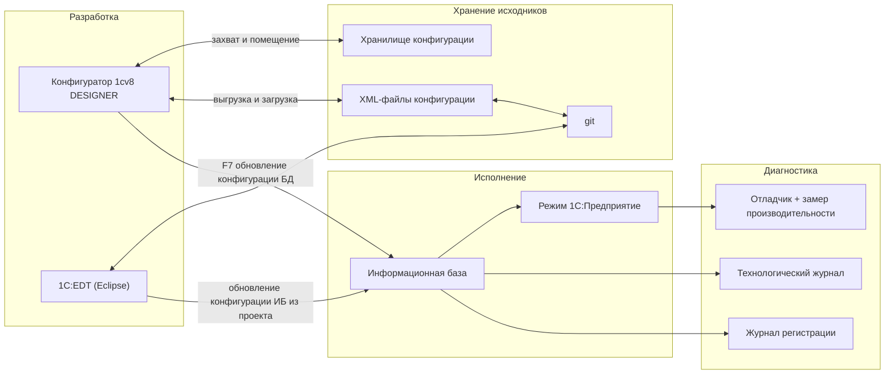
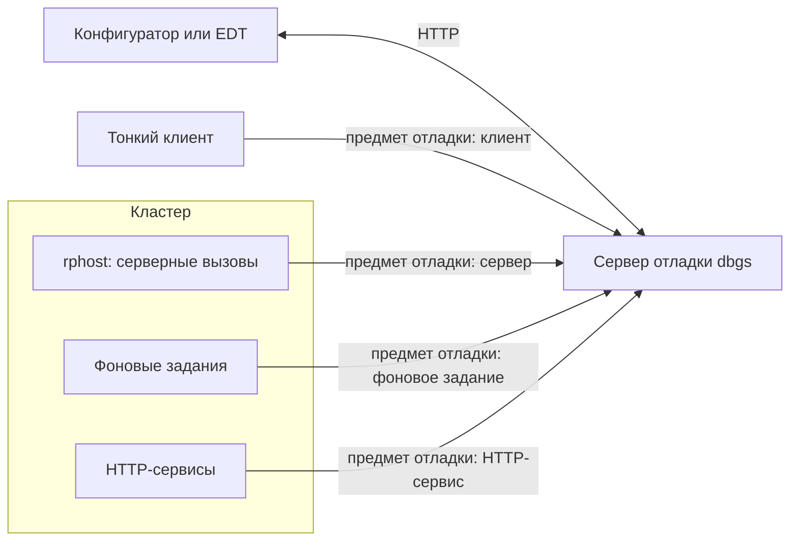
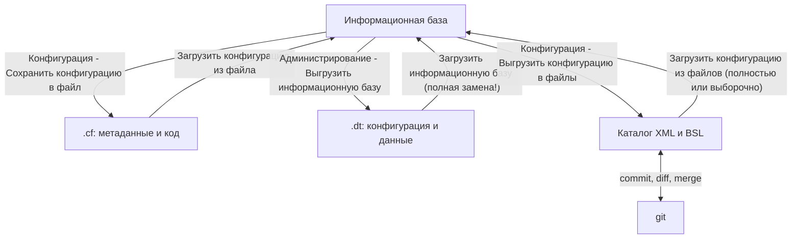
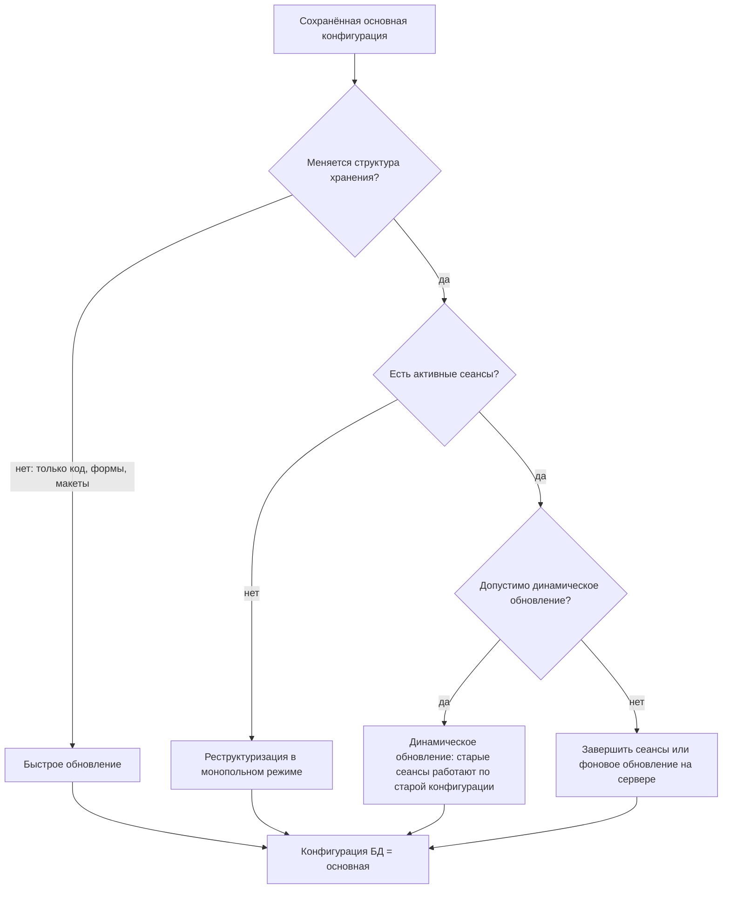
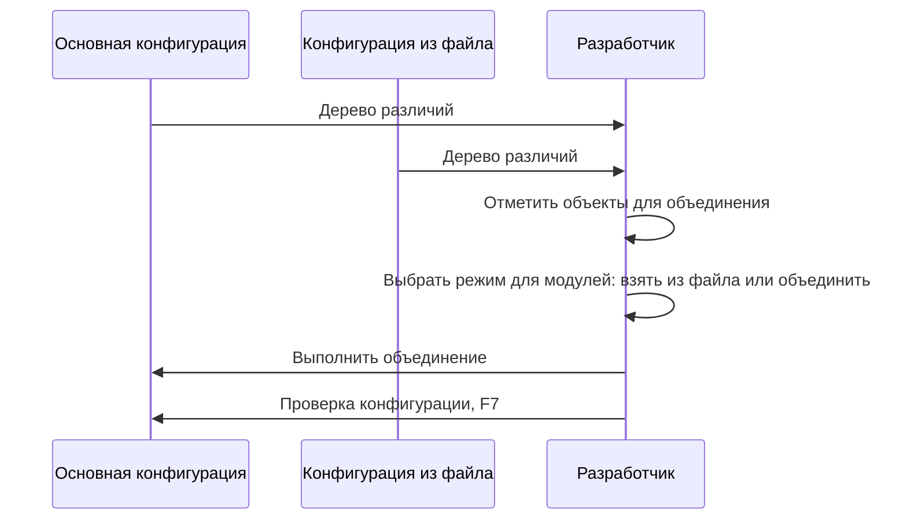
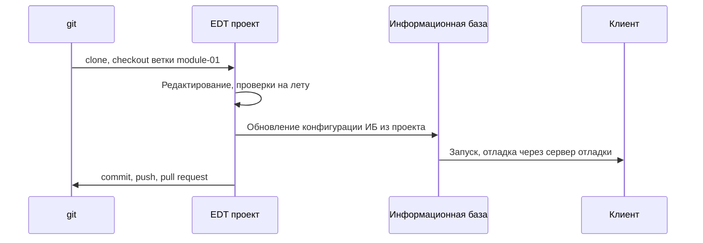

# Модуль 01. Инструменты разработчика: Конфигуратор, EDT, отладчик, выгрузка в файлы

> **Объём:** 10 ак. ч · **Неделя:** 1 · **Источники:** [Я] спринт 00 (инструменты), спринт 01 (Конфигуратор, конструктор движений, конструктор печатных форм), спринт 04 (отладка кода), спринт 09 (воркшоп «Хранилище конфигурации»), спринт 12 (обновление модифицированной типовой); [ПР] модуль 1 (основы администрирования), модуль 2 (режим отладки, выгрузка и загрузка ИБ); [ПР2] —; [К] модули 1, 2; [Т] модуль 2 (палитра свойств, окно «Табло»), модуль 3 (глобальный поиск и замена, синтакс-помощник, окно «Конфигурация», окно редактирования объекта), модуль 4 (конструкторы — обзор), модуль 5 (отладка клиентского приложения, окно «Выражение», стек вызовов, замер производительности, обновление конфигурации БД, поставка, поддержка, групповая разработка)
> **Нет в источниках (написано по документации платформы/опыту):** 1C:Enterprise Development Tools (EDT) — проекты, формат исходников, git; выгрузка/загрузка конфигурации в XML-файлы и пакетный режим Конфигуратора (`/DumpCfg`, `/DumpConfigToFiles`, `/UpdateDBCfg` и др.); отладка серверного кода в клиент-серверном варианте, отладка по HTTP и сервер отладки; динамическое и фоновое обновление конфигурации БД; сравнение/объединение и сопоставление объектов по внутренним идентификаторам; технологический журнал как аналог ST05; проверка конфигурации как аналог расширенной проверки/ATC.

## Результат модуля

- Умеете ориентироваться в Конфигураторе: дерево метаданных, палитра свойств, синтакс-помощник, глобальный поиск, поиск ссылок, проверка конфигурации.
- Умеете отлаживать клиентский и серверный код: точки останова (в т.ч. условные), остановка по ошибке, табло, «Выражение», стек вызовов; знаете, как включить отладку сервера в кластере.
- Умеете найти узкое место замером производительности и знаете, когда переходить к технологическому журналу.
- Умеете сохранять/загружать `.cf` и `.dt`, выгружать конфигурацию в XML-файлы для git и делать это из командной строки.
- Умеете сравнить и объединить две конфигурации и понимаете, как платформа сопоставляет объекты.
- Умеете поднять проект в EDT и понимаете разницу форматов Конфигуратора и EDT.

## Карта понятий SAP → 1С

| SAP | 1С | Ключевое отличие |
|---|---|---|
| SE80 (Object Navigator) | Конфигуратор: дерево конфигурации | Одно дерево на всю систему, без пакетов; объекты группируются подсистемами |
| SE11 (DDIC) | Окно редактирования объекта метаданных + палитра свойств | Таблица, BO, формы и права объекта редактируются в одном окне |
| ADT (Eclipse) | 1C:EDT (Eclipse) | Исходники — файлы на диске, git «из коробки»; ИБ — только среда исполнения |
| abapGit | Выгрузка конфигурации в XML / проект EDT в git | Встроенная функция платформы, а не сторонний инструмент |
| Активация (Ctrl+F3) + SE14 | Обновление конфигурации БД (F7) с реструктуризацией | Применяется вся сохранённая конфигурация |
| Where-used list | Поиск ссылок на объект; глобальный поиск (Ctrl+Shift+F) | Поиск по метаданным + текстовый поиск по модулям |
| Extended check (SLIN) / ATC | Проверка конфигурации (расширенная проверка); проверки EDT; АПК/SonarQube — [модуль 14](14-team-dev-quality.md) | |
| ABAP Debugger | Отладчик Конфигуратора/EDT | Отладка клиента и сервера в одной сессии; сервер отладки по HTTP |
| Watchpoint | Нет как такового; условная точка останова | Остановки по изменению переменной нет |
| SAT (Runtime Analysis) | Замер производительности | Построчная статистика, клиент и сервер раздельно |
| ST05 / ST12 | Технологический журнал (`logcfg.xml`), профайлер СУБД | Настраивается файлом на сервере; детали — [модуль 12](12-jobs-bp-admin-performance.md) |
| SM21 / ST22 / SLG1 | Журнал регистрации | Один журнал на ИБ, с отбором по событиям и пользователям |
| SM50 / SM04 | Консоль кластера / `rac` | |
| SE16N | Режим 1С:Предприятие → «Все функции»; консоль запросов | Прямого редактора таблиц нет |
| Сравнение версий (Version Management), SPAU | Сравнение/объединение конфигураций | Трёхстороннее сравнение всей конфигурации |
| Transport Organizer | Хранилище конфигурации / git | Детали — [модуль 14](14-team-dev-quality.md) |

## Теория

### 1. Карта инструментов



В SAP разработчик почти никогда не думает о «где лежат исходники»: они в репозитории системы. В 1С есть два принципиально разных подхода:

- **Конфигуратор-центричный:** исходник — сама ИБ (основная конфигурация). Командная работа — через хранилище конфигурации. Выгрузка в XML используется для истории в git и ревью.
- **EDT-центричный:** исходник — файлы в git. ИБ — лишь «рантайм», в который EDT публикует конфигурацию. Это ближе к ADT + abapGit, но в 1С это полноценный штатный путь.

### 2. Конфигуратор

Конфигуратор — это тот же исполняемый файл `1cv8`, запущенный в режиме `DESIGNER`. Базовые окна:

| Окно | Назначение | Комментарий для ABAP-разработчика |
|---|---|---|
| Дерево конфигурации | Все объекты метаданных по видам | Нет пакетов; навигация по подсистемам — через фильтр по подсистеме |
| Окно редактирования объекта | Вкладки: основные, подсистемы, данные, нумерация, движения, формы, команды, макеты, права и т.д. | Одно окно заменяет SE11 + часть SE24 + SE93 |
| Палитра свойств | Все свойства объекта/реквизита/элемента формы | Многие свойства влияют на генерируемый SQL (индексирование, длина, иерархия) |
| Редактор модулей | Код, синтаксическая подсветка, контекстная подсказка (Ctrl+Space), шаблоны текста | Переход к определению — F12 |
| Синтакс-помощник | Справка по всем типам, методам и свойствам платформы с указанием доступности (клиент/сервер) | Ctrl+F1 на слове в модуле; аналог F1 в ABAP Editor, но это главный справочник API |
| Глобальный поиск и замена | Поиск по модулям, формам, макетам, свойствам | Ctrl+Shift+F |
| Поиск ссылок на объект | Где используется объект метаданных | Контекстное меню объекта в дереве; аналог where-used |

Полезные операции, которые стоит освоить сразу:

- **Синтаксический контроль модуля** (Ctrl+F7) — компиляция текущего модуля.
- **Проверка конфигурации** (меню «Конфигурация») — проверка логической целостности, поиск некорректных ссылок, неиспользуемых процедур, проверка модулей в разных контекстах (тонкий клиент, веб-клиент, сервер, внешнее соединение, мобильные контексты). Аналог extended check: ошибка «метод недоступен на клиенте» ловится здесь, а не синтаксическим контролем одного модуля.
- **Режим совместимости** (свойство корня конфигурации) — определяет, какое поведение платформы используется; влияет, например, на доступность синхронных вызовов и новых методов языка.

#### Конструкторы — обзор

Конструкторы — генераторы кода и макетов. Используйте их как ускоритель, но всегда читайте результат.

| Конструктор | Что генерирует | Где разбирается |
|---|---|---|
| Конструктор запроса (с обработкой результата) | Текст запроса на языке запросов + код обхода выборки | [модуль 04](04-queries.md) |
| Конструктор движений | Код `ОбработкаПроведения` для записи в регистры | [модуль 06](06-registers-posting.md) |
| Конструктор ввода на основании | Код `ОбработкаЗаполнения` | [модуль 03](03-metadata-objects.md) |
| Конструктор печати | Макет + код печатной формы | [модуль 07](07-reports-skd-print.md) |
| Конструктор схемы компоновки данных | Схему СКД (декларативный отчёт) | [модуль 07](07-reports-skd-print.md) |
| Конструктор форм | Форму по реквизитам объекта | [модуль 05](05-managed-forms.md) |
| Конструктор форматной строки / строк на разных языках | Параметры `Формат()` / строку `НСтр()` | [модуль 02](02-language.md) |
| Конструктор ограничений доступа | Текст RLS-ограничения | [модуль 10](10-security-interface.md) |

### 3. Режим 1С:Предприятие как инструмент разработчика

Из Конфигуратора запускается клиент с подключённым отладчиком (F5). Для разработчика полезны:

- **«Все функции»** (меню «Сервис и настройки»; включается в параметрах клиента флагом отображения команды «Все функции») — доступ к любому объекту метаданных без командного интерфейса. Аналог SE16N/SM30 для просмотра данных, но через формы объектов.
- **Стандартные функции** («Функции для технического специалиста»): удаление помеченных объектов, журнал регистрации, активные пользователи, управление итогами, регламентные и фоновые задания, полнотекстовый поиск. Часть из них в типовых дублирована подсистемами БСП.
- **Пользователи.** Пока в ИБ нет ни одного пользователя, вход без авторизации с полными правами. Как только создан первый пользователь — авторизация обязательна. Для учебной базы заведите пользователя `Администратор` с ролью полных прав, когда роли появятся ([модуль 10](10-security-interface.md)).

### 4. Отладчик

#### Архитектура отладки

Современный механизм — **отладка по протоколу HTTP**: Конфигуратор (или EDT) поднимает **сервер отладки** (`dbgs`), к которому подключаются **предметы отладки** — клиентские сеансы, серверные сеансы, фоновые задания, HTTP- и веб-сервисы, внешние соединения. Протокол настраивается в параметрах Конфигуратора (раздел «Отладка»).



- **Файловый вариант:** отладка клиента и сервера работает сразу при запуске через F5 — серверный код исполняется в том же процессе или в процессе, которым управляет платформа.
- **Клиент-серверный вариант:** кластер должен быть запущен в режиме разрешения отладки — `ragent` стартует с ключом `-debug` (для HTTP-отладки дополнительно `-http`). На продуктиве отладку не включают: она снижает производительность и даёт доступ к данным в обход прав.
- **Автоматическое подключение** («Отладка → Подключение», настройка автоподключения) — задаёт, какие предметы отладки подключать автоматически: например, фоновые задания и HTTP-сервисы, которые не стартуют из Конфигуратора. Аналог «внешних точек останова» для RFC/HTTP в SAP.

#### Инструменты отладчика

| Действие | Клавиша / меню | Аналог в ABAP Debugger |
|---|---|---|
| Начать отладку | F5 | /h + запуск |
| Точка останова | F9 | Session breakpoint |
| Точка останова с условием | «Отладка → Точка останова с условием» | Conditional breakpoint |
| Остановка по ошибке | «Отладка → Остановка по ошибке» (можно задать фильтр по тексту ошибки) | Breakpoint at exception |
| Шагнуть в / через / из | F11 / F10 / Shift+F11 | F5 / F6 / F7 |
| Идти до курсора | Shift+F10 | Continue to cursor |
| Вычислить выражение | Shift+F9, окно «Выражение» | Окно переменных + выражение |
| Табло | «Отладка → Табло» | Watch-переменные (без watchpoint) |
| Стек вызовов | «Отладка → Стек вызовов» | Call stack |

Особенности, отличающие отладчик 1С:

- **Сквозная отладка клиент → сервер.** F11 на вызове `&НаСервере`-процедуры переводит в серверный контекст; в стеке видны кадры обоих контекстов.
- **Окно «Выражение» исполняет код.** Вычисление `Объект.Записать()` или вызов функции с побочными эффектами в «Выражении» реально выполнится. Так можно «на лету» проверить гипотезу, но это же источник порчи данных.
- **Нет watchpoint на изменение переменной** — используйте условную точку останова на строках присваивания.
- **Табличные значения** (`ТаблицаЗначений`, результат запроса после `Выгрузить()`) просматриваются в табличном виде прямо в табло/выражении.

Для упражнений используем обработку-песочницу:

```bsl
// Модуль формы обработки Песочница (команда формы ЗапуститьПроверки)
&НаКлиенте
Процедура ЗапуститьПроверки(Команда)
	Результат = ВычислитьНаСервере(100);
	ПоказатьПредупреждение(, "Результат: " + Результат);
КонецПроцедуры

&НаСервереБезКонтекста
Функция ВычислитьНаСервере(Количество)
	Сумма = 0;
	Для Сч = 1 По Количество Цикл
		Сумма = Сумма + Сч * Сч; // условная точка останова: Сч = 50
	КонецЦикла;
	Возврат Сумма;
КонецФункции
```

### 5. Замер производительности и технологический журнал

**Замер производительности** («Отладка → Замер производительности») — построчный профилировщик встроенного языка: количество выполнений строки, время, процент от общего времени, отдельно для клиента и сервера. Аналог SAT в режиме «per statement».

Типовой сценарий:

1. Включить замер.
2. Выполнить действие в клиенте (провести документ, сформировать отчёт).
3. Выключить замер, отсортировать по времени, спуститься в «тяжёлые» строки.
4. Если тяжёлая строка — `Запрос.Выполнить()` или `Объект.Записать()`, замер дальше не поможет: нужен план запроса → технологический журнал.

```bsl
// Пример для замера: поиск в массиве O(n) против соответствия O(1)
&НаСервереБезКонтекста
Функция СравнитьПоиск(Размер)
	Массив = Новый Массив;
	Индекс = Новый Соответствие;
	Для Сч = 1 По Размер Цикл
		Ключ = "K" + Формат(Сч, "ЧГ=0");
		Массив.Добавить(Ключ);
		Индекс.Вставить(Ключ, Истина);
	КонецЦикла;
	
	Начало = ТекущаяУниверсальнаяДатаВМиллисекундах();
	Для Сч = 1 По Размер Цикл
		Найден = Массив.Найти("K" + Формат(Сч, "ЧГ=0")) <> Неопределено;
	КонецЦикла;
	ВремяМассив = ТекущаяУниверсальнаяДатаВМиллисекундах() - Начало;
	
	Начало = ТекущаяУниверсальнаяДатаВМиллисекундах();
	Для Сч = 1 По Размер Цикл
		Найден = Индекс.Получить("K" + Формат(Сч, "ЧГ=0")) <> Неопределено;
	КонецЦикла;
	ВремяСоответствие = ТекущаяУниверсальнаяДатаВМиллисекундах() - Начало;
	
	Возврат СтрШаблон("Массив: %1 мс, Соответствие: %2 мс", ВремяМассив, ВремяСоответствие);
КонецФункции
```

**Технологический журнал (ТЖ)** — аналог ST05 + системных трасс: включается файлом `logcfg.xml` в каталоге настроек платформы на сервере и пишет события (SQL-запросы к СУБД, исключения, ожидания на блокировках, взаимоблокировки, длительные вызовы). Минимальный пример — все SQL-запросы к PostgreSQL:

```xml
<?xml version="1.0" encoding="UTF-8"?>
<config xmlns="http://v8.1c.ru/v8/tech-log">
  <log location="/var/log/1c/techlog" history="2">
    <event>
      <eq property="name" value="DBPOSTGRS"/>
    </event>
    <property name="all"/>
  </log>
</config>
```

Подробный разбор событий ТЖ, анализ планов и блокировок — [модуль 12](12-jobs-bp-admin-performance.md). **Журнал регистрации** (SM21-аналог) включён по умолчанию, в нём фиксируются входы, ошибки, изменения данных; читается из клиента и программно (`ВыгрузитьЖурналРегистрации`).

### 6. Выгрузка/загрузка: `.cf`, `.dt`, XML-файлы



| Операция | Что сохраняется | Когда использовать | Аналог SAP |
|---|---|---|---|
| `.cf` | Основная конфигурация | Поставка, бэкап кода, перенос в QAS/PRD | Нет (весь репозиторий одним файлом) |
| Сохранение конфигурации БД в файл | Конфигурация БД (может отличаться от основной) | Зафиксировать то, что реально работает у пользователей | — |
| `.dt` | Всё: конфигурация + данные + пользователи | Копия базы, переход между СУБД, сдача экзамена | System copy |
| XML-файлы | Конфигурация в виде дерева файлов | git, ревью, diff, частичная загрузка | abapGit serialisation |

**Загрузка `.dt` полностью заменяет ИБ**, включая пользователей и конфигурацию. Это не «импорт данных».

#### Формат выгрузки в файлы

Иерархический формат Конфигуратора (по умолчанию):

```text
src/
├── Configuration.xml              # корень конфигурации
├── ConfigDumpInfo.xml             # версии объектов (для инкрементальной выгрузки)
├── Catalogs/
│   ├── Номенклатура.xml           # описание метаданных справочника
│   └── Номенклатура/
│       ├── Ext/ObjectModule.bsl   # модуль объекта
│       ├── Ext/ManagerModule.bsl  # модуль менеджера
│       ├── Forms/ФормаЭлемента.xml          # описание формы в метаданных
│       └── Forms/ФормаЭлемента/Ext/Form.xml # структура формы; модуль — Ext/Form/Module.bsl
├── CommonModules/УчебныйЯзык/Ext/Module.bsl
└── Roles/Администратор/Ext/Rights.xml
```

Формат EDT отличается (объекты — файлы `.mdo`, формы — `.form`, модули лежат рядом без `Ext`): каталоги несовместимы напрямую, EDT умеет импортировать выгрузку Конфигуратора и экспортировать в неё.

#### Пакетный режим Конфигуратора

Всё, что делается меню, можно сделать из командной строки — основа CI ([модуль 14](14-team-dev-quality.md)):

```bat
set V8="C:\Program Files\1cv8\8.3.xx.xxxx\bin\1cv8.exe"
set IB=/F "C:\Bases\Trade" /N "Администратор" /P ""

rem Сохранить .cf
%V8% DESIGNER %IB% /DisableStartupDialogs /DumpCfg "C:\out\trade.cf" /Out "C:\out\dumpcfg.log"

rem Выгрузить ИБ в .dt
%V8% DESIGNER %IB% /DisableStartupDialogs /DumpIB "C:\out\trade.dt" /Out "C:\out\dumpib.log"

rem Выгрузить конфигурацию в XML (инкрементально, по ConfigDumpInfo.xml)
%V8% DESIGNER %IB% /DisableStartupDialogs /DumpConfigToFiles "C:\git\trade\src" -update /Out "C:\out\xml.log"

rem Загрузить конфигурацию из XML и обновить конфигурацию БД
%V8% DESIGNER %IB% /DisableStartupDialogs /LoadConfigFromFiles "C:\git\trade\src" /UpdateDBCfg /Out "C:\out\load.log"
```

Для серверной ИБ вместо `/F` используется `/S "сервер\имя_ИБ"`. На Linux исполняемый файл лежит в `/opt/1cv8/x86_64/<версия>/1cv8`; пакетный Конфигуратор может требовать графической среды (часто запускают через `xvfb-run`). Альтернатива без графики — утилита `ibcmd` (операции с ИБ и конфигурацией из командной строки; синтаксис — в документации платформы).

> Результат пакетного запуска проверяйте по файлу `/Out` и коду возврата процесса: Конфигуратор в пакетном режиме не показывает диалогов, ошибки видны только в логе.

### 7. Обновление конфигурации базы данных

«Обновить конфигурацию базы данных» (F7) сравнивает основную конфигурацию с конфигурацией БД и, если меняется структура хранения, показывает окно реорганизации информации со списком изменений. Аналог: массовая активация + SE14.



- **Динамическое обновление** применяет изменения без выгона пользователей; уже открытые сеансы продолжают работать со старой версией и получают предложение перезапуститься. Для продуктива — только для «безопасных» изменений (код), иначе получите сеансы с разными версиями логики.
- **Фоновое обновление** (клиент-серверный вариант) выполняет подготовку реструктуризации на сервере без монопольного режима, оставляя на финальный шаг короткую монопольную фазу.
- Удаление реквизита с данными требует подтверждения: платформа предупредит, что данные будут потеряны. Стандарт типовых — сначала переименовать в `Удалить…`, удалить через релиз.

### 8. Сравнение и объединение конфигураций

Операции меню «Конфигурация»: «Сравнить конфигурации» (любые две из: основная, БД, поставщика, из файла) и «Сравнить, объединить с конфигурацией из файла». Результат — дерево различий по объектам, свойствам, модулям (с процедурным сравнением), формам, макетам.



Ключевой момент: **объекты сопоставляются по внутренним идентификаторам метаданных (UUID), а не по имени.** Если вы создали справочник `Склады` в двух независимых базах, при объединении это будут два разных объекта с одинаковым именем — конфликт. Решение — ручное «Установить соответствие объектов» или изначально переносить объекты через `.cf`/XML. Для ABAP-разработчика, привыкшего, что TADIR-ключ — это имя объекта, это главная неожиданность.

Режимы объединения модулей: «взять из файла», «объединять с приоритетом основной конфигурации», «объединять с приоритетом конфигурации из файла» и попроцедурный выбор. Результат слияния модулей всегда просматривайте глазами — платформа объединяет на уровне процедур, а не семантики.

### 9. 1C:Enterprise Development Tools (EDT)

EDT — среда разработки на Eclipse (аналог ADT). Запускается через лаунчер, работает с **рабочими областями** (workspace) и **проектами**:

| Вид проекта | Что содержит |
|---|---|
| Проект конфигурации | Полная конфигурация в формате EDT |
| Проект расширения | Расширение, привязанное к проекту конфигурации |
| Проект внешних обработок и отчётов | `.epf`/`.erf` в виде исходников |



Отличия от Конфигуратора, важные для командной работы:

- Исходник — файлы проекта; ИБ привязывается к проекту и получает конфигурацию при публикации. Несколько ИБ к одному проекту — нормальная практика (DEV, тестовая).
- Встроенные проверки кода и стандартов на лету, рефакторинг (переименование с обновлением ссылок), навигация по вызовам.
- Git (EGit) — штатный; ветки вместо захвата объектов в хранилище.
- Некоторые редакторы (табличных документов, отдельных конструкторов) EDT может открывать через Конфигуратор; EDT требовательна к памяти на больших конфигурациях (ERP).
- Утилита командной строки EDT (`1cedtcli`) позволяет конвертировать между форматами EDT и Конфигуратора в CI.

Выбор в курсе: основной путь — Конфигуратор + выгрузка XML в git (проще на старте, совпадает с требованиями экзамена «1С:Специалист»); EDT осваиваем параллельно и переходим на неё в [модуле 14](14-team-dev-quality.md).

## Ловушки для ABAP-разработчика

1. **Загрузка `.dt` = полная замена базы.** Это не импорт данных, а восстановление из бэкапа: конфигурация, данные и пользователи цели будут уничтожены.
2. **Ctrl+S ≠ F7.** Отлаживаете старый код, потому что не обновили конфигурацию БД; или наоборот, F7 применил чужие сохранённые изменения.
3. **Одинаковые имена ≠ одинаковые объекты.** Сравнение/объединение сопоставляет по UUID. Пересоздали объект «с тем же именем» — потеряли данные при объединении.
4. **Отладка на продуктиве.** Запуск кластера с `-debug` на PRD — дыра в безопасности (через «Выражение» можно выполнить произвольный код) и потеря производительности.
5. **Вычисление «Выражения» с побочными эффектами.** Вызов функции, которая пишет данные, реально запишет их. Аналогично «Табло» с вызовами функций — вычисляется на каждом шаге.
6. **Синтаксический контроль модуля прошёл, а на клиенте ошибка.** Ctrl+F7 не проверяет доступность методов в контексте тонкого/веб-клиента — запускайте «Проверку конфигурации» с нужными режимами.
7. **Конфликт форматов.** Каталог, выгруженный Конфигуратором, нельзя открыть в EDT как проект напрямую, и наоборот — нужен импорт/экспорт.
8. **Динамическое обновление на продуктиве «потому что пользователи работают».** Получите сеансы со старой логикой проведения, пишущие в новые таблицы.
9. **Ожидать, что замер производительности покажет SQL.** Он показывает только строки встроенного языка; SQL и планы — технологический журнал/СУБД.

## Практика (сквозной проект)

Ветка `module-01`. Все задания — в ИБ `УчебнаяТорговля` из M00-T1.

### M01-T1. Обработка-песочница

**Формулировка.** Создайте обработку `Песочница` с основной формой, командой формы `ЗапуститьПроверки` и кодом из раздела 4. Добавьте общий модуль `УчебныйЯзык` (флаги: Сервер, ВызовСервера) с пустой экспортной процедурой `ПроверитьВсе()` — он будет наполнен в [модуле 02](02-language.md).

**Критерии приёмки:**
- [ ] «Проверка конфигурации» с режимами «Тонкий клиент», «Веб-клиент», «Сервер» проходит без ошибок.
- [ ] Обработка открывается из «Все функции», по кнопке выводится `Результат: 338350`.

**Самопроверка.** Сумма квадратов 1..100 = 338350.

### M01-T2. Навигация и поиск

**Формулировка.** Используя синтакс-помощник, найдите для методов `ТаблицаЗначений.Свернуть`, `ПолучитьСтруктуруХраненияБазыДанных`, `ПоказатьПредупреждение` их доступность (клиент/сервер/внешнее соединение) и сигнатуры. Глобальным поиском найдите все вызовы `ВычислитьНаСервере`. Поиском ссылок найдите, где используется общий модуль `УчебныйЯзык`.

**Критерии приёмки:**
- [ ] В `docs/M01-T2.md` таблица «метод → доступность → параметры».
- [ ] Отмечено, какой из методов недоступен в тонком клиенте и почему.

**Самопроверка.** Попробуйте вызвать `Новый ТаблицаЗначений` в процедуре `&НаКлиенте` и запустите «Проверку конфигурации» с режимом «Тонкий клиент» — должна быть ошибка.

### M01-T3. Отладка клиент → сервер

**Формулировка.** Поставьте точку останова на вызове `ВычислитьНаСервере`, войдите в серверную функцию (F11), установите условную точку останова `Сч = 50`, выведите в табло `Сумма` и `Сч`, через «Выражение» вычислите `Сумма / Сч`. Включите «Остановку по ошибке», добавьте в код деление на ноль, поймайте его.

**Критерии приёмки:**
- [ ] Скриншот стека вызовов с кадрами клиента и сервера в `docs/M01-T3/`.
- [ ] При `Сч = 50` значение `Сумма` в табло = 40425 (сумма квадратов 1..49).
- [ ] Отладчик останавливается на строке с делением на ноль до появления сообщения пользователю.

**Самопроверка.** Повторите сценарий на серверной ИБ из M00-T4 (кластер с `-debug -http`): серверная точка останова должна срабатывать.

### M01-T4. Замер производительности

**Формулировка.** Добавьте в песочницу команду, вызывающую `СравнитьПоиск(20000)`. Выполните замер производительности, найдите строку-лидер по времени.

**Критерии приёмки:**
- [ ] Лидер по времени — строка с `Массив.Найти`.
- [ ] В `docs/M01-T4.md` — таблица результатов замера (строка, количество, время, %) и вывод о сложности алгоритмов.

**Самопроверка.** Увеличьте размер вдвое: время поиска в массиве должно вырасти примерно в 4 раза, в соответствии — примерно в 2.

### M01-T5. Бэкап-скрипты

**Формулировка.** Напишите скрипт `scripts/backup.cmd` (или `.sh`), который в пакетном режиме сохраняет `.cf` и `.dt` в каталог с датой в имени и проверяет код возврата.

**Критерии приёмки:**
- [ ] Скрипт работает без интерактивных диалогов.
- [ ] При неверном пути к ИБ скрипт завершается с ненулевым кодом и сообщением из лога `/Out`.
- [ ] Восстановление из `.dt` в новую пустую ИБ даёт работающую песочницу.

**Самопроверка.** Восстановите `.dt` в отдельный каталог и откройте обработку `Песочница`.

### M01-T6. Конфигурация в git

**Формулировка.** Выгрузите конфигурацию в каталог `src/` (иерархический формат). Измените текст `ВычислитьНаСервере`, выгрузите повторно с `-update` и посмотрите `git diff`. Затем измените `.bsl`-файл вручную и загрузите конфигурацию из файлов обратно, обновите конфигурацию БД.

**Критерии приёмки:**
- [ ] `git diff` после изменения кода затрагивает только `Module.bsl` формы обработки (и, возможно, `ConfigDumpInfo.xml`).
- [ ] Изменение, сделанное в файле, видно в Конфигураторе и работает в клиенте.

**Самопроверка.** `git status` после повторной выгрузки без изменений — чистый (кроме служебных файлов, которые вы явно решили не коммитить).

### M01-T7. Сравнение и объединение

**Формулировка.** Сделайте копию ИБ (через `.dt`). В копии добавьте в песочницу команду `Приветствие` и новый общий модуль `Временный`; в исходной ИБ параллельно измените `ВычислитьНаСервере`. Сохраните конфигурацию копии в `.cf` и выполните «Сравнить, объединить» в исходной ИБ: перенесите команду, но не модуль `Временный`; для модуля формы используйте попроцедурное объединение. Отдельно создайте в обеих базах независимо общий модуль с одинаковым именем `Дубль` и посмотрите, как его покажет сравнение.

**Критерии приёмки:**
- [ ] После объединения в исходной ИБ есть обе доработки модуля формы, нет модуля `Временный`.
- [ ] В `docs/M01-T7.md` объяснено, почему модули `Дубль` не сопоставились автоматически.

**Самопроверка.** «Сравнить конфигурации» (основная ↔ файл) после объединения показывает только ожидаемые различия.

### M01-T8*. EDT round-trip

**Формулировка.** Импортируйте выгрузку `src/` в проект EDT, привяжите к нему новую пустую ИБ и опубликуйте конфигурацию. Измените код в EDT, запустите отладку из EDT с точкой останова в серверной функции. Экспортируйте проект обратно в формат Конфигуратора и сравните с исходным `src/`.

**Критерии приёмки:**
- [ ] Отладка из EDT останавливается на серверной точке.
- [ ] Различия после round-trip сводятся к вашему изменению кода (плюс служебные файлы); перечень — в `docs/M01-T8.md`.

**Самопроверка.** Загрузите экспортированный каталог в чистую ИБ через `/LoadConfigFromFiles` — песочница работает.

## Контрольные вопросы

1. Чем различаются основная конфигурация и конфигурация БД, и как увидеть их различия?
2. Что произойдёт при загрузке `.dt` в ИБ с данными? Чем это отличается от загрузки `.cf`?
3. Как включить отладку серверного кода в клиент-серверном варианте? Почему этого не делают на продуктиве?
4. Как отладить фоновое задание или HTTP-сервис, которые не запускаются из Конфигуратора?
5. Почему синтаксический контроль модуля может пройти, а код упадёт в тонком клиенте? Каким инструментом это ловится заранее?
6. Как платформа сопоставляет объекты при сравнении/объединении? Что будет с двумя независимо созданными объектами с одним именем?
7. Когда достаточно замера производительности, а когда нужен технологический журнал?
8. Чем динамическое обновление конфигурации БД опасно для продуктива?
9. Чем формат исходников EDT отличается от выгрузки Конфигуратора и как между ними переходить?

## Документация

- Документация платформы (руководство разработчика, руководство администратора, параметры командной строки): https://its.1c.ru/db/v83doc
- Стандарты разработки: https://its.1c.ru/db/v8std
- Методическая поддержка (отладка, производительность, технологический журнал): https://its.1c.ru/db/metod8dev
- 1C:EDT: https://edt.1c.ru
- Репозитории фирмы «1С» (в т.ч. материалы по EDT): https://github.com/1C-Company
- Сайт платформы: https://v8.1c.ru
