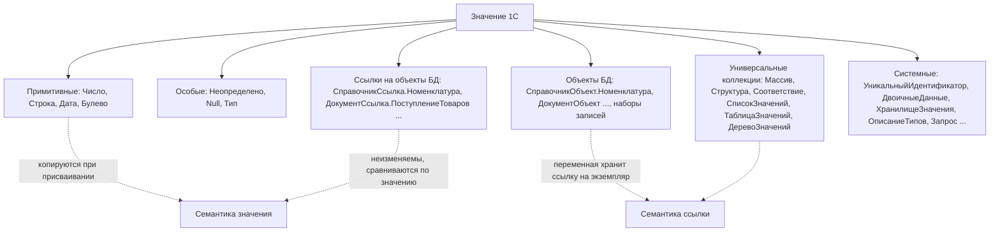
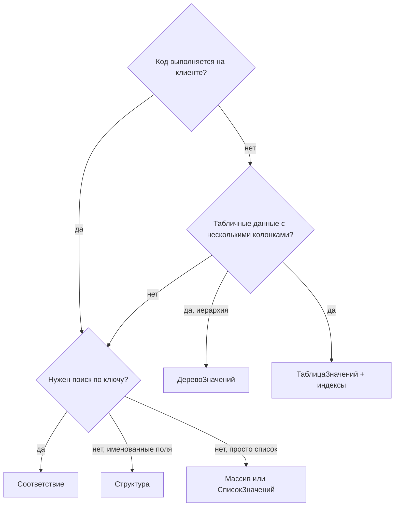

# Модуль 02. Встроенный язык 1С для ABAP-разработчика

> **Объём:** 12 ак. ч · **Неделя:** 2 · **Источники:** [Я] спринт 00 («Обзор языка 1С»), спринт 02 (переменные и типы данных, функции, процедуры, ветвления и циклы, модули в 1С, работа с коллекциями); [ПР] модуль 2 (переменные, работа с типами значений, функции работы со строками/числами/датами/булево, операции сравнения, синтаксические конструкции, структура модуля, модуль объекта и менеджера, универсальные коллекции: массивы, структуры, списки значений, таблицы значений), модуль 5 (директивы компиляции); [ПР2] —; [К] модули 2, 3; [Т] модуль 4 (конструктор форматной строки, конструктор строк на разных языках), модуль 6 (основы встроенного языка, виды программных модулей)
> **Нет в источниках (написано по документации платформы/опыту):** обработка исключений (`Попытка`/`Исключение`/`ВызватьИсключение`, `ИнформацияОбОшибке`, шаблон транзакции); `Соответствие` и `ДеревоЗначений`; передача параметров `Знач`/по ссылке и её поведение при серверных вызовах; инструкции препроцессора (`#Область`, `#Если`) и стандартная структура модуля; составные типы и `ОписаниеТипов`; различие `Null`/`Неопределено`/пустой ссылки; `СтрШаблон`, `НСтр`; часовые пояса и `ТекущаяДатаСеанса`; десятичная арифметика чисел; приёмы замены ООП (общие модули с флагами, модули менеджера, структуры как «объекты»).

## Результат модуля

- Умеете читать и писать код 1С на уровне уверенного ABAP-разработчика: синтаксис, типы, ветвления, циклы, процедуры и функции.
- Умеете выбирать коллекцию (`Массив`, `Структура`, `Соответствие`, `СписокЗначений`, `ТаблицаЗначений`, `ДеревоЗначений`) и переносить привычные операции с internal tables.
- Умеете безопасно работать с `Неопределено`, `Null`, пустыми ссылками и составными типами.
- Умеете обрабатывать ошибки без классов исключений и правильно оборачивать транзакции.
- Умеете раскладывать код по видам модулей вместо классов и оформлять модуль по стандартам (области, препроцессор).
- Умеете форматировать строки, числа и даты, локализовать тексты и корректно работать со временем сеанса.

## Карта понятий SAP → 1С

| SAP (ABAP) | 1С | Ключевое отличие |
|---|---|---|
| Статическая типизация, `DATA ... TYPE` | Динамическая типизация, переменная создаётся присваиванием | Тип хранится у значения, не у переменной; ошибки типов — во время выполнения |
| `TYPE P` (packed) | `Число` | Десятичная арифметика без двоичных погрешностей; длина/точность задаются только в метаданных |
| `TYPE D`, `TYPE T`, `TIMESTAMP` | `Дата` (дата + время, точность — секунда) | Отдельного типа «время» нет; арифметика в секундах |
| Initial value | `Неопределено`, пустое значение типа, пустая ссылка | Три разных «пустых», плюс `Null` из запросов |
| Generic types, `REF TO data` | Составной тип реквизита, `ОписаниеТипов` | Реквизит в БД может хранить значения разных типов |
| Internal table | `ТаблицаЗначений` | Только в памяти сервера; нет SORTED/HASHED, есть индексы |
| `COLLECT` | `ТаблицаЗначений.Свернуть()` | Выполняется после заполнения, удаляет непоименованные колонки |
| Hashed table / `cl_abap_...` map | `Соответствие` | Ключ — любое значение, включая ссылки |
| Structure (`BEGIN OF`) | `Структура` | Динамическая: ключи добавляются во время выполнения |
| Класс, метод | Общий модуль, модуль объекта, модуль менеджера | Нет классов, наследования, интерфейсов |
| `TRY ... CATCH cx_... ENDTRY` | `Попытка ... Исключение ... КонецПопытки` | Нет классов исключений и `CLEANUP`; ловится всё |
| `USING`/`CHANGING`/`VALUE()` | Параметры по ссылке (по умолчанию) / `Знач` | По умолчанию — по ссылке |
| Text elements, `TEXT-001` | `НСтр("ru = '...'; en = '...'")` | Переводы — прямо в коде |
| `WRITE ... TO`, string templates `\|...\|` | `Формат()`, `СтрШаблон()` | Форматная строка вида `"ЧДЦ=2"` |
| `sy-datum`, `GET TIME STAMP` | `ТекущаяДатаСеанса()`, `ТекущаяУниверсальнаяДата()` | Дата сеанса учитывает часовой пояс сеанса |

## Теория

### 1. Синтаксис: быстрый перенос с ABAP

Встроенный язык интерпретируемый (модули компилируются в байт-код при первом обращении), регистронезависимый, с русским и английским синтаксисом (смешивать в одном проекте не принято — стандарты требуют русский). Инструкции завершаются `;`, комментарии — только строчные `//`.

```abap
DATA lv_sum TYPE p DECIMALS 2.
DATA lt_lines TYPE STANDARD TABLE OF ty_line.

IF lv_qty > 0 AND lv_price IS NOT INITIAL.
  lv_sum = lv_qty * lv_price.
ELSEIF lv_qty = 0.
  lv_sum = 0.
ELSE.
  RAISE EXCEPTION TYPE zcx_trade.
ENDIF.

DO 10 TIMES.
  CHECK sy-index MOD 2 = 0.
  lv_sum = lv_sum + sy-index.
ENDDO.

LOOP AT lt_lines INTO DATA(ls_line).
  IF ls_line-qty < 0. EXIT. ENDIF.
ENDLOOP.

DATA(lv_status) = COND string( WHEN lv_sum > 0 THEN 'Есть' ELSE 'Нет' ).
```

```bsl
Сумма = 0;

Если Количество > 0 И ЗначениеЗаполнено(Цена) Тогда
	Сумма = Количество * Цена;
ИначеЕсли Количество = 0 Тогда
	Сумма = 0;
Иначе
	ВызватьИсключение НСтр("ru = 'Отрицательное количество'");
КонецЕсли;

Для Сч = 1 По 10 Цикл
	Если Сч % 2 <> 0 Тогда
		Продолжить;
	КонецЕсли;
	Сумма = Сумма + Сч;
КонецЦикла;

Для Каждого Строка Из ТаблицаСтрок Цикл
	Если Строка.Количество < 0 Тогда
		Прервать;
	КонецЕсли;
КонецЦикла;

Статус = ?(Сумма > 0, "Есть", "Нет");
```

| ABAP | 1С | Примечание |
|---|---|---|
| `=` / `EQ`, `<>` / `NE` | `=`, `<>` | `=` — и присваивание, и сравнение (по контексту) |
| `AND`, `OR`, `NOT` | `И`, `ИЛИ`, `НЕ` | Вычисление по сокращённой схеме: `Если Ссылка <> Неопределено И Ссылка.Проведен` безопасно |
| `CASE ... WHEN` | Нет; цепочка `ИначеЕсли` или `Соответствие` | |
| `DO n TIMES`, `WHILE` | `Для ... По ... Цикл`, `Пока ... Цикл` | Счётчик `Для` включает обе границы |
| `EXIT`, `CONTINUE`, `CHECK` | `Прервать`, `Продолжить`, — | `CHECK` нет |
| `MOD`, `DIV` | `%`, `Цел(А / Б)` | |
| `&&`, string templates | `+`, `СтрШаблон()` | |

Строковые литералы — в двойных кавычках, кавычка внутри удваивается, многострочная строка продолжается символом `|`:

```bsl
ТекстЗапроса =
"ВЫБРАТЬ
|	Номенклатура.Ссылка КАК Ссылка
|ИЗ
|	Справочник.Номенклатура КАК Номенклатура
|ГДЕ
|	Номенклатура.Артикул = ""A-001""";
ДатаНачала = '20250101'; // литерал даты: 'ГГГГММДД' или 'ГГГГММДДччммсс'
```

Структура модуля: раздел объявления переменных (`Перем`), раздел процедур и функций, раздел основной программы (операторы, выполняемые при инициализации модуля). Порядок разделов фиксирован; процедуры можно вызывать до их текстового объявления.

### 2. Система типов



#### «Пустые» значения

| Значение | Откуда берётся | Проверка | Аналог ABAP |
|---|---|---|---|
| `Неопределено` | Неинициализированная переменная, `Массив.Найти` без результата, пустой реквизит составного типа, `Соответствие.Получить` без ключа | `Значение = Неопределено` | Unbound reference / нет значения |
| `Null` | Результат запроса (поле из несопоставленной стороны LEFT JOIN, поле реквизита, отсутствующего у типа составной ссылки) | `Значение = Null`; в запросе — `ЕСТЬ NULL`, `ЕСТЬNULL()` | SQL NULL (в Open SQL — initial при чтении) |
| Пустая ссылка | Незаполненный реквизит ссылочного типа | `Ссылка.Пустая()`, `= Справочники.Номенклатура.ПустаяСсылка()` | Ключ = initial |
| Пустое значение примитива | `0`, `""`, `'00010101'`, `Ложь` | `ЗначениеЗаполнено(Значение)` | `IS INITIAL` |

`ЗначениеЗаполнено()` — универсальная проверка «как `IS INITIAL`»: ложь для `Неопределено`, `Null`, пустой ссылки, нуля, пустой строки, пустой даты.

Ссылка на объект БД — неизменяемое значение (сравнивается по значению); каждое обращение `Ссылка.Реквизит` может породить запрос к БД, поэтому «точка через ссылку» в цикле — главный источник тормозов ([модуль 03](03-metadata-objects.md), [модуль 04](04-queries.md)).

#### Проверка и приведение типов

```bsl
Если ТипЗнч(Значение) = Тип("СправочникСсылка.Номенклатура") Тогда
	// ...
ИначеЕсли ТипЗнч(Значение) = Тип("Число") Тогда
	// ...
КонецЕсли;

ТипКоличество = Новый ОписаниеТипов("Число", Новый КвалификаторыЧисла(15, 3));
Количество = ТипКоличество.ПривестиЗначение("abc"); // 0 — приведение без исключения
ДопустимСклад = Новый ОписаниеТипов("СправочникСсылка.Склады").СодержитТип(ТипЗнч(Значение));

Число1 = Число("125");      // исключение, если строка не число
Строка1 = Строка(125.5);     // с учётом локали: "125,5"
Строка2 = XMLСтрока(125.5);  // локаленезависимо: "125.5" — для обмена и ключей
Дата1 = Дата(2025, 1, 31);   // или Дата("20250131")
```

Не полагайтесь на неявные приведения в выражениях: тип результата арифметики определяется левым операндом, а сравнение значений разных типов на `<`/`>` вызывает ошибку. Всегда приводите явно.

#### Составные типы — ничего подобного в ABAP

Реквизит метаданных, переменная или колонка таблицы значений может иметь **составной тип**: например, `Строка(50) + СправочникСсылка.Контрагенты + СправочникСсылка.Организации`. В СУБД под такой реквизит создаются колонка с типом значения и по колонке на каждую разновидность (см. [модуль 00](00-architecture.md#7-как-объекты-метаданных-отображаются-в-таблицы-субд)). Типичное применение — регистратор регистра (ссылка на любой из документов-регистраторов), субконто бухучёта, «Партия» (ссылка на разные документы).

Цена составного типа: сложнее запросы (соединения со всеми возможными таблицами при разыменовании), риск `Null` при обращении к реквизиту, которого нет у одного из типов. Для описания составного типа в нескольких местах используют **определяемые типы** (объект метаданных `ОпределяемыйТип`) — аналог общего домена в DDIC, но для набора типов.

### 3. Универсальные коллекции

| Коллекция | Аналог ABAP | Доступна на тонком клиенте | Когда использовать |
|---|---|---|---|
| `Массив` | Standard table одного поля, `RANGE` без опций | Да | Список значений, параметр `В (&Список)` запроса |
| `Структура` | Structure, но динамическая | Да | Именованные параметры, возврат нескольких значений, передача клиент-сервер |
| `Соответствие` | Hashed table с уникальным ключом | Да | Поиск по ключу O(1), ключ — любое значение (ссылка, число, строка) |
| `СписокЗначений` | Таблица для F4 с текстом/пометкой | Да | Списки выбора, отметки пользователя |
| `ТаблицаЗначений` | Internal table | **Нет** (сервер, толстый клиент, внешнее соединение) | Результат запроса, расчёты в памяти |
| `ДеревоЗначений` | Иерархическая internal table (ALV tree) | **Нет** | Иерархии, результат запроса по группировкам |
| `ФиксированныйМассив`/`ФиксированнаяСтруктура`/`ФиксированноеСоответствие` | `READ-ONLY` / константы | Да | Возврат из модулей повторного использования (кеш) |

#### Массив, Структура, Соответствие

```bsl
Склады = Новый Массив;
Склады.Добавить(СкладОсновной);
Склады.Добавить(СкладРозница);
Индекс = Склады.Найти(СкладРозница);  // 1 (индексация с 0) или Неопределено

Параметры = Новый Структура("Номенклатура, Количество", Номенклатура, 5);
Параметры.Вставить("Склад", СкладОсновной);
Если Параметры.Свойство("Цена") Тогда   // безопасная проверка ключа
	Цена = Параметры.Цена;
КонецЕсли;
// Параметры.Цена без проверки — ошибка выполнения, если ключа нет

ЦеныПоНоменклатуре = Новый Соответствие;
ЦеныПоНоменклатуре.Вставить(Номенклатура, 150);
Цена = ЦеныПоНоменклатуре[Номенклатура];          // Неопределено, если ключа нет
Для Каждого КлючИЗначение Из ЦеныПоНоменклатуре Цикл
	Текст = СтрШаблон("%1: %2", КлючИЗначение.Ключ, КлючИЗначение.Значение);
КонецЦикла;
```

| | `Структура` | `Соответствие` |
|---|---|---|
| Ключ | Строка-идентификатор | Любое значение |
| Доступ | `Стр.Ключ`, `Стр["Ключ"]` | `Соотв[Ключ]`, `Соотв.Получить(Ключ)` |
| Нет ключа | Ошибка выполнения (проверка — `Свойство()`) | Возвращается `Неопределено` |
| Инициализация списком | `Новый Структура("А, Б", 1, 2)` | Только `Вставить()` |
| Типичное применение | Параметры, DTO | Индексы, группировки, кеш |

`ЗаполнитьЗначенияСвойств(Приемник, Источник, "Список, Свойств", "Исключения")` — аналог `MOVE-CORRESPONDING`: копирует одноимённые свойства между структурами, строками таблиц, объектами.

#### ТаблицаЗначений ↔ internal table

```abap
TYPES: BEGIN OF ty_sale,
         matnr TYPE matnr,
         werks TYPE werks_d,
         qty   TYPE menge_d,
         amt   TYPE netwr,
       END OF ty_sale.
DATA lt_sales TYPE STANDARD TABLE OF ty_sale WITH EMPTY KEY.

APPEND VALUE #( matnr = 'M1' werks = 'W1' qty = 2 amt = 200 ) TO lt_sales.
READ TABLE lt_sales INTO DATA(ls_sale) WITH KEY matnr = 'M1' werks = 'W1'.
LOOP AT lt_sales ASSIGNING FIELD-SYMBOL(<ls>) WHERE werks = 'W1'.
  <ls>-amt = <ls>-amt * '1.2'.
ENDLOOP.
SORT lt_sales BY amt DESCENDING matnr.
DATA(lv_lines) = lines( lt_sales ).
" Агрегация по matnr: COLLECT в новую таблицу
```

```bsl
Продажи = Новый ТаблицаЗначений;
Продажи.Колонки.Добавить("Номенклатура", Новый ОписаниеТипов("СправочникСсылка.Номенклатура"));
Продажи.Колонки.Добавить("Склад", Новый ОписаниеТипов("СправочникСсылка.Склады"));
Продажи.Колонки.Добавить("Количество", Новый ОписаниеТипов("Число", Новый КвалификаторыЧисла(15, 3)));
Продажи.Колонки.Добавить("Сумма", Новый ОписаниеТипов("Число", Новый КвалификаторыЧисла(15, 2)));

НоваяСтрока = Продажи.Добавить();                       // APPEND INITIAL LINE ... ASSIGNING
НоваяСтрока.Номенклатура = Товар1;
НоваяСтрока.Склад = СкладОсновной;
НоваяСтрока.Количество = 2;
НоваяСтрока.Сумма = 200;

Отбор = Новый Структура("Номенклатура, Склад", Товар1, СкладОсновной);
Найденные = Продажи.НайтиСтроки(Отбор);                 // массив строк (READ TABLE / LOOP WHERE)
Для Каждого Строка Из Продажи.НайтиСтроки(Новый Структура("Склад", СкладОсновной)) Цикл
	Строка.Сумма = Строка.Сумма * 1.2;                  // строка — ссылка, как field-symbol
КонецЦикла;

Продажи.Сортировать("Сумма Убыв, Номенклатура");        // SORT BY ... DESCENDING
КоличествоСтрок = Продажи.Количество();                 // lines( )
ИтогСумма = Продажи.Итог("Сумма");                      // REDUCE / SUM

Свод = Продажи.Скопировать();                           // копия таблицы
Свод.Свернуть("Номенклатура", "Количество, Сумма");     // COLLECT; колонка Склад удалена!

Продажи.Индексы.Добавить("Номенклатура, Склад");        // ускоряет НайтиСтроки (≈ secondary key)
МассивНоменклатуры = Продажи.ВыгрузитьКолонку("Номенклатура");
```

| Операция ABAP | ТаблицаЗначений | Нюанс |
|---|---|---|
| `APPEND` / `INSERT ... INDEX` | `Добавить()` / `Вставить(Индекс)` | Возвращают строку, заполняйте поля после |
| `READ TABLE ... WITH KEY` (несколько полей) | `НайтиСтроки(Структура)` | Возвращает массив |
| `READ TABLE ... WITH KEY` (одно значение) | `Найти(Значение, "Кол1, Кол2")` | **Ищет значение в любой из перечисленных колонок** (ИЛИ, а не И) |
| `COLLECT` | `Свернуть(Группировки, Суммирование)` | Колонки вне параметров удаляются |
| `DELETE ADJACENT DUPLICATES` | `Свернуть("Кол1, Кол2")` без суммируемых | |
| `DELETE itab WHERE` | Цикл по массиву `НайтиСтроки` + `Удалить(Строка)` | Не удаляйте строки внутри `Для Каждого` по самой таблице |
| `MODIFY` | Изменение полей строки | Строка — ссылка |
| `itab[ 1 ]` | `Продажи[0]`, `Продажи.Получить(0)` | Индекс с 0 |
| `SELECT ... INTO TABLE` | `Запрос.Выполнить().Выгрузить()` | [модуль 04](04-queries.md) |

На практике ТЗ чаще получают из запроса, чем строят вручную, а группировку/сортировку делают в запросе: СУБД это делает лучше, чем сервер 1С в памяти. Ручная ТЗ — для промежуточных расчётов (распределение, FIFO) и для передачи в запрос как временной таблицы.

#### ДеревоЗначений

```bsl
Дерево = Новый ДеревоЗначений;
Дерево.Колонки.Добавить("Наименование", Новый ОписаниеТипов("Строка"));
Дерево.Колонки.Добавить("Сумма", Новый ОписаниеТипов("Число"));

Группа = Дерево.Строки.Добавить();
Группа.Наименование = "Продукты";
Позиция = Группа.Строки.Добавить();
Позиция.Наименование = "Молоко";
Позиция.Сумма = 100;
```

Результат запроса с итогами выгружается в дерево напрямую: `РезультатЗапроса.Выгрузить(ОбходРезультатаЗапроса.ПоГруппировкам)`.



### 4. Процедуры и функции, передача параметров

```bsl
// Экспортная функция с параметром по значению и значением по умолчанию
Функция СуммаСоСкидкой(Знач Сумма, ПроцентСкидки = 0) Экспорт
	Возврат Окр(Сумма * (100 - ПроцентСкидки) / 100, 2);
КонецФункции

// Процедура с «выходным» параметром (по ссылке)
Процедура РассчитатьСтроку(СтрокаТовара, ОшибкаРасчета)
	ОшибкаРасчета = "";
	Если СтрокаТовара.Количество <= 0 Тогда
		ОшибкаРасчета = НСтр("ru = 'Количество должно быть положительным'");
		Возврат;
	КонецЕсли;
	СтрокаТовара.Сумма = СтрокаТовара.Количество * СтрокаТовара.Цена;
КонецПроцедуры

Итого = СуммаСоСкидкой(1000);        // параметр по умолчанию
Итого = СуммаСоСкидкой(1000, 5);
СуммаСоСкидкой(1000);                 // функцию можно вызвать как процедуру — результат теряется
```

| ABAP | 1С | Поведение |
|---|---|---|
| `IMPORTING VALUE(iv)` | `Знач Параметр` | Изменения внутри не видны снаружи |
| `CHANGING cv`, `EXPORTING ev` | Параметр без `Знач` | Присваивание параметру меняет переменную вызывающего |
| `RETURNING VALUE(rv)` | `Функция ... Возврат Значение` | Одно возвращаемое значение; несколько — через `Структура` |
| `OPTIONAL`, `DEFAULT` | `Параметр = Значение` | Значение по умолчанию — только литерал |
| `IS SUPPLIED` | Нет | Пропущенный параметр без значения по умолчанию = `Неопределено` |

Ключевая тонкость — `Знач` для объектных типов. Передаётся копия **ссылки** на объект, а не копия объекта:

```bsl
Процедура Изменить(Знач Коллекция)
	Коллекция.Добавить(1);       // ВИДНО вызывающему: объект общий
	Коллекция = Новый Массив;    // НЕ видно: заменили локальную копию ссылки
КонецПроцедуры
```

Это поведение ближе к передаче `REF TO` в ABAP, чем к `VALUE()` для internal table. Нужна независимая копия — копируйте явно (`ТаблицаЗначений.Скопировать()`, `Новый Массив(Новый ФиксированныйМассив(Исходный))` и т.п.).

При вызове сервера с клиента параметры сериализуются и передаются по сети; параметры без `Знач` после вызова возвращаются обратно на клиент. Отсюда правило стандартов: у серверных процедур, вызываемых с клиента, параметры, которые не должны возвращаться, объявлять с `Знач` (детально — [модуль 05](05-managed-forms.md)).

### 5. Области и инструкции препроцессора

```bsl
#Если Сервер Или ТолстыйКлиентОбычноеПриложение Или ВнешнееСоединение Тогда

#Область ПрограммныйИнтерфейс

// Возвращает сумму с учётом скидки.
// Параметры:
//   Сумма - Число - исходная сумма.
//   ПроцентСкидки - Число - процент скидки.
// Возвращаемое значение:
//   Число - сумма со скидкой.
Функция СуммаСоСкидкой(Знач Сумма, ПроцентСкидки = 0) Экспорт
	Возврат Окр(Сумма * (100 - ПроцентСкидки) / 100, 2);
КонецФункции

#КонецОбласти

#Область СлужебныеПроцедурыИФункции
// ...
#КонецОбласти

#Иначе
ВызватьИсключение НСтр("ru = 'Недопустимый вызов объекта на клиенте.'");
#КонецЕсли
```

- `#Область ... #КонецОбласти` — сворачиваемые блоки; стандарты задают набор областей: `ПрограммныйИнтерфейс`, `СлужебныйПрограммныйИнтерфейс`, `ОбработчикиСобытий`, `СлужебныеПроцедурыИФункции` и др. Аналог разделов PUBLIC/PROTECTED/PRIVATE в классе — но **только визуально**: видимость определяет лишь `Экспорт`.
- `#Если Сервер Тогда` и подобные — условная компиляция по контексту исполнения. Обёртка выше — стандартный заголовок модулей объектов и менеджеров: код не попадёт в клиентское приложение.
- Комментарий перед экспортной процедурой в формате выше — стандарт; по нему работает контекстная подсказка (аналог ABAP Doc).
- `&НаКлиенте`, `&НаСервере`, `&НаСервереБезКонтекста`, `&НаКлиентеНаСервереБезКонтекста` — **директивы компиляции** (а не препроцессор): задают, где исполняется процедура модуля формы или команды. Детально — [модуль 05](05-managed-forms.md).

### 6. Исключения

```abap
TRY.
    lv_price = lv_amount / lv_qty.
  CATCH cx_sy_zerodivide INTO DATA(lx_div).
    MESSAGE lx_div->get_text( ) TYPE 'E'.
  CATCH zcx_trade_error INTO DATA(lx_trade).
    RAISE EXCEPTION TYPE zcx_posting_failed EXPORTING previous = lx_trade.
  CLEANUP.
    PERFORM release_locks.
ENDTRY.
```

```bsl
Попытка
	Цена = Сумма / Количество;
Исключение
	Инфо = ИнформацияОбОшибке();
	ЗаписьЖурналаРегистрации(НСтр("ru = 'УчебнаяТорговля.РасчетЦены'"),
		УровеньЖурналаРегистрации.Ошибка, , , ПодробноеПредставлениеОшибки(Инфо));
	ВызватьИсключение СтрШаблон(НСтр("ru = 'Не удалось рассчитать цену: %1'"),
		КраткоеПредставлениеОшибки(Инфо));
КонецПопытки;
```

Что важно знать:

- **Нет классов исключений.** `Исключение` ловит всё; различать ошибки приходится по тексту или по собственным соглашениям (например, префикс-код в тексте, структура в `ДополнительныеСвойства`). В новых версиях платформы у `ВызватьИсключение` есть расширенная форма с категорией и кодом ошибки — смотрите синтакс-помощник своей версии и режим совместимости.
- **`ИнформацияОбОшибке()`** возвращает объект с `Описание`, `ИмяМодуля`, `НомерСтроки`, `ИсходнаяСтрока` и `Причина` (вложенная информация — аналог `previous`). Для текста используйте `КраткоеПредставлениеОшибки()` (пользователю) и `ПодробноеПредставлениеОшибки()` (в журнал регистрации, со стеком); в новых версиях те же функции доступны через `ОбработкаОшибок`.
- **`ВызватьИсключение;`** без параметра внутри блока `Исключение` пробрасывает исходное исключение (аналог `RAISE` без нового объекта / `RESUMABLE` нет).
- **Нет `CLEANUP`/`finally`.** Освобождение ресурсов — явно в обеих ветках.
- **Исключение на сервере** долетает до клиента как исключение в точке серверного вызова.

#### Шаблон транзакции

В 1С нет `COMMIT WORK`: запись объекта сама открывает транзакцию. Явная транзакция нужна, когда несколько записей должны быть атомарны. Вложенные `НачатьТранзакцию()` не создают вложенных транзакций: фиксация происходит на внешнем уровне, а ошибка на любом уровне отменяет всё.

```bsl
НачатьТранзакцию();
Попытка
	Блокировка = Новый БлокировкаДанных;
	ЭлементБлокировки = Блокировка.Добавить("РегистрНакопления.ОстаткиТоваров");
	ЭлементБлокировки.УстановитьЗначение("Склад", Склад);
	Блокировка.Заблокировать();
	
	ДокументОбъект.Записать(РежимЗаписиДокумента.Проведение);
	ВторойДокумент.Записать(РежимЗаписиДокумента.Проведение);
	
	ЗафиксироватьТранзакцию();
Исключение
	ОтменитьТранзакцию();
	ЗаписьЖурналаРегистрации(НСтр("ru = 'УчебнаяТорговля.ПакетноеПроведение'"),
		УровеньЖурналаРегистрации.Ошибка, , , ПодробноеПредставлениеОшибки(ИнформацияОбОшибке()));
	ВызватьИсключение;
КонецПопытки;
```

Правила стандартов: `НачатьТранзакцию()` — непосредственно перед `Попытка`; `ЗафиксироватьТранзакцию()` — последней строкой в `Попытка`; в `Исключение` первым действием `ОтменитьТранзакцию()`. После ошибки внутри транзакции продолжать работу с БД в ней нельзя — транзакция уже помечена к отмене (в отличие от ABAP, где после пойманного исключения LUW можно продолжить). Блокировки — [модуль 06](06-registers-posting.md).

### 7. Нет ООП: чем заменить классы

В 1С нет классов, наследования, интерфейсов, конструкторов и деструкторов. Их роли распределены между видами модулей:

| Задача в ABAP OO | Решение в 1С |
|---|---|
| Утилитный статический класс | Общий модуль (`ОбщегоНазначенияСервер`-подобный) |
| Методы BO (`zcl_material->check( )`) | Экспортные методы модуля объекта (`НоменклатураОбъект.Проверить()`) |
| Статические фабрики/селекторы (`zcl_material=>get_by_code( )`) | Модуль менеджера (`Справочники.Номенклатура.НайтиПоАртикулу()`) |
| Объект-значение (value object) | `Структура` + функция-«конструктор» в общем модуле |
| Интерфейс + несколько реализаций (BAdI) | Подписки на события, «переопределяемые» общие модули БСП, динамический вызов по имени модуля (`Выполнить()`/`ОбщегоНазначения.ВыполнитьМетодКонфигурации` в БСП) |
| Синглтон / кеш | Общий модуль с повторным использованием возвращаемых значений (на время вызова / на время сеанса) |
| Наследование | Нет; общий код выносят в общие модули |

Свойства общего модуля определяют, где он доступен:

| Флаг общего модуля | Смысл | Соглашение об имени (стандарт) |
|---|---|---|
| Сервер | Компилируется на сервере | `ПродажиСервер` или без суффикса |
| Клиент (управляемое приложение) | Компилируется на клиенте | `...Клиент` |
| Сервер + Клиент | Общий код для обоих контекстов (без обращения к БД) | `...КлиентСервер` |
| Вызов сервера | Методы можно вызывать с клиента | `...ВызовСервера` |
| Внешнее соединение | Доступен во внешнем соединении | — |
| Привилегированный | Выполняется без проверки прав | `...Полные` |
| Глобальный | Методы доступны без имени модуля | `...Глобальный` (используйте минимально) |
| Повторное использование возвращаемых значений | Кеширование результатов функций | `...ПовтИсп` |

#### Виды модулей — обзор

| Модуль | Где | Назначение | Подробно |
|---|---|---|---|
| Модуль управляемого приложения | Корень конфигурации | События старта/завершения клиента | [модуль 05](05-managed-forms.md) |
| Модуль сеанса | Корень | `УстановкаПараметровСеанса` (сервер) | [модуль 10](10-security-interface.md) |
| Модуль внешнего соединения | Корень | События при COM-подключении | [модуль 11](11-integration.md) |
| Общие модули | Ветка «Общие» | Библиотечный код | этот модуль |
| Модуль объекта | Справочник, документ, обработка… | События записи/проведения, методы экземпляра | [модуль 03](03-metadata-objects.md) |
| Модуль менеджера | То же | Методы «класса», печать, формы | [модуль 03](03-metadata-objects.md) |
| Модуль набора записей | Регистры | События записи набора | [модуль 06](06-registers-posting.md) |
| Модуль менеджера значения | Константы | События записи константы | [модуль 03](03-metadata-objects.md) |
| Модуль формы | Формы | Клиент-серверная логика UI | [модуль 05](05-managed-forms.md) |
| Модуль команды | Команды | Обработка команды (клиент) | [модуль 05](05-managed-forms.md) |
| Модули HTTP-/Web-сервисов | Сервисы | Обработчики запросов | [модуль 11](11-integration.md) |

Переменные модуля (`Перем`) не являются атрибутами класса. В общих модулях объявлять переменные (и раздел основной программы) нельзя вовсе; в модуле объекта переменные живут, пока жив экземпляр объекта в памяти; переменные модуля формы на сервере не сохраняются между серверными вызовами.

### 8. Строки, числа, даты

#### Строки

```abap
DATA(lv_text) = |Документ { lv_num } от { lv_date DATE = USER } на сумму { lv_amt }|.
SPLIT lv_csv AT ';' INTO TABLE DATA(lt_parts).
FIND 'A-' IN lv_code MATCH OFFSET DATA(lv_off).
REPLACE ALL OCCURRENCES OF ',' IN lv_text WITH '.'.
lv_upper = to_upper( lv_text ).
lv_len = strlen( lv_text ).
CONDENSE lv_text.
```

```bsl
Текст = СтрШаблон(НСтр("ru = 'Документ %1 от %2 на сумму %3'; en = 'Document %1 dated %2, amount %3'"),
	Номер, Формат(Дата, "ДЛФ=D"), Формат(Сумма, "ЧДЦ=2"));
Части = СтрРазделить(СтрокаCSV, ";", Ложь);     // Массив; Ложь — без пустых элементов
Склеено = СтрСоединить(Части, ", ");
Позиция = СтрНайти(Артикул, "A-");              // 1-based, 0 — не найдено
Текст = СтрЗаменить(Текст, ",", ".");
ВерхнийРегистр = ВРег(Текст);
Длина = СтрДлина(Текст);
Текст = СокрЛП(Текст);                           // только края, внутренние пробелы не сжимает
Префикс = Лев(Артикул, 2);
Середина = Сред(Артикул, 3, 4);                  // с 3-го символа 4 символа
```

- `СтрШаблон` подставляет параметры `%1`…`%10`; значения приводятся к строке так же, как `Строка()` (с учётом локали).
- `НСтр("ru = '...'; en = '...'")` — выбирает строку на языке текущего сеанса (или указанном вторым параметром). Все тексты, видимые пользователю, по стандартам оборачиваются в `НСтр` — даже в одноязычной конфигурации. Аналог text elements, но переводы живут в коде.
- **Сравнение строк `=` чувствительно к регистру** (`"abc" = "ABC"` — `Ложь`); для регистронезависимого сравнения приводите к `ВРег`/`НРег`. В языке запросов сравнение строк, наоборот, регистронезависимо.

#### Формат()

| Задача | Форматная строка | Пример результата (русская локаль) |
|---|---|---|
| Два знака после запятой | `"ЧДЦ=2"` | `1 234 567,89` |
| Без разделителя групп | `"ЧДЦ=2; ЧГ=0"` | `1234567,89` |
| Дата коротко (локальный формат) | `"ДЛФ=D"` | `31.01.2025` |
| Дата и время | `"ДЛФ=DT"` | `31.01.2025 14:05:00` |
| Произвольный шаблон даты | `"ДФ=dd.MM.yyyy"` | `31.01.2025` |
| Булево | `"БЛ=Нет; БИ=Да"` | `Да` |

Форматную строку удобнее собирать конструктором форматной строки (контекстное меню в модуле). Разделители зависят от локали сеанса: для машинного обмена используйте `XMLСтрока()`, а не `Формат()`/`Строка()`.

#### Числа

`Число` — десятичное с фиксированной точкой: `0.1 + 0.2 = 0.3` точно (как `TYPE P`, а не `TYPE F`). Округление явно: `Окр(Значение, 2)` (по умолчанию режим `РежимОкругления.Окр15как20` — «половина вверх»), `Цел()` — отбрасывание дробной части. Деление на ноль — исключение. Ограничения длины и точности существуют только у реквизитов метаданных и колонок с `ОписаниеТипов`; при записи в реквизит значение приводится к его квалификаторам.

#### Даты и время

```abap
DATA(lv_today) = sy-datum.
lv_due = lv_today + 30.                                  " +30 дней
CALL FUNCTION 'RP_LAST_DAY_OF_MONTHS' ...                " конец месяца
GET TIME STAMP FIELD DATA(lv_ts).
CONVERT TIME STAMP lv_ts TIME ZONE sy-zonlo INTO DATE lv_d TIME lv_t.
```

```bsl
Сегодня = ТекущаяДатаСеанса();                  // дата-время в часовом поясе сеанса
СрокОплаты = НачалоДня(Сегодня) + 30 * 86400;   // арифметика — в СЕКУНДАХ
КонецМес = КонецМесяца(Сегодня);                // 31.01.2025 23:59:59
СледующийМесяц = ДобавитьМесяц(НачалоМесяца(Сегодня), 1);
ДнейМежду = (НачалоДня(Дата2) - НачалоДня(Дата1)) / 86400;
НомерДняНедели = ДеньНедели(Сегодня);           // 1 — понедельник ... 7 — воскресенье
UTC = ТекущаяУниверсальнаяДата();
Местное = МестноеВремя(UTC, ЧасовойПоясСеанса());
Начало = ТекущаяУниверсальнаяДатаВМиллисекундах(); // для замеров длительности
ПустаяДата = Дата(1, 1, 1);                     // '00010101000000'
```

- `ТекущаяДата()` возвращает время компьютера, на котором выполняется код (клиентского ПК или сервера). Стандарты требуют `ТекущаяДатаСеанса()` — время в часовом поясе сеанса, одинаковое для клиента и сервера в рамках настроек ИБ (на клиенте в типовых используется обёртка БСП).
- `КонецМесяца`, `КонецДня` возвращают последнюю **секунду** периода (`23:59:59`). Для условий «по дату включительно» в запросах это важно ([модуль 04](04-queries.md)).
- Отдельного типа «время» нет: время хранят как `Дата` с датой `0001-01-01` (состав даты «Время» у реквизита); момент документа в пределах секунды упорядочивает платформа ([модуль 06](06-registers-posting.md)).

## Ловушки для ABAP-разработчика

1. **Параметры по умолчанию передаются по ссылке.** Присвоили параметру новое значение «как локальной переменной» — испортили переменную вызывающего. Пишите `Знач` всегда, когда параметр не выходной.
2. **`Знач` не копирует объект.** Для `Массив`, `ТаблицаЗначений`, `Структура` передаётся копия ссылки: изменение содержимого видно вызывающему.
3. **`ТаблицаЗначений.Найти(Значение, "Кол1, Кол2")` — это ИЛИ, а не И.** Для поиска по нескольким полям — `НайтиСтроки(Новый Структура(...))`.
4. **`Свернуть` удаляет колонки**, не указанные в параметрах, и работает «на месте». Нужна исходная таблица — сворачивайте копию.
5. **`ТаблицаЗначений` и `ДеревоЗначений` недоступны на тонком клиенте.** Код, работающий в толстом клиенте или на сервере, упадёт в `&НаКлиенте`.
6. **Удаление строк внутри `Для Каждого` по той же коллекции** пропускает элементы. Удаляйте в цикле по индексу от конца или по заранее полученному массиву строк.
7. **Дата + 1 — это плюс одна секунда**, а не день. И `КонецМесяца` — это `23:59:59`, а не начало следующего дня.
8. **`Null` ≠ `Неопределено`.** Поле запроса после LEFT JOIN приходит как `Null`; `ЗначениеЗаполнено(Null)` даст `Ложь`, но сравнение `= Неопределено` — тоже `Ложь`.
9. **Пустой блок `Исключение` и продолжение работы в «сломанной» транзакции.** После ошибки внутри транзакции её можно только отменить.
10. **Сравнение строк чувствительно к регистру** в языке и нечувствительно в запросах — одинаковые на вид проверки дают разный результат.

## Практика (сквозной проект)

Ветка `module-02`. Код пишется в общем модуле `УчебныйЯзык` (Сервер, Вызов сервера), созданном в M01-T1. Для самопроверки в нём же создаётся процедура `ПроверитьВсе()` с утверждениями:

```bsl
#Область СлужебныеПроцедурыИФункции

Процедура ПроверитьРавенство(Знач Фактическое, Знач Ожидаемое, Знач Описание)
	Если Фактическое <> Ожидаемое Тогда
		ВызватьИсключение СтрШаблон("Тест «%1»: ожидалось [%2], получено [%3]",
			Описание, Ожидаемое, Фактическое);
	КонецЕсли;
КонецПроцедуры

#КонецОбласти
```

`ПроверитьВсе()` вызывается из обработки `Песочница` (замените вызов `ВычислитьНаСервере` на вызов `УчебныйЯзык.ПроверитьВсе()`). Все проверки зелёные — выводится «Все тесты пройдены». В [модуле 14](14-team-dev-quality.md) эти утверждения будут перенесены в YAxUnit.

### M02-T1. Строки и форматирование

**Формулировка.** Реализуйте функции:
- `ПредставлениеДокумента(Знач Номер, Знач Дата, Знач Сумма)` → `"Документ 0001 от 31.01.2025 на сумму 1234,50"` с использованием `СтрШаблон`, `НСтр` (ru и en), `Формат` (для суммы — `"ЧДЦ=2; ЧГ=0"`);
- `РазобратьАртикул(Знач Артикул)` для формата `"ГРУППА-КОД-ВАРИАНТ"` → `Структура` с ключами `Группа`, `Код`, `Вариант` (отсутствующие части — пустая строка, лишние пробелы удаляются).

**Критерии приёмки:**
- [ ] `ПредставлениеДокумента("0001", '20250131', 1234.5)` возвращает ожидаемую строку при русской локали.
- [ ] `РазобратьАртикул(" ab - 12 ")` → `Группа = "ab"`, `Код = "12"`, `Вариант = ""`.
- [ ] Нет конкатенации пользовательских текстов через `+` — только `СтрШаблон`.

**Самопроверка.** Утверждения в `ПроверитьВсе()`.

### M02-T2. Даты

**Формулировка.** Реализуйте `РабочихДнейМежду(Знач Начало, Знач Окончание)` (пн–пт, обе границы включительно, без учёта праздников) и `ГраницыКвартала(Знач Дата)` → `Структура("Начало, Окончание")`.

**Критерии приёмки:**
- [ ] `РабочихДнейМежду('20250101', '20250131') = 23`.
- [ ] `ГраницыКвартала('20250515')` → `'20250401'` и `'20250630235959'`.
- [ ] Время во входных датах не влияет на результат.

**Самопроверка.** Утверждения + проверка, что `ДеньНедели('20250101') = 3`.

### M02-T3. ТаблицаЗначений вместо internal table

**Формулировка.** Перепишите на 1С ABAP-фрагмент из раздела 3 (заполнение, поиск по двум ключам, увеличение суммы на складе, сортировка, итог, агрегация по номенклатуре). Пока справочников нет — используйте колонки типа `Строка`. Добавьте индекс и сравните время `НайтиСтроки` на 50 000 строк с индексом и без (замер из [модуля 01](01-tools.md)).

**Критерии приёмки:**
- [ ] Свёрнутая таблица содержит по одной строке на номенклатуру, сумма итогов до и после свёртки совпадает.
- [ ] Исходная таблица после свёртки не изменилась (свёрнута копия).
- [ ] В `docs/M02-T3.md` — время поиска с индексом и без.

**Самопроверка.** `ПроверитьРавенство(Исходная.Итог("Сумма"), Свод.Итог("Сумма"), "Итог при свёртке")`.

### M02-T4. Соответствие, Структура, Знач

**Формулировка.** Реализуйте `ЧастотаСлов(Знач Текст)` → `Соответствие` «слово (в нижнем регистре) → количество» и `БезопасноеЗначение(Знач Структура, Знач Ключ, Знач ПоУмолчанию = Неопределено)`. Добавьте четыре процедуры-эксперимента: параметр-число и параметр-массив, каждый по ссылке и с `Знач` (добавление элемента и переприсваивание).

**Критерии приёмки:**
- [ ] `ЧастотаСлов("Склад склад СКЛАД товар")["склад"] = 3`; `БезопасноеЗначение(Новый Структура("А", 1), "Б", 0) = 0` без исключения.
- [ ] Утверждения однозначно показывают, какие изменения видны вызывающему в каждом из 4 экспериментов.
- [ ] В `docs/M02-T4.md` — таблица «вариант → видно ли добавление → видно ли переприсваивание» и сопоставление с `VALUE()`/`CHANGING`/`REF TO` в ABAP.

**Самопроверка.** Утверждения в `ПроверитьВсе()`.

### M02-T5. Исключения и транзакция

**Формулировка.** Реализуйте `ЦенаЗаЕдиницу(Знач Сумма, Знач Количество)`, которая при нулевом количестве вызывает исключение с кодом `[ERR_ZERO_QTY]` в начале текста. Реализуйте `ВыполнитьАтомарно(Знач ИменаПроцедур)`: в транзакции по очереди вызывает процедуры модуля `УчебныйЯзык` по имени (через `Выполнить`), при ошибке отменяет транзакцию, пишет `ПодробноеПредставлениеОшибки` в журнал регистрации с событием `УчебнаяТорговля.Атомарно` и пробрасывает исключение.

**Критерии приёмки:**
- [ ] Вызывающий код отличает `[ERR_ZERO_QTY]` от прочих ошибок по коду в тексте.
- [ ] Шаблон транзакции соответствует стандарту (`НачатьТранзакцию` перед `Попытка`, `ОтменитьТранзакцию` первым в `Исключение`).
- [ ] В журнале регистрации есть событие с полным стеком.

**Самопроверка.** Тест, ожидающий исключение:

```bsl
ИсключениеБыло = Ложь;
Попытка
	ЦенаЗаЕдиницу(100, 0);
Исключение
	ИсключениеБыло = СтрНайти(ОписаниеОшибки(), "[ERR_ZERO_QTY]") > 0;
КонецПопытки;
ПроверитьРавенство(ИсключениеБыло, Истина, "Деление на нулевое количество");
```

### M02-T6*. Дерево и «объект без классов»

**Формулировка.** Дана таблица значений с колонками `Код`, `КодРодителя`, `Наименование`, `Сумма` (иерархия групп номенклатуры произвольной глубины, суммы только у листьев). Постройте `ДеревоЗначений`, рассчитайте суммы групп рекурсивной функцией по `Строки` каждого узла, выведите плоский список «отступ + наименование + сумма». Оформите API в стиле «объекта без классов»: `НовыйКонструкторИерархии()` → `Структура` с состоянием, `ДобавитьУзел(Конструктор, ...)`, `ПостроитьДерево(Конструктор)`.

**Критерии приёмки:**
- [ ] Сумма корня равна сумме всех листьев.
- [ ] Порядок строк в таблице-источнике не влияет на результат (родитель может идти после потомка).
- [ ] Обнаружение цикла в иерархии вызывает исключение `[ERR_CYCLE]`.
- [ ] Модуль оформлен по стандарту: области, комментарии к экспортным методам.

**Самопроверка.** Утверждения на 3 уровня вложенности и на зацикленные данные.

## Контрольные вопросы

1. Чем отличаются `Неопределено`, `Null` и пустая ссылка? Где появляется каждое из них?
2. Что будет видно вызывающему коду, если процедура с параметром `Знач Массив` добавит элемент в массив, а затем присвоит параметру `Новый Массив`?
3. Почему `ТаблицаЗначений` нельзя использовать в процедуре `&НаКлиенте`? Какие коллекции можно?
4. Чем `Структура` отличается от `Соответствие` при обращении к отсутствующему ключу?
5. Как реализовать аналог `READ TABLE ... WITH KEY` по двум полям? Почему `Найти` не подходит?
6. Как правильно оформить явную транзакцию с обработкой исключений? Что происходит при вложенных `НачатьТранзакцию()`?
7. Чем `ТекущаяДата()` отличается от `ТекущаяДатаСеанса()`, и почему стандарты требуют второе?
8. Какие флаги общих модулей существуют и какими суффиксами имён их принято обозначать?
9. Как в 1С реализуют то, что в ABAP делается через интерфейс и несколько реализаций (BAdI)?
10. Что такое составной тип реквизита и какую цену за него платят запросы?

## Документация

- Документация платформы (встроенный язык, синтакс-помощник): https://its.1c.ru/db/v83doc
- Стандарты разработки (структура модуля, тексты модулей, транзакции, обработка исключений): https://its.1c.ru/db/v8std
- Методическая поддержка разработчиков: https://its.1c.ru/db/metod8dev
- Библиотека стандартных подсистем (общие модули `ОбщегоНазначения*`): https://its.1c.ru/db/bsp
- Сайт платформы: https://v8.1c.ru
