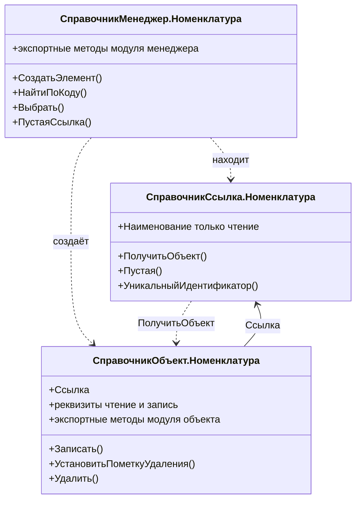
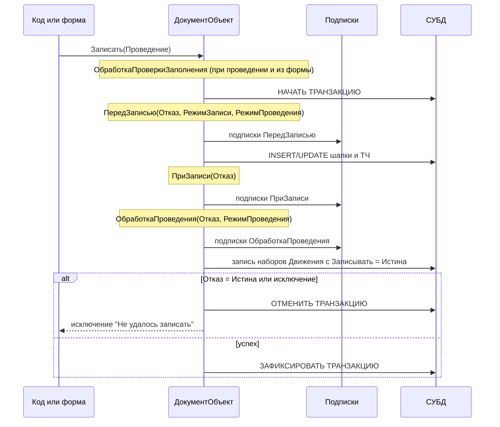
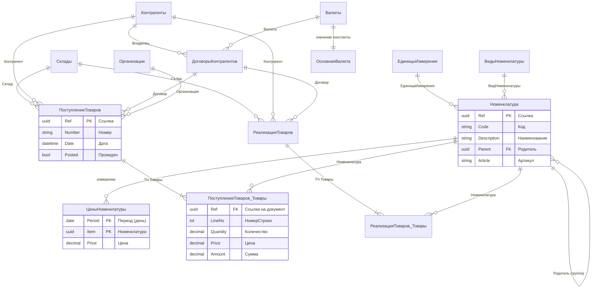
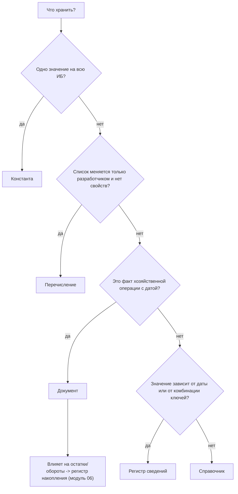

# Модуль 03. Прикладные объекты и объектная модель

> **Объём:** 24 ак. ч · **Неделя:** 3–4 · **Источники:** [Я] спринт 01 (справочники, документы, регистры и движения), спринт 02 (модули в 1С), [ПР] модуль 2 (константы, справочники, иерархия, ссылочный тип, документы, табличные части, пометка на удаление, обработчики событий, модуль объекта и менеджера, ввод на основании, регистры сведений, журналы документов), [ПР2] модуль 3 (предопределённые данные и обработчики событий в расширениях), [К] модуль 2, [Т] модуль 1 (основные сведения об объектах конфигурации), модуль 4 (конструктор ввода на основании), модуль 6 (виды программных модулей, обработчики событий, подписки на события, справочники, документы, регистры сведений)
> **Нет в источниках (написано по документации платформы/опыту):** перечисления как отдельный вид объекта, нумераторы, подчинённость справочников (владельцы) и серии кодов, периодичность и режим записи регистров сведений, срез последних/первых как API, контроль ссылочной целостности и удаление помеченных, `ОбменДанными.Загрузка`, транзакционная схема записи объекта и порядок событий, физическое хранение объектов в СУБД (`ПолучитьСтруктуруХраненияБазыДанных`), сопоставление с DDIC/SNRO/BOR

## Результат модуля

- Умеете выбрать вид объекта метаданных под задачу (справочник / перечисление / документ / регистр сведений / константа) и объяснить, во что он превращается в СУБД.
- Умеете работать с объектной моделью: различать `Ссылка`, `Объект`, `Менеджер`, читать и записывать объекты, понимать цену `Ссылка.Реквизит`.
- Умеете писать обработчики событий объекта и менеджера (`ПередЗаписью`, `ПриЗаписи`, `ОбработкаПроверкиЗаполнения`, `ОбработкаЗаполнения`) с учётом `ОбменДанными.Загрузка` и транзакции записи.
- Умеете выносить сквозную логику в подписки на события и настраивать ввод на основании.
- Умеете проектировать периодический регистр сведений и получать срез последних.
- Спроектировали ядро НСИ и первичных документов сквозного проекта «УчебнаяТорговля».

## Карта понятий SAP → 1С

| SAP | 1С | Ключевое отличие |
|---|---|---|
| Прозрачная таблица DDIC + домены/элементы данных | Объект метаданных (справочник, документ, регистр) | Таблица СУБД генерируется платформой; её имя (`_Reference42`) вы не выбираете и в коде не используете |
| Первичный ключ (MANDT + ключевые поля) | `Ссылка` — UUID (16 байт), суррогатный ключ | Бизнес-ключ (Код/Номер) не является PK, уникальность кода контролирует платформа (опционально) |
| Внешний ключ + check table | Реквизит ссылочного типа (`СправочникСсылка.Валюты`) | Ссылочная целостность на уровне СУБД **не** обеспечивается; контроль — при удалении помеченных |
| Текстовая таблица (`*T`, SPRAS) | Реквизит `Наименование` (одноязычный); мультиязычность — через конфигурацию/БСП | Нет встроенной текстовой таблицы по языкам для данных |
| Фиксированные значения домена | Перечисление | Перечисление — отдельная таблица со ссылками; в коде `Перечисления.ВидыНоменклатуры.Товар` |
| Customizing-таблица с одной строкой / TVARVC | Константа | Каждая константа — отдельная таблица из одной строки |
| Мастер-данные (MARA, KNA1) | Справочник | Иерархия, владельцы, предопределённые элементы — встроены в платформу |
| Бизнес-документ (EKKO/EKPO, VBAK/VBAP) | Документ + табличные части | Шапка и позиции — один объект, пишутся одной транзакцией; есть встроенное «проведение» |
| Номерной диапазон SNRO | Автонумерация документа/справочника, Нумератор | Нет интервалов и буферизации; номер уникален в пределах периода (год/квартал/месяц/день) |
| Таблица условий с датой действия (A-таблицы, PA0008 с BEGDA/ENDDA) | Периодический регистр сведений | Хранится только дата начала; «срез последних» — виртуальная таблица |
| BOR / RAP Business Object | Прикладной объект: модуль объекта + модуль менеджера | Методы объекта — экспортные процедуры модуля объекта, «статические» — модуля менеджера |
| BAdI / enhancement spot / user exit | Подписка на событие; расширение конфигурации (модуль 13) | Подписка — один обработчик на много типов объектов, без правки исходного объекта |
| Copy control (VTAA/VTFA), «создать с ссылкой» | Ввод на основании (`ОбработкаЗаполнения`) | Логика копирования — код в объекте-приёмнике |
| Флаг удаления (LOEKZ) + архивирование | Пометка удаления + «Удаление помеченных объектов» | Физическое удаление — отдельная операция с поиском ссылок |
| Update task / LUW (`COMMIT WORK`) | Неявная транзакция `Записать()` | Транзакцию открывает платформа; обработчики событий выполняются внутри неё |

## Теория

### 1. Объект метаданных → таблицы СУБД

Конфигурация — это метаданные. При «Обновлении конфигурации базы данных» (F7) платформа реструктуризирует таблицы, как активация в SE11 + `SE14`. Имена таблиц и полей генерируются и отличаются в разных базах, поэтому прямой SQL к ним — антипаттерн (и нарушение лицензии для прикладного доступа). Посмотреть отображение можно программно:

```bsl
// Сервер. Возвращает ТаблицаЗначений: Метаданные, ИмяТаблицыХранения, Поля, Индексы...
Структура = ПолучитьСтруктуруХраненияБазыДанных(); // без параметров - вся конфигурация
Для Каждого Строка Из Структура Цикл
	Если СтрНайти(Строка.Метаданные, "Номенклатура") > 0 Тогда
		Сообщить(Строка.Метаданные + " -> " + Строка.ИмяТаблицыХранения);
	КонецЕсли;
КонецЦикла;
```

| Объект | Таблица СУБД (пример) | Системные поля |
|---|---|---|
| Справочник `Номенклатура` | `_Reference37` | `_IDRRef` (UUID), `_Version`, `_Marked`, `_PredefinedID`, `_Code`, `_Description`, `_ParentIDRRef`, `_Folder`; реквизиты — `_Fld<N>` |
| ТЧ справочника/документа | `_Reference37_VT45` | ссылка на владельца, `_KeyField`, `_LineNo<N>` |
| Документ `ПоступлениеТоваров` | `_Document52` | `_IDRRef`, `_Number`, `_Date_Time`, `_Posted`, `_Marked` |
| Перечисление | `_Enum12` | `_IDRRef`, `_EnumOrder` |
| Константа | `_Const5` | одна строка |
| Регистр сведений | `_InfoRg60` | `_Period` (если периодический), `_RecorderRRef` (если подчинён), измерения/ресурсы |

Поле составного типа (например, `Регистратор` или реквизит типа «любая ссылка») раскладывается на три колонки: `_TYPE`, `_RTRef` (номер таблицы), `_RRRef` (UUID). Это важно для понимания стоимости запросов ([модуль 04](04-queries.md)).

### 2. Константы

Константа хранит одно значение (любого типа, включая `ХранилищеЗначения`). Сквозной проект: `ОсновнаяВалюта` (тип `СправочникСсылка.Валюты`).

```bsl
Валюта = Константы.ОсновнаяВалюта.Получить();
Константы.ОсновнаяВалюта.Установить(Справочники.Валюты.НайтиПоКоду("643"));

// Менеджер значения - для обработчиков событий и транзакционной записи
МЗ = Константы.ОсновнаяВалюта.СоздатьМенеджерЗначения();
МЗ.Прочитать();
МЗ.Значение = НоваяВалюта;
МЗ.Записать();
```

Константа — **не** глобальная переменная и не кеш: каждое `Получить()` — чтение из БД. Для часто читаемых параметров используют общий модуль с повторным использованием возвращаемых значений ([модуль 05](05-managed-forms.md)). Функциональные опции (модуль 10) обычно хранятся в константах типа Булево.

### 3. Справочники

#### 3.1. Структура и свойства

| Свойство метаданных | Значения | Комментарий для SAP-разработчика |
|---|---|---|
| Длина кода / наименования | число | Длина 0 = поле не создаётся |
| Тип кода | Строка / Число | Строковый код — с лидирующими нулями «по-1С-овски» (`000000001`) |
| Серии кодов | Во всём справочнике / В пределах подчинения / В пределах подчинения владельцу | Область уникальности кода |
| Контроль уникальности | флаг | Проверка выполняется платформой при записи (не unique-индекс СУБД) |
| Автонумерация | флаг | Новый код — при записи, если не задан |
| Иерархический | флаг; Вид: «Иерархия групп и элементов» / «Иерархия элементов» | Группа (`ЭтоГруппа = Истина`) — отдельный вид записи со своим набором реквизитов |
| Ограничение количества уровней | флаг + число | |
| Владельцы | список справочников | Подчинённый справочник (≈ зависимая таблица с FK на «шапку») |
| Использование подчинения | Элементам / Группам / Группам и элементам | |
| Основное представление | В виде кода / В виде наименования | Что показывать в полях ссылочного типа |

Реквизит справочника имеет свойство «Использование»: «Для элемента», «Для группы», «Для группы и элемента». В сквозном проекте `Номенклатура` — иерархия групп и элементов; `Артикул`, `ЕдиницаИзмерения`, `ВидНоменклатуры` — только для элемента.

#### 3.2. Подчинённость (владельцы)

`ДоговорыКонтрагентов` подчинён `Контрагенты`: у каждого договора есть стандартный реквизит `Владелец`. Это не произвольный реквизит, а встроенное отношение: форма выбора договора автоматически фильтруется по владельцу при связи параметров выбора, а при пометке удаления владельца платформа помечает и подчинённые элементы.

```bsl
// Поиск договора у конкретного контрагента
Договор = Справочники.ДоговорыКонтрагентов.НайтиПоНаименованию("Основной", Истина, , Контрагент);
// параметры: Наименование, ТочноеСоответствие, Родитель, Владелец
```

#### 3.3. Предопределённые элементы

Предопределённые элементы задаются в конфигураторе (≈ поставляемые записи customizing-таблицы, но с гарантированным именем). Обращение:

```bsl
// Сервер: через менеджер
Группа = Справочники.Номенклатура.Услуги;
// Клиент и сервер: по строке, разрешается в ссылку платформой
Группа = ПредопределенноеЗначение("Справочник.Номенклатура.Услуги");
// У объекта
Если Объект.Предопределенный Тогда ... КонецЕсли;
Имя = Объект.ИмяПредопределенныхДанных;
```

Предопределённые элементы платформа создаёт в БД автоматически; для узлов РИБ и обмена это поведение управляется свойством объекта «Обновление предопределённых данных». Предопределённый элемент нельзя удалить интерактивно; при программном удалении код, ссылающийся на его имя, упадёт с ошибкой.

#### 3.4. API справочника

```bsl
// Создание группы и элемента
Группа = Справочники.Номенклатура.СоздатьГруппу();
Группа.Наименование = "Канцтовары";
Группа.Записать();

Элемент = Справочники.Номенклатура.СоздатьЭлемент();
Элемент.Родитель = Группа.Ссылка;
Элемент.Наименование = "Бумага А4";
Элемент.Артикул = "P-A4";
Элемент.ВидНоменклатуры = Перечисления.ВидыНоменклатуры.Товар;
Элемент.Записать();   // код присвоится автоматически

// Поиск
Ссылка = Справочники.Номенклатура.НайтиПоКоду("000000012");
Ссылка = Справочники.Номенклатура.НайтиПоРеквизиту("Артикул", "P-A4");
Если Ссылка.Пустая() Тогда ... КонецЕсли; // не найдено -> пустая ссылка, а не Неопределено

// Выборка (объектный курсор, ~ SELECT ... ENDSELECT; для отчётов используйте запрос)
Выборка = Справочники.Номенклатура.Выбрать(Группа.Ссылка); // Родитель, Владелец, Отбор, Порядок
Пока Выборка.Следующий() Цикл
	// Выборка.Ссылка, Выборка.Наименование, Выборка.ПолучитьОбъект()
КонецЦикла;
```

`НайтиПоРеквизиту` возвращает **первый** найденный элемент — без гарантии уникальности. Для бизнес-ключа, отличного от кода, уникальность нужно контролировать самостоятельно (в `ОбработкаПроверкиЗаполнения` или `ПередЗаписью` с запросом).

### 4. Перечисления

Перечисление — статический список значений, задаётся только в конфигураторе. В отличие от фиксированных значений домена, это **ссылочный** тип: в таблице хранится UUID и порядок (`_EnumOrder`), в реквизитах — ссылка.

```bsl
Если Элемент.ВидНоменклатуры = Перечисления.ВидыНоменклатуры.Услуга Тогда ... КонецЕсли;
// На клиенте:
Вид = ПредопределенноеЗначение("Перечисление.ВидыНоменклатуры.Товар");
// Имя значения по ссылке (сервер):
Индекс = Перечисления.ВидыНоменклатуры.Индекс(Вид);
Имя = Метаданные.Перечисления.ВидыНоменклатуры.ЗначенияПеречисления[Индекс].Имя;
```

Когда не перечисление, а справочник: если список меняют пользователи, если у значения есть свойства (ставка, счёт) или если значения нужны в РИБ с разным набором. Предопределённые элементы справочника — промежуточный вариант.

### 5. Документы

#### 5.1. Номер и дата, нумераторы

| Свойство | Значения |
|---|---|
| Тип номера | Строка / Число |
| Длина номера | число |
| Периодичность номера | Непериодический / В пределах года / квартала / месяца / дня |
| Автонумерация | флаг |
| Контроль уникальности | флаг |
| Нумератор | ссылка на объект «Нумератор» (общие объекты) |

Нумератор — общий объект с теми же настройками номера; документы, указывающие на один нумератор, получают **сквозную** нумерацию (≈ один номерной диапазон SNRO на несколько видов документов). В отличие от SNRO, нет интервалов, внешней нумерации и буферизации: номер вычисляется при записи как «максимальный в периоде + 1» с префиксом.

```bsl
// Модуль объекта документа. Префикс организации/узла РИБ
Процедура ПриУстановкеНовогоНомера(СтандартнаяОбработка, Префикс)
	Префикс = "ПТ-";
КонецПроцедуры
```

Программно: `ДокОбъект.УстановитьНовыйНомер()` — присвоить номер до записи. Номер **не** гарантированно без пропусков (удаление документа оставляет дыру) — для фискальной сплошной нумерации нужно отдельное решение.

Дата документа — дата и время (до секунды). Вместе со ссылкой образует **момент времени** (`ДокОбъект.МоментВремени()`), по которому упорядочиваются движения регистров ([модуль 06](06-registers-posting.md)).

#### 5.2. Табличные части

ТЧ — отдельная таблица СУБД, но часть объекта: читается и пишется целиком вместе с шапкой.

```bsl
Док = Документы.ПоступлениеТоваров.СоздатьДокумент();
Док.Дата = ТекущаяДатаСеанса();
Док.Склад = Склад;
Док.Контрагент = Контрагент;
Док.Договор = Договор;

Стр = Док.Товары.Добавить();
Стр.Номенклатура = Бумага;
Стр.Количество = 10;
Стр.Цена = 250;
Стр.Сумма = Стр.Количество * Стр.Цена;

ИтогСумма = Док.Товары.Итог("Сумма");
Строки = Док.Товары.НайтиСтроки(Новый Структура("Номенклатура", Бумага));
Док.Записать(РежимЗаписиДокумента.Проведение, РежимПроведенияДокумента.Неоперативный);
```

`НомерСтроки` — системное поле, перенумеровывается при удалении строк; не используйте его как ключ позиции (в отличие от POSNR). Для устойчивого ключа строки заводят реквизит ТЧ (например, `КлючСтроки` типа `УникальныйИдентификатор`).

#### 5.3. Проведение — кратко

Свойство «Проведение»: Разрешить/Запретить. Проведение = запись документа + формирование движений по регистрам в одной транзакции. `Проведен` — флаг документа; движения хранятся в регистрах с `Регистратор = Ссылка документа`.

```bsl
// Модуль объекта документа. Детально - модуль 06
Процедура ОбработкаПроведения(Отказ, РежимПроведения)
	Движения.ОстаткиТоваров.Записывать = Истина;
	Для Каждого Стр Из Товары Цикл
		Движение = Движения.ОстаткиТоваров.ДобавитьПриход();
		Движение.Период = Дата;
		Движение.Номенклатура = Стр.Номенклатура;
		Движение.Склад = Склад;
		Движение.Количество = Стр.Количество;
	КонецЦикла;
КонецПроцедуры
```

`РежимЗаписиДокумента`: `Запись`, `Проведение`, `ОтменаПроведения`. Интерактивная запись уже проведённого документа из формы выполняет перепроведение; программный `Записать(РежимЗаписиДокумента.Запись)` движения не пересчитывает. Подробности — [модуль 06](06-registers-posting.md).

#### 5.4. Журналы документов

Журнал документов — объект, объединяющий список документов разных видов с общими «графами» (≈ представление на UNION нескольких заголовочных таблиц, но **материализованное**: у журнала своя таблица, которую платформа поддерживает при записи документов). Используется для общих списков («Все документы склада»). Цена: каждая запись документа пишет ещё и в таблицу журнала.

```bsl
Выборка = ЖурналыДокументов.СкладскиеДокументы.Выбрать(НачалоМесяца(ТекущаяДатаСеанса()), КонецМесяца(ТекущаяДатаСеанса()));
Пока Выборка.Следующий() Цикл
	Сообщить(Выборка.Ссылка);
КонецЦикла;
```

### 6. Регистры сведений

#### 6.1. Структура

Регистр сведений — таблица с составным ключом из измерений (и периода), значения — ресурсы, плюс реквизиты (не входят в ключ). Ключ уникален: запись с тем же набором измерений (+ период, + регистратор) заменяется.

| Свойство | Значения | Что меняет |
|---|---|---|
| Периодичность | Непериодический / В пределах секунды / дня / месяца / квартала / года / Позиция регистратора | Добавляет поле `Период` в ключ; период усекается до начала интервала |
| Режим записи | Независимый / Подчинение регистратору | Подчинённый — записи принадлежат документу-регистратору и пишутся при проведении |
| Измерение: Ведущее | флаг | При удалении объекта-значения измерения удаляются записи; запись в форме объекта |
| Измерение: Основной отбор | флаг | Можно отбирать наборы записей по измерению |
| Запрет незаполненных значений | флаг | ≈ NOT NULL + не пустая ссылка |
| Индексировать | флаг у реквизита | Отдельный индекс СУБД |

`ЦеныНоменклатуры`: периодический (день), независимый, измерение `Номенклатура`, ресурс `Цена`. Аналог в SAP — таблица условий с датой начала действия, но хранится **только дата начала**: цена действует до следующей записи. Нет ENDDA → нет проблемы перекрытия интервалов, но и нельзя задать «цена до 31.12» без второй записи.

#### 6.2. Запись: менеджер записи vs набор записей

```bsl
// Независимый регистр: одна запись (≈ MODIFY по ключу)
МЗ = РегистрыСведений.ЦеныНоменклатуры.СоздатьМенеджерЗаписи();
МЗ.Период = НачалоДня(ТекущаяДатаСеанса());
МЗ.Номенклатура = Бумага;
МЗ.Цена = 260;
МЗ.Записать(); // Замещать = Истина по умолчанию

// Набор записей по отбору (≈ DELETE WHERE + INSERT в одной операции)
Набор = РегистрыСведений.ЦеныНоменклатуры.СоздатьНаборЗаписей();
Набор.Отбор.Номенклатура.Установить(Бумага);
Набор.Отбор.Период.Установить(Дата);
Запись = Набор.Добавить();
Запись.Период = Дата;
Запись.Номенклатура = Бумага;
Запись.Цена = 270;
Набор.Записать(); // все записи по отбору будут ЗАМЕНЕНЫ содержимым набора
```

Набор записей с незаполненным отбором при `Записать()` заменит **весь регистр** — аналог `DELETE FROM` без `WHERE`. Для подчинённого регистратору регистра менеджер записи не создаётся; отбор набора — по `Регистратор`.

#### 6.3. Срез последних / первых

```bsl
// Структура ресурсов на дату (одна запись)
Цена = РегистрыСведений.ЦеныНоменклатуры.ПолучитьПоследнее(Дата, Новый Структура("Номенклатура", Бумага)).Цена;
// ТаблицаЗначений по всем номенклатурам на дату
ТЗ = РегистрыСведений.ЦеныНоменклатуры.СрезПоследних(Дата);
```

`ПолучитьПоследнее` для массовых операций — антипаттерн (запрос на каждую строку). Для ТЧ документа — виртуальная таблица `СрезПоследних` в запросе с соединением по номенклатуре ([модуль 04](04-queries.md)). `СрезПервых` / `ПолучитьПервое` — первая запись **после** даты (например, «следующее плановое изменение»).

### 7. Ссылочная модель: Ссылка, Объект, Менеджер



- **Ссылка** — неизменяемое значение (UUID + тип). Хранится в реквизитах, передаётся на клиент, сравнивается через `=`. Чтение `Ссылка.Артикул` на сервере неявно читает объект в объектный кеш — **весь объект**, а не одно поле. На клиенте разыменовывать ссылку нельзя (только представление).
- **Объект** — изменяемый экземпляр в памяти сервера (≈ экземпляр BO после `READ ENTITIES`). Получается `ПолучитьОбъект()` (SELECT шапки и всех ТЧ). Существует только на сервере.
- **Менеджер** — «класс» объекта: фабрика, поиск, экспортные функции модуля менеджера (≈ статические методы).

Чтение одного-двух реквизитов по ссылке — через запрос (в БСП — `ОбщегоНазначения.ЗначениеРеквизитаОбъекта(Ссылка, "Артикул")` / `ЗначенияРеквизитовОбъекта`), а не `Ссылка.ПолучитьОбъект().Артикул`.

```bsl
// Плохо: читает объект целиком (с ТЧ), 1 запрос на итерацию
Для Каждого Стр Из Товары Цикл
	Если Стр.Номенклатура.ВидНоменклатуры = Перечисления.ВидыНоменклатуры.Услуга Тогда ...
КонецЦикла;
// Хорошо: один запрос по всем строкам (модуль 04)
```

Блокировка объекта: `Объект.Заблокировать()` — объектная (пессимистическая) блокировка для редактирования (≈ enqueue на ключ), снимается при уничтожении объекта/закрытии формы. Оптимистическая — по полю `_Version`: если объект изменён другим сеансом после чтения, `Записать()` завершится ошибкой блокировки (объект изменён или удалён другим пользователем). Транзакционные (управляемые) блокировки — [модуль 06](06-registers-posting.md).

### 8. Пометка удаления vs удаление

| Действие | API | Что происходит |
|---|---|---|
| Пометка удаления | `Объект.УстановитьПометкуУдаления(Истина)` | Поле `_Marked = Истина`, объект пишется (с событиями записи). Для проведённого документа — отмена проведения. Ссылки остаются валидными |
| Непосредственное удаление | `Объект.Удалить()` | Физическое DELETE **без контроля ссылок** → «битые ссылки» (`<Объект не найден>`) |
| Удаление помеченных с контролем | Интерактивно: «Удаление помеченных объектов»; программно: `НайтиПоСсылкам(Массив)`, `УдалитьОбъекты(Массив, Истина)` | Поиск всех ссылок по всем таблицам → удаляются только объекты без ссылок (кроме ссылок из других удаляемых) |

Интерактивное непосредственное удаление обычно запрещено ролями (право «Интерактивное удаление»). Контроль ссылочной целостности в 1С — **отложенный**, это осознанный дизайн: нет FK в СУБД, удаление — регламентная операция (≈ архивирование SARA с проверками зависимостей, а не каскад FK).

### 9. Модули: объект vs менеджер

| | Модуль объекта | Модуль менеджера |
|---|---|---|
| Контекст | экземпляр (`ЭтотОбъект`, реквизиты напрямую) | без экземпляра |
| Где исполняется | сервер (и толстый клиент — legacy) | сервер |
| События | `ПередЗаписью`, `ПриЗаписи`, `ПередУдалением`, `ОбработкаЗаполнения`, `ОбработкаПроверкиЗаполнения`, `ПриКопировании`, `ОбработкаПроведения`, `ОбработкаУдаленияПроведения`, `ПриУстановкеНовогоНомера` | `ОбработкаПолученияДанныхВыбора`, `ОбработкаПолученияФормы`, `ОбработкаПолученияПредставления`, `ОбработкаПолученияПолейПредставления` |
| Вызов экспортного метода | `ДокОбъект.ЗаполнитьЦены()` | `Документы.ПоступлениеТоваров.ДанныеДляПечати(Ссылка)` |
| ≈ ABAP | instance method BO / метод класса с атрибутами | static method / function module группы функций |

Стандарт разработки: модуль объекта — только логика, которой нужен экземпляр; печать, запросы для формы, программный интерфейс — в модуле менеджера. В модулях объекта и менеджера используют области `#Область ПрограммныйИнтерфейс`, `#Область ОбработчикиСобытий`, `#Область СлужебныеПроцедурыИФункции` (стандарт 455 на its.1c.ru/db/v8std).

### 10. События объекта и транзакция записи



Ключевые правила:

1. `ПередЗаписью` и `ПриЗаписи` выполняются **внутри** транзакции. Тяжёлые вычисления и, тем более, HTTP-вызовы там удлиняют блокировки. `ПриЗаписи` — объект уже записан в БД (ссылка есть), можно писать связанные данные в той же транзакции.
2. `Отказ = Истина` в любом обработчике → откат всей транзакции (≈ `ROLLBACK WORK` в update task). Вызывающий код получает исключение, которое надо обработать `Попытка ... Исключение`.
3. Обработчик в модуле объекта вызывается раньше подписок; порядок между несколькими подписками не гарантирован.
4. Если `Записать()` вызывается внутри уже открытой транзакции (`НачатьТранзакцию()`), вложенной транзакции не создаётся: любая ошибка помечает внешнюю транзакцию к откату.
5. Новая ссылка известна в `ПередЗаписью` только если её установили: `ЭтоНовый()`, `ПолучитьСсылкуНового()` / `УстановитьСсылкуНового(Ссылка)`.

#### 10.1. ОбработкаПроверкиЗаполнения

Декларативная проверка: свойство реквизита «Проверка заполнения = Выдавать ошибку» → реквизит попадает в массив `ПроверяемыеРеквизиты`. Обработчик корректирует массив и добавляет свои проверки. Вызывается при интерактивной записи из формы, при проведении и при явном вызове `ПроверитьЗаполнение()`; при программной записи справочника (`Записать()`) **не** вызывается.

```bsl
Процедура ОбработкаПроверкиЗаполнения(Отказ, ПроверяемыеРеквизиты)
	// Договор обязателен только для поставщиков
	Если Контрагент.ВидКонтрагента <> Перечисления.ВидыКонтрагентов.Поставщик Тогда
		ПроверяемыеРеквизиты.Удалить(ПроверяемыеРеквизиты.Найти("Договор"));
	КонецЕсли;
	Если Товары.Количество() = 0 Тогда
		ОбщегоНазначения.СообщитьПользователю("Не заполнена табличная часть", ЭтотОбъект, "Товары", "Объект", Отказ); // БСП
	КонецЕсли;
КонецПроцедуры
```

Без БСП вместо `ОбщегоНазначения.СообщитьПользователю` используется `Сообщение = Новый СообщениеПользователю; Сообщение.Текст = ...; Сообщение.Поле = "Товары"; Сообщение.УстановитьДанные(ЭтотОбъект); Сообщение.Сообщить(); Отказ = Истина;`.

(Перечисление `ВидыКонтрагентов` здесь — допущение; в справочнике проекта реквизит `ВидКонтрагента` может иметь тип перечисления, которое вы создадите в M03-T1.)

#### 10.2. ПередЗаписью, ПриЗаписи и ОбменДанными.Загрузка

```bsl
Процедура ПередЗаписью(Отказ, РежимЗаписи, РежимПроведения)
	Если ОбменДанными.Загрузка Тогда
		Возврат; // данные пришли из обмена/загрузки: бизнес-логику не выполняем
	КонецЕсли;
	Для Каждого Стр Из Товары Цикл
		Стр.Сумма = Стр.Количество * Стр.Цена;
	КонецЦикла;
	СуммаДокумента = Товары.Итог("Сумма");
КонецПроцедуры
```

`ОбменДанными.Загрузка = Истина` устанавливает код обмена (планы обмена, загрузка из XML, восстановление данных). Платформа в этом режиме отключает часть своих проверок, но **обработчики `ПередЗаписью`/`ПриЗаписи`/`ПередУдалением` всё равно вызываются** — проверка флага в начале каждого такого обработчика обязательна по стандарту (≈ проверка `sy-batch`/флага миграции в BAdI, чтобы не пересчитывать данные при LSMW-загрузке). Через `ОбменДанными.Получатели` и `ОбменДанными.Отправитель` — управление регистрацией в планах обмена ([модуль 11](11-integration.md)).

`ДополнительныеСвойства` (Структура) объекта — канал передачи флагов между вызывающим кодом, обработчиками и подписками в рамках одной записи (≈ параметр-контейнер в BAdI):

```bsl
Док.ДополнительныеСвойства.Вставить("НеПересчитыватьЦены", Истина);
Док.Записать();
```

#### 10.3. ОбработкаЗаполнения и ввод на основании

`ОбработкаЗаполнения(ДанныеЗаполнения, ТекстЗаполнения, СтандартнаяОбработка)` вызывается при создании нового объекта: интерактивно (данные — значения отбора списка в виде структуры), при «Создать на основании» (данные — ссылка основания), при `Объект.Заполнить(Данные)`.

Настройка: у приёмника `ПоступлениеТоваров` — свойство «Вводится на основании» += `ЗаказПоставщику`; у источника появится команда «Создать на основании» (свойство «Является основанием для» синхронизируется). Конструктор ввода на основании генерирует каркас.

```bsl
// Модуль объекта ПоступлениеТоваров
Процедура ОбработкаЗаполнения(ДанныеЗаполнения, ТекстЗаполнения, СтандартнаяОбработка)
	Если ТипЗнч(ДанныеЗаполнения) = Тип("ДокументСсылка.ЗаказПоставщику") Тогда
		ЗаполнитьПоЗаказу(ДанныеЗаполнения);
	ИначеЕсли ТипЗнч(ДанныеЗаполнения) = Тип("Структура") Тогда
		// значения отбора списка, например Контрагент
		ЗаполнитьЗначенияСвойств(ЭтотОбъект, ДанныеЗаполнения);
	КонецЕсли;
КонецПроцедуры

Процедура ЗаполнитьПоЗаказу(Заказ)
	Запрос = Новый Запрос;
	Запрос.Текст =
	"ВЫБРАТЬ
	|	Заказ.Контрагент КАК Контрагент
	|ИЗ
	|	Документ.ЗаказПоставщику КАК Заказ
	|ГДЕ
	|	Заказ.Ссылка = &Заказ
	|;
	|////////////////////////////////////////////////////////////////////////////////
	|ВЫБРАТЬ
	|	Т.Номенклатура КАК Номенклатура,
	|	Т.Количество КАК Количество,
	|	Т.Цена КАК Цена,
	|	Т.Сумма КАК Сумма
	|ИЗ
	|	Документ.ЗаказПоставщику.Товары КАК Т
	|ГДЕ
	|	Т.Ссылка = &Заказ";
	Запрос.УстановитьПараметр("Заказ", Заказ);
	Пакет = Запрос.ВыполнитьПакет();
	Шапка = Пакет[0].Выбрать();
	Если Шапка.Следующий() Тогда
		ЗаполнитьЗначенияСвойств(ЭтотОбъект, Шапка);
	КонецЕсли;
	Товары.Загрузить(Пакет[1].Выгрузить());
КонецПроцедуры
```

Программный ввод на основании: `Док = Документы.ПоступлениеТоваров.СоздатьДокумент(); Док.Заполнить(ЗаказСсылка);`. Для сохранения связи заведите в приёмнике реквизит `Основание` (≈ PRECEDING DOCUMENT в document flow VBFA — в 1С документного потока «из коробки» нет, структуру подчинённости строит БСП по реквизитам-ссылкам).

### 11. Подписки на события (≈ BAdI)

Подписка — объект «Общие → Подписки на события»: **Источник** (набор типов, например все `ДокументОбъект.*` складского контура), **Событие** (`ПередЗаписью`, `ПриЗаписи`, `ОбработкаПроведения`, `ОбработкаЗаполнения`, `ПередУдалением` и др.), **Обработчик** — экспортная процедура серверного общего модуля. Параметры обработчика: `Источник` + параметры события.

```bsl
// Общий модуль СкладСобытия (Сервер). Подписка ПроверкаДатыЗапрета:
// Источник - ДокументОбъект.ПоступлениеТоваров, ДокументОбъект.РеализацияТоваров
// Событие - ПередЗаписью
Процедура ПроверкаДатыЗапретаПередЗаписью(Источник, Отказ, РежимЗаписи, РежимПроведения) Экспорт
	Если Источник.ОбменДанными.Загрузка Тогда
		Возврат;
	КонецЕсли;
	Если Источник.Дата < Константы.ДатаЗапретаИзменения.Получить() Тогда
		Отказ = Истина;
		ВызватьИсключение "Период закрыт для изменений";
	КонецЕсли;
КонецПроцедуры
```

| BAdI | Подписка 1С |
|---|---|
| Определение + реализация, фильтры | Источник = список типов (фильтр по типу объекта) |
| Несколько реализаций, порядок через sort-BAdI | Несколько подписок на одно событие, порядок не гарантирован |
| Работает в модифицированной системе без правки стандарта | Подписка — объект конфигурации; на поддержке типовой — добавляется в расширении (модуль 13) |
| Интерфейс методов фиксирован | Сигнатура = сигнатура события + `Источник` |

Цена: подписка с источником «все документы» срабатывает на каждой записи любого документа. Типовые конфигурации активно используют подписки (даты запрета, версионирование, регистрация к обмену), поэтому при анализе «почему документ записывается медленно» смотрите и подписки.

### 12. ER-диаграмма сквозного проекта (модуль 03)



Обратите внимание: все «FK» на диаграмме — логические. В СУБД ограничений нет, целостность обеспечивают платформа (типизация реквизитов) и регламентное удаление помеченных.

### 13. Выбор вида объекта



## Ловушки для ABAP-разработчика

1. **`Ссылка.Реквизит` в цикле.** Выглядит как доступ к полю структуры, а на деле — чтение объекта из БД (или кеша). Это `SELECT SINGLE` в `LOOP` с худшей проекцией (`SELECT *` плюс ТЧ). Используйте запрос.
2. **Набор записей без отбора.** `СоздатьНаборЗаписей()` + `Записать()` без `Отбор.*.Установить()` стирает регистр целиком.
3. **Ждать FK от СУБД.** Внешних ключей нет; `Объект.Удалить()` создаёт битые ссылки без предупреждения. Удаление — только через пометку и «Удаление помеченных».
4. **Код ≠ первичный ключ.** Код можно поменять, он может быть неуникальным (если контроль выключен или серии кодов «в пределах подчинения»). Ключ — `Ссылка`. Для интеграции передавайте UUID (`Ссылка.УникальныйИдентификатор()`), а не код.
5. **Логика без проверки `ОбменДанными.Загрузка`.** При обмене/восстановлении данные будут «пересчитаны» и испорчены, а обмен станет медленным.
6. **Тяжёлая логика в `ПередЗаписью`/`ПриЗаписи`.** Это внутри транзакции СУБД — длинные блокировки, как обновление в V1-update-задаче с внешними вызовами.
7. **`НомерСтроки` как ключ позиции.** Перенумеровывается при удалении строки; ссылаться на позицию из другого документа по номеру строки нельзя.
8. **Ожидание сплошной нумерации.** Номер не транзакционно-бесщелевой; это не SNRO с буфером, но и не гарантия отсутствия дыр.
9. **Периодический РС как интервальная таблица.** Нет даты окончания: «отменить» цену можно только новой записью с новым значением.
10. **`НайтиПоНаименованию`/`НайтиПоРеквизиту` для бизнес-логики.** Возвращает первый попавшийся элемент при дублях — тихая ошибка данных.

## Практика (сквозной проект)

### M03-T1. НСИ: справочники и перечисления

Создайте `ЕдиницыИзмерения`, `Валюты`, `Организации`, `Склады`, `Контрагенты`, `ДоговорыКонтрагентов` (подчинён `Контрагенты`), `Номенклатура` (иерархия групп и элементов), перечисления `ВидыНоменклатуры` (Товар, Услуга) и `ВидыКонтрагентов` (Поставщик, Покупатель, ПоставщикИПокупатель).

**Критерии приёмки:**
- [ ] `Номенклатура.ЕдиницаИзмерения`, `Артикул`, `ВидНоменклатуры` — использование «Для элемента», проверка заполнения «Выдавать ошибку» для `ВидНоменклатуры`.
- [ ] `ДоговорыКонтрагентов`: серии кодов «В пределах подчинения», реквизиты `Валюта`, `ВидДоговора`.
- [ ] `ЕдиницыИзмерения`: код строковый длины 3 (код ОКЕИ), контроль уникальности.
- [ ] Предопределённые группы `Номенклатура.Товары`, `Номенклатура.Услуги`; предопределённая валюта `RUB`.

**Самопроверка:** запрос в консоли (`checks/M03-T1.sql.txt`): `ВЫБРАТЬ Ссылка, ИмяПредопределенныхДанных ИЗ Справочник.Номенклатура ГДЕ Предопределенный` — 2 строки. Попытка создать два договора с одинаковым кодом у разных контрагентов — успешна, у одного — ошибка.

### M03-T2. Константы и регистр сведений цен

Константа `ОсновнаяВалюта`; регистр сведений `ЦеныНоменклатуры` (периодический, день, независимый; измерение `Номенклатура` — ведущее, основной отбор; ресурс `Цена`).

**Критерии приёмки:**
- [ ] Цена, установленная 01.03 и 15.03, по `ПолучитьПоследнее` на 10.03 возвращает мартовскую первую, на 20.03 — вторую.
- [ ] Запись двух цен на одну номенклатуру в один день оставляет одну запись (ключ период+измерение).
- [ ] В форме элемента номенклатуры доступна ссылка на записи регистра (следствие «ведущее»).

**Самопроверка:** `ВЫБРАТЬ * ИЗ РегистрСведений.ЦеныНоменклатуры.СрезПоследних(&Дата, )` на две даты.

### M03-T3. Документы поступления и реализации

Документы `ПоступлениеТоваров`, `РеализацияТоваров`: шапка (Организация, Склад, Контрагент, Договор, СуммаДокумента), ТЧ `Товары` (Номенклатура, Количество, Цена, Сумма). Общий нумератор `СкладскиеДокументы`, периодичность — в пределах года, префикс через `ПриУстановкеНовогоНомера`.

**Критерии приёмки:**
- [ ] `ПередЗаписью` пересчитывает `Сумма` строк и `СуммаДокумента`, с выходом при `ОбменДанными.Загрузка`.
- [ ] `ОбработкаПроверкиЗаполнения`: пустая ТЧ → отказ; договор принадлежит контрагенту (`Договор.Владелец = Контрагент`) — иначе сообщение, привязанное к полю.
- [ ] Сквозная нумерация: поступление и реализация, созданные подряд, имеют номера N и N+1.
- [ ] Журнал документов `СкладскиеДокументы` с графами Склад, Контрагент, СуммаДокумента.

**Самопроверка:** сценарий: создать документ программно с `ОбменДанными.Загрузка = Истина` и ценой×количеством, не равным сумме — сумма не пересчитана; без флага — пересчитана.

### M03-T4. Модуль менеджера и ссылочная модель

В модуле менеджера `Номенклатура` — экспортная функция `РеквизитыНоменклатуры(МассивСсылок)`, возвращающая `Соответствие` Ссылка → Структура(Артикул, ВидНоменклатуры, ЕдиницаИзмерения) одним запросом.

**Критерии приёмки:**
- [ ] Ни одного обращения `Ссылка.Реквизит` в цикле.
- [ ] Функция используется в `ОбработкаПроверкиЗаполнения` реализации: услуги не должны продаваться с количеством дробным.
- [ ] Замер производительности (модуль 01) на документе со 100 строками: 1 запрос вместо 100 чтений.

**Самопроверка:** замер производительности, сравнение двух вариантов.

### M03-T5. Подписка и ввод на основании

1. Документ `ЗаказПоставщику` (Контрагент, Договор, ТЧ Товары, Статус) — минимальная версия (формы — модуль 05).
2. Ввод `ПоступлениеТоваров` на основании `ЗаказПоставщику` (реквизит `Основание`).
3. Константа `ДатаЗапретаИзменения` + подписка `ПроверкаДатыЗапретаПередЗаписью` на все три документа.

**Критерии приёмки:**
- [ ] Из формы заказа доступна команда «Создать на основании → Поступление товаров», ТЧ скопирована.
- [ ] Документ с датой раньше даты запрета не записывается ни интерактивно, ни программно; при `ОбменДанными.Загрузка` — записывается.
- [ ] Программно: `Док.Заполнить(Заказ)` даёт тот же результат, что интерактивный ввод.

**Самопроверка:** тестовая обработка/YAxUnit-тест (модуль 14), сохраните сценарий в `checks/M03-T5.txt`.

### M03-T6. Обработка заполнения тестовых данных

Внешняя или встроенная обработка `ЗаполнениеТестовыхДанных`, которая идемпотентно создаёт НСИ (поиск по коду/ИНН, создание при отсутствии), цены и 20 документов поступления и реализации. Данные — из `project/testdata/` (JSON или макет).

**Критерии приёмки:**
- [ ] Повторный запуск не создаёт дубли.
- [ ] Все записи в одной транзакции на документ; ошибка одного документа не отменяет остальные (`Попытка` + `ОтменитьТранзакцию`).
- [ ] Ссылки задаются через `УстановитьСсылкуНового` из UUID в файле — повторная загрузка в чистую базу даёт те же UUID.

**Самопроверка:** запуск дважды, запрос `ВЫБРАТЬ КОЛИЧЕСТВО(*) ИЗ Справочник.Номенклатура` не меняется.

### M03-T7*. Контроль ссылочной целостности

Обработка «Удаление помеченных (учебная)»: собирает все помеченные объекты справочников `Номенклатура`, `Контрагенты`, вызывает `НайтиПоСсылкам`, выводит в таблицу «что мешает удалению» и удаляет только свободные через `УдалитьОбъекты`.

**Критерии приёмки:**
- [ ] Номенклатура, используемая в проведённом поступлении, не удаляется, причина показана (ссылающийся документ).
- [ ] Контрагент, у которого помечены и все договоры, удаляется вместе с договорами.
- [ ] Обработка не удаляет предопределённые элементы.

**Самопроверка:** сценарий на тестовых данных из M03-T6.

## Контрольные вопросы

1. Чем отличаются `СправочникСсылка`, `СправочникОбъект` и `СправочникМенеджер`? Где каждый доступен (клиент/сервер)?
2. Что произойдёт в СУБД и в данных при `Объект.Удалить()` для элемента, на который ссылаются документы? Как удалить корректно?
3. В каком порядке вызываются `ПередЗаписью`, `ПриЗаписи`, `ОбработкаПроведения` и подписки? Какие из них внутри транзакции?
4. Зачем проверять `ОбменДанными.Загрузка` и в каких обработчиках?
5. Чем отличается периодичность регистра сведений «в пределах дня» от непериодического регистра с измерением `Дата`?
6. Регистр сведений в режиме «Подчинение регистратору» — чем запись в него отличается от независимого? Можно ли использовать менеджер записи?
7. Когда выбрать перечисление, а когда справочник с предопределёнными элементами?
8. Что такое серии кодов и как они влияют на уникальность?
9. Как организовать сквозную нумерацию двух видов документов и почему она не гарантирует отсутствие пропусков?
10. Почему обращение `Стр.Номенклатура.ВидНоменклатуры` в цикле по ТЧ — проблема производительности?

## Документация

- Документация платформы 8.3 (руководство разработчика, справочник встроенного языка): https://its.1c.ru/db/v83doc
- Стандарты и методики разработки (структура модулей, обработчики событий, `ОбменДанными.Загрузка`): https://its.1c.ru/db/v8std
- Методическая поддержка разработчиков: https://its.1c.ru/db/metod8dev
- Библиотека стандартных подсистем (`ОбщегоНазначения`, удаление помеченных, структура подчинённости): https://its.1c.ru/db/bsp
- Сайт платформы: https://v8.1c.ru
