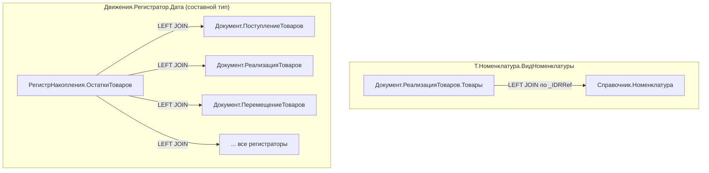
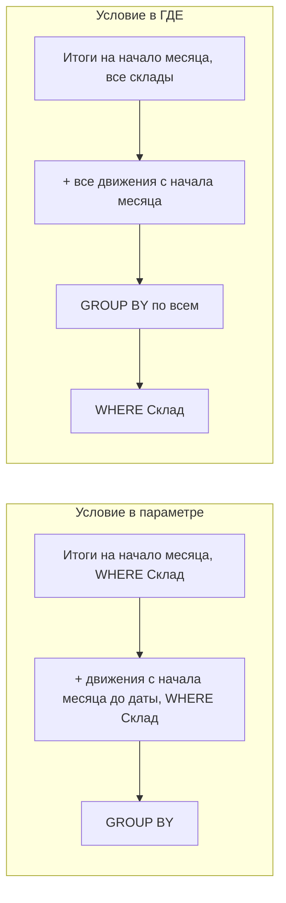
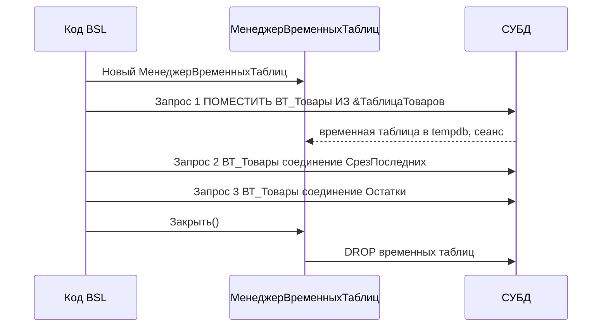

# Модуль 04. Язык запросов

> **Объём:** 18 ак. ч · **Неделя:** 5 · **Источники:** [Я] спринт 03 (язык запросов, консоль запросов, функции языка запросов, хранение таблиц в базах данных, виртуальные таблицы регистров, параметры и соединения), спринт 04 (итоги в запросах), [ПР] модуль 3 (синтаксис, группировки, виртуальные таблицы, несколько источников, итоги, запросы во встроенном языке, причины неоптимальной работы), [ПР] модуль 2 (табличная модель доступа к данным), [К] модуль 4, [Т] модуль 4 (конструктор запроса), модуль 7 (табличная модель: конструктор запроса, настройка ограничений)
> **Нет в источниках (написано по документации платформы/опыту):** временные таблицы и `МенеджерВременныхТаблиц`, пакетные запросы, `ИЕРАРХИЯ` в итогах и `В ИЕРАРХИИ`, `РАЗРЕШЕННЫЕ` (как ключевое слово запроса), обход результата (`Выбрать`/`Выгрузить`, обход по группировкам), трансляция запроса в SQL СУБД и неявные соединения при разыменовании, индексы, запрос в цикле как антипаттерн, сопоставление с Open SQL/CDS

## Результат модуля

- Умеете писать запросы на языке 1С, понимая, в какой SQL они превращаются и где появляются неявные соединения.
- Умеете получать остатки, обороты и срезы через виртуальные таблицы, корректно используя их параметры.
- Умеете строить пакетные запросы с временными таблицами и передавать данные между запросами через `МенеджерВременныхТаблиц`.
- Умеете получать иерархические итоги (`ИТОГИ ... ПО ... ИЕРАРХИЯ`) и обходить результат по группировкам.
- Умеете находить и устранять типовые причины неоптимальности: запрос в цикле, разыменование составных типов, фильтр виртуальной таблицы в `ГДЕ`, `ИЛИ` в условиях.

## Карта понятий SAP → 1С

| SAP | 1С | Ключевое отличие |
|---|---|---|
| Open SQL `SELECT` | `Новый Запрос` + текст на языке запросов | Текст — строка, проверяется при выполнении, а не при активации |
| Path expression CDS (`_Partner.Name`) / ассоциации | Разыменование через точку `Т.Контрагент.ИНН` | Автоматический LEFT JOIN по типу реквизита; для составного типа — по всем таблицам типа |
| `CAST` | `ВЫРАЗИТЬ(... КАК ...)` | Нужно для сужения составного типа и неограниченных строк |
| `COALESCE` | `ЕСТЬNULL(Выражение, Замена)` | Двухаргументная функция |
| CDS view с параметрами, `_Stock` таблицы MARD/MCHB | Виртуальные таблицы регистров (`.Остатки(...)`, `.Обороты(...)`) | Агрегаты берутся из таблиц итогов; параметры фильтруют до агрегации |
| Таблица условий с датой действия + выборка «на дату» | `РегистрСведений.X.СрезПоследних(&Дата, Условие)` | Платформа строит подзапрос MAX(Период) + соединение |
| Internal table + `FOR ALL ENTRIES` | Параметр-массив `В (&Список)` или временная таблица | Временная таблица живёт в СУБД (tempdb), можно индексировать |
| Common Table Expression / `WITH` | Пакет запросов + `ПОМЕСТИТЬ ВТ` | Таблицы видны последующим запросам пакета и через менеджер ВТ |
| `UNION [ALL]` | `ОБЪЕДИНИТЬ [ВСЕ]` | — |
| Вычисление итогов в ALV | `ИТОГИ ... ПО` | Итоги считает платформа, результат можно обойти как дерево |
| Authority-check в CDS (DCL) | `ВЫБРАТЬ РАЗРЕШЕННЫЕ` + RLS (модуль 10) | Без `РАЗРЕШЕННЫЕ` при ограничении записей — ошибка доступа вместо отсечения строк |
| `SELECT` in `LOOP` | Запрос в цикле | Тот же антипаттерн, но чаще скрыт: `Ссылка.Реквизит`, `ПолучитьПоследнее` |
| ST05 SQL trace / SAT | Технологический журнал (события СУБД), замер производительности | Видно реальный SQL после трансляции |
| SQVI / SE16N | Консоль запросов (внешняя обработка) | Для отладки текста запроса |

## Теория

### 1. Как запрос попадает в СУБД


Следствия:

- Язык запросов — **только чтение** (кроме `ПОМЕСТИТЬ` во временные таблицы и `УНИЧТОЖИТЬ`). INSERT/UPDATE/DELETE в нём нет — запись идёт только через объектную модель (наборы записей, объекты). Это сильнее, чем запрет Native SQL в ABAP: обойти нельзя.
- Запрос выполняется только на сервере (в файловом варианте — в процессе клиента, но в серверном контексте).
- Реальный SQL видно в технологическом журнале (события `DBMSSQL`, `DBPOSTGRS`) — аналог ST05 ([модуль 12](12-jobs-bp-admin-performance.md)).

### 2. Базовый синтаксис и API

```bsl
Запрос = Новый Запрос;
Запрос.Текст =
"ВЫБРАТЬ
|	Т.Номенклатура КАК Номенклатура,
|	СУММА(Т.Количество) КАК Количество
|ИЗ
|	Документ.ПоступлениеТоваров.Товары КАК Т
|ГДЕ
|	Т.Ссылка.Дата МЕЖДУ &НачалоПериода И &КонецПериода
|	И Т.Ссылка.Проведен
|	И Т.Номенклатура.ВидНоменклатуры = ЗНАЧЕНИЕ(Перечисление.ВидыНоменклатуры.Товар)
|СГРУППИРОВАТЬ ПО
|	Т.Номенклатура
|УПОРЯДОЧИТЬ ПО
|	Количество УБЫВ";
Запрос.УстановитьПараметр("НачалоПериода", НачалоМесяца(Дата));
Запрос.УстановитьПараметр("КонецПериода", КонецМесяца(Дата));

Результат = Запрос.Выполнить();       // РезультатЗапроса
Если Результат.Пустой() Тогда
	Возврат;
КонецЕсли;
Выборка = Результат.Выбрать();       // ВыборкаИзРезультатаЗапроса, курсор
Пока Выборка.Следующий() Цикл
	// Выборка.Номенклатура, Выборка.Количество
КонецЦикла;
ТЗ = Результат.Выгрузить();          // ТаблицаЗначений целиком в память
```

```abap
SELECT i~matnr, SUM( i~menge ) AS menge
  FROM ekpo AS i INNER JOIN ekko AS h ON h~ebeln = i~ebeln
  WHERE h~bedat BETWEEN @lv_from AND @lv_to
  GROUP BY i~matnr
  ORDER BY menge DESCENDING
  INTO TABLE @DATA(lt_qty).
```

Порядок секций: `ВЫБРАТЬ [РАЗРЕШЕННЫЕ] [РАЗЛИЧНЫЕ] [ПЕРВЫЕ N] ... [ПОМЕСТИТЬ ВТ] ИЗ ... [ГДЕ] [СГРУППИРОВАТЬ ПО] [ИМЕЮЩИЕ] [ОБЪЕДИНИТЬ [ВСЕ] ...] [УПОРЯДОЧИТЬ ПО] [АВТОУПОРЯДОЧИВАНИЕ] [ИТОГИ ... ПО ...] [ДЛЯ ИЗМЕНЕНИЯ]`. `ИНДЕКСИРОВАТЬ ПО` указывается в конце запроса с `ПОМЕСТИТЬ`. Ключевые слова имеют английские синонимы (`SELECT`, `FROM`, `WHERE`...).

Особенности, которых нет в Open SQL:

| Конструкция | Пример | Назначение |
|---|---|---|
| `ЗНАЧЕНИЕ()` | `ЗНАЧЕНИЕ(Справочник.Номенклатура.ПустаяСсылка)`, `ЗНАЧЕНИЕ(Перечисление.ВидыНоменклатуры.Услуга)` | Литерал ссылки/предопределённого/перечисления |
| `ССЫЛКА` | `Т.Регистратор ССЫЛКА Документ.ПоступлениеТоваров` | Проверка типа значения составного поля |
| `ТИПЗНАЧЕНИЯ()`, `ТИП()` | `ТИПЗНАЧЕНИЯ(Т.Регистратор) = ТИП(Документ.РеализацияТоваров)` | То же, через выражение |
| `В ИЕРАРХИИ` | `Т.Номенклатура В ИЕРАРХИИ (&Группа)` | Отбор с подчинёнными элементами иерархического справочника |
| `ПРЕДСТАВЛЕНИЕ()`, `ПРЕДСТАВЛЕНИЕССЫЛКИ()` | `ПРЕДСТАВЛЕНИЕССЫЛКИ(Т.Номенклатура)` | Текстовое представление (дополнительное соединение) |
| `НАЧАЛОПЕРИОДА`, `КОНЕЦПЕРИОДА`, `ДОБАВИТЬКДАТЕ`, `РАЗНОСТЬДАТ` | `НАЧАЛОПЕРИОДА(Т.Период, МЕСЯЦ)` | Работа с датами |
| `ВЫБОР КОГДА ... ТОГДА ... ИНАЧЕ ... КОНЕЦ` | | ≈ `CASE` |
| `ПОДОБНО` | `Т.Артикул ПОДОБНО "P-%"` | ≈ `LIKE` |

Параметры: `&Имя`. Значение-массив или `СписокЗначений` используется с `В (&Список)`. `ТаблицаЗначений` как параметр допускается только как источник в `ПОМЕСТИТЬ` (см. ниже).

### 3. Разыменование через точку: неявные соединения

`Т.Номенклатура.ВидНоменклатуры` — удобно, как ассоциация в CDS, но каждая точка — соединение.



Правила:

1. Разыменование ссылочного поля одного типа — один LEFT JOIN (плюс соединения для RLS, если `РАЗРЕШЕННЫЕ`). Приемлемо в разумных количествах.
2. Разыменование поля **составного** типа (`Регистратор`, «любая ссылка», реквизит с несколькими типами) — LEFT JOIN к **каждой** таблице из состава типа и `CASE` по `_RTRef`. 20 видов документов-регистраторов — 20 соединений.
3. Лечение — `ВЫРАЗИТЬ`:

```bsl
"ВЫБРАТЬ
|	ВЫРАЗИТЬ(Д.Регистратор КАК Документ.РеализацияТоваров).Контрагент КАК Контрагент,
|	Д.Количество
|ИЗ
|	РегистрНакопления.ОстаткиТоваров КАК Д
|ГДЕ
|	Д.Регистратор ССЫЛКА Документ.РеализацияТоваров"
```

4. `ВЫРАЗИТЬ(Т.Комментарий КАК СТРОКА(200))` — обязательно для сравнения/группировки по строке неограниченной длины (в СУБД это `ntext`/`text`, сравнивать её нельзя).
5. Разыменование в условии `ГДЕ` препятствует использованию индекса по основной таблице. Лучше `ГДЕ Т.Номенклатура В (ВЫБРАТЬ Ссылка ИЗ Справочник.Номенклатура ГДЕ ...)` или временная таблица.

### 4. NULL, ЕСТЬNULL и соединения

`NULL` появляется в 1С только из внешних соединений (и разыменования «пустой ссылки» → NULL у полей). Пустая ссылка ≠ NULL: `ГДЕ Т.Договор = ЗНАЧЕНИЕ(Справочник.ДоговорыКонтрагентов.ПустаяСсылка)`.

```bsl
"ВЫБРАТЬ
|	Номенклатура.Ссылка КАК Номенклатура,
|	ЕСТЬNULL(Остатки.КоличествоОстаток, 0) КАК Остаток
|ИЗ
|	Справочник.Номенклатура КАК Номенклатура
|		ЛЕВОЕ СОЕДИНЕНИЕ РегистрНакопления.ОстаткиТоваров.Остатки(&Дата, Склад = &Склад) КАК Остатки
|		ПО Номенклатура.Ссылка = Остатки.Номенклатура
|ГДЕ
|	НЕ Номенклатура.ЭтоГруппа"
```

Виды соединений: `ВНУТРЕННЕЕ`, `ЛЕВОЕ`, `ПРАВОЕ`, `ПОЛНОЕ` `СОЕДИНЕНИЕ`. Проверка: `ГДЕ Остатки.Номенклатура ЕСТЬ NULL`.

### 5. Виртуальные таблицы регистров

Виртуальная таблица — параметризованное представление, которое платформа раскрывает в подзапрос к таблице движений и таблице итогов (детально про итоги — [модуль 06](06-registers-posting.md)).

| Регистр | Виртуальная таблица | Параметры | Поля ресурсов |
|---|---|---|---|
| Накопления (остатки) | `Остатки(Период, Условие)` | момент времени/граница, отбор | `<Ресурс>Остаток` |
| Накопления | `Обороты(НачалоПериода, КонецПериода, Периодичность, Условие)` | | `<Ресурс>Оборот`; для регистра остатков ещё `Приход`, `Расход` |
| Накопления (остатки) | `ОстаткиИОбороты(НачалоПериода, КонецПериода, Периодичность, МетодДополнения, Условие)` | | `НачальныйОстаток`, `Приход`, `Расход`, `Оборот`, `КонечныйОстаток` |
| Сведений (периодический) | `СрезПоследних(Период, Условие)`, `СрезПервых(Период, Условие)` | | ресурсы как есть |
| Бухгалтерии/расчёта | свои (модули 08, 09) | | |

`Периодичность`: `Авто`, `Регистратор`, `Запись`, `Секунда`, `Минута`, `Час`, `День`, `Неделя`, `Декада`, `Месяц`, `Квартал`, `Полугодие`, `Год`, `Период`. Добавляет поля `Период`, `Регистратор` и т.п.

#### 5.1. Параметры vs ГДЕ

```bsl
// Правильно: отбор в параметрах - фильтр применяется ДО агрегации в таблице итогов
"ВЫБРАТЬ О.Номенклатура, О.КоличествоОстаток
|ИЗ РегистрНакопления.ОстаткиТоваров.Остатки(&Дата, Склад = &Склад) КАК О"

// Неправильно: платформа сначала посчитает остатки по ВСЕМ складам, затем отфильтрует
"ВЫБРАТЬ О.Номенклатура, О.КоличествоОстаток
|ИЗ РегистрНакопления.ОстаткиТоваров.Остатки(&Дата, ) КАК О
|ГДЕ О.Склад = &Склад"
```



Результат одинаковый, объём чтения — разный на порядки. Ограничения на условие в параметре: можно использовать только поля самой виртуальной таблицы (измерения), нельзя ссылаться на другие таблицы запроса, но можно — на вложенный запрос и временную таблицу: `Номенклатура В (ВЫБРАТЬ Т.Номенклатура ИЗ ВТ_Товары КАК Т)`.

#### 5.2. Период и граница

`Остатки(&Дата)` по дате возвращает остаток **на начало** этой секунды, то есть без движений с той же датой и временем. Для «остатка на момент документа, без самого документа» используют границу:

```bsl
Запрос.УстановитьПараметр("Момент", Новый Граница(ДокОбъект.МоментВремени(), ВидГраницы.Исключая));
```

При проведении документа с контролем остатков (новая методика) в параметр периода не передают ничего — берутся текущие итоги ([модуль 06](06-registers-posting.md)).

#### 5.3. Срез последних в запросе

```bsl
"ВЫБРАТЬ
|	Т.НомерСтроки,
|	Т.Номенклатура,
|	ЕСТЬNULL(Цены.Цена, 0) КАК Цена
|ИЗ
|	ВТ_Товары КАК Т
|		ЛЕВОЕ СОЕДИНЕНИЕ РегистрСведений.ЦеныНоменклатуры.СрезПоследних(
|				&Дата,
|				Номенклатура В (ВЫБРАТЬ ВТ.Номенклатура ИЗ ВТ_Товары КАК ВТ)) КАК Цены
|		ПО Т.Номенклатура = Цены.Номенклатура"
```

`СрезПоследних` без условия в параметрах — подзапрос по всему регистру с `MAX(Период)` на каждую комбинацию измерений: на больших регистрах это главный источник медленных запросов.

### 6. Временные таблицы, пакеты, менеджер ВТ



```bsl
МВТ = Новый МенеджерВременныхТаблиц;
Запрос = Новый Запрос;
Запрос.МенеджерВременныхТаблиц = МВТ;
Запрос.Текст =
"ВЫБРАТЬ
|	Т.НомерСтроки КАК НомерСтроки,
|	Т.Номенклатура КАК Номенклатура,
|	Т.Количество КАК Количество
|ПОМЕСТИТЬ ВТ_Товары
|ИЗ
|	&Товары КАК Т
|ИНДЕКСИРОВАТЬ ПО
|	Номенклатура
|;
|
|////////////////////////////////////////////////////////////////////////////////
|ВЫБРАТЬ
|	ВТ.Номенклатура КАК Номенклатура,
|	СУММА(ВТ.Количество) КАК Количество,
|	ЕСТЬNULL(МАКСИМУМ(О.КоличествоОстаток), 0) КАК Остаток
|ИЗ
|	ВТ_Товары КАК ВТ
|		ЛЕВОЕ СОЕДИНЕНИЕ РегистрНакопления.ОстаткиТоваров.Остатки(
|				&Дата,
|				Склад = &Склад
|					И Номенклатура В (ВЫБРАТЬ Т.Номенклатура ИЗ ВТ_Товары КАК Т)) КАК О
|		ПО ВТ.Номенклатура = О.Номенклатура
|СГРУППИРОВАТЬ ПО
|	ВТ.Номенклатура";
// Передаём ТЧ: для ТаблицаЗначений колонки должны быть типизированы
Запрос.УстановитьПараметр("Товары", Товары.Выгрузить(, "НомерСтроки, Номенклатура, Количество"));
Запрос.УстановитьПараметр("Дата", Дата);
Запрос.УстановитьПараметр("Склад", Склад);

Результаты = Запрос.ВыполнитьПакет(); // Массив РезультатЗапроса по каждому запросу пакета
Выборка = Результаты[1].Выбрать();
// ВТ_Товары доступна и следующему запросу с тем же МВТ
МВТ.Закрыть();
```

Ключевые факты:

- Без `МенеджерВременныхТаблиц` временные таблицы живут в пределах одного `Выполнить`/`ВыполнитьПакет`; с ним — пока менеджер существует или не закрыт.
- `Выполнить()` у пакета возвращает результат **последнего** запроса; `ВыполнитьПакет()` — массив результатов.
- `ТаблицаЗначений` попадает в запрос только через `ВЫБРАТЬ ... ПОМЕСТИТЬ ... ИЗ &Параметр`. Колонки без явного типа (`ОписаниеТипов`) дают ошибку «Тип не может быть выбран в запросе». Выгрузка из ТЧ объекта (`Товары.Выгрузить()`) типизирована.
- `УНИЧТОЖИТЬ ВТ_Товары` — явное удаление внутри пакета.
- Временная таблица ≈ локальная `#temp` в tempdb (MS SQL) / `pg_temp` в PostgreSQL; индекс — `ИНДЕКСИРОВАТЬ ПО`. Аналог в ABAP — internal table + FOR ALL ENTRIES, только с соединениями на стороне СУБД.

### 7. Вложенные запросы, ОБЪЕДИНИТЬ

```bsl
"ВЫБРАТЬ
|	""Поступление"" КАК Вид,
|	П.Ссылка КАК Документ,
|	П.СуммаДокумента КАК Сумма
|ИЗ
|	Документ.ПоступлениеТоваров КАК П
|ГДЕ
|	П.Контрагент = &Контрагент
|
|ОБЪЕДИНИТЬ ВСЕ
|
|ВЫБРАТЬ
|	""Реализация"",
|	Р.Ссылка,
|	Р.СуммаДокумента
|ИЗ
|	Документ.РеализацияТоваров КАК Р
|ГДЕ
|	Р.Контрагент = &Контрагент"
```

Имена колонок результата берутся из первого запроса объединения, типы объединяются: поле `Документ` получит составной тип. `ОБЪЕДИНИТЬ` без `ВСЕ` — с удалением дублей (дороже). Вложенный запрос в `ИЗ` допустим, но в соединении (`... СОЕДИНЕНИЕ (ВЫБРАТЬ ...) КАК Подзапрос ПО ...`) — одна из классических причин плохого плана: оптимизатор СУБД не знает его кардинальность. Заменяйте временной таблицей с индексом.

### 8. ИТОГИ и иерархия

```bsl
"ВЫБРАТЬ
|	О.Номенклатура КАК Номенклатура,
|	О.Склад КАК Склад,
|	О.КоличествоОстаток КАК Количество
|ИЗ
|	РегистрНакопления.ОстаткиТоваров.Остатки(&Дата, ) КАК О
|ИТОГИ
|	СУММА(Количество)
|ПО
|	ОБЩИЕ,
|	Номенклатура ИЕРАРХИЯ,
|	Склад"
```

`ИТОГИ ... ПО` добавляет в результат строки группировок (с полем-признаком уровня); `ИЕРАРХИЯ` — итоги по группам иерархического справочника (`ТОЛЬКО ИЕРАРХИЯ` — только групповые). Обход:

```bsl
Результат = Запрос.Выполнить();
ВыборкаНом = Результат.Выбрать(ОбходРезультатаЗапроса.ПоГруппировкамСИерархией, "Номенклатура");
Пока ВыборкаНом.Следующий() Цикл
	// ВыборкаНом.Номенклатура (элемент или группа), ВыборкаНом.Количество - итог
	ВыборкаСклад = ВыборкаНом.Выбрать(ОбходРезультатаЗапроса.ПоГруппировкам, "Склад");
	Пока ВыборкаСклад.Следующий() Цикл
		// итог по складу внутри номенклатуры
	КонецЦикла;
КонецЦикла;

Дерево = Результат.Выгрузить(ОбходРезультатаЗапроса.ПоГруппировкам); // ДеревоЗначений
```

`ОбходРезультатаЗапроса`: `Прямой` (по умолчанию, включая итоговые строки как обычные), `ПоГруппировкам`, `ПоГруппировкамСИерархией`. Рекурсивный обход иерархии делается вложенным вызовом `Выборка.Выбрать(...)` в своей процедуре — отдельного метода «ВыбратьРекурсивно» у выборки нет. На практике итоги для отчётов строит СКД ([модуль 07](07-reports-skd-print.md)); `ИТОГИ` в коде нужны для печатных форм и иерархических алгоритмов.

### 9. РАЗРЕШЕННЫЕ

При ограничении доступа на уровне записей (RLS, [модуль 10](10-security-interface.md)) запрос без `РАЗРЕШЕННЫЕ` к таблице, где у пользователя есть недоступные записи, завершается **ошибкой** «Недостаточно прав». С `ВЫБРАТЬ РАЗРЕШЕННЫЕ` недоступные записи отсекаются. Стандарт: в запросах, результат которых показывается пользователю, писать `РАЗРЕШЕННЫЕ`; в коде проведения с привилегированным режимом — нет. Ключевое слово ставится в первом запросе объединения и в каждом запросе пакета отдельно.

### 10. Запрос в цикле и другие причины неоптимальности

```bsl
// Антипаттерн: N запросов (≈ SELECT SINGLE в LOOP)
Для Каждого Стр Из Товары Цикл
	Стр.Цена = РегистрыСведений.ЦеныНоменклатуры.ПолучитьПоследнее(Дата,
		Новый Структура("Номенклатура", Стр.Номенклатура)).Цена;
КонецЦикла;

// Правильно: 1 запрос (ВТ из ТЧ + СрезПоследних с условием в параметре), затем
ЦеныПоНоменклатуре = Новый Соответствие;
Выборка = Запрос.Выполнить().Выбрать();
Пока Выборка.Следующий() Цикл
	ЦеныПоНоменклатуре.Вставить(Выборка.Номенклатура, Выборка.Цена);
КонецЦикла;
Для Каждого Стр Из Товары Цикл
	Стр.Цена = ЦеныПоНоменклатуре[Стр.Номенклатура];
КонецЦикла;
```

Скрытые формы «запроса в цикле»: `Ссылка.Реквизит`, `Ссылка.ПолучитьОбъект()`, `НайтиПоКоду`, `ПолучитьПоследнее`, `Константы.X.Получить()` в цикле.

Типовые причины неоптимальной работы запросов (по методическим материалам ИТС):

| Причина | Почему плохо | Решение |
|---|---|---|
| Соединение с вложенным запросом | Нет статистики → nested loops по большому набору | Временная таблица + `ИНДЕКСИРОВАТЬ ПО` |
| Соединение с виртуальной таблицей | Виртуальная таблица — тяжёлый подзапрос | Сначала поместить результат в ВТ, отфильтровав параметрами |
| Отбор виртуальной таблицы в `ГДЕ` вместо параметров | Агрегация по всему регистру | Условие в параметре |
| Несоответствие индексов и условий | Scan вместо seek | Условия по первым полям индекса; для реквизитов — флаг «Индексировать» |
| `ИЛИ` в условиях | Индекс не используется | `ОБЪЕДИНИТЬ ВСЕ` двух запросов или `В (...)` |
| Получение данных через точку от полей составного типа | Соединения со всеми таблицами типа | `ВЫРАЗИТЬ` |
| Вложенные запросы в условии соединения | Неоптимальный план | ВТ |
| Функции над полями в условии (`НАЧАЛОПЕРИОДА(Т.Дата, ДЕНЬ) = &Д`) | Индекс не используется | Диапазон `Т.Дата МЕЖДУ &Начало И &Конец` |

#### 10.1. Индексы, которые создаёт платформа

| Объект | Индексы (упрощённо) |
|---|---|
| Справочник | по `Ссылка` (кластерный), по коду, по наименованию, по родителю/владельцу + код/наименование |
| Документ | по `Ссылка`, по дате+ссылке, по номеру |
| Реквизит с «Индексировать» | реквизит + ссылка; «с доп. упорядочиванием» — + код/наименование/дата |
| Регистр сведений | по ключу: период + измерения в порядке их следования в конфигураторе; для подчинённого — по регистратору |
| Регистр накопления | движения: по регистратору+номер строки, по периоду; итоги: по периоду+измерениям |

Порядок измерений в регистре = порядок полей в составном индексе. Измерение, по которому чаще всего фильтруют, ставьте первым — так же, как проектируют вторичный индекс в SE11. Точный состав индексов показывает `ПолучитьСтруктуруХраненияБазыДанных()` (колонка `Индексы`; второй параметр `Истина` — имена в терминах СУБД).

### 11. Инструменты: конструктор и консоль запросов

- **Конструктор запроса** (контекстное меню в модуле → «Конструктор запроса», также «с обработкой результата») — генерирует текст и код обхода. Полезен для виртуальных таблиц: параметры заполняются в отдельном диалоге, что снижает риск «условие в ГДЕ».
- **Консоль запросов** — внешняя обработка (поставляется на ИТС, есть в составе инструментов разработчика и множество вариантов от сообщества). Позволяет выполнять текст с параметрами, смотреть временные таблицы пакета, время выполнения. Это ваш SE16N/SQVI и первый инструмент самопроверки заданий курса.
- **Технологический журнал** и **замер производительности** — модуль 01 и 12.

Тексты запросов в коде по стандарту оформляются многострочной строкой с `|`, как выдаёт конструктор, чтобы их можно было открыть конструктором обратно.

## Ловушки для ABAP-разработчика

1. **Фильтр виртуальной таблицы в `ГДЕ`.** Синтаксически корректно, результат верный, производительность — катастрофа на реальных объёмах.
2. **Точка от составного типа.** `Регистратор.Дата`, `Документ.Контрагент` в объединённом журнале — десятки скрытых JOIN. Всегда `ВЫРАЗИТЬ`.
3. **NULL vs пустая ссылка.** `ГДЕ Т.Договор ЕСТЬ NULL` не найдёт незаполненный договор; нужен `= ЗНАЧЕНИЕ(Справочник.ДоговорыКонтрагентов.ПустаяСсылка)`.
4. **`Остатки(&Дата)` не включает движения в момент `&Дата`.** Для «на конец дня» передавайте `КонецДня(Дата)` или `Новый Граница(..., ВидГраницы.Включая)`.
5. **Нет INSERT/UPDATE в запросе.** Массовое изменение — через объекты/наборы записей. Не ищите аналог `UPDATE ... SET`.
6. **Нетипизированная `ТаблицаЗначений` в параметре.** Колонки, созданные `Колонки.Добавить("Имя")` без типа, ломают `ПОМЕСТИТЬ ... ИЗ &Таблица`.
7. **`РАЗРЕШЕННЫЕ` забыт.** У разработчика с полными правами всё работает, у кладовщика с RLS — ошибка. Тестируйте под ролью.
8. **Строки неограниченной длины.** Сравнение, группировка, `РАЗЛИЧНЫЕ` по такому полю — ошибка или неверный результат без `ВЫРАЗИТЬ(... КАК СТРОКА(N))`.
9. **`ПолучитьПоследнее` и `Ссылка.Реквизит` в цикле.** Это запрос в цикле, даже если слова «Запрос» в коде нет.
10. **`Выгрузить()` на миллион строк.** Вся выборка в памяти сервера. Для потоковой обработки — `Выбрать()`.

## Практика (сквозной проект)

Все тексты запросов сохраняйте в `checks/M04-Tk.sql.txt`.

### M04-T1. Заполнение цен в реализации одним запросом

Экспортная процедура модуля объекта `РеализацияТоваров.ЗаполнитьЦены()`: цены из `ЦеныНоменклатуры.СрезПоследних` на дату документа.

**Критерии приёмки:**
- [ ] Один вызов `ВыполнитьПакет()`; ТЧ передаётся параметром и помещается в ВТ.
- [ ] Условие `Номенклатура В (ВЫБРАТЬ ... ИЗ ВТ)` — в параметре `СрезПоследних`, не в `ГДЕ`.
- [ ] Номенклатура без цены получает 0 (`ЕСТЬNULL`).
- [ ] Нет `ПолучитьПоследнее` и обращений через точку в цикле.

**Самопроверка:** документ со 100 строками — замер производительности показывает 1 обращение к СУБД на заполнение.

### M04-T2. Отчёт «Продажи по группам номенклатуры» без СКД

Запрос к `Документ.РеализацияТоваров.Товары` за период с `ИТОГИ СУММА(Количество), СУММА(Сумма) ПО ОБЩИЕ, Номенклатура ИЕРАРХИЯ`, вывод в `ДеревоЗначений` и далее — в сообщения/табличный документ.

**Критерии приёмки:**
- [ ] Только проведённые документы, `ВЫБРАТЬ РАЗРЕШЕННЫЕ`.
- [ ] Сумма по группе «Товары» = сумме по её элементам.
- [ ] Обход через `ОбходРезультатаЗапроса.ПоГруппировкамСИерархией`.

**Самопроверка:** сверка общего итога с запросом без итогов `ВЫБРАТЬ СУММА(Сумма)`.

### M04-T3. Пакет с временными таблицами: оборотка по документам

Пакет: ВТ поступлений и ВТ реализаций за период по номенклатуре → итоговая таблица «Номенклатура | Поступило | Продано | Разница» через `ПОЛНОЕ СОЕДИНЕНИЕ`.

**Критерии приёмки:**
- [ ] `ЕСТЬNULL` по обеим сторонам, номенклатура без движений не выводится.
- [ ] Использован `МенеджерВременныхТаблиц`; после выполнения в консоли запросов видны промежуточные ВТ.
- [ ] Альтернативная версия через `ОБЪЕДИНИТЬ ВСЕ` + `СГРУППИРОВАТЬ ПО` даёт тот же результат.

**Самопроверка:** сравнение двух вариантов в консоли запросов (результаты и время).

### M04-T4. Разыменование составного типа

Журнал документов `СкладскиеДокументы` (из M03): запрос «документы по контрагенту» с колонкой `Контрагент`, полученной через `ВЫРАЗИТЬ` по каждому виду документа.

**Критерии приёмки:**
- [ ] Два варианта текста: через точку от `Ссылка` и через `ВЫРАЗИТЬ` + `ВЫБОР`.
- [ ] В отчёте по заданию — фрагмент SQL из технологического журнала для обоих вариантов, количество JOIN подсчитано.

**Самопроверка:** технологический журнал (событие СУБД) на файловой или клиент-серверной базе ([lab](../lab/README.md)).

### M04-T5. Поиск неоптимальностей

Дан запрос (напишите его сами по шаблону): `СрезПоследних` без параметров, условие по `Номенклатура.ВидНоменклатуры` в `ГДЕ`, `ИЛИ` между двумя складами, соединение с вложенным запросом. Перепишите.

**Критерии приёмки:**
- [ ] Каждая причина из таблицы 10 устранена и прокомментирована в тексте (`//` комментарии в тексте запроса допустимы).
- [ ] Результаты исходного и оптимизированного запроса совпадают.

**Самопроверка:** время в консоли на 10 000 строк тестовых данных (генератор из M03-T6, расширьте).

### M04-T6*. Остатки на момент документа с контролем

Функция модуля менеджера `РеализацияТоваров.НехваткаТоваров(ДокументОбъект)`: ТЧ в ВТ, свёрнутая по номенклатуре; остатки `ОстаткиТоваров.Остатки` на `Новый Граница(МоментВремени(), ВидГраницы.Исключая)` по складу документа; результат — таблица «Номенклатура, Требуется, Остаток, Нехватка» только для строк с нехваткой. Регистр `ОстаткиТоваров` создайте в минимальном виде заранее (полностью — в модуле 06).

**Критерии приёмки:**
- [ ] Один пакет, условия по складу и номенклатуре — в параметрах виртуальной таблицы.
- [ ] Повторяющиеся строки ТЧ суммируются до сравнения.
- [ ] Для нового (не записанного) документа используется текущая дата.

**Самопроверка:** сценарий: приход 10, расход 7, новый расход 5 → нехватка 2.

## Контрольные вопросы

1. Во что транслируется `Т.Регистратор.Дата` для регистра с пятью видами регистраторов? Как сократить?
2. Почему отбор виртуальной таблицы `Остатки` в параметрах эффективнее, чем в `ГДЕ`? Когда условие нельзя перенести в параметры?
3. Что вернёт `Остатки(&Дата)`, если документ с движением проведён ровно в `&Дата`? Как получить остаток с учётом этого движения?
4. Сколько живёт временная таблица без менеджера ВТ и с ним? Как передать `ТаблицаЗначений` в запрос?
5. Чем отличаются `Выполнить()` и `ВыполнитьПакет()`; `Выбрать()` и `Выгрузить()`?
6. Что такое `ИТОГИ ... ПО ... ИЕРАРХИЯ` и какие виды обхода результата существуют?
7. Для чего `РАЗРЕШЕННЫЕ` и что будет без него при включённом RLS?
8. Назовите пять типовых причин неоптимальной работы запросов и способ устранения каждой.
9. Как узнать, какие индексы есть у таблицы регистра и как порядок измерений влияет на производительность?
10. Чем `NULL` отличается от пустой ссылки и где каждый появляется?

## Документация

- Документация платформы 8.3 (раздел «Язык запросов», объекты `Запрос`, `МенеджерВременныхТаблиц`): https://its.1c.ru/db/v83doc
- Методическая поддержка разработчиков (оптимизация запросов, виртуальные таблицы): https://its.1c.ru/db/metod8dev
- Стандарты разработки (оформление текстов запросов, `РАЗРЕШЕННЫЕ`, производительность): https://its.1c.ru/db/v8std
- Сайт платформы: https://v8.1c.ru
