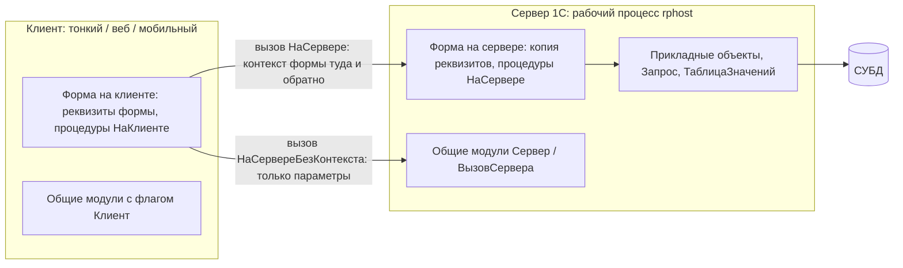
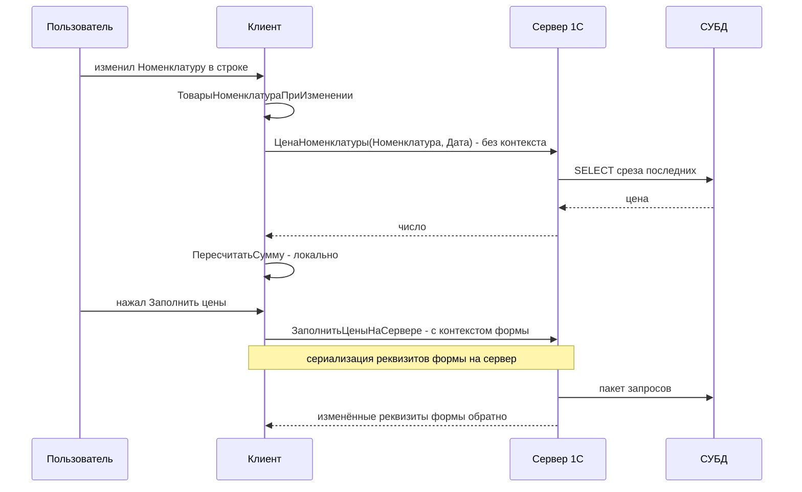
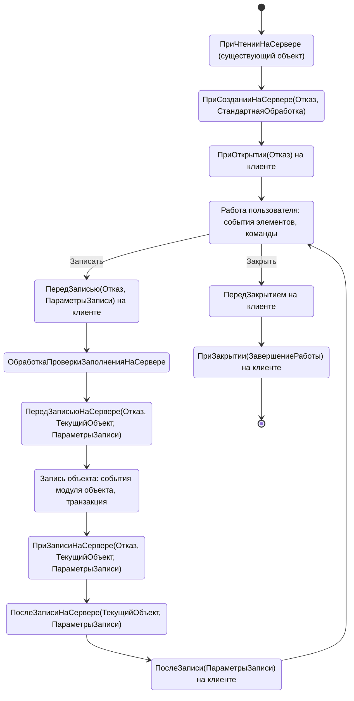
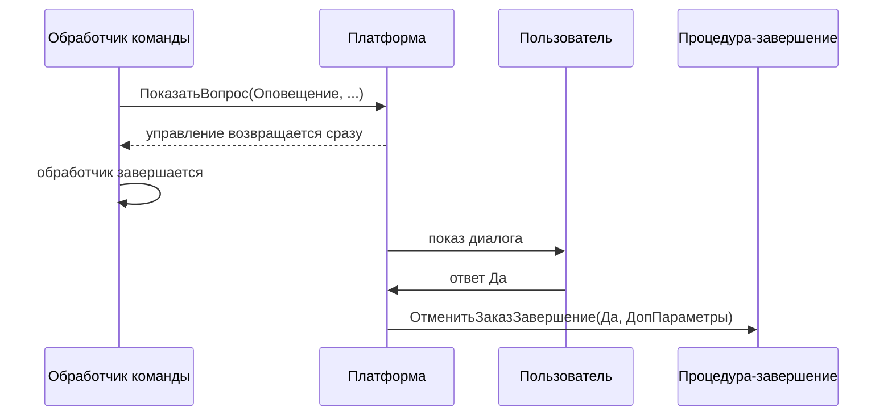
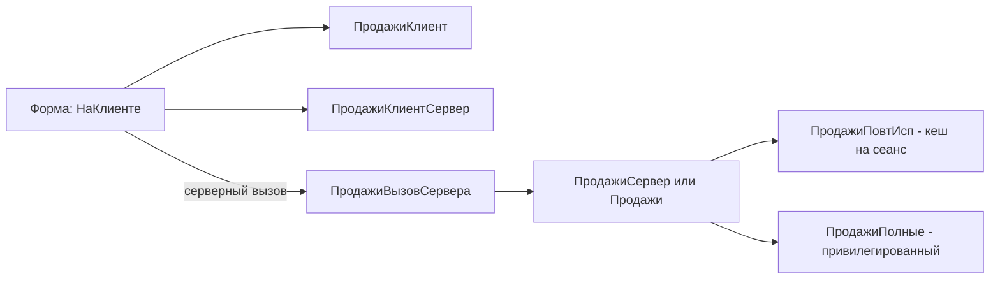

# Модуль 05. Управляемые формы и клиент-серверная архитектура

> **Объём:** 24 ак. ч · **Неделя:** 6–7 · **Источники:** [Я] спринт 02 (формы и подсистемы, программирование управляемых форм, модули в 1С), спринт 03 (вебинар «Реквизиты формы и реквизиты документа»), [ПР] модуль 5 (клиент-серверное взаимодействие, директивы компиляции, преобразование прикладных объектов в данные формы, параметры формы, данные заполнения, передача параметров, команды формы, параметризуемые команды), [ПР] модуль 9 (организация диалога с пользователем), [ПР] модуль 2 (тонкий/толстый клиент, работа с интерфейсом), [К] модули 2, 3, 9, [Т] модуль 3 (редакторы командного интерфейса, редактор обычных и управляемых форм), модуль 4 (конструктор форм), модуль 10 (параметры, команды, реквизиты формы, динамический список, элементы формы, командный интерфейс формы)
> **Нет в источниках (написано по документации платформы/опыту):** асинхронность `Асинх`/`Ждать` и обещания, `ОписаниеОповещения` как механизм немодальных диалогов, оповещения (`Оповестить`/`ОбработкаОповещения`), флаги общих модулей (Клиент, Сервер, Вызов сервера, Глобальный, Привилегированный, повторное использование возвращаемых значений), порядок событий жизненного цикла формы, `&НаСервереБезКонтекста` и стоимость серверного вызова, временное хранилище, сопоставление с PBO/PAI и Fiori/OData

## Результат модуля

- Умеете разделять код формы по контекстам и выбирать директиву так, чтобы минимизировать число и объём серверных вызовов.
- Умеете работать с реквизитами формы, конвертировать данные формы в прикладной объект и обратно.
- Умеете открывать формы с параметрами, получать результат закрытия, оповещать другие формы.
- Умеете писать немодальный диалог через `ОписаниеОповещения` и через `Асинх`/`Ждать`.
- Умеете настроить динамический список на произвольном запросе и командный интерфейс через подсистемы.
- Умеете спроектировать набор общих модулей с правильными флагами компиляции.

## Карта понятий SAP → 1С

| SAP | 1С | Ключевое отличие |
|---|---|---|
| Dynpro: PBO/PAI на сервере приложений, SAP GUI — рендерер | Управляемая форма: модуль формы с кодом **и на клиенте, и на сервере** | Часть логики выполняется на клиенте без обращения к серверу |
| PAI-roundtrip на каждое действие | Серверный вызов только из `&НаСервере`-процедур | Каждый вызов — сериализация контекста формы; их число — ключевая метрика |
| Fiori/UI5 + OData (stateless) | Тонкий/веб-клиент + сервер 1С (stateful форма) | Серверная копия формы живёт в сеансе; нет ETag — оптимистическая блокировка по версии объекта |
| Поля экрана / TOP-INCLUDE глобальные переменные | Реквизиты формы | Описываются декларативно, синхронизируются клиент↔сервер платформой |
| Экранные элементы, Screen Painter | Элементы формы (дерево), редактор формы | Форма генерируется платформой по метаданным, можно не рисовать |
| Function codes, GUI status | Команды формы, общие команды, параметризуемые команды | Команда отделена от кнопки; одна команда — много мест размещения |
| `CALL SCREEN`, `CALL TRANSACTION ... USING` | `ОткрытьФорму(Имя, Параметры, ...)` | Окно не модальное по умолчанию; результат — через оповещение о закрытии |
| `POPUP_TO_CONFIRM` (синхронный) | `ПоказатьВопрос` + `ОписаниеОповещения` или `Ждать ВопросАсинх` | Синхронные модальные окна запрещены в веб-клиенте и новых конфигурациях |
| ALV Grid с SELECT в PBO | Динамический список | Читает данные порциями с сервера при прокрутке, запрос — декларативный |
| Area menu / Launchpad, роли меню | Подсистемы + командный интерфейс | Интерфейс собирается из подсистем и прав, а не рисуется вручную |
| Function group / class (static) | Общий модуль с флагами компиляции | Флаги определяют, где модуль доступен и как кешируются результаты |
| `SET/GET PARAMETER`, ABAP memory | Параметры формы, временное хранилище, `Оповестить` | Нет общей памяти между окнами; данные передаются явно |

## Теория

### 1. Контексты исполнения



На клиенте **нет** базы данных, прикладных объектов и ряда типов. Доступно на клиенте: примитивы, ссылки (как значения, без разыменования), `Структура`, `Массив`, `Соответствие`, `СписокЗначений`, `ДанныеФормы*`, фиксированные коллекции. Только на сервере: `Запрос`, `ТаблицаЗначений`, `ДеревоЗначений`, `СправочникОбъект`/`ДокументОбъект`, менеджеры (`Справочники.*`, `Документы.*`), `Метаданные` в полном объёме.

Сравнение с SAP:

| | Dynpro (SAP GUI) | Fiori + OData | Управляемая форма 1С |
|---|---|---|---|
| Где UI-логика | сервер (PBO/PAI) | браузер (JS) | клиент (`&НаКлиенте`) + сервер (`&НаСервере`) |
| Состояние | сервер (сессия) | клиент, сервер stateless | **и там и там**: копия данных формы на клиенте и на сервере |
| Roundtrip | каждый PAI | каждый OData-вызов | только явный вызов серверной процедуры (или платформенный: запись, чтение порции списка) |
| Язык клиента | — | JavaScript | тот же встроенный язык 1С |

### 2. Директивы компиляции

| Директива | Где исполняется | Доступ к реквизитам формы | Передача данных |
|---|---|---|---|
| `&НаКлиенте` | клиент | да (клиентская копия) | — |
| `&НаСервере` | сервер | да (серверная копия), `РеквизитФормыВЗначение` | весь контекст формы туда и обратно |
| `&НаСервереБезКонтекста` | сервер | **нет** | только параметры и возвращаемое значение |
| `&НаКлиентеНаСервереБезКонтекста` | там, откуда вызвана | нет | вызов не порождает перехода между контекстами |

```bsl
&НаКлиенте
Процедура ТоварыНоменклатураПриИзменении(Элемент)
	ТекущиеДанные = Элементы.Товары.ТекущиеДанные;
	// 1 вызов без контекста: передаём два значения, получаем число
	ТекущиеДанные.Цена = ЦенаНоменклатуры(ТекущиеДанные.Номенклатура, Объект.Дата);
	ПересчитатьСумму(ТекущиеДанные);
КонецПроцедуры

&НаСервереБезКонтекста
Функция ЦенаНоменклатуры(Номенклатура, Дата)
	Возврат РегистрыСведений.ЦеныНоменклатуры.ПолучитьПоследнее(Дата,
		Новый Структура("Номенклатура", Номенклатура)).Цена;
КонецФункции

&НаКлиентеНаСервереБезКонтекста
Процедура ПересчитатьСумму(СтрокаТЧ)
	СтрокаТЧ.Сумма = СтрокаТЧ.Количество * СтрокаТЧ.Цена; // без серверного вызова
КонецПроцедуры

&НаСервере
Процедура ЗаполнитьЦеныНаСервере()
	ДокОбъект = РеквизитФормыВЗначение("Объект");
	ДокОбъект.ЗаполнитьЦены();              // экспортный метод модуля объекта (M04-T1)
	ЗначениеВРеквизитФормы(ДокОбъект, "Объект");
КонецПроцедуры
```

Правило выбора: по умолчанию — `&НаКлиенте`; если нужна БД — `&НаСервереБезКонтекста` с минимальными параметрами; `&НаСервере` — только если нужно читать/менять много реквизитов формы или вызывать `РеквизитФормыВЗначение`. Из `&НаСервере` можно вызывать только серверные процедуры; из клиентской — серверную, но не наоборот (сервер не может вызвать клиента: обратные вызовы — только через возврат значения и обработку на клиенте).

В модулях объектов и общих модулях вместо директив используют инструкции препроцессора `#Если Сервер Или ТолстыйКлиентОбычноеПриложение Или ВнешнееСоединение Тогда ... #КонецЕсли`.

### 3. Цена серверного вызова



Метрики, на которые смотрят при ревью: число серверных вызовов на одно действие пользователя (цель — не более одного), объём данных контекста (форма с ТЧ на 5 000 строк при каждом `&НаСервере` гоняет её по сети), отсутствие серверных вызовов в `ПриАктивизацииСтроки` и подобных частых событиях (или их откладывание через `ПодключитьОбработчикОжидания`). В веб-клиенте и через интернет каждый вызов — десятки–сотни миллисекунд. Инструмент — замер производительности с отображением серверных вызовов (модуль 01) и показатель «Серверные вызовы» в отладчике.

Большие данные между клиентом и сервером передают через временное хранилище:

```bsl
// Сервер
Адрес = ПоместитьВоВременноеХранилище(ДвоичныеДанные, УникальныйИдентификатор); // идентификатор формы
// Клиент получает строку-адрес, а сами данные остаются на сервере
// Сервер, позже:
Данные = ПолучитьИзВременногоХранилища(Адрес);
```

### 4. Реквизиты формы и данные формы

Реквизит формы — типизированная переменная формы, существующая в двух копиях (клиент и сервер). Основной реквизит формы объекта — `Объект`. Его тип на сервере и клиенте — **не** `ДокументОбъект`, а `ДанныеФормыСтруктура` (ТЧ — `ДанныеФормыКоллекция`, деревья — `ДанныеФормыДерево`). Методы модуля объекта у `Объект` в форме недоступны.

| Задача | API (только на сервере) |
|---|---|
| Данные формы → прикладной объект | `РеквизитФормыВЗначение("Объект")` или `ДанныеФормыВЗначение(Объект, Тип("ДокументОбъект.РеализацияТоваров"))` |
| Прикладной объект → данные формы | `ЗначениеВРеквизитФормы(ДокОбъект, "Объект")` или `ЗначениеВДанныеФормы(ДокОбъект, Объект)` |
| ТаблицаЗначений → реквизит-таблица | `ЗначениеВРеквизитФормы(ТЗ, "ТаблицаПодбора")` |
| Перечитать объект | `ЭтотОбъект.Прочитать()` в модуле формы |

Реквизит объекта vs реквизит формы:

| | Реквизит объекта (`Объект.Склад`) | Реквизит формы (`ПоказыватьУслуги`) |
|---|---|---|
| Хранится в БД | да, при записи | нет (кроме «Сохраняемые данные» в настройках) |
| Описан в | метаданных объекта | редакторе формы |
| Тип | из метаданных | любой допустимый для формы |
| Пример | Склад документа | флаг фильтра, вспомогательная таблица подбора |

Элементы формы (`Элементы.Товары`, `Элементы.Склад`) — визуальное представление, связанное с реквизитом через свойство `ПутьКДанным`. Видимость/доступность управляются через `Элементы.X.Видимость`, `ТолькоПросмотр`, условное оформление (`УсловноеОформление` формы — предпочтительнее программного изменения в цикле по строкам). Программное создание: `Элементы.Добавить(Имя, Тип("ПолеФормы"), Родитель)` и реквизитов — `ИзменитьРеквизиты(Добавляемые, Удаляемые)` (только на сервере).

### 5. Жизненный цикл формы объекта



- `ПриСозданииНаСервере` — единственное место для инициализации по параметрам формы, настройки видимости, заполнения реквизитов формы. Аналог PBO, но выполняется **один раз** при создании формы. Отказ = Истина → форма не откроется.
- `ПриЧтенииНаСервере(ТекущийОбъект)` — вызывается для существующего объекта при чтении (в том числе при перечитывании). Для нового объекта не вызывается. Типичный приём — общая процедура «ПриЧтенииСозданииНаСервере», вызываемая из обоих обработчиков.
- `ПередЗаписьюНаСервере(Отказ, ТекущийОбъект, ПараметрыЗаписи)` — `ТекущийОбъект` здесь — настоящий `ДокументОбъект`: можно заполнить реквизиты, которых нет в форме. `ПараметрыЗаписи.РежимЗаписи` — режим записи документа.
- `ПриЗаписиНаСервере` — выполняется в той же транзакции, что и запись объекта.
- После записи платформа сама оповещает открытые динамические списки об изменении объекта.

Не дублируйте логику формы и объекта: проверки и пересчёты, которые должны работать и при программной записи, — в модуле объекта ([модуль 03](03-metadata-objects.md)); форма — только интерактив.

### 6. Команды формы и параметризуемые команды

Команда формы: имя, действие (процедура `&НаКлиенте`), картинка, представление. Кнопка — отдельный элемент, связанный с командой.

```bsl
&НаКлиенте
Процедура ЗаполнитьЦены(Команда)
	Если Объект.Товары.Количество() = 0 Тогда
		Возврат; // обрабатываем на клиенте - сервер не дёргаем
	КонецЕсли;
	ЗаполнитьЦеныНаСервере();
КонецПроцедуры
```

**Общая команда** (Общие → Общие команды) с «Тип параметра команды» — параметризуемая: появляется в формах объектов указанных типов (≈ GOS-меню/кнопка, добавляемая в чужие экраны). Свойства: «Группа» (куда размещать: командная панель формы, панель навигации), «Режим использования параметра» (однократный/множественный).

```bsl
// Модуль общей команды "СоздатьПоступлениеПоЗаказу", тип параметра - ДокументСсылка.ЗаказПоставщику
&НаКлиенте
Процедура ОбработкаКоманды(ПараметрКоманды, ПараметрыВыполненияКоманды)
	ПараметрыФормы = Новый Структура("Основание", ПараметрКоманды);
	ОткрытьФорму("Документ.ПоступлениеТоваров.ФормаОбъекта", ПараметрыФормы,
		ПараметрыВыполненияКоманды.Источник, ПараметрыВыполненияКоманды.Уникальность,
		ПараметрыВыполненияКоманды.Окно);
КонецПроцедуры
```

Команды также есть у объектов метаданных (команды документа/справочника) — для них работает то же самое, и именно так в типовых делают «Печать», «Создать на основании», отчёты по объекту.

### 7. Открытие форм и параметры

```bsl
// Открыть существующий объект
ОткрытьФорму("Документ.ЗаказПоставщику.ФормаОбъекта", Новый Структура("Ключ", ЗаказСсылка));
// Короче, для ссылки - форма объекта по умолчанию
ПоказатьЗначение(, ЗаказСсылка);

// Новый объект с заполнением (уйдёт в ОбработкаЗаполнения как Структура)
ЗначенияЗаполнения = Новый Структура("Контрагент", Контрагент);
ОткрытьФорму("Документ.ЗаказПоставщику.ФормаОбъекта",
	Новый Структура("ЗначенияЗаполнения", ЗначенияЗаполнения));

// Форма выбора с получением результата без модальности
Оповещение = Новый ОписаниеОповещения("ВыборНоменклатурыЗавершение", ЭтотОбъект);
ОткрытьФорму("Справочник.Номенклатура.ФормаВыбора",
	Новый Структура("РежимВыбора", Истина), ЭтотОбъект, , , , Оповещение,
	РежимОткрытияОкнаФормы.БлокироватьОкноВладельца);
```

Сигнатура: `ОткрытьФорму(ИмяФормы, Параметры, Владелец, Уникальность, Окно, НавигационнаяСсылка, ОписаниеОповещенияОЗакрытии, РежимОткрытияОкна)`. Стандартные параметры форм объектов: `Ключ`, `ЗначенияЗаполнения`, `Основание`, `ЗначениеКопирования`; форм списка/выбора: `Отбор`, `РежимВыбора`, `МножественныйВыбор`, `ТекущаяСтрока`. Собственные параметры добавляются в редакторе формы (вкладка «Параметры») и читаются в `ПриСозданииНаСервере`:

```bsl
&НаСервере
Процедура ПриСозданииНаСервере(Отказ, СтандартнаяОбработка)
	Если Параметры.Свойство("ТолькоУслуги") И Параметры.ТолькоУслуги Тогда
		ОбщегоНазначенияКлиентСервер.УстановитьЭлементОтбораДинамическогоСписка(Список,
			"ВидНоменклатуры", Перечисления.ВидыНоменклатуры.Услуга); // БСП
	КонецЕсли;
КонецПроцедуры
```

Параметры формы доступны только в `ПриСозданииНаСервере` (дальше их надо скопировать в реквизиты формы). Возврат результата: в открытой форме `Закрыть(Результат)` или `ОповеститьОВыборе(Значение)` (для форм выбора) → вызывается `ОписаниеОповещенияОЗакрытии` / `ОбработкаВыбора` владельца.

### 8. Оповещения между формами

```bsl
// После проведения заказа - сообщить всем открытым формам
&НаКлиенте
Процедура ПослеЗаписи(ПараметрыЗаписи)
	Оповестить("ИзменёнСтатусЗаказа", Объект.Статус, Объект.Ссылка);
КонецПроцедуры

// В любой другой открытой форме
&НаКлиенте
Процедура ОбработкаОповещения(ИмяСобытия, Параметр, Источник)
	Если ИмяСобытия = "ИзменёнСтатусЗаказа" Тогда
		Элементы.Список.Обновить();
	КонецЕсли;
КонецПроцедуры
```

`Оповестить` — широковещательное событие в пределах клиентского сеанса (≈ `RAISE EVENT` с `SET HANDLER ... FOR ALL INSTANCES`, только между окнами одного пользователя). Для изменения данных вне формы (например, из обработки) используйте `ОповеститьОбИзменении(Ссылка)` — динамические списки обновятся.

### 9. Асинхронность и диалоги

Модальные окна (`Вопрос()`, `ОткрытьФормуМодально()`) запрещены свойством конфигурации «Режим использования модальности = Не использовать» (по умолчанию для новых конфигураций) и не работают в веб-клиенте под рядом браузеров. Варианты:

```bsl
// Вариант 1: callback через ОписаниеОповещения (8.3.3+)
&НаКлиенте
Процедура ОтменитьЗаказ(Команда)
	Оповещение = Новый ОписаниеОповещения("ОтменитьЗаказЗавершение", ЭтотОбъект,
		Новый Структура("Заказ", Объект.Ссылка));
	ПоказатьВопрос(Оповещение, "Отменить заказ?", РежимДиалогаВопрос.ДаНет);
	// код здесь выполнится СРАЗУ, не дожидаясь ответа
КонецПроцедуры

&НаКлиенте
Процедура ОтменитьЗаказЗавершение(Результат, ДополнительныеПараметры) Экспорт
	Если Результат = КодВозвратаДиалога.Да Тогда
		ОтменитьЗаказНаСервере();
	КонецЕсли;
КонецПроцедуры

// Вариант 2: Асинх/Ждать (8.3.18+), линейный код поверх обещаний
&НаКлиенте
Асинх Процедура ОтменитьЗаказАсинх(Команда)
	Ответ = Ждать ВопросАсинх("Отменить заказ?", РежимДиалогаВопрос.ДаНет);
	Если Ответ = КодВозвратаДиалога.Да Тогда
		ОтменитьЗаказНаСервере();
	КонецЕсли;
КонецПроцедуры
```



Правила: процедура-завершение — экспортная, в той же форме/модуле, что указан в `ОписаниеОповещения`; состояние передаётся через `ДополнительныеПараметры`; после вызова `ПоказатьВопрос` код в обработчике продолжает выполняться — не пишите после него логику, зависящую от ответа. `Асинх`-функция возвращает `Обещание`; `Ждать` допустим только внутри `Асинх`-метода. Для «Перед закрытием» и «Перед записью» с вопросом пользователю используют паттерн: `Отказ = Истина`, показать вопрос, в завершении — повторно вызвать `Записать()`/`Закрыть()` с флагом, что вопрос уже задан.

### 10. Динамический список

Динамический список — реквизит формы типа `ДинамическийСписок`. Данные читаются с сервера порциями при прокрутке, сортировка и отбор выполняются в СУБД; на клиенте только видимая часть. Ключевые свойства: `ОсновнаяТаблица`, `ПроизвольныйЗапрос` (флаг), `ТекстЗапроса`, `ДинамическоеСчитываниеДанных`.

```bsl
// Произвольный запрос списка заказов с остатком к поступлению
// ВЫБРАТЬ
//	Заказ.Ссылка, Заказ.Номер, Заказ.Дата, Заказ.Контрагент, Заказ.Статус,
//	ЕСТЬNULL(Суммы.Сумма, 0) КАК СуммаЗаказа
// ИЗ Документ.ЗаказПоставщику КАК Заказ
//	ЛЕВОЕ СОЕДИНЕНИЕ (...) КАК Суммы ПО ...
// ГДЕ Заказ.Дата >= &НачалоПериода

&НаСервере
Процедура ПриСозданииНаСервере(Отказ, СтандартнаяОбработка)
	Список.Параметры.УстановитьЗначениеПараметра("НачалоПериода", НачалоГода(ТекущаяДатаСеанса()));

	ЭлементОтбора = Список.Отбор.Элементы.Добавить(Тип("ЭлементОтбораКомпоновкиДанных"));
	ЭлементОтбора.ЛевоеЗначение = Новый ПолеКомпоновкиДанных("Статус");
	ЭлементОтбора.ВидСравнения = ВидСравненияКомпоновкиДанных.НеРавно;
	ЭлементОтбора.ПравоеЗначение = Перечисления.СтатусыЗаказов.Закрыт;
	ЭлементОтбора.Использование = Истина;
КонецПроцедуры
```

Отбор, сортировка и условное оформление списка — объекты СКД (`Отбор`, `Порядок`, `УсловноеОформление`), подробности — [модуль 07](07-reports-skd-print.md). Ограничения произвольного запроса: не всё допустимо (нет `ИТОГИ`, `ПОМЕСТИТЬ`, пакетов); соединения с тяжёлыми виртуальными таблицами вызываются на **каждую порцию** при прокрутке — держите запрос лёгким. Для вычисляемых колонок, которые дорого получать в запросе, есть событие таблицы `ПриПолученииДанныхНаСервере` (обработчик — `&НаСервереБезКонтекста`), где можно дополнить строки порции.

(Перечисление `СтатусыЗаказов` — вводится в M05-T1 для реквизита `ЗаказПоставщику.Статус`.)

### 11. Общие модули и флаги

| Флаг | Значение |
|---|---|
| Глобальный | экспортные методы вызываются без имени модуля, компилируются при старте — замедляют запуск, используйте минимально |
| Клиент (управляемое приложение) | доступен в клиентском коде |
| Сервер | доступен в серверном коде |
| Внешнее соединение | доступен при подключении через COM-соединение |
| Клиент (обычное приложение) | толстый клиент, legacy |
| Вызов сервера | серверный модуль, методы которого можно вызывать с клиента (точка серверного вызова) |
| Привилегированный | код выполняется без проверки прав (≈ отключённый `AUTHORITY-CHECK`) |
| Повторное использование возвращаемых значений | Не использовать / На время вызова / На время сеанса — кеш результатов функций по параметрам |

Стандарт именования (v8std): `ОбщегоНазначения` (Сервер), `ОбщегоНазначенияКлиент`, `ОбщегоНазначенияКлиентСервер` (Клиент + Сервер), `ОбщегоНазначенияВызовСервера`, `...Глобальный`, `...Полные` (привилегированный), `...ПовтИсп` / `...КлиентПовтИсп` (повторное использование).



```bsl
// Общий модуль НастройкиПовтИсп: Сервер, повторное использование - на время сеанса
Функция ОсновнаяВалюта() Экспорт
	Возврат Константы.ОсновнаяВалюта.Получить(); // прочитается один раз за сеанс
КонецФункции
```

Кеш повторного использования хранит результат по значениям параметров; возвращайте неизменяемые значения (`ФиксированнаяСтруктура`, `ФиксированныйМассив`), иначе вызывающий код может испортить кеш. Сброс — `ОбновитьПовторноИспользуемыеЗначения()`. «На время вызова» — кеш живёт до возврата из текущего серверного вызова.

### 12. Командный интерфейс и подсистемы

Подсистема — объект метаданных, группирующий объекты (≈ раздел меню/Launchpad-группа). Свойство «Включать в командный интерфейс» делает её разделом. Состав подсистемы определяет, какие команды (списки, создание, отчёты) появятся в разделе; редактор командного интерфейса подсистемы задаёт видимость и порядок по ролям. Итоговый интерфейс пользователя = подсистемы ∩ права ролей ∩ функциональные опции ([модуль 10](10-security-interface.md)).

Сквозной проект: подсистемы `Склад`, `Продажи`, `Финансы`, `Зарплата`, `Администрирование`. Документ может входить в несколько подсистем (например, `РеализацияТоваров` — в `Продажи` и `Склад`).

Командный интерфейс формы объекта: панель навигации (связанные списки — например, движения документа, записи регистра сведений с ведущим измерением) и командная панель. Настраивается в редакторе формы, вкладка «Командный интерфейс».

### 13. Обычные формы — legacy

Обычные формы (обычное приложение, толстый клиент) работают только в толстом клиенте под Windows/Linux, не поддерживаются тонким, веб- и мобильным клиентом. Код формы целиком исполняется на клиенте с прямым доступом к БД — привычная SAP-разработчику «всё на одном уровне» модель, но именно из-за неё не масштабируется через интернет. Встретите в старых конфигурациях (УПП, Бухгалтерия 2.0, самописные системы). Новую разработку ведут только на управляемых формах; конвертация обычных форм в управляемые — фактически переписывание.

## Ловушки для ABAP-разработчика

1. **«Всё на сервере».** Привычка Dynpro: пометить все процедуры `&НаСервере`. Каждое изменение поля превращается в roundtrip с сериализацией формы.
2. **Разыменование ссылки на клиенте.** `Объект.Контрагент.ИНН` в `&НаКлиенте` — ошибка: на клиенте ссылку разыменовать нельзя. Нужен серверный вызов или реквизит формы, заполненный на сервере.
3. **`Объект` в форме — не `ДокументОбъект`.** Методы модуля объекта у него вызвать нельзя; нужна `РеквизитФормыВЗначение` на сервере.
4. **Код после `ПоказатьВопрос` как после `POPUP_TO_CONFIRM`.** Выполнится сразу, до ответа пользователя.
5. **Логика только в форме.** Пересчёт суммы в `ПриИзменении` поля, но не в `ПередЗаписью` объекта → при загрузке/программной записи суммы неверные.
6. **`&НаСервере` вместо `&НаСервереБезКонтекста`.** Для «получить цену по номенклатуре» контекст формы не нужен, а гоняется.
7. **Повторное использование без фиксированных коллекций.** Изменение возвращённой структуры портит кеш у всех вызывающих в сеансе.
8. **Тяжёлый произвольный запрос динамического списка.** Срез последних или остатки без параметров — выполняются при каждой прокрутке.
9. **Параметры формы после `ПриСозданииНаСервере`.** Объект `Параметры` дальше недоступен для изменения и не передаётся на клиент в полном виде — сохраняйте нужное в реквизиты формы.
10. **Модальность.** `Вопрос()` и `ОткрытьФормуМодально()` в новом коде — ошибка проверки конфигурации при режиме модальности «Не использовать».

## Практика (сквозной проект)

### M05-T1. Документ ЗаказПоставщику: форма и подсистемы

Доработайте `ЗаказПоставщику` (из M03-T5): перечисление `СтатусыЗаказов` (Черновик, Согласован, Закрыт), реквизит `Статус`. Создайте подсистемы `Склад`, `Продажи`, `Финансы`, `Зарплата`, `Администрирование`, распределите объекты.

**Критерии приёмки:**
- [ ] Форма документа создана конструктором, ТЧ `Товары` с колонкой «Сумма» только для чтения и итогом в подвале.
- [ ] Раздел «Склад» содержит списки `ПоступлениеТоваров`, `ЗаказПоставщику`, `Номенклатура`, `Склады`.
- [ ] `Номенклатура` доступна из двух разделов.

**Самопроверка:** запуск тонкого клиента под пользователем с полными правами; скриншот разделов в отчёте по заданию.

### M05-T2. Пересчёт строк с минимумом серверных вызовов

В формах `ЗаказПоставщику`, `ПоступлениеТоваров`, `РеализацияТоваров`: при изменении номенклатуры — подстановка цены, при изменении количества/цены — пересчёт суммы.

**Критерии приёмки:**
- [ ] Изменение количества/цены — 0 серверных вызовов (`&НаКлиентеНаСервереБезКонтекста` или клиентский общий модуль `ПродажиКлиентСервер`).
- [ ] Изменение номенклатуры — ровно 1 вызов `&НаСервереБезКонтекста`.
- [ ] Логика пересчёта сумм продублирована в `ПередЗаписью` объекта через общую процедуру (не копипаст).

**Самопроверка:** замер производительности с показом серверных вызовов (модуль 01); число вызовов зафиксировать в `checks/M05-T2.txt`.

### M05-T3. Команда «Заполнить цены» и пакетное заполнение

Команда формы реализации «Заполнить цены» вызывает `ЗаполнитьЦены()` из M04-T1 через `РеквизитФормыВЗначение`/`ЗначениеВРеквизитФормы`.

**Критерии приёмки:**
- [ ] При пустой ТЧ серверный вызов не выполняется.
- [ ] После заполнения форма помечена как модифицированная (`Модифицированность = Истина`).
- [ ] Код заполнения находится в модуле объекта, форма только вызывает его.

**Самопроверка:** сценарий на документе из 50 строк.

### M05-T4. Параметризуемая команда и ввод на основании из списка

Общая команда «Создать поступление по заказу» (тип параметра `ДокументСсылка.ЗаказПоставщику`, множественный режим отключён) в форме заказа и в форме списка заказов.

**Критерии приёмки:**
- [ ] Команда открывает форму нового `ПоступлениеТоваров`, заполненного через `ОбработкаЗаполнения` (параметр `Основание`).
- [ ] Для заказа в статусе «Черновик» показывается немодальный вопрос «Заказ не согласован. Продолжить?» (`ОписаниеОповещения`).
- [ ] Вторая реализация того же диалога — через `Асинх`/`Ждать ВопросАсинх`.

**Самопроверка:** сценарий с отказом и согласием; проверка конфигурации на использование модальности — без ошибок.

### M05-T5. Динамический список заказов с произвольным запросом

Форма списка `ЗаказПоставщику`: произвольный запрос с колонкой «Сумма заказа» (сумма ТЧ), отбор «Скрыть закрытые» (реквизит формы-флаг), условное оформление: согласованные — жирным.

**Критерии приёмки:**
- [ ] Отбор по флагу через `Список.Отбор` или параметр запроса, без пересоздания текста запроса.
- [ ] Запрос не содержит виртуальных таблиц без параметров.
- [ ] После изменения статуса в форме заказа список обновляется (`Оповестить` + `ОбработкаОповещения` или автоматическое оповещение при записи).

**Самопроверка:** 1 000 заказов из генератора тестовых данных — прокрутка без задержек; время запроса порции в замере производительности.

### M05-T6. Общие модули

Создайте `ПродажиКлиентСервер`, `ПродажиВызовСервера`, `ПродажиСервер`, `НастройкиПовтИсп` (сеанс). Перенесите в них логику из T2–T4.

**Критерии приёмки:**
- [ ] Флаги модулей соответствуют суффиксам стандарта.
- [ ] `НастройкиПовтИсп.ОсновнаяВалюта()` возвращает значение, повторный вызов не обращается к БД.
- [ ] Ни одна форма не содержит запросов — только вызовы модулей менеджеров/общих модулей.

**Самопроверка:** замер производительности: второе обращение к `ОсновнаяВалюта()` без запроса к СУБД.

### M05-T7*. Форма подбора товаров

Отдельная форма «Подбор» (общая форма или форма обработки): слева дерево групп номенклатуры, справа динамический список с колонками «Цена» (срез последних на дату документа) и «Остаток» (по складу документа, регистр из модуля 06 или заглушка), корзина подобранного. Открывается из реализации с параметрами `Дата`, `Склад`; результат возвращается через `Закрыть(АдресВоВременномХранилище)`.

**Критерии приёмки:**
- [ ] Параметры формы объявлены в редакторе, читаются в `ПриСозданииНаСервере`.
- [ ] Результат передаётся через временное хранилище, в реализацию загружается одним серверным вызовом.
- [ ] Срез цен и остатки в запросе списка — с условиями в параметрах виртуальных таблиц.
- [ ] Двойной щелчок по товару добавляет его в корзину без серверного вызова.

**Самопроверка:** сценарий подбора 20 позиций; не более 2 серверных вызовов на «Перенести в документ».

## Контрольные вопросы

1. Чем отличаются `&НаСервере` и `&НаСервереБезКонтекста`? Когда что выбрать?
2. Какие типы недоступны на клиенте? Почему нельзя на клиенте получить `Объект.Контрагент.ИНН`?
3. Как преобразовать данные формы в прикладной объект и обратно? Почему в форме нельзя вызвать экспортный метод модуля объекта у `Объект`?
4. Назовите порядок событий при открытии формы существующего документа и при его записи из формы.
5. Как вернуть значение из открытой формы в вызывающую без модальности?
6. Что произойдёт с кодом, написанным после `ПоказатьВопрос(...)`? Чем `Ждать ВопросАсинх` отличается по поведению?
7. Какие флаги у общего модуля `ОбщегоНазначенияВызовСервера` и зачем модуль с флагом «Вызов сервера» отделяют от просто серверного?
8. Как работает повторное использование возвращаемых значений и почему возвращать нужно фиксированные коллекции?
9. Чем динамический список отличается от реквизита-таблицы значений с точки зрения нагрузки?
10. Как формируется командный интерфейс пользователя из подсистем, ролей и функциональных опций?

## Документация

- Документация платформы 8.3 (руководство разработчика: управляемые формы, директивы компиляции, асинхронные методы): https://its.1c.ru/db/v83doc
- Стандарты разработки (общие модули и их именование, клиент-серверное взаимодействие, модальность): https://its.1c.ru/db/v8std
- Методическая поддержка разработчиков (минимизация серверных вызовов, динамические списки): https://its.1c.ru/db/metod8dev
- Библиотека стандартных подсистем (`ОбщегоНазначенияКлиентСервер` и др.): https://its.1c.ru/db/bsp
- Сайт платформы (новое в версиях, в т.ч. Асинх/Ждать): https://v8.1c.ru
