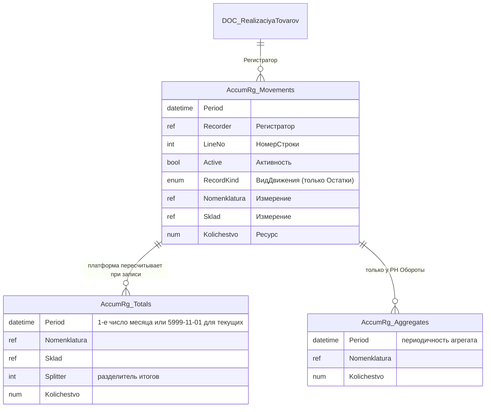
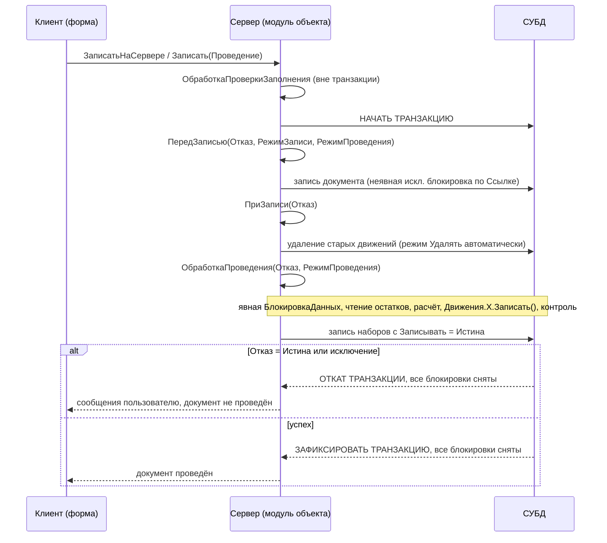
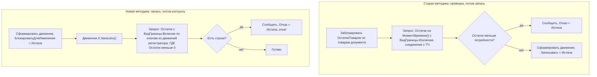
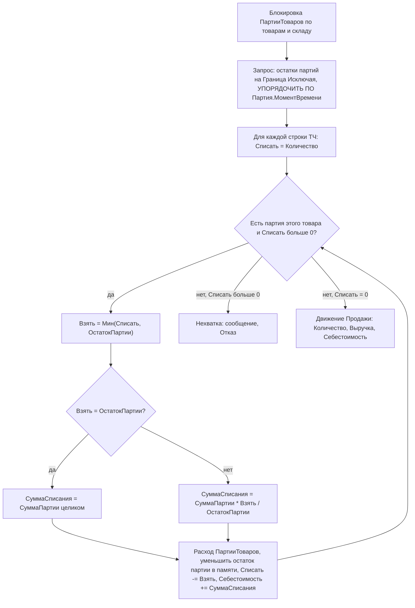

# Модуль 06. Регистры накопления и проведение

> **Объём:** 28 ак. ч · **Неделя:** 8–9 · **Источники:** [Я] спринты 01 (регистры и движения, конструктор движений), 04–05 (оперативный учёт: контроль остатков, методики, партионный учёт, себестоимость, деньги); [ПР] модуль 2 (РН «Остатки», контроль остатков через объектную и табличную модель), модуль 9 (контроль остатков, партионный учёт, себестоимость, новая методика проведения, управляемые блокировки); [ПР2] модуль 1 (методики контроля остатков, складской учёт, взаиморасчёты); [К] модули 2, 9, 10, 18 (проектирование РН, две методики проведения); [Т] модуль 6 (объектные и управляемые блокировки), модуль 4 (конструктор движений, конструктор агрегатов), модуль 12 (РН, агрегаты, итоги, оперативное проведение, последовательности)
> **Нет в источниках (написано по документации платформы/опыту):** разделение итогов; физическая структура таблиц регистра (имена таблиц СУБД); `БлокироватьДляИзменения` и передача флагов через `ДополнительныеСвойства`; объекты `МоментВремени`/`Граница` как тема; режим «Удаление движений» и отмена проведения; сопоставление с SAP MM (MATDOC/MARD/MBEW, BAPI_GOODSMVT_CREATE, ENQUEUE, update task)

## Результат модуля

- Умеете спроектировать регистр накопления (вид, измерения, ресурсы, реквизиты) под задачу и объяснить, какие физические таблицы и итоги он породит.
- Умеете писать обработку проведения в обеих методиках (старой и новой), с корректными управляемыми блокировками и контролем остатков, и объяснить, почему без блокировки контроль не работает.
- Умеете реализовать списание по партиям (ФИФО) и по средней с расчётом себестоимости и формированием движений по `ПартииТоваров` и `Продажи`.
- Понимаете оперативное/неоперативное проведение, `МоментВремени`, `Граница`, роль последовательностей и периода рассчитанных итогов.
- Умеете объяснить архитектору SAP, почему в 1С нет update task и lock-сервера, и чем за это платите.

## Карта понятий SAP → 1С

| SAP | 1С | Ключевое отличие |
|---|---|---|
| MATDOC / MSEG (строки документа материала) | Основная таблица движений регистра накопления | Движение — это не документ, а набор записей, принадлежащий **регистратору**; переписывается целиком при перепроведении |
| MARD / MCHB (запас по складу/партии) | Таблица итогов РН вида «Остатки» | Итоги хранятся помесячно + «текущие»; ведёт их платформа, а не прикладной код |
| MBEW (стоимость, V/S-цена) | РН `ПартииТоваров` (Количество + Сумма) | Нет «цены материала» как поля: себестоимость = Сумма/Количество из остатков в момент списания |
| S-таблицы LIS, обновляемые V2 | РН вида «Обороты» (`Продажи`) | Пишется синхронно в той же транзакции, что и складские движения |
| BAPI_GOODSMVT_CREATE / MB_CREATE_GOODS_MOVEMENT | `ДокументОбъект.Записать(РежимЗаписиДокумента.Проведение)` | Одна транзакция СУБД, никаких COMMIT WORK / update task |
| ENQUEUE_/DEQUEUE_ (lock-сервер, enqueue table) | `БлокировкаДанных` (управляемая блокировка) | Живёт только внутри транзакции СУБД и снимается при её завершении. Явного DEQUEUE нет |
| Сторно / отмена документа материала (MBST) | Отмена проведения / перепроведение | Движения удаляются физически, сторно-записи не создаются (если не реализовать вручную) |
| Период проводок MMPV / закрытие периода | Период рассчитанных итогов, дата запрета изменения (БСП) | ПРИ — техническая оптимизация, а не учётное закрытие |
| FIFO valuation (MRF4) | Партионный учёт ФИФО в момент списания | В 1С ФИФО — способ оценки каждого расхода, а не отдельный прогон оценки запаса |

## Теория

### 1. Регистр накопления: что это на самом деле

РН — объект метаданных для хранения **движений** числовых показателей в многомерном разрезе. Структура:

- **Измерения** — разрезы (ключ итогов): `Номенклатура`, `Склад`, `Партия`.
- **Ресурсы** — только числовые, суммируемые: `Количество`, `Сумма`.
- **Реквизиты** — описательные поля строки движения, в итогах не участвуют.
- **Стандартные реквизиты:** `Период`, `Регистратор`, `НомерСтроки`, `Активность`, а у регистра остатков ещё и `ВидДвижения` (`ВидДвиженияНакопления.Приход` / `.Расход`).

Двух видов РН достаточно для всей оперативки:

| | Остатки | Обороты |
|---|---|---|
| Смысл | Состояние, которое можно «исчерпать» (склад, долг, партия) | Поток, у которого остаток бессмыслен (продажи, затраты) |
| `ВидДвижения` | есть (Приход/Расход) | нет, запись = оборот со знаком |
| Виртуальные таблицы | `Остатки`, `Обороты`, `ОстаткиИОбороты` | только `Обороты` |
| Итоги | остатки на конец месяца + текущие | обороты |
| Агрегаты | нет | есть (вместо итогов) |

**Регистратор обязателен.** РН, в отличие от регистра сведений, не может быть «независимым»: каждая запись принадлежит документу (или другому объекту из списка регистраторов). Набор записей всегда читается и пишется целиком по отбору `Регистратор`. Это аналог «строки документа материала», но без собственного номера: идентичность движения = (Регистратор, НомерСтроки).

### 2. Физические таблицы



В СУБД (имена видны через `ПолучитьСтруктуруХраненияБазыДанных()`):

- **Таблица движений** (`_AccumRgNNN`) — все записи всех регистраторов. Прямой аналог MATDOC.
- **Таблица итогов** (`_AccumRgTNNN` для остатков, `_AccumRgTnNNN` для оборотов). Для регистра остатков хранятся остатки на начало каждого месяца до **периода рассчитанных итогов (ПРИ)** и одна строка «текущих» итогов с датой 01.11.5999. Аналог MARD, но с историей помесячных срезов.
- **Таблицы агрегатов** — только у оборотных регистров при включённом режиме агрегатов: предрассчитанные обороты по выбранным подмножествам измерений и периодичностям (аналог BW-агрегатов, только внутри OLTP-базы). Режимы итогов и агрегатов взаимоисключающие. Настройка — конструктор агрегатов. Менеджер: `УстановитьРежимАгрегатов()`, `ОбновитьАгрегаты()`, `ПерестроитьИспользованиеАгрегатов()`.

**Как считается `Остатки(&Дата)`**: берётся ближайший сохранённый срез итогов (начало месяца или текущие) и к нему досчитываются/вычитаются движения из таблицы движений за «хвост» периода. Поэтому запрос на дату внутри месяца стоит «итоги + движения за часть месяца», а запрос текущих остатков (без параметра) — только чтение таблицы итогов.

**Период рассчитанных итогов.** Если ПРИ установлен на конец марта, то при проведении документа апрелем платформа обновляет только текущие итоги, а не срезы апреля, мая и т.д. При проведении задним числом «до ПРИ» пересчитываются все срезы от даты документа до ПРИ. Регламентно ПРИ двигают вперёд (обычно до конца прошлого месяца):

```bsl
РегистрыНакопления.ОстаткиТоваров.УстановитьМаксимальныйПериодРассчитанныхИтогов(КонецМесяца(ДобавитьМесяц(ТекущаяДатаСеанса(), -1)));
```

Сопутствующие методы менеджера: `ПолучитьМаксимальныйПериодРассчитанныхИтогов()`, `УстановитьИспользованиеИтогов(Булево)`, `ПересчитатьИтоги()`, `ПересчитатьТекущиеИтоги()`. В типовых это делает регламентное задание БСП.

**Разделение итогов** (свойство регистра «Разрешить разделение итогов» + `УстановитьРазделениеИтогов(Истина)`). Проблема: два сеанса проводят расход одного товара → оба обновляют **одну и ту же строку текущих итогов** → сериализация на блокировке СУБД. Разделение итогов добавляет в таблицу итогов колонку-разделитель: каждая транзакция пишет приращение в «свою» строку, при чтении строки суммируются. Плата — чуть более дорогое чтение. Важно: разделение снимает конкуренцию только на уровне таблицы итогов. Если вы сами ставите исключительную управляемую блокировку по товару для контроля остатков, параллельности не прибавится.

### 3. Движения документа

У объекта документа есть коллекция `Движения` — по набору записей на каждый регистр, в котором документ указан регистратором.

```bsl
// Модуль объекта документа ПоступлениеТоваров
Процедура ОбработкаПроведения(Отказ, РежимПроведения)

    Движения.ОстаткиТоваров.Записывать = Истина;
    Движения.ПартииТоваров.Записывать  = Истина;

    Для Каждого СтрокаТЧ Из Товары Цикл
        Движение = Движения.ОстаткиТоваров.ДобавитьПриход();
        Движение.Период       = Дата;
        Движение.Номенклатура = СтрокаТЧ.Номенклатура;
        Движение.Склад        = Склад;
        Движение.Количество   = СтрокаТЧ.Количество;

        Движение = Движения.ПартииТоваров.Добавить();
        Движение.ВидДвижения  = ВидДвиженияНакопления.Приход; // эквивалент ДобавитьПриход()
        Движение.Период       = Дата;
        Движение.Номенклатура = СтрокаТЧ.Номенклатура;
        Движение.Склад        = Склад;
        Движение.Партия       = Ссылка;
        Движение.Количество   = СтрокаТЧ.Количество;
        Движение.Сумма        = СтрокаТЧ.Сумма;
    КонецЦикла;

КонецПроцедуры
```

Механика, которую нужно знать наизусть:

1. Набор `Движения.X` — это `РегистрНакопленияНаборЗаписей.X` с уже установленным отбором `Регистратор = Ссылка`.
2. `Записывать = Истина` — платформа запишет набор **после** выхода из `ОбработкаПроведения` (в той же транзакции). Явный `Движения.X.Записать()` пишет сразу и сбрасывает флаг `Записывать`. Это и нужно для новой методики.
3. Запись набора **замещает** все записи этого регистратора в регистре. Частичного UPDATE нет.
4. Свойство документа **«Удаление движений»**: «Удалять автоматически» — платформа удаляет старые движения перед повторным проведением и при отмене проведения. «Удалять автоматически при отмене проведения» — только при отмене. «Не удалять автоматически» — вся ответственность на вас. Для учебного проекта и почти всегда в своём коде: «Удалять автоматически».
5. Свойство набора `Записывать` у регистров, которые документ в этот раз не трогает (например, документ раньше писал в `Продажи`, а теперь нет), при «Удалять автоматически» ни на что не влияет: движения уже очищены.

Порядок событий при `Записать(РежимЗаписиДокумента.Проведение)`:



### 4. Почему нет update task (и чем за это платите)

В SAP проведение документа материала — это dialog step, который ставит ENQUEUE на материал/завод, считает, регистрирует V1-модули в update task и делает `COMMIT WORK`. Update work process пишет MATDOC/MARD/MBEW асинхронно, V2 (статистика LIS) ещё позже. Блокировки передаются update task и снимаются после V1.

В 1С всё это **одна транзакция СУБД** на сервере приложений:

- нет разделения на dialog/update — нет «документ создан, но запас ещё не обновлён»;
- нет V2 — «статистика» (`Продажи`) пишется синхронно, и её запись тоже удлиняет транзакцию;
- нет lock-сервера — управляемые блокировки держит менеджер блокировок кластера (в файловой базе — сама СУБД файлового режима), но **время их жизни = время транзакции**;
- нет `COMMIT WORK` в прикладном коде проведения — фиксирует платформа.

Плата: длинное проведение (тяжёлый запрос партий, много строк) держит блокировки на товарах всё время транзакции. Оптимизация проведения в 1С = минимизация работы **внутри** транзакции и минимизация области исключительной блокировки.

```abap
" SAP: проведение движения материала
CALL FUNCTION 'BAPI_GOODSMVT_CREATE'
  EXPORTING goodsmvt_header = ls_head goodsmvt_code = '03'
  IMPORTING materialdocument = lv_mblnr
  TABLES goodsmvt_item = lt_item return = lt_return.
CALL FUNCTION 'BAPI_TRANSACTION_COMMIT' EXPORTING wait = 'X'.
```

```bsl
// 1С: тот же эффект
ДокОбъект = Документы.РеализацияТоваров.СоздатьДокумент();
// ... заполнение
ДокОбъект.Записать(РежимЗаписиДокумента.Проведение, РежимПроведенияДокумента.Неоперативный);
// исключение = откат, иначе всё уже зафиксировано
```

### 5. Управляемые блокировки

Режим задаётся свойством конфигурации «Режим управления блокировкой данных» (Автоматический / Управляемый / Автоматический и управляемый) и может переопределяться у объектов. Новая конфигурация — только **Управляемый**: блокировки уровня СУБД остаются минимальными, а логическую согласованность обеспечивает прикладной код.

Что делает платформа сама (неявные блокировки):
- при записи объекта или набора записей — **исключительная** управляемая блокировка на записываемые данные;
- при чтении (`Запрос`, `ПолучитьОбъект()`) в управляемом режиме — **никаких** блокировок. Чтение в транзакции видит зафиксированные данные, но не мешает другим их менять.

Отсюда классическая гонка: два документа читают остаток 10, оба списывают 8, оба проходят контроль. Лечится явной блокировкой **до чтения**:

```bsl
Блокировка = Новый БлокировкаДанных;

ЭлементБлокировки = Блокировка.Добавить("РегистрНакопления.ОстаткиТоваров");
ЭлементБлокировки.Режим = РежимБлокировкиДанных.Исключительный;
ЭлементБлокировки.ИсточникДанных = Товары;            // табличная часть
ЭлементБлокировки.ИспользоватьИзИсточникаДанных("Номенклатура", "Номенклатура");
ЭлементБлокировки.УстановитьЗначение("Склад", Склад);

ЭлементБлокировки = Блокировка.Добавить("РегистрНакопления.ПартииТоваров");
ЭлементБлокировки.Режим = РежимБлокировкиДанных.Исключительный;
ЭлементБлокировки.ИсточникДанных = Товары;
ЭлементБлокировки.ИспользоватьИзИсточникаДанных("Номенклатура", "Номенклатура");
ЭлементБлокировки.УстановитьЗначение("Склад", Склад);

Блокировка.Заблокировать(); // вне транзакции — исключение
```

Совместимость режимов:

| Держит \ Хочет | Разделяемая | Исключительная |
|---|---|---|
| Разделяемая | совместимо | ждёт |
| Исключительная | ждёт | ждёт |

- Блокировка ставится на **пространство** (`"РегистрНакопления.ОстаткиТоваров"`) и значения полей (измерения регистра, для справочника/документа — `Ссылка`). Поле без значения = «все значения».
- Ожидание ограничено таймаутом (по умолчанию 20 с), затем исключение «Не удалось захватить блокировку». Взаимоблокировки определяются менеджером блокировок, одна из транзакций получает исключение.
- Блокировка, поставленная внутри вложенной «транзакции» (`НачатьТранзакцию` внутри проведения), всё равно живёт до конца **внешней** транзакции: в 1С вложенных транзакций нет, есть счётчик.
- Разделяемая блокировка нужна, когда вы читаете данные для расчёта и хотите, чтобы их не изменили до конца транзакции, но сами их не пишете (например, цены или курсы).

```abap
" ABAP: lock-объект, живёт до DEQUEUE или конца LUW (с _SCOPE)
CALL FUNCTION 'ENQUEUE_EZ_STOCK'
  EXPORTING matnr = ls_item-matnr werks = lv_werks
  EXCEPTIONS foreign_lock = 1 OTHERS = 2.
IF sy-subrc <> 0. " показать, кто держит, SM12
ENDIF.
```

Ключевые отличия от ENQUEUE: (1) нельзя «заблокировать на время редактирования в форме», для этого есть объектная блокировка `ЗаблокироватьДанныеДляРедактирования()` / `Заблокировать()` у объекта (пессимистическая, вне транзакции СУБД) и оптимистическая проверка `ВерсияДанных`; (2) нет `DEQUEUE` — снятие только концом транзакции; (3) просмотр — не SM12, а технологический журнал/консоль кластера/«Управление производительностью».

### 6. Контроль остатков: две методики



**Старая методика** нужна, когда для формирования движений **нужны остатки** (партии ФИФО, средняя себестоимость): сначала надо прочитать, затем писать. Блокировка обязательна до чтения.

```bsl
Процедура ОбработкаПроведения(Отказ, РежимПроведения)

    УстановитьБлокировкуОстатков(); // см. раздел 5

    Запрос = Новый Запрос;
    Запрос.УстановитьПараметр("МоментВремени", Новый Граница(МоментВремени(), ВидГраницы.Исключая));
    Запрос.УстановитьПараметр("Склад", Склад);
    Запрос.УстановитьПараметр("Товары", Товары.Выгрузить(, "Номенклатура, Количество"));
    Запрос.Текст =
    "ВЫБРАТЬ
    |    Т.Номенклатура КАК Номенклатура,
    |    СУММА(Т.Количество) КАК Количество
    |ПОМЕСТИТЬ ВТ_Товары
    |ИЗ
    |    &Товары КАК Т
    |СГРУППИРОВАТЬ ПО
    |    Т.Номенклатура
    |ИНДЕКСИРОВАТЬ ПО
    |    Номенклатура
    |;
    |ВЫБРАТЬ
    |    ВТ.Номенклатура КАК Номенклатура,
    |    ВТ.Количество КАК Потребность,
    |    ЕСТЬNULL(Ост.КоличествоОстаток, 0) КАК Остаток
    |ИЗ
    |    ВТ_Товары КАК ВТ
    |        ЛЕВОЕ СОЕДИНЕНИЕ РегистрНакопления.ОстаткиТоваров.Остатки(
    |                &МоментВремени,
    |                Склад = &Склад
    |                    И Номенклатура В (ВЫБРАТЬ ВТ_Товары.Номенклатура ИЗ ВТ_Товары)) КАК Ост
    |        ПО ВТ.Номенклатура = Ост.Номенклатура
    |ГДЕ
    |    ВТ.Количество > ЕСТЬNULL(Ост.КоличествоОстаток, 0)";

    Выборка = Запрос.Выполнить().Выбрать();
    Пока Выборка.Следующий() Цикл
        ОбщегоНазначения.СообщитьПользователю(СтрШаблон("Не хватает %1: требуется %2, остаток %3",
            Выборка.Номенклатура, Выборка.Потребность, Выборка.Остаток), ЭтотОбъект, , , Отказ);
    КонецЦикла;
    Если Отказ Тогда
        Возврат;
    КонецЕсли;

    // ... формирование движений
КонецПроцедуры
```

> `ОбщегоНазначения.СообщитьПользователю` — функция БСП. Без БСП: `Сообщение = Новый СообщениеПользователю; Сообщение.Текст = ...; Сообщение.Сообщить(); Отказ = Истина;`

Почему `ВидГраницы.Исключая`: при перепроведении с режимом «Удалять автоматически» старые движения документа уже удалены, но семантически вы хотите остаток **до** этого документа, не включая документы с тем же моментом времени. Параметр-дата `Дата` вместо границы включил бы все документы этой секунды, в том числе более поздние в последовательности.

**Новая методика** — когда движения можно сформировать **без чтения остатков** (`ОстаткиТоваров`: просто расход количества из ТЧ). Записываем, потом проверяем, не ушёл ли остаток в минус:

```bsl
Процедура ОбработкаПроведения(Отказ, РежимПроведения)

    Движения.ОстаткиТоваров.БлокироватьДляИзменения = Истина;
    Для Каждого СтрокаТЧ Из Товары Цикл
        Движение = Движения.ОстаткиТоваров.ДобавитьРасход();
        Движение.Период       = Дата;
        Движение.Номенклатура = СтрокаТЧ.Номенклатура;
        Движение.Склад        = Склад;
        Движение.Количество   = СтрокаТЧ.Количество;
    КонецЦикла;
    Движения.ОстаткиТоваров.Записать();

    Запрос = Новый Запрос;
    Запрос.УстановитьПараметр("Регистратор", Ссылка);
    Запрос.УстановитьПараметр("МоментВремени", Новый Граница(МоментВремени(), ВидГраницы.Включая));
    Запрос.Текст =
    "ВЫБРАТЬ
    |    Ост.Номенклатура КАК Номенклатура,
    |    Ост.Склад КАК Склад,
    |    -Ост.КоличествоОстаток КАК Нехватка
    |ИЗ
    |    РегистрНакопления.ОстаткиТоваров.Остатки(
    |            &МоментВремени,
    |            (Номенклатура, Склад) В
    |                (ВЫБРАТЬ
    |                    Д.Номенклатура,
    |                    Д.Склад
    |                ИЗ
    |                    РегистрНакопления.ОстаткиТоваров КАК Д
    |                ГДЕ
    |                    Д.Регистратор = &Регистратор)) КАК Ост
    |ГДЕ
    |    Ост.КоличествоОстаток < 0";

    Выборка = Запрос.Выполнить().Выбрать();
    Пока Выборка.Следующий() Цикл
        ОбщегоНазначения.СообщитьПользователю(СтрШаблон("Не хватает %1 на складе %2: %3",
            Выборка.Номенклатура, Выборка.Склад, Выборка.Нехватка), ЭтотОбъект, , , Отказ);
    КонецЦикла;

КонецПроцедуры
```

Почему это корректно при конкуренции: `БлокироватьДляИзменения = Истина` заставляет платформу при записи набора поставить исключительную управляемую блокировку по значениям измерений записываемых строк, а не только по регистратору. Второй документ с тем же товаром ждёт на своей записи до фиксации первого и потом читает уже итоговый остаток. Без флага пришлось бы ставить ту же блокировку явно через `БлокировкаДанных` перед `Записать()`.

Плюсы новой методики: блокировка ставится позже и держится меньше; не нужно читать остатки до записи; один запрос контроля вместо соединения с ТЧ. Минус: контролируются **все** ключи документа, даже те, по которым остаток стал меньше нуля не из-за этого документа (например, ушёл в минус раньше при неоперативном проведении задним числом). Типовые конфигурации (УТ 11, ERP) поэтому контролируют только **изменение**: модуль набора записей в `ПередЗаписью` запоминает старые движения регистратора во временной таблице, в `ПриЗаписи` вычисляет разницу «новые − старые» и кладёт таблицу изменений в `МенеджерВременныхТаблиц`, переданный через `ДополнительныеСвойства` набора. Запрос контроля соединяется с этой таблицей. Флаги («нужен контроль», «режим проведения») туда же передаются через `ДополнительныеСвойства` документа → набора:

```bsl
// в документе перед записью набора
Движения.ОстаткиТоваров.ДополнительныеСвойства.Вставить("КонтрольОстатков", Истина);

// модуль набора записей РегистрНакопления.ОстаткиТоваров
Процедура ПередЗаписью(Отказ, Замещение)
    Если ОбменДанными.Загрузка Тогда
        Возврат;
    КонецЕсли;
    Если ДополнительныеСвойства.Свойство("КонтрольОстатков") Тогда
        // запомнить старые движения Отбор.Регистратор.Значение во временной таблице
    КонецЕсли;
КонецПроцедуры
```

Когда какую методику: если движения регистра можно сформировать без чтения этого же регистра — новая; если нужны остатки (партии, средняя себестоимость, взаимозачёт авансов) — старая для этого регистра. В одном документе методики комбинируются: `ОстаткиТоваров` по новой, `ПартииТоваров` по старой.

### 7. Партионный учёт и себестоимость

`ПартииТоваров` (остатки): измерения `Номенклатура`, `Склад`, `Партия` (`ДокументСсылка.ПоступлениеТоваров`); ресурсы `Количество`, `Сумма`. Способ списания — константа `СпособСписанияСебестоимости` (перечисление `СпособыСписания`: `ФИФО`, `Средняя`).

**ФИФО.** Для каждой строки расхода списываем партии в порядке их момента времени:



```bsl
Процедура СписатьПартииФИФО(Отказ)

    Запрос = Новый Запрос;
    Запрос.УстановитьПараметр("МоментВремени", Новый Граница(МоментВремени(), ВидГраницы.Исключая));
    Запрос.УстановитьПараметр("Склад", Склад);
    Запрос.УстановитьПараметр("СписокНоменклатуры", Товары.ВыгрузитьКолонку("Номенклатура"));
    Запрос.Текст =
    "ВЫБРАТЬ
    |    П.Номенклатура КАК Номенклатура,
    |    П.Партия КАК Партия,
    |    П.КоличествоОстаток КАК Количество,
    |    П.СуммаОстаток КАК Сумма
    |ИЗ
    |    РегистрНакопления.ПартииТоваров.Остатки(
    |            &МоментВремени,
    |            Склад = &Склад И Номенклатура В (&СписокНоменклатуры)) КАК П
    |ГДЕ
    |    П.КоличествоОстаток > 0
    |УПОРЯДОЧИТЬ ПО
    |    П.Партия.МоментВремени";
    Партии = Запрос.Выполнить().Выгрузить(); // порядок строк сохраняется

    Движения.ПартииТоваров.Записывать = Истина;
    Движения.Продажи.Записывать = Истина;

    Для Каждого СтрокаТЧ Из Товары Цикл
        Списать = СтрокаТЧ.Количество;
        Себестоимость = 0;
        Для Каждого Партия Из Партии.НайтиСтроки(Новый Структура("Номенклатура", СтрокаТЧ.Номенклатура)) Цикл
            Если Списать = 0 Тогда
                Прервать;
            КонецЕсли;
            Если Партия.Количество = 0 Тогда
                Продолжить;
            КонецЕсли;
            Взять = Мин(Списать, Партия.Количество);
            СуммаСписания = ?(Взять = Партия.Количество, Партия.Сумма,
                Окр(Партия.Сумма * Взять / Партия.Количество, 2));

            Движение = Движения.ПартииТоваров.ДобавитьРасход();
            Движение.Период       = Дата;
            Движение.Номенклатура = СтрокаТЧ.Номенклатура;
            Движение.Склад        = Склад;
            Движение.Партия       = Партия.Партия;
            Движение.Количество   = Взять;
            Движение.Сумма        = СуммаСписания;

            Партия.Количество = Партия.Количество - Взять; // строка ТЗ — общая для всех строк ТЧ
            Партия.Сумма      = Партия.Сумма - СуммаСписания;
            Списать       = Списать - Взять;
            Себестоимость = Себестоимость + СуммаСписания;
        КонецЦикла;

        Если Списать > 0 Тогда
            ОбщегоНазначения.СообщитьПользователю(СтрШаблон("Не хватает партий %1: %2",
                СтрокаТЧ.Номенклатура, Списать), ЭтотОбъект, , , Отказ);
            Продолжить;
        КонецЕсли;

        Движение = Движения.Продажи.Добавить();
        Движение.Период        = Дата;
        Движение.Номенклатура  = СтрокаТЧ.Номенклатура;
        Движение.Контрагент    = Контрагент;
        Движение.Количество    = СтрокаТЧ.Количество;
        Движение.Выручка       = СтрокаТЧ.Сумма;
        Движение.Себестоимость = Себестоимость;
    КонецЦикла;

КонецПроцедуры
```

Тонкие места:
- Остаток партии уменьшается **в памяти** (строка ТЗ), потому что в ТЧ может быть два раза один товар. Альтернатива — свернуть ТЧ по номенклатуре до расчёта.
- Полное списание партии забирает **всю** сумму, а не цену×количество: иначе копеечные «хвосты» сумм при нулевом количестве. Это главная ошибка на экзамене «Специалист».
- `УПОРЯДОЧИТЬ ПО П.Партия.МоментВремени` — упорядочивание по виртуальному полю документа (дата + ссылка), а не по `Партия.Дата`: у двух поступлений с одной датой-временем порядок должен быть детерминирован.
- ЛИФО = та же процедура с `УБЫВ`.

**По средней.** Себестоимость = `СуммаОстаток / КоличествоОстаток × Количество` по ключу (Номенклатура, Склад). В учебном проекте при способе «Средняя» `ПоступлениеТоваров` пишет пустую `Партия`, тогда ключ партии один, и алгоритм вырождается в «одна партия»: тот же код ФИФО даёт среднюю. Смена способа списания посреди периода ломает данные — способ меняют только с начала периода с документом-«переносом» остатков.

**Перемещение** (`ПеремещениеТоваров`): расход партий со склада-отправителя (ФИФО/средняя) и приход **тех же партий с теми же суммами** на склад-получатель. Себестоимость при перемещении не меняется.

**Проведение задним числом.** Если провести поступление задним числом, ранее проведённые списания остаются со старой себестоимостью. Корректно — перепровести все документы после него. Для этого есть последовательности (раздел 10) или в типовых — отдельный механизм расчёта себестоимости регламентной операцией. Аналог в SAP — переоценка, Material Ledger, «actual costing».

### 8. Взаиморасчёты

`Взаиморасчеты` (остатки): `Контрагент`, `Договор`; ресурс `Сумма`. Соглашение о знаке (зафиксируйте в комментарии регистра!): **плюс = долг контрагента нам**.

| Документ | Вид движения | Смысл |
|---|---|---|
| `РеализацияТоваров` | Приход | покупатель должен нам |
| `ОплатаОтПокупателя` | Расход | долг покупателя уменьшился |
| `ПоступлениеТоваров` | Расход | мы должны поставщику (остаток уходит в минус) |
| `ОплатаПоставщику` | Приход | наш долг уменьшился |

Контроль остатка здесь не нужен: отрицательный остаток = кредиторка, переплата = аванс. Регистр остатков **не запрещает** минус, минус — просто число. Это отличие от SAP FI-AR/AP, где дебитор и кредитор — разные подкниги (BSID/BSIK, в S/4 — ACDOCA с KOART). В 1С это один регистр, знак несёт смысл. Если нужен раздельный учёт авансов (как спецГК в SAP), добавляют измерение «ТипРасчетов» или разносят по документам расчётов (аналог открытых позиций с выравниванием).

### 9. Оперативное и неоперативное проведение, МоментВремени, Граница

Свойство документа «Оперативное проведение: Разрешить» включает различие режимов:

- **Оперативный** (`РежимПроведенияДокумента.Оперативный`) — документ проводится текущим днём. Платформа ставит ему время, равное текущему, и он оказывается **последним** в последовательности документов. Значит, остатки на его момент = **текущие** остатки, и их можно читать без параметра периода: `ОстаткиТоваров.Остатки(, Условие)` — только таблица итогов, самый быстрый вариант.
- **Неоперативный** — документ задним числом. Читаем остатки на `МоментВремени()`. Документ с датой в будущем нельзя провести оперативно.

```bsl
Если РежимПроведения = РежимПроведенияДокумента.Оперативный Тогда
    Период = Неопределено; // текущие итоги
Иначе
    Период = Новый Граница(МоментВремени(), ВидГраницы.Исключая);
КонецЕсли;
Запрос.УстановитьПараметр("МоментВремени", Период);
```

Учётная политика из опыта типовых: оперативный контроль остатков выполнять **только при оперативном** проведении, а при неоперативном (перепроведение задним числом) — не блокировать пользователя, а ставить отложенную проверку (последовательность, отчёт об отрицательных остатках).

- `МоментВремени` — пара (Дата, Ссылка). Метод `ДокументОбъект.МоментВремени()`, поле `Документ.МоментВремени` в запросах. Однозначно упорядочивает документы с одинаковой датой (по ссылке).
- `Граница(Значение, ВидГраницы)` — значение `Дата` или `МоментВремени` + `Включая`/`Исключая`. Виртуальные таблицы принимают `Дата`, `МоментВремени` или `Граница`. Голый `МоментВремени` трактуется как «исключая».

```mermaid
gantt
    dateFormat HH:mm
    axisFormat %H:%M
    title Документы одного дня и граница чтения остатков
    section Документы
    Поступление в 10-00                    :done, a1, 10:00, 5m
    Реализация в 12-00, текущий документ   :active, a2, 12:00, 5m
    Реализация в 12-00, большая ссылка     :a3, 12:00, 5m
    Перемещение в 15-00                    :a4, 15:00, 5m
```



Для текущего документа `Граница(МоментВремени(), Исключая)` включает поступление 10:00, но не включает реализацию с тем же временем, но большей ссылкой, и перемещение 15:00. Параметр `Дата` = 12:00 включил бы обе реализации 12:00.

### 10. Последовательности документов (кратко)

Объект метаданных **Последовательность**: список входящих документов, измерения (например `Номенклатура`, `Склад`) и движения, влияющие на последовательность. Платформа хранит **границу** — момент времени, до которого документы проведены в правильном порядке. При перепроведении документа задним числом граница по его измерениям сдвигается назад. Регламентная операция «восстановление последовательности» перепроводит документы от границы и двигает её вперёд. Менеджер последовательности имеет методы получения/установки границы и восстановления (`ПолучитьГраницу`, `УстановитьГраницу`, `Восстановить`). В современных типовых (УТ 11/ERP) последовательности заменены собственными механизмами «заданий к расчёту себестоимости», но для экзамена «Специалист» и небольших решений механизм актуален.

### 11. Отмена проведения

`Записать(РежимЗаписиДокумента.ОтменаПроведения)` → событие `ОбработкаУдаленияПроведения(Отказ)` → при «Удалять автоматически» платформа удаляет движения по всем регистрам. Контроль остатков при отмене (отмена поступления может увести остаток в минус) платформа **не делает**. Его нужно писать в `ОбработкаУдаленияПроведения` по той же новой методике: зафиксировать удаление набора (`Движения.ОстаткиТоваров.Записать()` с пустым набором и `БлокироватьДляИзменения`) и проверить остатки по ключам удалённых записей. Ключи нужно прочитать **до** удаления. Пометка на удаление проведённого документа сначала отменяет проведение.

## Ловушки для ABAP-разработчика

1. **Чтение без блокировки = нет гарантий.** В управляемом режиме запрос ничего не блокирует. Привычка «ENQUEUE уже стоит, раз я в транзакции» здесь не работает: `БлокировкаДанных` до чтения или `БлокироватьДляИзменения` до записи.
2. **Ждать `DEQUEUE` бесполезно.** Блокировку не снять раньше конца транзакции. Тяжёлые вычисления (выборки на сотни тысяч строк, HTTP-вызовы!) внутри `ОбработкаПроведения` держат склад заблокированным.
3. **`Дата` вместо `МоментВремени()` в параметре остатков.** Документы с одинаковым временем «видят» друг друга, что даёт двойное списание партии.
4. **Цена×количество при полном списании партии** оставляет суммовые «хвосты» при нулевом количестве. Остаток суммы забирается целиком.
5. **`Записывать = Истина` + явный `Записать()`** для одного набора: если после `Записать()` добавить строки и снова выставить `Записывать`, набор перезапишется второй раз. Держите одну стратегию на набор.
6. **Минус в регистре остатков не ошибка платформы.** Платформа не знает, что остаток не может быть отрицательным. Контроль — только ваш код (в отличие от SAP с проверкой отрицательных запасов в настройке).
7. **Регистратор в отборе.** Если писать набор вне документа (`РегистрыНакопления.X.СоздатьНаборЗаписей()`), не установив `Отбор.Регистратор`, запись невозможна или затронет не то. Набор РН всегда принадлежит регистратору.
8. **Агрегаты не ускоряют `Остатки`.** Агрегаты есть только у оборотных регистров. Для регистров остатков нужны правильные итоги, ПРИ и разделение итогов.
9. **Отмена проведения без контроля.** Отмена поступления после продажи уводит склад в минус молча.
10. **Двойное перепроведение типовых.** «Удалять автоматически» стирает движения до `ОбработкаПроведения`. Код, который хочет «сравнить с тем, что было», должен читать старые движения в `ПередЗаписью` документа, а не в `ОбработкаПроведения`.

## Практика (сквозной проект)

### M06-T1. Регистры накопления проекта
Создайте `ОстаткиТоваров`, `ПартииТоваров`, `Взаиморасчеты` (остатки), `Продажи` (обороты) по справочнику метаданных, перечисление `СпособыСписания` и константу `СпособСписанияСебестоимости`. Документы `ПеремещениеТоваров`, `ОплатаПоставщику`, `ОплатаОтПокупателя`.
- [ ] Измерения/ресурсы/типы точно по README проекта, `Партия` — `ДокументСсылка.ПоступлениеТоваров`.
- [ ] У всех документов «Удаление движений» = «Удалять автоматически», оперативное проведение у `РеализацияТоваров` и `ПеремещениеТоваров` разрешено.
- [ ] Режим блокировок конфигурации — «Управляемый».
- **Самопроверка:** `ПолучитьСтруктуруХраненияБазыДанных()` в консоли кода — найдите таблицы движений и итогов `ОстаткиТоваров` и агрегатов `Продажи` (после M06-T7). Запишите имена в `checks/M06-T1.txt`.

### M06-T2. Проведение поступления и оплат
`ПоступлениеТоваров` → `ОстаткиТоваров`, `ПартииТоваров`, `Взаиморасчеты`. `ОплатаПоставщику`/`ОплатаОтПокупателя` → `Взаиморасчеты`.
- [ ] Знаки по таблице раздела 8, комментарий в свойствах регистра.
- [ ] При способе «Средняя» `Партия` пустая.
- **Самопроверка:** `checks/M06-T2.sql.txt` — `Взаиморасчеты.ОстаткиИОбороты` по контрагенту за период, после поступления на 1000 и оплаты 400 конечный остаток −600.

### M06-T3. Реализация: контроль остатков по старой методике
- [ ] Явная `БлокировкаДанных` по `ОстаткиТоваров` (Номенклатура из ТЧ, Склад) до запроса.
- [ ] Остатки читаются на `Граница(МоментВремени(), Исключая)`, при оперативном проведении — текущие.
- [ ] Повторяющаяся номенклатура в ТЧ сворачивается.
- **Самопроверка:** сценарий: остаток 10, документ со строками 6 и 6 одного товара → отказ с одним сообщением о нехватке 2.

### M06-T4. Новая методика для ОстаткиТоваров
Переведите контроль `ОстаткиТоваров` в `РеализацияТоваров` и `ПеремещениеТоваров` на «запись → контроль».
- [ ] `БлокироватьДляИзменения = Истина`, явный `Записать()`, запрос с `Граница(..., Включая)` и подзапросом по `Регистратор`.
- [ ] Сообщения привязаны к документу.
- **Самопроверка (гонка):** две сессии (два клиента), в обеих открыта реализация на 8 шт. при остатке 10. В отладчике остановитесь после `Записать()` в первой, проведите вторую — она должна ждать, затем отказать. Повторите с `БлокироватьДляИзменения = Ложь` и опишите разницу в `checks/M06-T4.txt`.

### M06-T5. Партии ФИФО и по средней, РН Продажи
- [ ] `РеализацияТоваров` списывает `ПартииТоваров` по константе способа, пишет `Продажи` с себестоимостью.
- [ ] `ПеремещениеТоваров` переносит партии с суммами.
- [ ] Полное списание партии обнуляет и количество, и сумму.
- **Самопроверка:** запрос `checks/M06-T5.sql.txt`: `ПартииТоваров.Остатки` ГДЕ `КоличествоОстаток = 0 И СуммаОстаток <> 0` — пусто. Тест YAxUnit (или ручной сценарий): поступления 10 по 100 и 10 по 120, реализация 15 → себестоимость 1600 (ФИФО) и 1650 (средняя).

### M06-T6. Отмена проведения с контролем
- [ ] Отмена `ПоступлениеТоваров`, после которой остаток ушёл бы в минус, отклоняется.
- **Самопроверка:** поступление 10, реализация 8, отмена поступления → отказ, движения не изменились.

### M06-T7. Итоги и агрегаты
- [ ] Обработка «Обслуживание итогов»: показывает ПРИ каждого РН проекта, двигает ПРИ на конец прошлого месяца, включает разделение итогов для `ОстаткиТоваров`.
- [ ] Для `Продажи` конструктором агрегатов создан агрегат (Номенклатура, месяц), режим агрегатов включён, агрегаты заполнены.
- **Самопроверка:** замер производительности: отчёт продаж по месяцам до/после включения агрегатов.

### M06-T8* (со звёздочкой). Контроль только изменений
Реализуйте контроль `ОстаткиТоваров` «как в УТ 11»: модуль набора записей вычисляет таблицу изменений (новые − старые движения регистратора) и передаёт её через `ДополнительныеСвойства` в `МенеджерВременныхТаблиц`. Документ контролирует только ключи с уменьшившимся остатком.
- [ ] Перепроведение документа без изменений при уже отрицательном остатке (созданном задним числом) **не** даёт отказа.
- [ ] Увеличение количества в строке при отрицательном остатке даёт отказ.
- **Самопроверка:** два сценария выше как тесты YAxUnit (модуль 14) либо описанные шаги в `checks/M06-T8.txt`.

## Контрольные вопросы

1. Чем РН «Остатки» отличается от «Обороты» по набору виртуальных таблиц, полю `ВидДвижения` и способу хранения итогов? Почему у оборотного есть агрегаты, а у остатков нет?
2. Как вычисляется `Остатки(&Дата)` на 15-е число месяца, если ПРИ — конец прошлого месяца? Какие таблицы читаются?
3. Что такое разделение итогов, какую конкуренцию оно снимает и какую нет?
4. Опишите порядок событий при проведении документа и момент записи наборов с `Записывать = Истина`. Что происходит с движениями при режиме «Удалять автоматически»?
5. Почему в управляемом режиме блокировок контроль остатков без явной блокировки некорректен? Опишите сценарий двух сеансов.
6. Старая и новая методика: когда какая, где ставится блокировка, какой `ВидГраницы` используется при чтении остатков и почему?
7. Почему при полном списании партии сумма списывается целиком? Что будет, если сортировать партии по `Партия.Дата`?
8. Чем оперативное проведение отличается от неоперативного? Почему при оперативном можно читать текущие итоги?
9. Сравните `БлокировкаДанных` и ENQUEUE: время жизни, снятие, область, просмотр активных блокировок.
10. Почему в 1С нет аналога V1/V2 update task, и как это влияет на проектирование «статистических» регистров вроде `Продажи`?

## Документация

- Документация платформы 8.3 (Руководство разработчика, разделы «Регистры накопления», «Блокировки данных»): https://its.1c.ru/db/v83doc
- Методическая поддержка разработчиков (методики проведения, блокировки, итоги): https://its.1c.ru/db/metod8dev
- Стандарты и методики разработки: https://its.1c.ru/db/v8std
- Библиотека стандартных подсистем (`ОбщегоНазначения`, даты запрета изменения): https://its.1c.ru/db/bsp
- Сайт платформы: https://v8.1c.ru
- Стенд: [lab](../lab/README.md); связанные модули: [модуль 04](04-queries.md) (виртуальные таблицы), [модуль 08](08-accounting.md), [модуль 12](12-jobs-bp-admin-performance.md) (производительность, блокировки в кластере)
