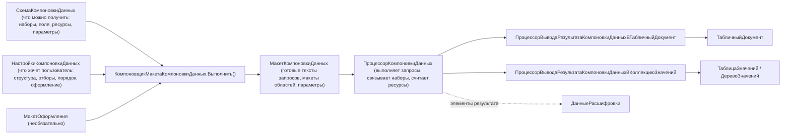
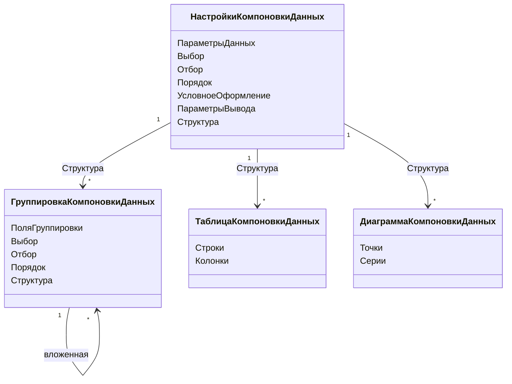
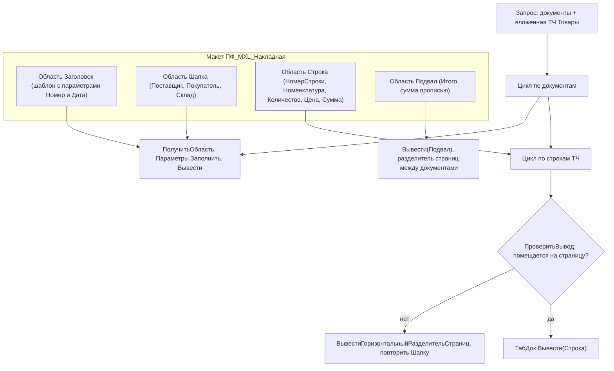

# Модуль 07. Отчёты на СКД и печатные формы

> **Объём:** 18 ак. ч · **Неделя:** 10 · **Источники:** [Я] спринты 01 (конструктор печатных форм), 03 (СКД), 05 (финансовые отчёты, визуализация данных, внешние отчёты), 10 (внешние отчёты и внешние печатные формы), 12 (доработка печатных форм); [ПР] модуль 3 (запрос как источник данных для СКД), модуль 7 (СКД: варианты, пользовательские настройки, внешние отчёты), модуль 8 (СКД во встроенном языке, макеты оформления); [ПР2] модуль 1 (отчёты на СКД), модуль 2 (печатные формы: макет, области, параметры, шаблоны, макет в СКД); [К] модули 4, 7, 8, 10, 11; [Т] модуль 4 (конструктор печати, макета, СКД), модуль 10 (диаграммы), модуль 11 (механизмы построения отчётности)
> **Нет в источниках (написано по документации платформы/опыту):** характеристики в СКД; набор данных «объект» (внешние наборы данных); вывод результата компоновки в коллекцию значений; подсистема «Печать» БСП (`УправлениеПечатью`); сопоставление с ALV/SALV, CDS analytical query, SmartForms/Adobe Forms

## Результат модуля

- Умеете собрать отчёт на СКД: наборы данных (запрос, объединение, объект), связи наборов, вычисляемые поля, ресурсы, параметры, варианты и пользовательские настройки.
- Умеете программно выполнить компоновку: схема → настройки → макет компоновки → процессор → вывод в табличный документ или таблицу значений, и вмешаться в любой шаг.
- Понимаете, где выполняется каждая стадия (СУБД, сервер), и почему СКД не «ALV поверх SELECT», а генератор запроса.
- Умеете сделать печатную форму на макете табличного документа (области, параметры, шаблоны) с командой печати и внешнюю печатную форму/отчёт.

## Карта понятий SAP → 1С

| SAP | 1С | Ключевое отличие |
|---|---|---|
| ALV (CL_SALV_TABLE, layout variants) | Отчёт на СКД + варианты + пользовательские настройки | СКД строит **запрос** под настройки (поля, отборы, группировки идут в SQL). ALV сортирует и фильтрует уже выбранную внутреннюю таблицу |
| ALV layout / variant (/DEFAULT, user-specific) | Вариант отчёта + пользовательские настройки (хранилище настроек) | Варианты хранятся в схеме (предопределённые) или в хранилище вариантов отчётов (БСП) |
| Selection screen (PARAMETERS, SELECT-OPTIONS) | Параметры данных и отборы компоновки, «быстрые» пользовательские настройки | Экран выбора генерируется из настроек, отдельного кода PBO/PAI нет |
| CDS analytical query (@Analytics.query, measures, dimensions) | Схема компоновки: поля, ресурсы, иерархические группировки | Ресурс СКД — агрегат, вычисляемый на каждом уровне группировки (как measure с exception aggregation) |
| CDS association / JOIN в разных источниках | Связи наборов данных | Связь — LEFT JOIN, выполняемый **процессором СКД** на сервере 1С, если наборы — разные источники |
| Hotspot / drill-down (ALV events) | Расшифровка (`ДанныеРасшифровкиКомпоновкиДанных`) | Стандартная расшифровка в другой отчёт/объект «из коробки» |
| SmartForms / Adobe Forms (form + print program) | Макет табличного документа + процедура `Печать` в модуле менеджера | Нет отдельного рантайма форм: печатная форма — просто `ТабличныйДокумент`, собранный кодом из областей |
| Output determination (NACE, condition records) | Команды печати объекта / подсистема «Печать» БСП | Состав печатных форм определяет код (или БСП), а не настраиваемые condition records |

## Теория

### 1. Архитектура СКД: конвейер

СКД — это не «отчётник», а **конвейер из четырёх объектов**. Каждый можно создавать и подменять программно.



Ключевая идея: **компоновщик макета переписывает запрос набора** под настройки. Если пользователь не выбрал поле — оно не попадёт в `ВЫБРАТЬ`. Если поставил отбор по полю — отбор уйдёт в `ГДЕ` (или в параметры виртуальной таблицы, если это разрешено). Поэтому:
- запрос в наборе пишется «максимальным»: все поля, которые могут понадобиться;
- лишние соединения не стоят ничего, если их поля не выбраны (компоновщик их выкидывает, если включено «Автозаполнение»/оптимизация);
- отборы, поставленные пользователем, оптимизируются, только если поле **доступно для отбора** в нужном месте запроса.

Сравнение с ALV: в SALV вы сначала `SELECT ... INTO TABLE`, а потом отдаёте таблицу. ALV-фильтр работает по памяти. В СКД пользовательский фильтр по складу превращается в `ГДЕ Склад = &П1` в СУБД (а для виртуальной таблицы — в её параметр `Условие`).

### 2. Схема компоновки данных

#### 2.1. Наборы данных

| Тип набора | Источник | Типичное применение |
|---|---|---|
| **Запрос** | язык запросов + расширение СКД (`{ }`) | 95% отчётов |
| **Объект** | внешняя коллекция (`ТаблицаЗначений`), переданная в `ПроцессорКомпоновкиДанных.Инициализировать()` через структуру внешних наборов | данные из HTTP/файла/расчёта, которые не получить запросом |
| **Объединение** | несколько вложенных наборов, результат — UNION ALL по одноимённым полям | план+факт из разных регистров |

Расширение языка запросов для СКД:

```bsl
ВЫБРАТЬ
    Продажи.Номенклатура КАК Номенклатура,
    Продажи.Контрагент КАК Контрагент,
    Продажи.Период КАК Период,
    Продажи.КоличествоОборот КАК Количество,
    Продажи.ВыручкаОборот КАК Выручка,
    Продажи.СебестоимостьОборот КАК Себестоимость
{ВЫБРАТЬ
    Номенклатура.*,
    Контрагент.*,
    Период,
    Количество,
    Выручка,
    Себестоимость}
ИЗ
    РегистрНакопления.Продажи.Обороты(&НачалоПериода, &КонецПериода, Авто, ) КАК Продажи
{ГДЕ
    Продажи.Номенклатура.*,
    Продажи.Контрагент.*}
```

- `{ВЫБРАТЬ}`, `{ГДЕ}` — какие поля доступны пользователю для выбора/отбора. `.*` — разрешить «через точку» реквизиты.
- `Авто` как периодичность виртуальной таблицы — СКД подставит нужную по группировкам (День/Месяц/…), если выбраны поля `ПериодДень`, `ПериодМесяц`.
- `&НачалоПериода`, `&КонецПериода` автоматически становятся параметрами схемы. Обычно добавляют параметр `Период` типа `СтандартныйПериод` и выражения `&Период.ДатаНачала`, `&Период.ДатаОкончания` у этих параметров.
- Параметры виртуальных таблиц, указанные как `{(&П)}`, и поля в фигурных скобках позволяют СКД переносить пользовательские отборы внутрь параметров виртуальной таблицы.
- Флаг «Автозаполнение» набора: поля схемы создаются из запроса автоматически. Отключают, когда нужно полностью управлять ролями полей.

#### 2.2. Связи наборов

Связь «источник → приёмник» по выражениям = **LEFT JOIN, выполняемый процессором компоновки**, а не СУБД. Использовать, когда наборы действительно разнородные (запрос + объект; два запроса с разной детализацией, которые нельзя соединить без размножения строк). Внутри одного запроса соединяйте в запросе — это дешевле.

Связь можно параметризовать: поле источника передаётся в параметр приёмника («Параметр» в связи) — тогда для каждой строки источника приёмник **выполняется заново**. Это N+1 запросов, аналог SELECT в LOOP — только для малых источников.

#### 2.3. Вычисляемые поля и ресурсы

- **Вычисляемое поле** — выражение на **языке выражений СКД** (не язык запросов и не встроенный язык): арифметика, `ВЫБОР`, функции `ЕстьNULL`, `Формат`, `ВычислитьВыражение`, функции общих модулей (если разрешено). Вычисляется процессором на сервере после получения данных.
- **Ресурс** — поле с агрегатным выражением, которое считается на **каждом** уровне группировки: `Сумма(Выручка)`, `Среднее(...)`, `Максимум(...)`, `Количество(Различные Номенклатура)`. Ресурс можно ограничить группировками («Рассчитывать по»).

Маржа как ресурс (не как вычисляемое поле — иначе на итоговых строках просуммируется процент):

```text
Ресурс Маржа:          Сумма(Выручка) - Сумма(Себестоимость)
Ресурс РентабельностьПроцент:
    ВЫБОР КОГДА Сумма(Себестоимость) = 0 ТОГДА 0
         ИНАЧЕ (Сумма(Выручка) - Сумма(Себестоимость)) / Сумма(Себестоимость) * 100 КОНЕЦ
Ресурс ДоляВыручки:    Сумма(Выручка) / ВычислитьВыражение("Сумма(Выручка)", "ОбщийИтог") * 100
```

Это прямой аналог measure с exception aggregation в CDS analytical query: формула применяется к агрегатам уровня, а не агрегируется сама.

#### 2.4. Параметры

Параметр схемы: тип, значение по умолчанию, «Включать в доступные поля», «Ограничение доступности» (скрыт от пользователя), «Доступен список значений», выражение (вычисление из других параметров). Программно:

```bsl
Настройки.ПараметрыДанных.УстановитьЗначениеПараметра("Период", Новый СтандартныйПериод(ВариантСтандартногоПериода.ЭтотМесяц));
```

#### 2.5. Характеристики

Вкладка «Характеристики» (или конструкция `ХАРАКТЕРИСТИКИ` в запросе набора) подключает **динамические поля** из ПВХ + регистр/табличная часть значений: каждое значение ПВХ становится полем отчёта, доступным для выбора и отбора. Это механизм для «дополнительных реквизитов» (БСП) и свойств номенклатуры. Аналог в SAP — характеристики классификации (CLF/AUSP), которые в ALV пришлось бы разворачивать вручную. ПВХ — [модуль 08](08-accounting.md).

### 3. Настройки и варианты

Настройки (`НастройкиКомпоновкиДанных`) — это то, что пользователь видит в окне «Настройки»:



- **Структура** — дерево группировок, таблиц (кросс-таблица, строки×колонки) и диаграмм. Группировка без полей = детальные записи.
- **Отбор** на уровне настроек уходит в запрос. Отбор на уровне группировки фильтрует **уже сгруппированные** строки (аналог HAVING по ресурсам).
- **Условное оформление** — правила «отбор → оформление (цвет, шрифт, формат) → поля».
- **Параметры вывода** — заголовок, расположение итогов, «Выводить отбор», макет оформления и т.д.
- **Варианты отчёта** — именованные наборы настроек в схеме (предопределённые). Пользовательские варианты сохраняются в хранилище вариантов отчётов, в типовых — подсистема «Варианты отчётов» БСП.
- **Пользовательские настройки** — подмножество настроек, отмеченных «Включать в пользовательские настройки» (быстрые — прямо на форме отчёта, обычные — в окне). Это ваш selection screen: что вынесено, то пользователь и меняет, не открывая полный редактор.

`КомпоновщикНастроекКомпоновкиДанных` связывает схему (доступные поля), настройки варианта и пользовательские настройки. У формы отчёта он есть как реквизит `Отчет.КомпоновщикНастроек`.

### 4. Программная работа с СКД

#### 4.1. Стандартная форма отчёта с вмешательством

Если у отчёта задана «Основная схема компоновки данных», платформа сама строит форму и вызывает компоновку. Перехват — в модуле объекта отчёта:

```bsl
Процедура ПриКомпоновкеРезультата(ДокументРезультат, ДанныеРасшифровки, СтандартнаяОбработка)

    СтандартнаяОбработка = Ложь;

    Настройки = КомпоновщикНастроек.ПолучитьНастройки(); // вариант + пользовательские
    // параметр, который пользователь не задаёт, заполняем сами
    Настройки.ПараметрыДанных.УстановитьЗначениеПараметра("ТекущаяДата", ТекущаяДатаСеанса());

    КомпоновщикМакета = Новый КомпоновщикМакетаКомпоновкиДанных;
    МакетКомпоновки = КомпоновщикМакета.Выполнить(СхемаКомпоновкиДанных, Настройки, ДанныеРасшифровки);

    ПроцессорКомпоновки = Новый ПроцессорКомпоновкиДанных;
    ПроцессорКомпоновки.Инициализировать(МакетКомпоновки, , ДанныеРасшифровки, Истина);

    ДокументРезультат.Очистить();
    ПроцессорВывода = Новый ПроцессорВыводаРезультатаКомпоновкиДанныхВТабличныйДокумент;
    ПроцессорВывода.УстановитьДокумент(ДокументРезультат);
    ПроцессорВывода.Вывести(ПроцессорКомпоновки);

КонецПроцедуры
```

`СхемаКомпоновкиДанных` здесь — реквизит объекта отчёта, связанный с основной схемой (в модуле объекта доступна и через `ПолучитьМакет("ОсновнаяСхемаКомпоновкиДанных")`). Последний параметр `Инициализировать` разрешает вызов функций общих модулей из выражений схемы.

#### 4.2. СКД как «движок запросов» без отчёта: вывод в таблицу значений

Полезно в обработках, API, тестах: пользовательские настройки → данные без табличного документа.

```bsl
Функция ОстаткиПоСкладу(Склад) Экспорт

    Схема = Отчеты.ОстаткиТоваров.ПолучитьМакет("ОсновнаяСхемаКомпоновкиДанных");
    Настройки = Схема.НастройкиПоУмолчанию;

    // отбор
    ЭлементОтбора = Настройки.Отбор.Элементы.Добавить(Тип("ЭлементОтбораКомпоновкиДанных"));
    ЭлементОтбора.ЛевоеЗначение  = Новый ПолеКомпоновкиДанных("Склад");
    ЭлементОтбора.ВидСравнения   = ВидСравненияКомпоновкиДанных.Равно;
    ЭлементОтбора.ПравоеЗначение = Склад;
    ЭлементОтбора.Использование  = Истина;

    // структура: одна группировка по номенклатуре
    Настройки.Структура.Очистить();
    Группировка = Настройки.Структура.Добавить(Тип("ГруппировкаКомпоновкиДанных"));
    ПолеГруппировки = Группировка.ПоляГруппировки.Элементы.Добавить(Тип("ПолеГруппировкиКомпоновкиДанных"));
    ПолеГруппировки.Поле = Новый ПолеКомпоновкиДанных("Номенклатура");
    Группировка.Выбор.Элементы.Добавить(Тип("АвтоВыбранноеПолеКомпоновкиДанных"));
    Группировка.Порядок.Элементы.Добавить(Тип("АвтоЭлементПорядкаКомпоновкиДанных"));

    КомпоновщикМакета = Новый КомпоновщикМакетаКомпоновкиДанных;
    МакетКомпоновки = КомпоновщикМакета.Выполнить(Схема, Настройки, , ,
        Тип("ГенераторМакетаКомпоновкиДанныхДляКоллекцииЗначений"));

    ПроцессорКомпоновки = Новый ПроцессорКомпоновкиДанных;
    ПроцессорКомпоновки.Инициализировать(МакетКомпоновки);

    Результат = Новый ТаблицаЗначений;
    ПроцессорВывода = Новый ПроцессорВыводаРезультатаКомпоновкиДанныхВКоллекциюЗначений;
    ПроцессорВывода.УстановитьОбъект(Результат);
    ПроцессорВывода.Вывести(ПроцессорКомпоновки);

    Возврат Результат;

КонецФункции
```

Обратите внимание на тип генератора: без `ГенераторМакетаКомпоновкиДанныхДляКоллекцииЗначений` макет строится для табличного документа (с оформлением) и в коллекцию корректно не выводится.

#### 4.3. Внешний набор данных («объект»)

```bsl
ВнешниеНаборы = Новый Структура("КурсыИзAPI", ТаблицаКурсов); // имя = свойство «Имя объекта» набора
ПроцессорКомпоновки.Инициализировать(МакетКомпоновки, ВнешниеНаборы, ДанныеРасшифровки);
```

Колонки таблицы значений должны совпадать с полями набора, типизированные колонки — обязательное условие для отборов и группировок по ссылкам.

#### 4.4. Что смотреть при отладке

`МакетКомпоновки.НаборыДанных[0].Запрос` — готовый текст запроса, который пойдёт в СУБД. Это главный инструмент оптимизации отчёта: так видно, попал ли отбор в параметры виртуальной таблицы.

#### 4.5. Условное оформление программно

```bsl
Элемент = Настройки.УсловноеОформление.Элементы.Добавить();
Отбор = Элемент.Отбор.Элементы.Добавить(Тип("ЭлементОтбораКомпоновкиДанных"));
Отбор.ЛевоеЗначение  = Новый ПолеКомпоновкиДанных("Маржа");
Отбор.ВидСравнения   = ВидСравненияКомпоновкиДанных.Меньше;
Отбор.ПравоеЗначение = 0;
Элемент.Оформление.УстановитьЗначениеПараметра("ЦветТекста", WebЦвета.Красный);
ПолеОформления = Элемент.Поля.Элементы.Добавить();
ПолеОформления.Поле = Новый ПолеКомпоновкиДанных("Маржа");
```

### 5. Диаграммы

В структуре настроек элемент «Диаграмма» (`ДиаграммаКомпоновкиДанных`): **Точки** — группировка по оси X (номенклатура, месяц), **Серии** — группировка серий (склад), значения — выбранные ресурсы. Тип диаграммы (гистограмма, круговая, график, воронка и т.д.) — параметр вывода «ТипДиаграммы». В табличный документ диаграмма выводится как рисунок. На форме можно разместить элемент «Диаграмма» и заполнять его кодом (`Диаграмма.Серии`, `Диаграмма.Точки`, `УстановитьЗначение`), но для отчётов дешевле СКД. Диаграмма Ганта — отдельный объект, используется в расчётных задачах ([модуль 09](09-periodic-calculations.md)).

### 6. Внешние отчёты

Файл `.erf` — отчёт вне конфигурации, без изменения метаданных (аналог локальной программы $TMP, которую можно подложить в продуктив без транспорта).

- Открытие пользователем: Файл → Открыть (требует права «Интерактивное открытие внешних отчётов и обработок»).
- Программно: файл помещается во временное хранилище (`ПоместитьВоВременноеХранилище`), на сервере `ВнешниеОтчеты.Подключить(Адрес, , БезопасныйРежим, ОписаниеЗащиты)` (`ОписаниеЗащиты = Новый ОписаниеЗащитыОтОпасныхДействий`) возвращает имя подключённого отчёта, далее на клиенте `ОткрытьФорму("ВнешнийОтчет." + Имя + ".Форма")`. Параметр безопасного режима определяет, может ли код отчёта работать с файлами, COM и привилегированным режимом.
- В типовых — подсистема БСП «Дополнительные отчёты и обработки»: в модуле объекта экспортная функция `СведенияОВнешнейОбработке()` описывает вид (отчёт, печатная форма, заполнение), команды и привязку к объектам. Подробнее — [модуль 13](13-typical-configs-bsp-extensions.md).

### 7. Печатные формы

#### 7.1. Макет табличного документа

Макет (`ТабличныйДокумент` в конфигураторе) состоит из **именованных областей**: горизонтальные (строки: `Заголовок`, `Шапка`, `Строка`, `Подвал`), вертикальные (колонки), прямоугольные. Пересечение горизонтальной и вертикальной — `Макет.ПолучитьОбласть("Строка|Колонка")`. Это нужно для переменного числа колонок.

Заполнение ячейки:
- **Текст** — статичный;
- **Параметр** — имя параметра, значение задаёт код;
- **Шаблон** — текст с параметрами в квадратных скобках: `Расходная накладная № [Номер] от [Дата]`.
- У параметра-ячейки есть «Параметр расшифровки» — что откроется по двойному клику.



#### 7.2. Процедура печати в модуле менеджера

```bsl
// Модуль менеджера документа РеализацияТоваров
Процедура Печать(ТабДок, МассивСсылок) Экспорт

    Макет = Документы.РеализацияТоваров.ПолучитьМакет("ПФ_MXL_Накладная");

    Запрос = Новый Запрос;
    Запрос.УстановитьПараметр("Ссылки", МассивСсылок);
    Запрос.Текст =
    "ВЫБРАТЬ
    |    Док.Ссылка КАК Ссылка,
    |    Док.Номер КАК Номер,
    |    Док.Дата КАК Дата,
    |    Док.Контрагент КАК Покупатель,
    |    Док.Склад КАК Склад,
    |    Док.Товары.(
    |        НомерСтроки КАК НомерСтроки,
    |        Номенклатура КАК Номенклатура,
    |        Количество КАК Количество,
    |        Цена КАК Цена,
    |        Сумма КАК Сумма
    |    ) КАК Товары
    |ИЗ
    |    Документ.РеализацияТоваров КАК Док
    |ГДЕ
    |    Док.Ссылка В (&Ссылки)
    |УПОРЯДОЧИТЬ ПО
    |    Док.Дата";

    ОбластьЗаголовок = Макет.ПолучитьОбласть("Заголовок");
    ОбластьШапка     = Макет.ПолучитьОбласть("Шапка");
    ОбластьСтрока    = Макет.ПолучитьОбласть("Строка");
    ОбластьПодвал    = Макет.ПолучитьОбласть("Подвал");

    ТабДок.Очистить();
    ТабДок.ИмяПараметровПечати = "ПАРАМЕТРЫ_ПЕЧАТИ_РеализацияТоваров_Накладная";
    ТабДок.ОриентацияСтраницы = ОриентацияСтраницы.Портрет;
    ТабДок.АвтоМасштаб = Истина;

    ПервыйДокумент = Истина;
    Выборка = Запрос.Выполнить().Выбрать();
    Пока Выборка.Следующий() Цикл
        Если Не ПервыйДокумент Тогда
            ТабДок.ВывестиГоризонтальныйРазделительСтраниц();
        КонецЕсли;
        ПервыйДокумент = Ложь;
        НомерСтрокиНачало = ТабДок.ВысотаТаблицы + 1;

        ОбластьЗаголовок.Параметры.Заполнить(Выборка); // по совпадающим именам
        ТабДок.Вывести(ОбластьЗаголовок);
        ОбластьШапка.Параметры.Заполнить(Выборка);
        ТабДок.Вывести(ОбластьШапка);

        Итого = 0;
        ВыборкаТовары = Выборка.Товары.Выбрать();
        Пока ВыборкаТовары.Следующий() Цикл
            ОбластьСтрока.Параметры.Заполнить(ВыборкаТовары);
            МассивОбластей = Новый Массив;
            МассивОбластей.Добавить(ОбластьСтрока);
            Если Не ТабДок.ПроверитьВывод(МассивОбластей) Тогда
                ТабДок.ВывестиГоризонтальныйРазделительСтраниц();
                ТабДок.Вывести(ОбластьШапка);
            КонецЕсли;
            ТабДок.Вывести(ОбластьСтрока);
            Итого = Итого + ВыборкаТовары.Сумма;
        КонецЦикла;

        ОбластьПодвал.Параметры.Итого = Итого;
        ОбластьПодвал.Параметры.СуммаПрописью = ЧислоПрописью(Итого, "L=ru_RU", "рубль, рубля, рублей, м, копейка, копейки, копеек, ж, 2");
        ТабДок.Вывести(ОбластьПодвал);

        // область печати документа — для печати комплектом
        ТабДок.Область(НомерСтрокиНачало, , ТабДок.ВысотаТаблицы).Имя = "Документ_" + Выборка.Номер;
    КонецЦикла;

КонецПроцедуры
```

> Последняя строка именует область — при необходимости можно убрать. `Параметры.Заполнить()` заполняет параметры области из свойств структуры/выборки **по совпадающим именам** (несовпавшие игнорируются), поэтому имена параметров макета согласуют с псевдонимами запроса.

Сравнение с SmartForms: там «print program» выбирает данные и передаёт в функциональный модуль формы, а логика окон, страниц и переносов живёт в форме. В 1С **вся** логика пагинации (повтор шапки, разрыв страниц) — в коде печати (`ПроверитьВывод`, `ВывестиГоризонтальныйРазделительСтраниц`). Зато нет отдельного рантайма и нет проблем со шрифтами Adobe Document Services: результат — `ТабличныйДокумент`, который сохраняется в PDF/XLSX/DOCX методом `Записать(ИмяФайла, ТипФайлаТабличногоДокумента.PDF)`.

#### 7.3. Команда печати

Команда документа `Печать` (группа «Панель командной формы. Важное» или подменю «Печать»), тип параметра `ДокументСсылка.РеализацияТоваров`, режим использования параметра «Множественный» — печать из списка нескольких документов.

```bsl
// Модуль команды
&НаКлиенте
Процедура ОбработкаКоманды(ПараметрКоманды, ПараметрыВыполненияКоманды)
    ТабДок = Новый ТабличныйДокумент;
    ПечатьНаСервере(ТабДок, ПараметрКоманды);
    ТабДок.ОтображатьСетку = Ложь;
    ТабДок.Защита = Ложь;
    ТабДок.ТолькоПросмотр = Ложь;
    ТабДок.ОтображатьЗаголовки = Ложь;
    ТабДок.Показать("Расходная накладная");
КонецПроцедуры

&НаСервере
Процедура ПечатьНаСервере(ТабДок, ПараметрКоманды)
    Документы.РеализацияТоваров.Печать(ТабДок, ПараметрКоманды);
КонецПроцедуры
```

Этот каркас генерирует **конструктор печати** (макет с областями + процедура в менеджере + команда). Его результат — хорошая отправная точка, но запрос и пагинацию обычно переписывают.

В типовых на БСП печатные формы подключаются иначе: модуль менеджера реализует `ДобавитьКомандыПечати(КомандыПечати)` и `Печать(МассивОбъектов, ПараметрыПечати, КоллекцияПечатныхФорм, ОбъектыПечати, ПараметрыВывода)`, а показ, комплекты, сохранение и отправку по почте делает общая форма подсистемы «Печать» (`УправлениеПечатью`). Внешние печатные формы — через «Дополнительные отчёты и обработки». См. [модуль 13](13-typical-configs-bsp-extensions.md).

#### 7.4. Макет СКД и макеты оформления

В схеме СКД на вкладке «Макеты» можно переопределить вывод конкретной группировки/поля/заголовка своей областью (например, «шапка» отчёта с логотипом или нестандартный вывод итога). Макет оформления (стиль цветов/шрифтов) задаётся в параметрах вывода. Нестандартные печатные документы делают на табличном документе кодом, а аналитические отчёты — на СКД. Смешивать подходы без нужды не стоит.

## Ловушки для ABAP-разработчика

1. **Мышление «сначала выбрать всё, потом фильтровать».** Отбор в СКД должен оказаться в запросе. Проверяйте `МакетКомпоновки.НаборыДанных[...].Запрос`: если отбор по складу не попал в параметры `Остатки(...)`, виртуальная таблица посчитает остатки по всем складам.
2. **Процент как вычисляемое поле, а не ресурс.** На итоговых строках он просуммируется. Всё, что зависит от агрегатов уровня, — ресурс с формулой.
3. **Связи наборов вместо JOIN.** Связь двух запросов по полю выполняется в памяти сервера 1С. Связь с параметром — N+1 запрос. Если оба набора из одной базы, соединяйте в одном запросе.
4. **`ПроцессорВыводаРезультатаКомпоновкиДанныхВКоллекциюЗначений` без генератора для коллекции** даёт пустые или «кривые» колонки. Нужен тип генератора в `КомпоновщикМакета.Выполнить`.
5. **Остатки на конец периода через `&КонецПериода`.** Граница должна включать весь последний день: `КонецДня(...)` или `Новый Граница(КонецПериода, ВидГраницы.Включая)`. Иначе документы последнего дня «теряются».
6. **Печать в цикле по ссылкам с `Ссылка.Товары`.** Обращение через точку к объекту по каждой ссылке = чтение объекта целиком. Один запрос с вложенной ТЧ на массив ссылок — правильно.
7. **`ТабличныйДокумент.Показать()` на сервере.** Показ — только клиент. Сервер формирует документ и возвращает его (табличный документ сериализуем между клиентом и сервером).
8. **Параметры макета без совпадения имён.** `Параметры.Заполнить()` молча пропускает несовпадающие имена — ошибки не будет, будет пустая ячейка.
9. **Внешние отчёты в продуктиве.** Это обход «транспорта». Без безопасного режима и прав на открытие это дыра, сравнимая с SE38 в проде.

## Практика (сквозной проект)

### M07-T1. Отчёт «Остатки товаров» на СКД
Отчёт `ОстаткиТоваров`: набор-запрос по `РегистрНакопления.ОстаткиТоваров.ОстаткиИОбороты`, параметр `Период` (`СтандартныйПериод`), группировки Склад → Номенклатура (иерархия), ресурсы начальный остаток, приход, расход, конечный остаток.
- [ ] Отбор по складу попадает в параметр виртуальной таблицы (проверено по тексту запроса макета).
- [ ] Период и склад — быстрые пользовательские настройки.
- [ ] Два варианта: «По складам» и «По номенклатуре» (кросс-таблица Номенклатура × Склад).
- **Самопроверка:** сравните итоги с запросом `checks/M07-T1.sql.txt` к `ОстаткиТоваров.Остатки` на конец периода. Текст запроса макета сохраните в `checks/M07-T1-macet.txt`.

### M07-T2. Отчёт «Валовая прибыль»
По РН `Продажи`: группировки Контрагент → Номенклатура, периодичность Авто (месяц), ресурсы Выручка, Себестоимость, Маржа, Рентабельность %, Доля в выручке %.
- [ ] Проценты — ресурсы, корректны на итоговых строках.
- [ ] Условное оформление: отрицательная маржа красным.
- [ ] Диаграмма «Выручка по месяцам» как отдельный элемент структуры варианта.
- **Самопроверка:** ручной расчёт по двум контрагентам совпадает с отчётом. Общий итог «Доля» = 100.

### M07-T3. Программная компоновка
Общий модуль `ОтчетыСервер`, функция `ДанныеОтчета(ИмяОтчета, Отборы)` → `ТаблицаЗначений` через вывод в коллекцию значений.
- [ ] Отборы передаются структурой «Поле → Значение» и применяются как `ЭлементОтбораКомпоновкиДанных`.
- [ ] Используется в HTTP-сервисе `API` `GET /stock` ([модуль 11](11-integration.md)) либо в тесте.
- **Самопроверка:** тест YAxUnit или консоль кода: результат по складу равен результату отчёта M07-T1.

### M07-T4. Набор-объект и связи наборов
В отчёт M07-T2 добавьте внешний набор `ПланПродаж` (таблица значений, заполняется в `ПриКомпоновкеРезультата` — например, из макета-таблицы или констант) и свяжите с набором фактов по Номенклатуре и Месяцу.
- [ ] План/факт/отклонение в одном отчёте.
- [ ] Объясните в комментарии к коду, почему здесь связь наборов, а не объединение (и когда было бы наоборот).
- **Самопроверка:** номенклатура без факта, но с планом, отображается.

### M07-T5. Печатная форма «Расходная накладная»
Макет `ПФ_MXL_Накладная`, процедура `Печать` в менеджере `РеализацияТоваров`, команда с множественным параметром.
- [ ] Один запрос на массив ссылок, ТЧ вложенной выборкой.
- [ ] Повтор шапки таблицы при переносе на новую страницу (`ПроверитьВывод`), разрыв страниц между документами.
- [ ] Сумма прописью, заголовок через шаблон.
- **Самопроверка:** печать 3 документов из списка, в одном 60 строк — визуально и сохранением в PDF.

### M07-T6. Внешняя печатная форма и внешний отчёт
- [ ] Внешний отчёт «Продажи за сегодня» (.erf), открывается через Файл → Открыть.
- [ ] Обработка-загрузчик (в конфигурации), которая подключает `.erf` через `ВнешниеОтчеты.Подключить` из временного хранилища и открывает его форму.
- **Самопроверка:** пользователь с ролью `Менеджер` без права на интерактивное открытие не может открыть файл напрямую, но может через загрузчик (если это задумано) — опишите выбранную модель безопасности.

### M07-T7* (со звёздочкой). Отчёт с характеристиками и макетом
Добавьте ПВХ `СвойстваНоменклатуры` + регистр сведений `ЗначенияСвойствНоменклатуры` (Объект, Свойство, Значение) и подключите их как характеристики к отчёту M07-T2: группировка по любому свойству (например, «Бренд») без изменения запроса.
- [ ] Новое свойство, добавленное в режиме Предприятие, появляется в доступных полях отчёта.
- [ ] Заголовок отчёта выводится собственным макетом СКД (область с названием организации и периодом).
- **Самопроверка:** группировка по новому свойству работает без изменения конфигурации.

## Контрольные вопросы

1. Перечислите объекты конвейера СКД от схемы до табличного документа. Где выполняется каждый шаг и что содержит `МакетКомпоновкиДанных`?
2. Чем ресурс отличается от вычисляемого поля? Как правильно вывести процент рентабельности на итоговых строках?
3. Когда использовать связь наборов данных, а когда соединение в запросе? Что происходит при связи с параметром?
4. Что делают фигурные скобки `{ВЫБРАТЬ}`, `{ГДЕ}` и как отбор пользователя попадает в параметры виртуальной таблицы?
5. Отбор в настройках и отбор на уровне группировки: в чём разница по месту выполнения?
6. Как получить результат СКД в `ТаблицаЗначений`? Какой тип генератора нужен и почему?
7. Что такое пользовательские настройки и чем они отличаются от настроек варианта?
8. Как устроены области макета табличного документа? Что такое пересечение областей и когда оно нужно?
9. Как обеспечить повтор шапки таблицы на каждой странице печатной формы?
10. Как подключается внешний отчёт программно и какие риски безопасности это несёт?

## Документация

- Документация платформы 8.3 (Руководство разработчика: «Система компоновки данных», «Табличный документ»): https://its.1c.ru/db/v83doc
- Методическая поддержка разработчиков (статьи по СКД, оптимизации отчётов): https://its.1c.ru/db/metod8dev
- Стандарты разработки (разделы об отчётах и печатных формах): https://its.1c.ru/db/v8std
- БСП (подсистемы «Варианты отчётов», «Печать», «Дополнительные отчёты и обработки»): https://its.1c.ru/db/bsp
- Сайт платформы: https://v8.1c.ru
- Связанные модули: [модуль 04](04-queries.md), [модуль 06](06-registers-posting.md), [модуль 13](13-typical-configs-bsp-extensions.md); стенд — [lab](../lab/README.md)
