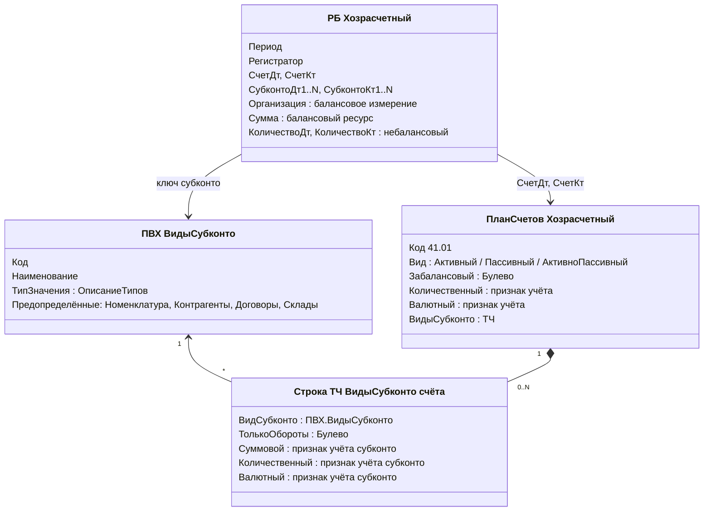
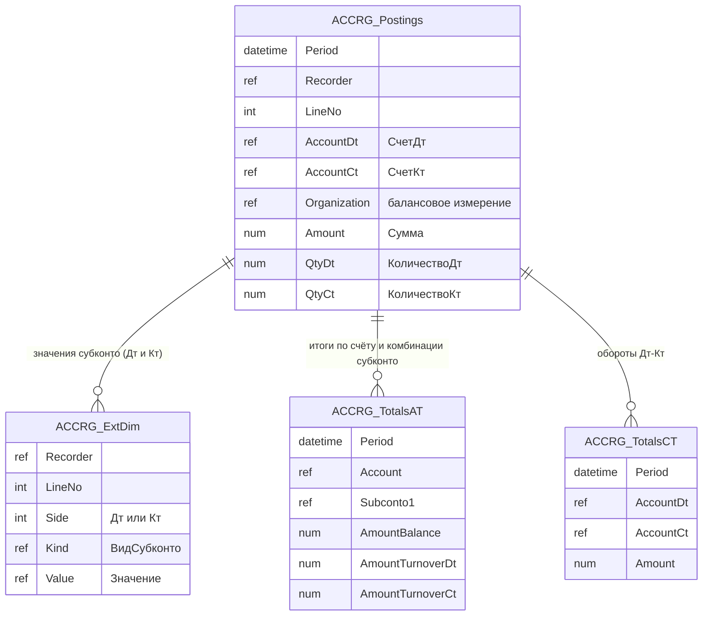
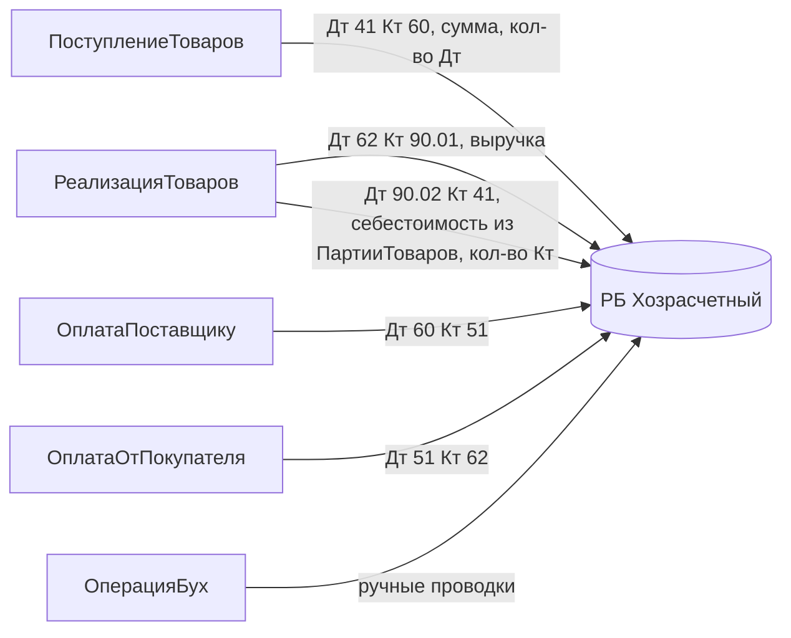
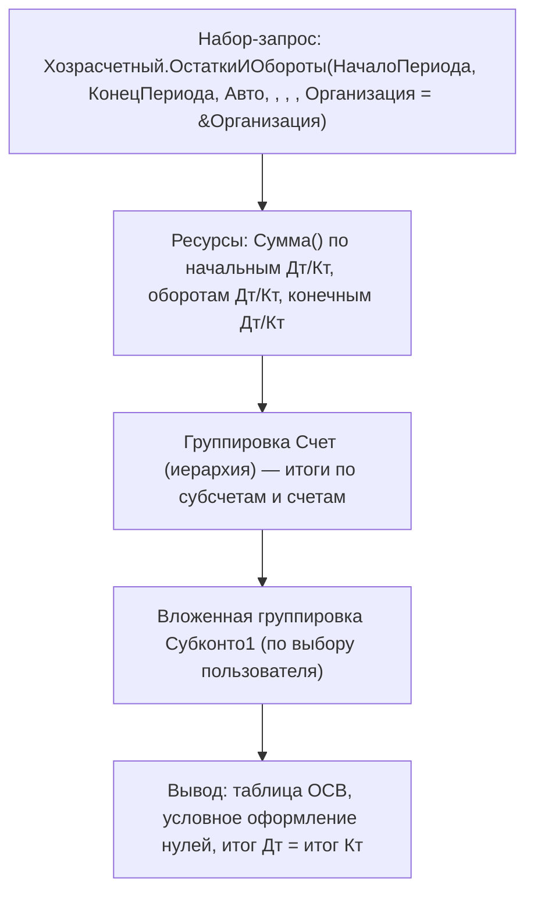

# Модуль 08. Бухгалтерский учёт

> **Объём:** 14 ак. ч · **Неделя:** 11 · **Источники:** [Я] спринт 06 (регламентированный учёт: план счетов, ПВХ, регистр бухгалтерии, проводки, бухгалтерские отчёты, контроль остатков на счетах); [ПР] модуль 2 (ПВХ, регистры бухгалтерии, ОСВ), модуль 9 (регистр бухгалтерии, оборотные субконто, измерения РБ, валютный и количественный учёт); [ПР2] модуль 1 (регистр бухгалтерии, ручные операции, ОСВ, признаки учёта, количественный учёт, себестоимость, валютный учёт); [К] модули 2, 9, 10, 18 (балансовый, признак учёта, признак учёта субконто, оборотное субконто, выбор между счетами/субконто/измерениями); [Т] модуль 13 (планы счетов, аналитический учёт, регистры бухгалтерии)
> **Нет в источниках (написано по документации платформы/опыту):** регистр бухгалтерии без поддержки корреспонденции; полный перечень виртуальных таблиц РБ (`ОборотыДтКт`, `ДвиженияССубконто`) и их параметры; физические таблицы РБ; ОСВ именно на СКД (в источниках — ОСВ как отчёт); сопоставление с SAP FI (SKA1/SKB1, ACDOCA, account assignment, сегменты, валюты документа/компании)

## Результат модуля

- Умеете спроектировать ПВХ видов субконто и план счетов: признаки учёта, виды субконто с признаками учёта субконто и флагом «только обороты», вид счёта, забалансовость, иерархию субсчетов, предопределённые счета.
- Умеете спроектировать регистр бухгалтерии (корреспонденция, балансовые и небалансовые измерения/ресурсы) и обосновать выбор «счёт / субконто / измерение».
- Умеете формировать проводки из документов проекта (поступление, реализация, оплаты) и вводить ручные проводки документом `ОперацияБух`.
- Умеете читать РБ через виртуальные таблицы `Остатки`, `Обороты`, `ОборотыДтКт`, `ОстаткиИОбороты`, `ДвиженияССубконто` и собрать ОСВ на СКД.
- Умеете вести количественный и валютный учёт на счетах и объяснить отличие от модели валют ACDOCA.

## Карта понятий SAP → 1С

| SAP | 1С | Ключевое отличие |
|---|---|---|
| Chart of accounts (SKA1) | План счетов `Хозрасчетный` (объект метаданных + предопределённые счета) | Структура счетов — **метаданные** (признаки учёта, виды субконто), а не только customizing. Код счёта — строка с маской |
| Company code data (SKB1: валюта, open item, field status) | Свойства счёта: признак `Валютный`, ТЧ `ВидыСубконто` | Нет уровня «счёт в БЕ»: план счетов один на базу, организация — балансовое измерение РБ |
| Account assignment (KOSTL, AUFNR, MATNR, KUNNR/LIFNR в позиции) | Субконто (до N видов на счёт, типы из ПВХ) | Набор аналитик **привязан к счёту**, а не к полю позиции. Нет «field status group», обязательность — свойствами вида субконто на счёте |
| Классификация (CLF, характеристики) | План видов характеристик (ПВХ) | ПВХ — справочник видов, у каждого вида свой **тип значения**. Шире классификации: ПВХ служит и видами субконто, и свойствами объектов |
| ACDOCA (Universal Journal) | Регистр бухгалтерии: таблица движений (проводки) + таблицы итогов | Проводка — пара Дт/Кт в одной записи (при корреспонденции), а не две строки с BSCHL |
| Сегмент, бизнес-сфера, profit center | Балансовое измерение РБ (`Организация`, `Подразделение`) | Балансовое измерение: Дт и Кт с одинаковым значением, баланс сходится по нему |
| Валюта документа (WSL) / валюта БЕ (HSL) / групповая (KSL) | `ВалютнаяСумма` + `Валюта` (небалансовые) / `Сумма` (балансовый ресурс) | Валютная сумма ведётся только на счетах с признаком `Валютный`. Параллельных валют «из коробки» нет — добавляются ресурсами |
| Количество в ACDOCA (MSL) | Небалансовый ресурс `Количество` с признаком учёта `Количественный` | Количество есть только на счетах/субконто с признаком |
| Account determination (OBYC, OKB9) | Код проведения документа | Счета выбираются кодом (или регистрами сведений «счета учёта»), а не транзакцией настройки |
| Ручная проводка FB50 | Документ `ОперацияБух` с редактируемым набором проводок | Документ — регистратор, проводки редактируются в его форме |
| Totals table (GLT0, FAGLFLEXT) | Таблицы итогов РБ (по счетам, субконто, корреспонденциям) | Ведутся платформой, ПРИ и разделение итогов как у РН |

## Теория

### 1. ПВХ: виды субконто

План видов характеристик — справочник, каждый элемент которого (вид характеристики) несёт свой **тип значения** (`ТипЗначения`). Тип значения ПВХ задаётся в метаданных как составной тип — множество допустимых типов для всех видов.



- Элементы ПВХ видов субконто — почти всегда **предопределённые** (`ПланыВидовХарактеристик.ВидыСубконто.Номенклатура`), потому что на них ссылается код проведения.
- Если в составном типе разрешены «дополнительные значения характеристик», ПВХ получает подчинённый справочник значений (для видов, значения которых вводит пользователь — «Статья затрат произвольная»).
- ПВХ — не только субконто: тот же механизм используют для свойств объектов («дополнительные реквизиты» БСП) и характеристик в СКД ([модуль 07](07-reports-skd-print.md)). Аналог классификации SAP (класс → характеристики → значения), но тип значения — любая ссылка/примитив платформы, а не CHAR/NUM/DATE.

### 2. План счетов

Свойства объекта метаданных: `ВидыСубконто` (ссылка на ПВХ), `МаксКоличествоСубконто` (у нас 3), маска кода (`@@.@@`), порядок по коду, **признаки учёта** (реквизиты-флаги счёта: `Количественный`, `Валютный`) и **признаки учёта субконто** (флаги в ТЧ субконто счёта: `Суммовой`, `Количественный`, `Валютный`).

Стандартные реквизиты счёта:

| Реквизит | Смысл | Аналог SAP |
|---|---|---|
| `Код`, `Наименование`, `Родитель` | Иерархия счёт/субсчёт | номер счёта, группа счетов |
| `Вид` (`ВидСчета.Активный/Пассивный/АктивноПассивный`) | Знак сальдо. На активном остаток всегда Дт (кредитовое сальдо показывается как Дт с минусом), на АП — развёрнутое | Нет прямого аналога (в SAP сальдо просто со знаком) |
| `Забалансовый` | Счёт без корреспонденции: проводки только Дт или только Кт, не участвуют в балансе | Статистические счета / memo |
| `ВидыСубконто` (ТЧ) | До `МаксКоличествоСубконто` видов аналитики в фиксированном порядке | field status + обязательные объекты присвоения |
| `ТолькоОбороты` (в ТЧ) | **Оборотное субконто**: в итогах по остаткам не хранится, только в оборотах | Аналитика, для которой нет «остатка по ней» (статья ДДС) |

Предопределённые счета нашего плана:

| Код | Имя | Вид | Субконто | Признаки |
|---|---|---|---|---|
| 10 | `Материалы` | А | Номенклатура, Склады | Количественный |
| 41 | `Товары` | А | Номенклатура, Склады | Количественный |
| 60 | `РасчетыСПоставщиками` | АП | Контрагенты, Договоры | Валютный |
| 62 | `РасчетыСПокупателями` | АП | Контрагенты, Договоры | Валютный |
| 90 | `Продажи` | АП | Номенклатура (только обороты) | — |
| 51 | `РасчетныеСчета` | А | — | — |
| 70 | `РасчетыПоОплатеТруда` | П | Сотрудники (в [модуле 09](09-periodic-calculations.md)) | — |
| 26 | `ОбщехозяйственныеРасходы` | А | Статьи затрат (только обороты) | — |

Обращение: `ПланыСчетов.Хозрасчетный.Товары`. Проверка принадлежности иерархии в запросе: `Счет В ИЕРАРХИИ (&Счет41)`.

**Субконто на счёте 41 vs измерение РБ.** Правило выбора:
- **Счёт** — когда отличается методология (активность, набор аналитики, признаки).
- **Субконто** — аналитика, нужная только на части счетов (номенклатура на 41, контрагент на 60/62).
- **Измерение РБ** — аналитика, которая нужна на **всех** счетах (организация, подразделение). Балансовое — если баланс должен сходиться в разрезе её значений (организация). Небалансовое — если по Дт и Кт значения могут различаться (валюта).

### 3. Регистр бухгалтерии

Свойства: `ПланСчетов`, `Корреспонденция` (поддержка корреспонденции), `Периодичность` хранения итогов, разрешение разделения итогов.

| | С корреспонденцией | Без корреспонденции |
|---|---|---|
| Запись | `СчетДт`, `СчетКт`, `СубконтоДт`, `СубконтоКт`, общая `Сумма` | `Счет`, `Субконто`, `ВидДвижения` (`ВидДвиженияБухгалтерии.Дебет/Кредит`) |
| Виртуальные таблицы | + `ОборотыДтКт`, корр. параметры в `Обороты` | без `ОборотыДтКт` |
| Применение | Бухучёт РФ (двойная запись в одной записи) | Учёт без корреспонденций (например, МСФО-журналы в некоторых решениях, однострочный учёт) |

Ближе к ACDOCA по форме именно РБ **без** корреспонденции (строка = одна сторона), но в РФ-решениях почти всегда используется корреспонденция: учётная модель требует знать «что с чем» (`ОборотыДтКт` для журналов-ордеров и анализа счетов).

**Балансовость.** У измерений и ресурсов есть флаг `Балансовый`:
- балансовое измерение — одно поле (`Организация`), значение одинаково для Дт и Кт;
- небалансовое — два поля (`ВалютаДт`, `ВалютаКт`);
- балансовый ресурс — одно поле `Сумма` (Дт = Кт, баланс сходится);
- небалансовый ресурс — `КоличествоДт`, `КоличествоКт`. У него указывают `ПризнакУчета` (счёта) и `ПризнакУчетаСубконто`: значение хранится, только если у счёта (и вида субконто) включён признак.

Наш регистр: измерение `Организация` (балансовое); ресурсы `Сумма` (балансовый), `Количество` (небалансовый, признак `Количественный`, признак субконто `Количественный`). В задании M08-T6* добавляются `Валюта` (небалансовое измерение, признак `Валютный`) и `ВалютнаяСумма` (небалансовый ресурс, признак `Валютный`).

Физические таблицы (имена через `ПолучитьСтруктуруХраненияБазыДанных()`): таблица проводок (`_AccRg`), таблица значений субконто проводок (`_AccRgED`), таблицы итогов по счетам (`_AccRgAT0`, `_AccRgAT1`… — по числу субконто), таблица итогов по корреспонденциям (`_AccRgCT`).



Отличие от ACDOCA: субконто хранятся **не в колонках проводки**, а в отдельной таблице по (Регистратор, НомерСтроки, Вид). Поэтому произвольные отборы по субконто дорогие. Для запросов используйте параметр `Субконто` виртуальных таблиц, а не соединения с таблицей движений.

### 4. Проводки из документов

```bsl
// Модуль объекта ПоступлениеТоваров: бухгалтерские движения
Процедура СформироватьПроводки()

    Движения.Хозрасчетный.Записывать = Истина;

    Для Каждого СтрокаТЧ Из Товары Цикл
        Проводка = Движения.Хозрасчетный.Добавить();
        Проводка.Период       = Дата;
        Проводка.Организация  = Организация;
        Проводка.СчетДт       = ПланыСчетов.Хозрасчетный.Товары;
        Проводка.СчетКт       = ПланыСчетов.Хозрасчетный.РасчетыСПоставщиками;
        Проводка.СубконтоДт[ПланыВидовХарактеристик.ВидыСубконто.Номенклатура] = СтрокаТЧ.Номенклатура;
        Проводка.СубконтоДт[ПланыВидовХарактеристик.ВидыСубконто.Склады]       = Склад;
        Проводка.СубконтоКт[ПланыВидовХарактеристик.ВидыСубконто.Контрагенты]  = Контрагент;
        Проводка.СубконтоКт[ПланыВидовХарактеристик.ВидыСубконто.Договоры]     = Договор;
        Проводка.Сумма        = СтрокаТЧ.Сумма;
        Проводка.КоличествоДт = СтрокаТЧ.Количество;
        Проводка.Содержание   = "Поступление товаров";
    КонецЦикла;

КонецПроцедуры
```

(Реквизит `Организация` у документов проекта появляется в этом модуле. `Содержание` — реквизит РБ, строка.)

- `СубконтоДт` / `СубконтоКт` — коллекция «вид → значение». Присвоение субконто, которого нет на счёте, игнорируется (значение не запишется). Это частая причина «пустых» субконто: ошиблись видом или счётом.
- `КоличествоДт` запишется, только если у счёта 41 включён признак `Количественный`. Для 60 его нет — `КоличествоКт` не заполняем.
- Порядок субконто в записи определяется порядком в ТЧ счёта, а не порядком присвоения.

Схема проводок проекта (≈ account determination, но в коде):



Себестоимость для проводки `Дт 90.02 Кт 41` берётся из того же расчёта партий, что и движения `ПартииТоваров` ([модуль 06](06-registers-posting.md)). Один расчёт — два учёта. Это аналог MM→FI интеграции: в SAP проводку FI порождает движение материала через OBYC, в 1С — тот же код проведения в той же транзакции.

**Контроль остатков на счетах** (например, нельзя уйти в кредит по 51) делается так же, как в РН: блокировка `"РегистрБухгалтерии.Хозрасчетный"` по `Счет` и измерениям, запись, запрос к `Остатки` с `Граница(МоментВремени(), Включая)` и условием `СуммаОстатокДт < 0`.

```bsl
ЭлементБлокировки = Блокировка.Добавить("РегистрБухгалтерии.Хозрасчетный");
ЭлементБлокировки.Режим = РежимБлокировкиДанных.Исключительный;
ЭлементБлокировки.УстановитьЗначение("Счет", ПланыСчетов.Хозрасчетный.РасчетныеСчета);
ЭлементБлокировки.УстановитьЗначение("Организация", Организация);
```

### 5. Ручная операция

`ОперацияБух` — документ-регистратор РБ, пользователь вводит проводки сам (аналог FB50/FB01). Реализация на управляемой форме:

- реквизит формы `Проводки` типа `РегистрБухгалтерииНаборЗаписей.Хозрасчетный`, на форме — таблица с колонками `СчетДт`, `СубконтоДт1..3`, `СчетКт`, `СубконтоКт1..3`, `Сумма`, `КоличествоДт/Кт`. Платформа сама переключает типы и доступность колонок субконто по выбранному счёту;
- при открытии набор читается по `Отбор.Регистратор`, при записи переносится в объект и записывается в транзакции записи документа.

```bsl
&НаСервере
Процедура ПриСозданииНаСервере(Отказ, СтандартнаяОбработка)
    Набор = РегистрыБухгалтерии.Хозрасчетный.СоздатьНаборЗаписей();
    Если Не Объект.Ссылка.Пустая() Тогда
        Набор.Отбор.Регистратор.Установить(Объект.Ссылка);
        Набор.Прочитать();
    КонецЕсли;
    ЗначениеВРеквизитФормы(Набор, "Проводки");
КонецПроцедуры

&НаСервере
Процедура ПриЗаписиНаСервере(Отказ, ТекущийОбъект, ПараметрыЗаписи)
    // внутри транзакции записи документа, Ссылка уже есть
    Набор = РеквизитФормыВЗначение("Проводки");
    Набор.Отбор.Регистратор.Установить(ТекущийОбъект.Ссылка);
    Для Каждого Запись Из Набор Цикл
        Запись.Период      = ТекущийОбъект.Дата;
        Запись.Организация = ТекущийОбъект.Организация;
        Запись.Активность  = Истина;
    КонецЦикла;
    Набор.Записать();
КонецПроцедуры
```

У документа `ОперацияБух` в этой схеме «Удаление движений» — «Не удалять автоматически» (иначе перепроведение сотрёт введённые проводки), а `ОбработкаПроведения` ничего не формирует. Альтернатива — хранить проводки в табличной части документа и формировать движения в `ОбработкаПроведения`. Это проще для обмена данными, но дублирует хранение. Оба подхода встречаются, выбор — проектное решение.

### 6. Виртуальные таблицы РБ

| Таблица | Параметры (порядок) | Основные поля |
|---|---|---|
| `Остатки` | `Период, УсловиеСчета, Субконто, Условие` | `СуммаОстаток`, `СуммаОстатокДт`, `СуммаОстатокКт`, `СуммаРазвернутыйОстатокДт/Кт`, `Субконто1..N` |
| `Обороты` | `НачалоПериода, КонецПериода, Периодичность, УсловиеСчета, Субконто, Условие, УсловиеКорСчета, КорСубконто` | `СуммаОборотДт`, `СуммаОборотКт`, `КорСчет`, `КорСубконто1..N` |
| `ОборотыДтКт` | `НачалоПериода, КонецПериода, Периодичность, УсловиеСчетаДт, СубконтоДт, УсловиеСчетаКт, СубконтоКт, Условие` | `СчетДт`, `СчетКт`, `СубконтоДт1..N`, `СубконтоКт1..N`, `СуммаОборот`, `КоличествоОборотДт` |
| `ОстаткиИОбороты` | `НачалоПериода, КонецПериода, Периодичность, МетодДополнения, УсловиеСчета, Субконто, Условие` | `СуммаНачальныйОстатокДт/Кт`, `СуммаОборотДт/Кт`, `СуммаКонечныйОстатокДт/Кт`, развёрнутые варианты |
| `ДвиженияССубконто` | `НачалоПериода, КонецПериода, Условие, Порядок, Первые` | все поля проводки с развёрнутыми `СубконтоДт1..N`, `СубконтоКт1..N` (журнал проводок) |

Параметр `Субконто` — вид субконто или массив видов. Он задаёт, **какие** субконто и в каком порядке окажутся в полях `Субконто1`, `Субконто2`… Это ключ к производительности: итоги берутся из таблицы итогов нужной «глубины».

```bsl
Запрос = Новый Запрос;
ВидыСубконто = Новый Массив;
ВидыСубконто.Добавить(ПланыВидовХарактеристик.ВидыСубконто.Номенклатура);
Запрос.УстановитьПараметр("ВидыСубконто", ВидыСубконто);
Запрос.УстановитьПараметр("Счет", ПланыСчетов.Хозрасчетный.Товары);
Запрос.УстановитьПараметр("Организация", Организация);
Запрос.УстановитьПараметр("Период", Новый Граница(КонецДня(ДатаОтчета), ВидГраницы.Включая));
Запрос.Текст =
"ВЫБРАТЬ
|    Ост.Субконто1 КАК Номенклатура,
|    Ост.КоличествоОстатокДт КАК Количество,
|    Ост.СуммаОстатокДт КАК Сумма
|ИЗ
|    РегистрБухгалтерии.Хозрасчетный.Остатки(
|            &Период,
|            Счет В ИЕРАРХИИ (&Счет),
|            &ВидыСубконто,
|            Организация = &Организация) КАК Ост";
```

Обороты по корреспонденции (журнал-ордер «Кт 51»). Отбор по счёту здесь для наглядности в `ГДЕ`. В рабочем коде его переносят в параметр условия на счёт кредита (`УсловиеСчетаКт`), чтобы фильтровала сама виртуальная таблица:

```bsl
"ВЫБРАТЬ
|    О.СчетДт КАК СчетДт,
|    СУММА(О.СуммаОборот) КАК Сумма
|ИЗ
|    РегистрБухгалтерии.Хозрасчетный.ОборотыДтКт(
|            &Начало, &Конец, , , , , ,
|            Организация = &Организация) КАК О
|ГДЕ
|    О.СчетКт = &Счет51
|СГРУППИРОВАТЬ ПО
|    О.СчетДт"
```

**Развёрнутый остаток.** Для АП-счёта (62) сальдо «свёрнуто» на уровне счёта: долг одного покупателя (Дт) и аванс другого (Кт) взаимно погашаются. `СуммаРазвернутыйОстатокДт/Кт` считает сальдо в разрезе **запрошенных субконто** и раскладывает по сторонам. Поэтому для 60/62 в ОСВ нужны развёрнутые поля с параметром `Субконто` = Контрагенты.

### 7. ОСВ на СКД



Минимальный запрос набора:

```bsl
ВЫБРАТЬ
    ХО.Счет КАК Счет,
    ХО.СуммаНачальныйОстатокДт КАК НачОстДт,
    ХО.СуммаНачальныйОстатокКт КАК НачОстКт,
    ХО.СуммаОборотДт КАК ОборотДт,
    ХО.СуммаОборотКт КАК ОборотКт,
    ХО.СуммаКонечныйОстатокДт КАК КонОстДт,
    ХО.СуммаКонечныйОстатокКт КАК КонОстКт
ИЗ
    РегистрБухгалтерии.Хозрасчетный.ОстаткиИОбороты(
        &НачалоПериода, &КонецПериода, , , , , Организация = &Организация) КАК ХО
```

Тонкость: если суммировать ресурсами СКД **развёрнутые** остатки по субконто до уровня счёта, получится развёрнутое сальдо счёта (как в классической ОСВ по 60/62). Если взять свёрнутые поля без субконто — свёрнутое. Решите, какое вам нужно, и не смешивайте на разных уровнях группировки. ОСВ по счёту с детализацией по субконто — отдельный вариант с параметром `Субконто`. Типовые реализуют ОСВ кодом, а не «голой» СКД, именно из-за этих правил развёртки.

Проверка корректности: итог начального Дт = итог начального Кт, итог оборотов Дт = итог оборотов Кт (на уровне всех балансовых счетов, без забалансовых).

### 8. Количественный и валютный учёт

**Количественный.** На счёте 41 признак `Количественный`, на субконто Номенклатура — признак учёта субконто `Количественный`, на субконто Склады — нет (или да, если нужно количество по складам). Тогда `КоличествоОстатокДт` по (Номенклатура) хранится, а по (Склад) — нет. Признак субконто управляет тем, в каких таблицах итогов ресурс ведётся.

**Валютный.** Модель 1С против SAP:

| SAP | 1С |
|---|---|
| Каждая позиция имеет WAERS (валюта документа), WRBTR/WSL и DMBTR/HSL (валюта БЕ), опционально KSL… | `Сумма` — всегда в валюте регламентированного учёта. `ВалютнаяСумма` + `Валюта` — только на счетах с признаком `Валютный` (60, 62, 52) |
| Курсовые разницы — FAGL_FCV / FAGL_FC_VAL (переоценка открытых позиций) | Документ/регламентная операция «Переоценка валюты»: разница между `ВалютнаяСумма × Курс` на дату и `Сумма` проводится в `Сумма` без изменения `ВалютнаяСумма` (Дт 60 Кт 91 и т.п.) |
| Курс — TCURR | Регистр сведений `КурсыВалют` (Курс, Кратность) — [модуль 11](11-integration.md) |

Проводка поступления в валюте (договор в USD):

```bsl
Курс = КурсыВалютНаДату(Договор.Валюта, Дата); // структура Курс, Кратность из РС КурсыВалют
Проводка.ВалютаКт        = Договор.Валюта;
Проводка.ВалютнаяСуммаКт = СтрокаТЧ.Сумма;
Проводка.Сумма           = Окр(СтрокаТЧ.Сумма * Курс.Курс / Курс.Кратность, 2);
// на 41 валюты нет — ВалютаДт/ВалютнаяСуммаДт не заполняются
```

(`КурсыВалютНаДату` — ваша функция над `РегистрыСведений.КурсыВалют.ПолучитьПоследнее(Дата, Новый Структура("Валюта", Валюта))`.)

## Ловушки для ABAP-разработчика

1. **Субконто ≠ поле позиции.** Записали `СубконтоДт[ВидыСубконто.Склады]` на счёт, где этого вида нет, — значение молча пропало. Проверяйте ТЧ субконто счёта, а не тип поля.
2. **Измерение «на всякий случай».** Каждое измерение РБ умножает размер итогов по всем счетам. Аналитику, нужную на 2–3 счетах, делайте субконто.
3. **Отбор по субконто через `Условие`, а не через параметр `Субконто`.** Без параметра `Субконто` поля `Субконто1..N` будут в порядке ТЧ счёта, и для разных счетов в одной выборке `Субконто1` означает разное.
4. **Свёрнутое сальдо АП-счетов.** `СуммаОстатокДт` по 62 без субконто покажет нетто-дебиторку, а не сумму долгов. Для баланса нужен развёрнутый остаток по контрагентам.
5. **Количество на счёте без признака.** `КоличествоДт` на счёт 60 не сохранится, ошибки не будет.
6. **Ожидание OBYC.** В 1С нет настроечной таблицы определения счетов — счета «зашиты» в коде проведения или выбираются из регистров сведений «Счета учёта номенклатуры» (так в типовых). Изменение схемы проводок = изменение кода/данных, а не customizing.
7. **Забалансовый счёт в корреспонденции.** У забалансового счёта нет пары: заполняется только `СчетДт` (или только `СчетКт`). Корр-счёт не указывается.
8. **Суммы в валюте документа в `Сумма`.** `Сумма` — всегда в валюте регламентированного учёта. Валюта документа — только `ВалютнаяСумма` на валютных счетах.
9. **Ручная операция и «Удалять автоматически».** Перепроведение стирает введённые руками проводки.

## Практика (сквозной проект)

### M08-T1. ПВХ и план счетов
ПВХ `ВидыСубконто` (Номенклатура, Контрагенты, Договоры, Склады, СтатьиЗатрат — справочник). План счетов `Хозрасчетный` (`МаксКоличествоСубконто` = 3, маска `@@.@@`), предопределённые счета по таблице раздела 2, субсчета 90.01 «Выручка» и 90.02 «Себестоимость продаж».
- [ ] Признаки учёта `Количественный`, `Валютный`, признаки учёта субконто `Суммовой`, `Количественный`, `Валютный`.
- [ ] Субконто Номенклатура на 90 и СтатьиЗатрат на 26 — `ТолькоОбороты`.
- [ ] Забалансовый счёт `МЦ` («ТМЦ в эксплуатации») с субконто Номенклатура.
- **Самопроверка:** запрос `checks/M08-T1.sql.txt` к `ПланСчетов.Хозрасчетный.ВидыСубконто` выводит для каждого счёта виды субконто и флаги. Сверка с таблицей раздела 2.

### M08-T2. Регистр бухгалтерии и проводки документов
РБ `Хозрасчетный` (корреспонденция, `Организация` балансовое, `Сумма` балансовый, `Количество` небалансовый с признаками). Реквизит `Организация` в документах. Проводки из `ПоступлениеТоваров`, `РеализацияТоваров` (выручка + себестоимость из расчёта партий), `ОплатаПоставщику`, `ОплатаОтПокупателя`.
- [ ] Себестоимость в проводке Дт 90.02 Кт 41 равна сумме расхода `ПартииТоваров` этого документа.
- [ ] Количество на 41 по Дт и Кт.
- **Самопроверка:** запрос `checks/M08-T2.sql.txt`: для каждого регистратора-реализации сравнить `ПартииТоваров` (расход, Сумма) и `Хозрасчетный.ДвиженияССубконто` (Дт 90.02). Расхождений нет. Остаток 41 по количеству совпадает с `ОстаткиТоваров`.

### M08-T3. Контроль остатка на 51
`ОплатаПоставщику` не проводится, если остаток денег на 51 по организации станет отрицательным.
- [ ] Новая методика: блокировка/запись/контроль по `Остатки` с `Граница(..., Включая)`.
- **Самопроверка:** сценарий: остаток 100, оплата 150 → отказ. Две параллельные оплаты по 70 → одна проходит.

### M08-T4. Ручная операция
Документ `ОперацияБух` с редактированием набора проводок в форме (раздел 5).
- [ ] Субконто в колонках переключаются по выбранному счёту.
- [ ] Повторное открытие показывает сохранённые проводки, изменение и запись заменяют набор.
- **Самопроверка:** ввод начальных остатков Дт 51 Кт 00 (добавьте вспомогательный счёт 00) и Дт 41 Кт 00 с количеством. ОСВ (M08-T5) показывает их.

### M08-T5. ОСВ на СКД
Отчёт `ОборотноСальдоваяВедомость`: группировка по счетам с иерархией, развёрнутое сальдо для 60/62 по контрагентам, параметр «Организация», вариант «ОСВ по счёту» с детализацией по субконто 1–2.
- [ ] Итоги Дт = Кт для балансовых счетов, забалансовые выводятся отдельно.
- [ ] Для 62 при долге одного покупателя 100 и авансе другого 30 сальдо: Дт 100 / Кт 30.
- **Самопроверка:** сверка конечного сальдо 41 с отчётом `ОстаткиТоваров` из [модуля 07](07-reports-skd-print.md) (по количеству) и с суммами `ПартииТоваров`.

### M08-T6* (со звёздочкой). Валютный учёт и переоценка
Добавьте в РБ `Валюта` (небалансовое измерение, признак `Валютный`) и `ВалютнаяСумма` (небалансовый ресурс, признак `Валютный`). Договоры в USD, проводки по 60/62 в валюте, документ «ПереоценкаВалюты» на конец месяца (курсовые разницы на 91.01/91.02).
- [ ] После переоценки `Сумма` остатка 60 по договору = `ВалютнаяСумма × курс на дату переоценки`.
- [ ] `ВалютнаяСумма` переоценкой не меняется.
- **Самопроверка:** запрос `checks/M08-T6.sql.txt` к `Остатки` по 60 с субконто Договоры: сравнение `СуммаОстаток` и `ВалютнаяСуммаОстаток × Курс`.

## Контрольные вопросы

1. Что такое ПВХ и чем тип значения ПВХ отличается от типа реквизита справочника? Зачем виды субконто делают предопределёнными?
2. Как выбрать между отдельным счётом, субконто и измерением РБ? Приведите примеры для каждого.
3. Что такое балансовое и небалансовое измерение/ресурс? Почему `Количество` небалансовое, а `Организация` балансовое?
4. Что такое признак учёта и признак учёта субконто? Что произойдёт с `КоличествоДт` на счёте без признака `Количественный`?
5. Что такое оборотное субконто? Какие виртуальные таблицы вернут по нему данные, а какие нет?
6. Чем активный, пассивный и активно-пассивный счёт отличаются при получении остатков? Что такое развёрнутый остаток?
7. Перечислите виртуальные таблицы РБ с корреспонденцией и назовите, что даёт параметр `Субконто`.
8. Как устроена запись РБ без поддержки корреспонденции? Когда она уместна?
9. Как в 1С ведётся валютный учёт на счетах? Сравните с WSL/HSL в ACDOCA и переоценкой FAGL_FCV.
10. Как реализовать документ ручной проводки и как он должен вести себя при перепроведении?

## Документация

- Документация платформы 8.3 (Руководство разработчика: «Планы видов характеристик», «Планы счетов», «Регистры бухгалтерии»): https://its.1c.ru/db/v83doc
- Методическая поддержка разработчиков: https://its.1c.ru/db/metod8dev
- Стандарты разработки: https://its.1c.ru/db/v8std
- БСП: https://its.1c.ru/db/bsp
- Сайт платформы: https://v8.1c.ru
- Связанные модули: [модуль 06](06-registers-posting.md), [модуль 07](07-reports-skd-print.md), [модуль 09](09-periodic-calculations.md), [модуль 11](11-integration.md); стенд — [lab](../lab/README.md)
