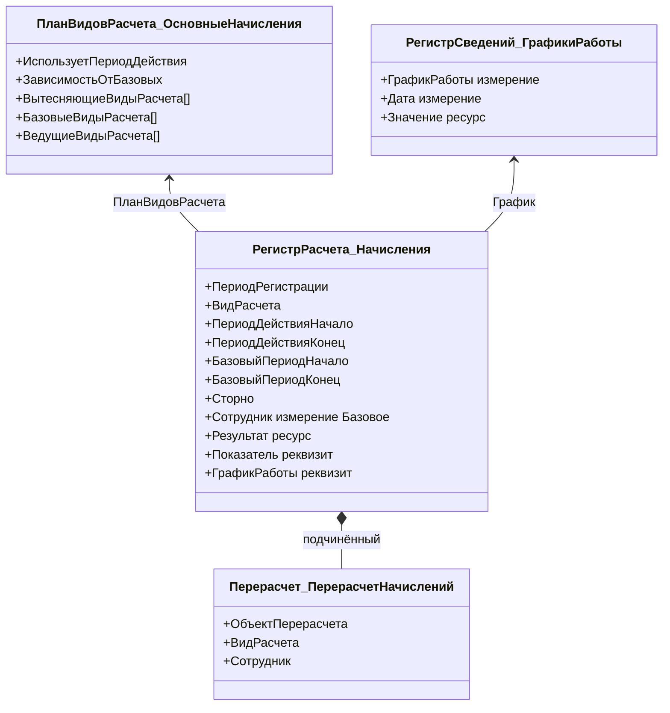
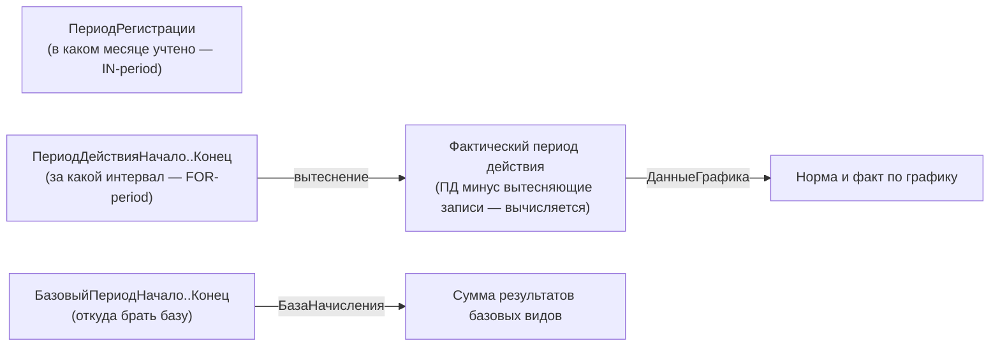
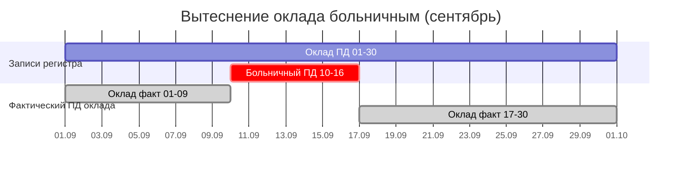
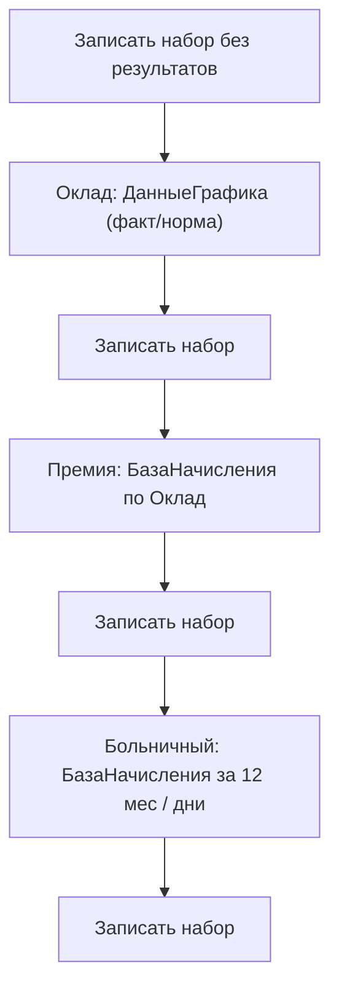
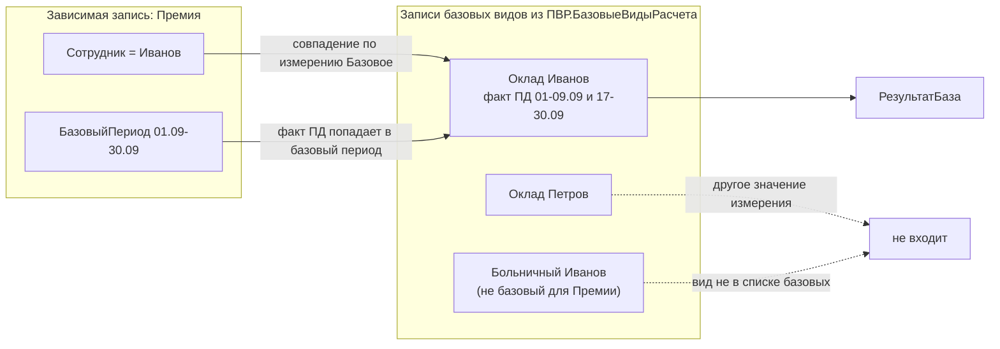
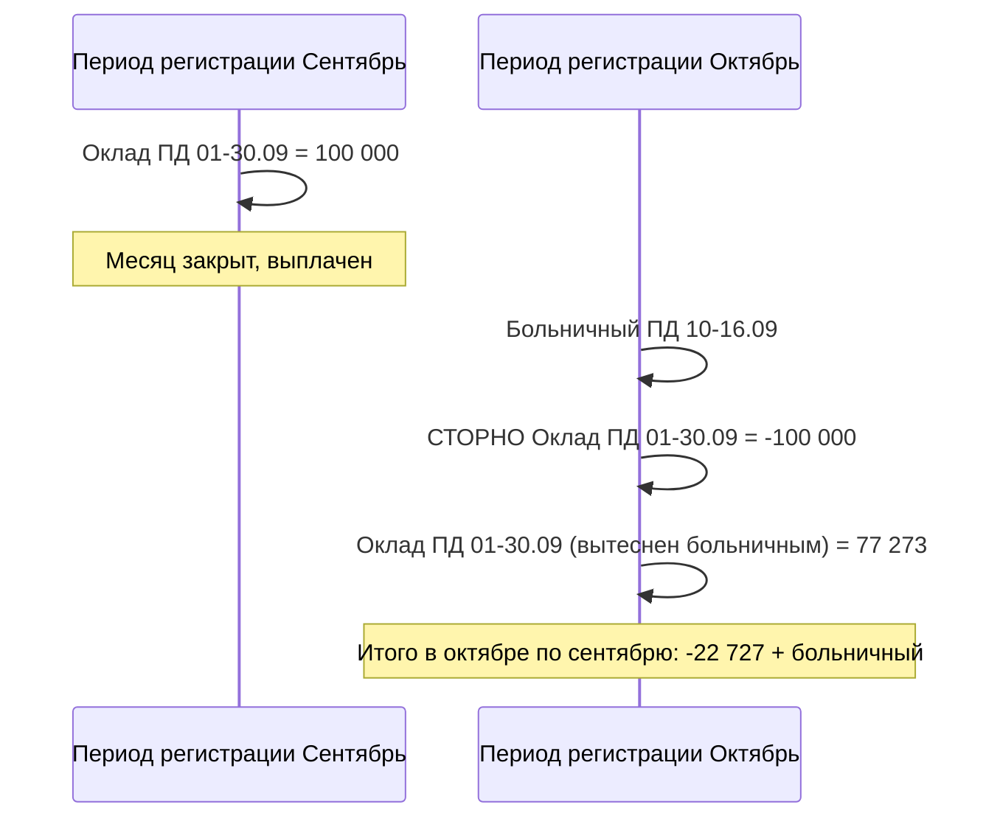
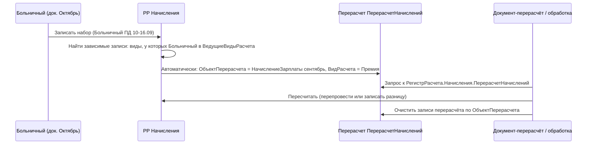

# Модуль 09. Сложные периодические расчёты: ПВР, регистры расчёта, вытеснение, базовые расчёты, перерасчёты, графики

> **Объём:** 14 ак. ч · **Неделя:** 12 · **Источники:** [Я] спринт 07 (план видов расчёта, регистр расчёта, вытесняющие расчёты и фактический период действия, зависимость по базе, отчёт по регистру расчёта, графики работы); [ПР] модуль 2 (производственный календарь и оклады сотрудников, расчёт заработной платы), модуль 9 (базовые виды расчёта, данные графиков по фактическому периоду действия и по периоду регистрации, перерасчёты и дополнения); [ПР2] модуль 1 (расчёт оклада по календарю, механизм вытеснения, прогулы, диаграмма Ганта, расчёт премии, расчёт «по среднему», сторно); [К] модули 2, 9, 10, 18 (методика решения расчётных задач, работа со временем, перерасчёты и дополнения); [Т] модуль 14 (планы видов расчёта, регистры расчёта, сторно-запись, механизм вытеснения)
> **Нет в источниках (написано по документации платформы/опыту):** ведущие виды расчёта как отдельная тема (в источниках только «перерасчёты»); сопоставление с SAP HCM PY (wage types, RT/CRT, retro, PCR)

## Результат модуля

- Умеете спроектировать план видов расчёта с вытесняющими, базовыми и ведущими видами и объяснить, какая настройка за какое поведение платформы отвечает.
- Умеете настроить регистр расчёта с периодом действия, базовым периодом и графиком и записать в него движения документа.
- Умеете получать фактический период действия, данные графика и базу через виртуальные таблицы и считать оклад по графику, премию от базы, больничный «по среднему».
- Понимаете разницу между периодом регистрации и периодом действия (≈ IN-period / FOR-period в SAP PY), умеете делать сторно и обрабатывать перерасчёты.
- Умеете визуализировать периоды действия в диаграмме Ганта.

## Карта понятий SAP → 1С

| SAP HCM PY | 1С | Ключевое отличие |
|---|---|---|
| Wage type (T512W, V_512W_D) | Вид расчёта — элемент плана видов расчёта (ПВР) | ПВР — объект метаданных со своей таблицей; отношения между видами (вытеснение, база, ведущие) задаются табличными частями ПВР, а не правилами схемы |
| Processing class / cumulation class | Табличные части ПВР `БазовыеВидыРасчета`, `ВедущиеВидыРасчета`, `ВытесняющиеВидыРасчета` + реквизиты ПВР | Нет «классов» — зависимость задаётся явным списком видов |
| Cluster RT (results table) | Регистр расчёта (`РегистрРасчета.Начисления`) | Реляционная таблица с периодом регистрации и периодом действия, а не сериализованный кластер PCL2 |
| Cluster CRT (cumulated results) | Запрос с группировкой / виртуальная таблица `База…` | Кумуляций «на лету» в платформе нет — агрегация считается запросом |
| IN-period / FOR-period | ПериодРегистрации / ПериодДействия | Почти прямой аналог; в 1С период действия — интервал дат, а не номер периода |
| Retroactive accounting (retro calc, differences) | Перерасчёты (подчинённый объект регистра) + сторно-записи | Платформа только **регистрирует** необходимость перерасчёта, сам пересчёт пишет разработчик |
| Absences (IT2001) вытесняют оплату по времени | Вытеснение (`ВытесняющиеВидыРасчета`) | Делается платформой автоматически по пересечению периодов действия |
| Work schedule rule / partial period factor (/801…/803) | Регистр сведений‑график + `ДанныеГрафика` | Платформа сама суммирует значения графика по нужному периоду |
| Valuation bases (/001…), averages | Базовые виды расчёта + `База<ИмяРегистра>` | Механизм базы — платформенный, без правил схемы |
| Schema / PCR (PE01/PE02) | Код модуля документа / общего модуля | Нет интерпретатора правил: логика расчёта — обычный код на встроенном языке |
| Payroll control record (PA03) | Нет платформенного аналога | Закрытие периода реализуется в прикладном коде (дата запрета, проверка в проведении) |

## Теория

### Зачем отдельный механизм

Оклад, больничный, отпуск, прогул действуют **на интервал дат**, перекрываются, зависят друг от друга (премия от оклада, больничный от заработка за 12 месяцев) и могут вводиться задним числом. Регистр накопления (модуль 06) этого не умеет: у него одна дата. Механизм сложных периодических расчётов (СПР) — это связка трёх объектов:



> В справочнике метаданных проекта для модуля добавляются вспомогательные объекты: справочник `ГрафикиРаботы` и периодический по дню регистр сведений `ГрафикиРаботы` (измерения `ГрафикРаботы`, `Дата`; ресурс `Значение` — часы или дни). Регистр расчёта получает реквизиты `Показатель` (Число 15,2) и `ГрафикРаботы`.

### План видов расчёта (ПВР)

ПВР — справочникоподобный объект: элементы с кодом и наименованием, предопределённые элементы (`ПланыВидовРасчета.ОсновныеНачисления.Оклад`), реквизиты (например, `СпособРасчета` — ссылка на перечисление). Отличие от справочника — **стандартные табличные части**, через которые платформа понимает связи между видами:

| Табличная часть ПВР | Для чего | Требование |
|---|---|---|
| `ВытесняющиеВидыРасчета` | Виды, которые «выбивают» этот вид из периода действия | ПВР со свойством «Использует период действия» |
| `БазовыеВидыРасчета` | Виды, результаты которых — база для этого вида | Свойство «Зависимость от базовых видов расчёта» ≠ «Не зависит» |
| `ВедущиеВидыРасчета` | Виды, изменение которых требует пересчитать этот | Используется перерасчётами регистра |

Ключевые свойства ПВР в конфигураторе:

- **Использует период действия** — без него записи регистра не имеют интервала, вытеснения и `ФактическийПериодДействия` нет (сценарий «разовые начисления»).
- **Зависимость от базовых видов расчёта**: *не зависит* / *по периоду действия* / *по периоду регистрации*. По периоду действия база — записи базовых видов, чей **фактический период действия** попадает в базовый период зависимой записи; по периоду регистрации — записи, чей **период регистрации** попадает в базовый период.
- **Базовые виды расчёта** — список видов (часто других ПВР не используют: база берётся из того же ПВР/регистра).

> Свойство зависимости задаётся на уровне ПВР. Если для разных видов нужна разная логика (премия от оклада за этот месяц, больничный от заработка за 12 месяцев), обычно хватает одной настройки «по периоду действия» и разных базовых периодов у записей. Детализацию зависимости в вашей версии платформы проверьте в синтакс-помощнике.

Программно отношения доступны как обычные табличные части:

```bsl
Оклад = ПланыВидовРасчета.ОсновныеНачисления.Оклад;
Для Каждого Стр Из Оклад.ВытесняющиеВидыРасчета Цикл
	Сообщить("Оклад вытесняется видом: " + Стр.ВидРасчета);
КонецЦикла;
```

Для проекта:

| Вид | Вытесняющие | Базовые | Ведущие |
|---|---|---|---|
| Оклад | Больничный (и Прогул, если добавите) | — | — |
| Больничный | — | Оклад, Премия | — |
| Премия | — | Оклад | Оклад, Больничный |

Ведущие у премии указываются для того, чтобы ввод больничного задним числом (он меняет фактический период оклада, а значит базу премии) зарегистрировал премию к перерасчёту.

### Регистр расчёта: структура

Свойства регистра:

| Свойство | Смысл |
|---|---|
| `ПланВидовРасчета` | Обязательная ссылка на ПВР |
| `Периодичность` | Периодичность **периода регистрации** (обычно месяц) |
| `ПериодДействия` (флаг) | Использовать период действия — должен соответствовать ПВР |
| `БазовыйПериод` (флаг) | Есть ли поля базового периода |
| `График`, `ЗначениеГрафика`, `ДатаГрафика` | Регистр сведений‑график, его ресурс со значением и измерение с датой |

Стандартные реквизиты записи: `Регистратор`, `НомерСтроки`, `Активность`, `ПериодРегистрации`, `ВидРасчета`, `ПериодДействия`, `ПериодДействияНачало`, `ПериодДействияКонец`, `БазовыйПериодНачало`, `БазовыйПериодКонец`, `Сторно`. Регистр расчёта — **всегда подчинён регистратору**, «независимого» режима записи, как у регистра сведений, нет.

Свойства измерений/реквизитов, которые использует платформа:

- у измерения — флаг **«Базовое»**: по таким измерениям сопоставляются записи при расчёте базы (`Сотрудник`);
- у реквизита — **«Связь с графиком»**: какое измерение регистра‑графика задаёт реквизит (`ГрафикРаботы` → измерение `ГрафикРаботы` регистра сведений).

Вытеснение по периоду действия работает между записями с **одинаковыми значениями измерений** — поэтому всё, по чему записи не должны «видеть» друг друга, делайте измерениями, а прочую аналитику — реквизитами.

### Четыре «периода» одной записи



Фактический период действия **нигде не хранится**: платформа поддерживает служебную таблицу и отдаёт результат через виртуальную таблицу. Вытесняющими считаются записи видов из `ВытесняющиеВидыРасчета` с теми же значениями измерений, **у которых период регистрации не позже** периода регистрации вытесняемой записи. Запись, зарегистрированная позже, «закрытый» прошлый месяц не меняет — для этого и нужны сторно и перерасчёт.

### Вытеснение на временной оси

Сотрудник с окладом на сентябрь, больничный 10–16 сентября, в том же периоде регистрации:



Запрос к `ФактическийПериодДействия` вернёт по записи оклада **две строки** (01–09 и 17–30). Именно поэтому суммы считают через `ДанныеГрафика`, где платформа уже сложила значения графика по всем кускам.

### Запись движений

```bsl
Процедура ОбработкаПроведения(Отказ, Режим)

	Движения.Начисления.Записывать = Истина;
	ПериодРегистрации = НачалоМесяца(Дата);

	Для Каждого Стр Из Начисления Цикл
		Движение = Движения.Начисления.Добавить();
		Движение.ПериодРегистрации    = ПериодРегистрации;
		Движение.ВидРасчета           = Стр.ВидРасчета;
		Движение.Сотрудник            = Стр.Сотрудник;
		Движение.ГрафикРаботы         = Стр.ГрафикРаботы;
		Движение.Показатель           = Стр.Показатель;
		Движение.ПериодДействияНачало = Стр.ДатаНачала;
		Движение.ПериодДействияКонец  = КонецДня(Стр.ДатаОкончания);
		Если Стр.ВидРасчета = ПланыВидовРасчета.ОсновныеНачисления.Премия Тогда
			Движение.БазовыйПериодНачало = НачалоМесяца(Стр.ДатаНачала);
			Движение.БазовыйПериодКонец  = КонецМесяца(Стр.ДатаНачала);
		ИначеЕсли Стр.ВидРасчета = ПланыВидовРасчета.ОсновныеНачисления.Больничный Тогда
			Движение.БазовыйПериодНачало = ДобавитьМесяц(ПериодРегистрации, -12);
			Движение.БазовыйПериодКонец  = КонецМесяца(ДобавитьМесяц(ПериодРегистрации, -1));
		КонецЕсли;
	КонецЦикла;

	// 1. Записываем «каркас»: без него виртуальные таблицы не увидят записи документа
	Движения.Начисления.Записать();

	// 2. Считаем по порядку зависимостей: вытесняемые/базовые → зависимые
	РассчитатьОклад();
	РассчитатьПремию();
	РассчитатьБольничный();

КонецПроцедуры
```

Принципиально: виртуальные таблицы работают с **записанными** данными. Поэтому схема «записать → прочитать виртуальные таблицы → заполнить `Результат` в наборе → записать снова». Порядок расчёта — топологический по зависимостям: сначала то, что является базой, потом то, что от неё зависит.



### Виртуальная таблица ДанныеГрафика: оклад по графику

`РегистрРасчета.<Имя>.ДанныеГрафика(<Условие>)` возвращает запись регистра и суммы ресурса графика по разным периодам. Имена полей строятся из имени ресурса графика (`Значение`):

| Поле | Сумма графика за |
|---|---|
| `ЗначениеПериодДействия` | период действия записи (норма) |
| `ЗначениеФактическийПериодДействия` | фактический период действия (с учётом вытеснения) |
| `ЗначениеПериодРегистрации` | период регистрации |
| `ЗначениеБазовыйПериод` | базовый период |

```bsl
Процедура РассчитатьОклад()

	Запрос = Новый Запрос;
	Запрос.Текст =
	"ВЫБРАТЬ
	|	Д.НомерСтроки КАК НомерСтроки,
	|	Д.Показатель КАК Оклад,
	|	ЕСТЬNULL(Д.ЗначениеПериодДействия, 0) КАК Норма,
	|	ЕСТЬNULL(Д.ЗначениеФактическийПериодДействия, 0) КАК Факт
	|ИЗ
	|	РегистрРасчета.Начисления.ДанныеГрафика(
	|			Регистратор = &Регистратор
	|				И ВидРасчета = ЗНАЧЕНИЕ(ПланВидовРасчета.ОсновныеНачисления.Оклад)) КАК Д";
	Запрос.УстановитьПараметр("Регистратор", Ссылка);

	Выборка = Запрос.Выполнить().Выбрать();
	Пока Выборка.Следующий() Цикл
		Движение = Движения.Начисления[Выборка.НомерСтроки - 1];
		Движение.Результат = ?(Выборка.Норма = 0, 0,
			Окр(Выборка.Оклад * Выборка.Факт / Выборка.Норма, 2));
	КонецЦикла;
	Движения.Начисления.Записать();

КонецПроцедуры
```

> `НомерСтроки - 1` — индекс записи в наборе движений, т.к. набор пишется целиком одним регистратором. Если в наборе есть сторно-записи, добавленные отдельно, сопоставляйте по `НомерСтроки` аккуратно.

Оклад в `Показатель` кладётся при заполнении документа из `ОкладыСотрудников.СрезПоследних(&КонецМесяца, ...)`. Если оклад меняется внутри месяца — две строки «Оклад» с разными `ПериодДействия…`, каждая со своим окладом.

### Виртуальная таблица База<ИмяРегистра>: премия от базы

`РегистрРасчета.Начисления.БазаНачисления(<ИзмеренияОсновного>, <ИзмеренияБазового>, <Разрезы>, <Условие>)`:

- `ИзмеренияОсновного` / `ИзмеренияБазового` — массивы имён измерений, по которым сопоставляются записи (поэлементно: первый с первым);
- `Разрезы` — массив дополнительных измерений/полей базового регистра для детализации (обычно пусто);
- `Условие` — отбор **основных** (зависимых) записей;
- результат — поля основной записи + `<Ресурс>База` (здесь `РезультатБаза`).

```bsl
Процедура РассчитатьПремию()

	Измерения = Новый Массив;
	Измерения.Добавить("Сотрудник");

	Запрос = Новый Запрос;
	Запрос.Текст =
	"ВЫБРАТЬ
	|	Б.НомерСтроки КАК НомерСтроки,
	|	Б.Показатель КАК Процент,
	|	ЕСТЬNULL(Б.РезультатБаза, 0) КАК База
	|ИЗ
	|	РегистрРасчета.Начисления.БазаНачисления(
	|			&Измерения,
	|			&Измерения,
	|			,
	|			Регистратор = &Регистратор
	|				И ВидРасчета = ЗНАЧЕНИЕ(ПланВидовРасчета.ОсновныеНачисления.Премия)) КАК Б";
	Запрос.УстановитьПараметр("Измерения", Измерения);
	Запрос.УстановитьПараметр("Регистратор", Ссылка);

	Выборка = Запрос.Выполнить().Выбрать();
	Пока Выборка.Следующий() Цикл
		Движения.Начисления[Выборка.НомерСтроки - 1].Результат =
			Окр(Выборка.База * Выборка.Процент / 100, 2);
	КонецЦикла;
	Движения.Начисления.Записать();

КонецПроцедуры
```

Как платформа строит базу (зависимость по периоду действия):



Если базовая запись лишь частично попадает в базовый период, а у регистра задан график, платформа распределяет её результат пропорционально значениям графика (подробности — в документации к виртуальной таблице базы в вашей версии).

### Больничный «по среднему»

Учебная (не по 255-ФЗ) формула: средний дневной заработок = база за 12 предыдущих месяцев / число календарных дней базового периода; больничный = средний × дни **фактического** периода действия (у больничного вытесняющих нет, т.е. факт = период действия). Дни больничного удобно брать из графика «календарные дни» (`Значение = 1` на каждую дату) через `ДанныеГрафика`, либо как `РАЗНОСТЬДАТ`.

```bsl
Процедура РассчитатьБольничный()

	Измерения = Новый Массив;
	Измерения.Добавить("Сотрудник");

	Запрос = Новый Запрос;
	Запрос.Текст =
	"ВЫБРАТЬ
	|	Б.НомерСтроки КАК НомерСтроки,
	|	ЕСТЬNULL(Б.РезультатБаза, 0) КАК База,
	|	РАЗНОСТЬДАТ(Б.БазовыйПериодНачало, Б.БазовыйПериодКонец, ДЕНЬ) + 1 КАК ДнейБазы,
	|	РАЗНОСТЬДАТ(Б.ПериодДействияНачало, Б.ПериодДействияКонец, ДЕНЬ) + 1 КАК ДнейБолезни
	|ИЗ
	|	РегистрРасчета.Начисления.БазаНачисления(&Измерения, &Измерения, ,
	|			Регистратор = &Регистратор
	|				И ВидРасчета = ЗНАЧЕНИЕ(ПланВидовРасчета.ОсновныеНачисления.Больничный)) КАК Б";
	Запрос.УстановитьПараметр("Измерения", Измерения);
	Запрос.УстановитьПараметр("Регистратор", Ссылка);

	Выборка = Запрос.Выполнить().Выбрать();
	Пока Выборка.Следующий() Цикл
		СреднийДневной = ?(Выборка.ДнейБазы = 0, 0, Выборка.База / Выборка.ДнейБазы);
		Движения.Начисления[Выборка.НомерСтроки - 1].Результат =
			Окр(СреднийДневной * Выборка.ДнейБолезни, 2);
	КонецЦикла;
	Движения.Начисления.Записать();

КонецПроцедуры
```

### Виртуальная таблица ФактическийПериодДействия

`РегистрРасчета.Начисления.ФактическийПериодДействия(<Условие>)` — строки «запись × кусок фактического периода». Применение: отчёты, проверки, диаграмма Ганта, расчёты, где нужны **даты**, а не суммы графика.

```bsl
Запрос.Текст =
"ВЫБРАТЬ
|	Ф.Сотрудник,
|	Ф.ВидРасчета,
|	Ф.ПериодДействияНачало КАК Начало,
|	Ф.ПериодДействияКонец КАК Конец,
|	Ф.Регистратор
|ИЗ
|	РегистрРасчета.Начисления.ФактическийПериодДействия(
|			ПериодРегистрации = &Месяц) КАК Ф
|УПОРЯДОЧИТЬ ПО
|	Ф.Сотрудник,
|	Начало";
```

В этой таблице поля `ПериодДействияНачало/Конец` — это границы **фактического** куска, а не исходного периода записи.

### Период регистрации vs период действия, сторно

Сценарий retro: зарплата за сентябрь начислена и «закрыта» (документ проведён в периоде регистрации «сентябрь»). В октябре приносят больничный за 10–16 сентября.

- Если провести больничный с `ПериодРегистрации = сентябрь` — оклад сентября будет вытеснен, т.е. «тихо» изменятся данные закрытого месяца. Так обычно не делают.
- Правильно: больничный регистрируется в **октябре**. Тогда он **не вытесняет** сентябрьский оклад (вытесняют только записи с периодом регистрации не позже вытесняемой). Чтобы скорректировать сентябрь, в октябре пишется **сторно-запись** оклада: копия сентябрьской записи с `Сторно = Истина`, `ПериодРегистрации = октябрь`, теми же `ПериодДействияНачало/Конец`/`ПериодДействия` и отрицательным результатом на сумму вытесненной части, — плюс новая запись оклада за сентябрь, которую больничный уже вытесняет.



Набор записей регистра расчёта умеет подсказать, что сторнировать: метод набора `ПолучитьДополнение()` возвращает таблицу записей прошлых периодов регистрации, которые вытесняются записями набора и требуют сторно/дополнения. Конкретную сигнатуру и состав колонок проверьте в синтакс-помощнике своей версии; в учебных задачах сторно часто формируют запросом к регистру по пересечению периодов.

> Ключевая для SAP-разработчика мысль: в SAP PY retro делает **драйвер расчёта** (сравнивает старый и новый RT и пишет разницу в текущий период). В 1С этого драйвера нет: платформа даёт данные (фактический период, базу, дополнение), а кто и что сторнирует — решает код документа.

### Перерасчёты

Перерасчёт — подчинённый объект регистра расчёта: «список того, что нужно пересчитать». Его измерения (`Сотрудник`) связываются с измерениями регистра; свойство «Данные ведущих регистров» определяет, по каким полям искать ведущие записи. Стандартные поля: `ОбъектПерерасчета` (регистратор, который нужно пересчитать) и `ВидРасчета`.

Механика:



Чтение и очистка:

```bsl
// Что ждёт перерасчёта
Запрос = Новый Запрос(
"ВЫБРАТЬ РАЗЛИЧНЫЕ
|	П.ОбъектПерерасчета,
|	П.ВидРасчета,
|	П.Сотрудник
|ИЗ
|	РегистрРасчета.Начисления.ПерерасчетНачислений КАК П");

// После обработки — очистить
НаборПерерасчета = РегистрыРасчета.Начисления.Перерасчеты.ПерерасчетНачислений.СоздатьНаборЗаписей();
НаборПерерасчета.Отбор.ОбъектПерерасчета.Установить(ДокументСсылка);
НаборПерерасчета.Записать(); // пустой набор = удаление записей по отбору
```

Две стратегии:

1. **Перепровести** объект перерасчёта (если его период ещё открыт) — проще, но меняет историю.
2. **Записать дополнение** в текущем периоде регистрации: пересчитать вид за старый период действия, сравнить с уже начисленным и записать разницу (сторно + новая запись). Это аналог retro differences в SAP.

### Отчёт по регистру расчёта

Основная таблица `РегистрРасчета.Начисления` — обычный источник для СКД (модуль 07): группировка по `ПериодРегистрации`, `Сотрудник`, `ВидРасчета`, ресурс `Результат`. Для анализа «за какой месяц начислено» группируйте по `НАЧАЛОПЕРИОДА(ПериодДействияНачало, МЕСЯЦ)` — это аналог отчётов в разрезе FOR-period.

### Диаграмма Ганта как визуализация

Элемент формы «Диаграмма Ганта» (тип значения `ДиаграммаГанта`) показывает интервалы по точкам (сотрудники) и сериям (виды расчёта). Источник данных — `ФактическийПериодДействия`.

```bsl
&НаСервере
Процедура ЗаполнитьДиаграмму()

	Д = Диаграмма; // реквизит формы типа ДиаграммаГанта
	Д.Очистить();
	Д.Обновление = Ложь;

	Выборка = ЗапросФактическихПериодов().Выполнить().Выбрать();
	Пока Выборка.Следующий() Цикл
		Точка = Д.УстановитьТочку(Выборка.Сотрудник);
		Серия = Д.УстановитьСерию(Выборка.ВидРасчета);
		Значение = Д.ПолучитьЗначение(Точка, Серия);
		Интервал = Значение.Добавить();
		Интервал.Начало = Выборка.Начало;
		Интервал.Конец  = Выборка.Конец;
	КонецЦикла;

	Д.Обновление = Истина;

КонецПроцедуры
```

Альтернатива без кода — диаграмма Ганта в СКД (элемент структуры «Диаграмма», тип «Диаграмма Ганта»).

## Ловушки для ABAP-разработчика

1. **Виртуальные таблицы не видят незаписанный набор.** В SAP вы работаете с внутренней таблицей RT в памяти; в 1С `ДанныеГрафика`/`База…` читают БД. Забыли `Движения.Начисления.Записать()` перед запросом — получили нули.
2. **Порядок расчёта.** Премию считают после того, как оклад записан с результатом. Иначе `РезультатБаза = 0`. Порядок — ваш код, а не «схема».
3. **Вытеснение действует только «назад во времени регистрации».** Больничный, зарегистрированный в октябре, не вытеснит сентябрьский оклад. Ожидать автоматического retro как в PY — ошибка.
4. **Вытеснение — по совпадению всех измерений.** Добавили измерение `Подразделение` — больничный без подразделения перестанет вытеснять оклад. Лишняя аналитика — в реквизиты.
5. **`ФактическийПериодДействия` — несколько строк на запись.** Сумма «дней» по нему через `РАЗНОСТЬДАТ` по кускам — да, но для норм/факта используйте `ДанныеГрафика`.
6. **`ПериодРегистрации` должен соответствовать периодичности регистра.** Передавайте `НачалоМесяца(...)`, не дату документа «как есть».
7. **`КонецДня` для окончания периода действия.** `ПериодДействияКонец = '20260930'` (полночь) отрежет последний день из графика.
8. **Перерасчёты сами не пересчитывают.** Платформа только регистрирует строки в перерасчёте; не очищаете их — список растёт бесконечно.
9. **Нет «PCR»/схем.** Не пытайтесь строить интерпретатор правил в реквизитах ПВР — типовые 1С тоже держат формулы в коде/«показателях» прикладного уровня, а платформа даёт только механизм периодов и баз.
10. **Регистр расчёта не для оперативных остатков.** Долги по зарплате, выплаты — регистр накопления `ВзаиморасчетыССотрудниками` (аналог: результаты PY → постинг в FI).

## Практика (сквозной проект)

### M09-T1. Каркас: ПВР, график, регистр

Создайте ПВР `ОсновныеНачисления` (использует период действия, зависимость по периоду действия) с предопределёнными `Оклад`, `Больничный`, `Премия` и связями из таблицы раздела «План видов расчёта». Создайте справочник и регистр сведений `ГрафикиРаботы`, регистр расчёта `Начисления` (периодичность — месяц, период действия, базовый период, график), перерасчёт `ПерерасчетНачислений` (измерение `Сотрудник`). Заполните график «Пятидневка» (8 часов в рабочие дни) на текущий год обработкой.

- [ ] У `Оклад` в `ВытесняющиеВидыРасчета` — `Больничный`; у `Премия` в `БазовыеВидыРасчета` — `Оклад`; у `Больничный` — `Оклад`, `Премия`.
- [ ] Измерение `Сотрудник` — «Базовое»; реквизит `ГрафикРаботы` связан с графиком.
- [ ] Выгрузка в `src/` закоммичена в ветку `module-09`.

**Самопроверка:** запрос `checks/M09-T1.sql.txt` — сумма `Значение` графика за сентябрь = 8 × число рабочих дней.

### M09-T2. Документ НачислениеЗарплаты и оклад по графику

Документ `НачислениеЗарплаты` (ТЧ `Начисления`: Сотрудник, ВидРасчета, ДатаНачала, ДатаОкончания, ГрафикРаботы, Показатель, Результат). Команда «Заполнить» — оклады всех сотрудников из `ОкладыСотрудников.СрезПоследних` на конец месяца, период = месяц. Проведение — по схеме из теории.

- [ ] Сотрудник, отработавший полный месяц, получает ровно оклад.
- [ ] Сотрудник, принятый 15-го (две записи оклада или дата начала 15-го), получает пропорционально рабочим часам.
- [ ] Результат пишется в ТЧ документа после проведения (или выводится в отчёт).

**Самопроверка:** сценарий на 2 сотрудниках; ручной расчёт часов по производственному календарю совпадает с `Результат`.

### M09-T3. Вытеснение больничным

Отдельный документ `Больничный` (или строки вида `Больничный` в `НачислениеЗарплаты`) с тем же периодом регистрации.

- [ ] После проведения больничного 10–16.09 и **перепроведения** начисления оклад уменьшается пропорционально рабочим часам 10–16.09.
- [ ] Запрос к `ФактическийПериодДействия` показывает 2 куска оклада.

**Самопроверка:** `checks/M09-T3.sql.txt` — `ФактическийПериодДействия` по сотруднику за сентябрь.

### M09-T4. Премия от базы и больничный по среднему

- [ ] Премия = `Показатель`% от оклада, **фактически** начисленного за месяц (с учётом вытеснения).
- [ ] Больничный = средний дневной за 12 предыдущих месяцев (оклад + премия) × календарные дни болезни.
- [ ] Порядок расчёта в проведении — оклад → премия → больничный; повторное проведение даёт тот же результат.

**Самопроверка:** тест YAxUnit или ручной сценарий с заранее посчитанным в Excel ожидаемым результатом.

### M09-T5. Отчёт и диаграмма Ганта

Отчёт на СКД «Расчётный листок» (группировки: Сотрудник → ВидРасчета, колонки: период регистрации, период действия, результат) и обработка «График отсутствий» с диаграммой Ганта по `ФактическийПериодДействия`.

- [ ] На диаграмме у сотрудника с больничным видны два интервала оклада и интервал больничного.
- [ ] Отчёт различает «начислено в месяце» и «начислено за месяц».

### M09-T6. Ввод задним числом: перерасчёт и сторно

Сентябрь начислен. В октябре проводится больничный за 10–16.09 с периодом регистрации «октябрь».

- [ ] В `ПерерасчетНачислений` появилась строка по сентябрьскому документу (вид `Премия` — ведущий `Больничный`/`Оклад`).
- [ ] Документ `ПерерасчетЗарплаты` (октябрь) формирует сторно сентябрьского оклада и премии и новые записи за сентябрь; итог по сотруднику за октябрь = разница.
- [ ] После проведения перерасчёта записи `ПерерасчетНачислений` по объекту очищены.

**Самопроверка:** СКД-отчёт по `ПериодДействияНачало` = сентябрь показывает корректный итог за сентябрь, а по `ПериодРегистрации` = сентябрь — неизменную исходную сумму.

### M09-T7*. Дополнение и прогулы

Добавьте вид `Прогул` (вытесняет `Оклад`, результат 0). Реализуйте формирование сторно через `ПолучитьДополнение()` набора записей (сверьтесь с синтакс-помощником) и сравните с вашим запросным вариантом из M09-T6.

- [ ] Оба способа дают одинаковые сторно-записи на трёх сценариях (больничный, прогул, оба).
- [ ] В README ветки — короткое сравнение подходов.

## Контрольные вопросы

1. Чем период регистрации отличается от периода действия? Приведите аналогию из SAP PY.
2. Какие условия должны выполниться, чтобы запись A вытеснила запись B?
3. Почему фактический период действия нельзя получить, не записав набор? Где он хранится?
4. Чем зависимость «по периоду действия» отличается от «по периоду регистрации»? Когда какая нужна?
5. Что вернёт `ФактическийПериодДействия` для записи оклада, внутри которой два больничных?
6. Для чего нужны поля `ЗначениеПериодДействия` и `ЗначениеФактическийПериодДействия` в `ДанныеГрафика`?
7. Какие параметры у виртуальной таблицы `База<Регистр>` и как сопоставляются измерения?
8. Что такое сторно-запись, в каком периоде регистрации она пишется и почему?
9. Как заполняется перерасчёт и кто отвечает за его очистку? Зачем ПВР нужны ведущие виды расчёта?
10. Почему добавление нового измерения в регистр расчёта может сломать вытеснение?

## Документация

- Документация платформы 1С:Предприятие 8.3 (раздел «Механизм сложных периодических расчётов»): https://its.1c.ru/db/v83doc
- Методическая поддержка разработчиков: https://its.1c.ru/db/metod8dev
- Стандарты и методики разработки: https://its.1c.ru/db/v8std
- Сайт платформы: https://v8.1c.ru
