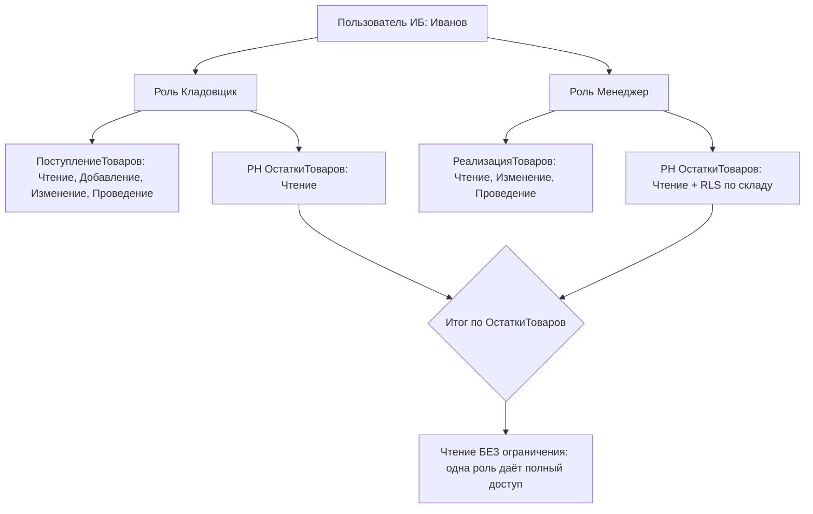
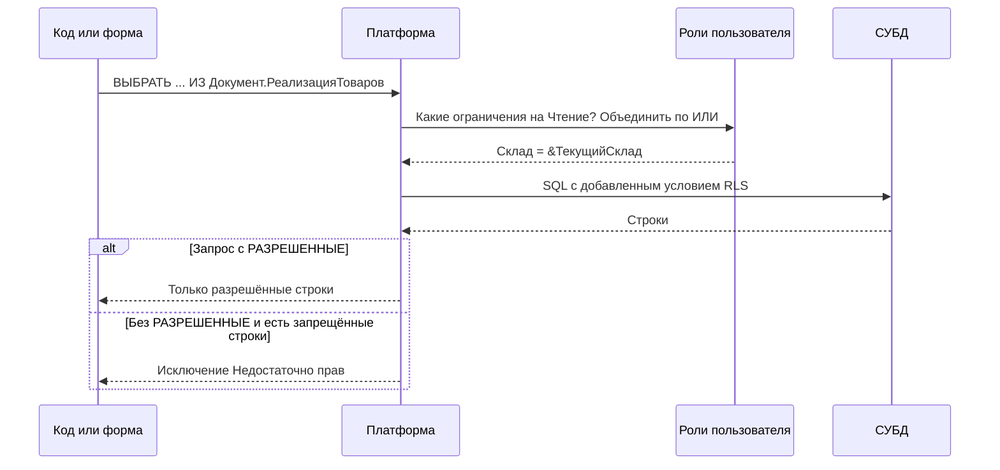
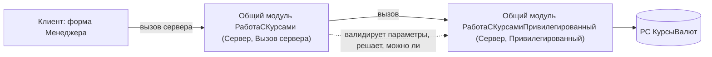
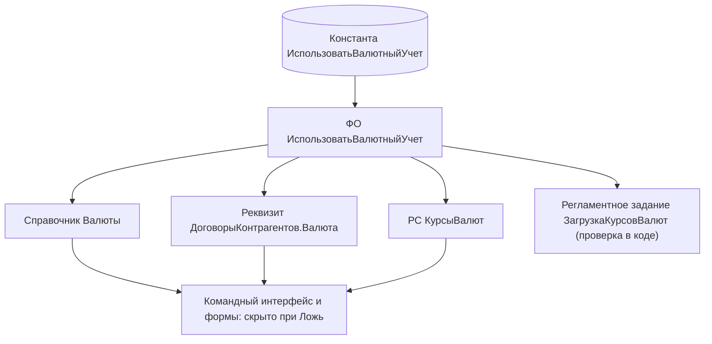
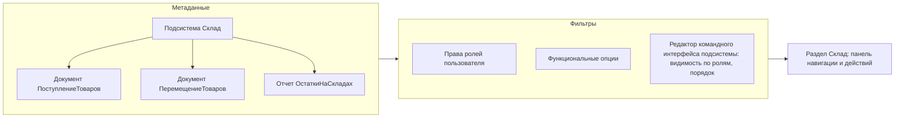

# Модуль 10. Права доступа: роли, RLS, функциональные опции, пользователи; командный интерфейс

> **Объём:** 8 ак. ч · **Неделя:** 13 · **Источники:** [Я] спринт 05 (разработка ролей, создание дополнительных ролей, стили конфигурации), спринт 06 (доработка командного интерфейса); [ПР] модуль 2 (функциональные опции, работа с интерфейсом, настройка интерфейса); [ПР2] модуль 3 (работа расширений с ролями), модуль 4 (БСП: список пользователей, настройка прав доступа), модуль 5 (механизм подсистем, роли, функциональные опции), модуль 8 (система прав доступа (RLS) в 1С:Предприятие.Элемент); [К] модули 2, 12, 13, 14, 17; [Т] модуль 3 (редакторы командного интерфейса), модуль 4 (конструктор ограничений доступа), модуль 7 («Настройка ограничений»), модуль 10 (начальная страница, командный интерфейс формы)
> **Нет в источниках (написано по документации платформы/опыту):** RLS платформы 8.3 как механизм (шаблоны ограничений, параметры сеанса) — в источниках только «конструктор ограничений доступа»/«настройка ограничений» и RLS в 1С:Элемент; `РАЗРЕШЕННЫЕ` в запросах; привилегированный режим и привилегированные общие модули; параметры функциональных опций; виды аутентификации (ОС, OpenID/OpenID Connect); программная работа с пользователями ИБ

## Результат модуля

- Умеете спроектировать набор ролей проекта и объяснить, чем аддитивная модель ролей 1С отличается от авторизационных объектов SAP.
- Умеете создавать пользователей ИБ программно и настраивать виды аутентификации.
- Умеете написать ограничение доступа на уровне записей (RLS) с шаблоном и параметром сеанса и понимаете последствия для запросов (`РАЗРЕШЕННЫЕ`).
- Умеете безопасно обходить проверки прав через привилегированный режим/модуль.
- Умеете управлять видимостью функциональности через функциональные опции и их параметры, собирать командный интерфейс из подсистем, начальную страницу и стиль.

## Карта понятий SAP → 1С

| SAP | 1С | Ключевое отличие |
|---|---|---|
| SU01 (пользователь) | Пользователь ИБ (`ПользовательИнформационнойБазы`), список пользователей в конфигураторе/БСП | Пользователь хранится **в ИБ**, не в отдельном клиенте; в типовых — пара «пользователь ИБ + элемент справочника `Пользователи` (БСП)» |
| PFCG роль | Роль (объект метаданных) | Роль — часть **конфигурации** (транспортируется с кодом), а не данные клиента |
| Профиль / composite role | Набор ролей пользователя; в БСП — «профили групп доступа» | В платформе нет составных ролей — только список ролей у пользователя |
| Авторизационный объект + поля (S_TCODE, M_BEST_WRK) | Права роли на объект метаданных + ограничение на уровне записей | Нет произвольных полей авторизации: права фиксированы платформой (Чтение, Изменение, Проведение…) |
| AUTHORITY-CHECK | `ПравоДоступа()`, `РольДоступна()`, `ВыполнитьПроверкуПравДоступа()` | Платформа проверяет права **сама** при каждом обращении к данным; явная проверка нужна редко |
| CDS access control (DCL, `@AccessControl`) | RLS — ограничения доступа к данным в роли | Похоже по сути: условие добавляется к запросу. Но задаётся в роли, а не в отдельном DCL-объекте |
| `WITH PRIVILEGED ACCESS` / технический пользователь RFC | `УстановитьПривилегированныйРежим(Истина)`, привилегированный общий модуль | Отключает **все** проверки прав в сеансе на время вызова |
| Switch framework / Business Functions (SFW5) | Функциональные опции | Опция управляет видимостью интерфейса и может быть «параметризована» (зависеть от организации) |
| Area menu, Fiori launchpad / space | Подсистемы, командный интерфейс, начальная страница | Меню собирается **из метаданных** автоматически с учётом прав и опций |
| Theme designer | Стиль, элементы стиля | Стиль — объект конфигурации |

## Теория

### Пользователи ИБ и аутентификация

Пользователи хранятся в самой ИБ (служебная таблица, не объект метаданных). Пока список пользователей **пуст**, любой вход — без аутентификации с полными правами. После создания первого пользователя вход по списку; первый пользователь должен иметь роль с правом `Администрирование`, иначе вы заблокируете себе конфигуратор.

| Вид аутентификации | Свойство пользователя | Комментарий |
|---|---|---|
| 1С:Предприятие (логин/пароль) | `АутентификацияСтандартная`, `Пароль` | Хеш пароля в ИБ; политика паролей задаётся в параметрах ИБ/БСП |
| Операционной системы | `АутентификацияОС`, `ПользовательОС` (`\\ДОМЕН\user`) | Windows (NTLM/Kerberos), в Linux — через Kerberos; аналог SSO/SNC |
| OpenID | `АутентификацияOpenID` | Одна ИБ выступает провайдером, другие (через веб-сервер) — потребителями |
| OpenID Connect | настраивается в публикации на веб-сервере (default.vrd) и свойствах пользователя | Внешние провайдеры (корпоративный IdP); доступно в новых версиях 8.3 — проверьте свою версию |

Программное создание (≈ BAPI_USER_CREATE1):

```bsl
&НаСервере
Процедура СоздатьКладовщика(Имя, ПолноеИмя, Пароль)

	Если ПользователиИнформационнойБазы.НайтиПоИмени(Имя) <> Неопределено Тогда
		ВызватьИсключение "Пользователь уже существует: " + Имя;
	КонецЕсли;

	Пользователь = ПользователиИнформационнойБазы.СоздатьПользователя();
	Пользователь.Имя = Имя;
	Пользователь.ПолноеИмя = ПолноеИмя;
	Пользователь.АутентификацияСтандартная = Истина;
	Пользователь.Пароль = Пароль;
	Пользователь.ПоказыватьВСпискеВыбора = Ложь;
	Пользователь.Роли.Добавить(Метаданные.Роли.Кладовщик);
	Пользователь.Записать();

КонецПроцедуры
```

Для этого кода нужно право `Администрирование` (или привилегированный режим). Текущий пользователь — `ПользователиИнформационнойБазы.ТекущийПользователь()`, его имя — `ИмяПользователя()`.

> В типовых конфигурациях пользователей ИБ напрямую не трогают: БСП ведёт справочник `Пользователи` и синхронизирует его с пользователями ИБ, а роли назначает через «группы доступа» и «профили». В учебном проекте без БСП работаем с платформенным API.

### Роли: аддитивная модель

Роль — объект метаданных, содержащий матрицу «объект метаданных × право» + ограничения на уровне записей. Права пользователя = **объединение** прав всех его ролей. Запрещающих прав нет (в SAP тоже нет явного deny, но там есть значения полей авторизации; здесь — только «да/нет» на объект плюс RLS).



Последняя строка схемы — главная ловушка: если одна роль даёт право без ограничения, а вторая — с RLS, ограничение «растворяется». RLS работает по «ИЛИ» между ролями.

Группы прав:

| Группа | Примеры | Аналог SAP |
|---|---|---|
| Права на конфигурацию (корень) | `Администрирование`, `АдминистрированиеДанных`, `ТонкийКлиент`, `ВебКлиент`, `ВнешнееСоединение`, `Вывод`, `СохранениеДанныхПользователя`, `ИнтерактивноеОткрытиеВнешнихОбработок`, `ИнтерактивноеОткрытиеВнешнихОтчетов` | S_ADMI_FCD, S_GUI, S_RFC |
| Основные (на данные) | `Чтение`, `Добавление`, `Изменение`, `Удаление`, `Проведение`, `ОтменаПроведения` | ACTVT 03/01/02/06 |
| Интерактивные | `Просмотр`, `Редактирование`, `ИнтерактивноеДобавление`, `ИнтерактивнаяПометкаУдаления`, `ИнтерактивноеУдаление`, `ИнтерактивноеПроведение`, `ВводПоСтроке` | S_TCODE / доступ к UI |
| Права на «код» | `Использование` (HTTP-сервис, общая команда), `Просмотр` (подсистема, общая форма), `Получение/Установка` (параметр сеанса) | S_SERVICE |

Важно различать: **основные** права проверяются при любом доступе к данным (в том числе из кода и запросов), **интерактивные** — только при действиях пользователя в UI. Право `Удаление` (непосредственное) обычно дают только администратору — пользователи помечают на удаление (`ИнтерактивнаяПометкаУдаления`).

Свойства роли: «Устанавливать права для новых объектов» (новый объект метаданных сразу получит все права в этой роли — удобно для роли администратора, опасно для прочих), «Устанавливать права для реквизитов и табличных частей по умолчанию», «Независимые права подчиненных объектов» (права на реквизиты/ТЧ не наследуются от объекта).

Конфигурация имеет свойство «Основные роли» — роли, применяемые при пустом списке пользователей.

### Проверка прав в коде

Явные проверки нужны, чтобы **не показывать/не предлагать** действие, а не для защиты данных (защиту платформа делает сама).

```bsl
// ≈ AUTHORITY-CHECK OBJECT 'M_BEST_BSA' ... без поля ACTVT
Если ПравоДоступа("Проведение", Метаданные.Документы.ЗаказПоставщику) Тогда
	Элементы.ФормаСогласовать.Видимость = Истина;
КонецЕсли;

// Проверка по роли — для прикладных «полномочий», не привязанных к объекту
Если РольДоступна("Бухгалтер") Тогда
	// ...
КонецЕсли;

// Проверка с исключением, если права нет
ВыполнитьПроверкуПравДоступа("Изменение", Метаданные.РегистрыСведений.КурсыВалют);
```

```abap
AUTHORITY-CHECK OBJECT 'M_BEST_BSA'
  ID 'ACTVT' FIELD '01'
  ID 'BSART' FIELD lv_bsart.
IF sy-subrc <> 0.
  MESSAGE e001(zmm).
ENDIF.
```

Стандарт 1С не рекомендует завязывать логику на `РольДоступна` с конкретными именами ролей — лучше `ПравоДоступа` на объект или отдельная роль‑«полномочие» вида `ПравоСогласованияЗакупок` без прав на объекты.

### Ограничение доступа на уровне записей (RLS)

Для права `Чтение`, `Добавление`, `Изменение`, `Удаление` объекта в роли можно задать **условие** на языке, близком к языку запросов. Платформа подставляет его в каждый запрос к таблице — как `@AccessControl.authorizationCheck: #CHECK` + DCL-роль в CDS.



#### Синтаксис

Простая форма — условие на поля таблицы, к которой задано ограничение:

```text
Склад = &ТекущийСклад
```

Форма с соединениями и подзапросами (поля других таблиц):

```text
ТекущаяТаблица ГДЕ ТекущаяТаблица.Контрагент В
    (ВЫБРАТЬ Д.Контрагент ИЗ РегистрСведений.ДоступКонтрагентов КАК Д
     ГДЕ Д.Пользователь = &ТекущийПользователь)
```

Параметры (`&ТекущийСклад`) — это **параметры сеанса**, других параметров в ограничениях нет. Параметры сеанса — объекты метаданных с типом и правами, значения устанавливаются в модуле сеанса:

```bsl
// Модуль сеанса
Процедура УстановкаПараметровСеанса(ТребуемыеПараметры)

	Если ТребуемыеПараметры = Неопределено
		Или ТребуемыеПараметры.Найти("ТекущийСклад") <> Неопределено Тогда
		ПараметрыСеанса.ТекущийСклад = ОпределитьСкладПользователя(ИмяПользователя());
	КонецЕсли;

КонецПроцедуры
```

`ТребуемыеПараметры` — массив имён, к которым обратились (ленивая инициализация), либо `Неопределено` при старте сеанса. Модуль сеанса выполняется в привилегированном режиме.

#### Шаблоны ограничений

Чтобы не копировать условие в десятки объектов, в роли заводят **шаблоны** (вкладка «Шаблоны ограничений»). Внутри шаблона: `#Параметр(N)` — подстановка параметра вызова, `#Если … #Тогда … #Иначе … #КонецЕсли` — препроцессор, `#ИмяТекущейТаблицы`, `#ИмяТекущегоПраваДоступа`.

Шаблон `ПоСкладу`:

```text
#Параметр(1) = &ТекущийСклад
```

Использование в ограничении `ПоступлениеТоваров` → Чтение:

```text
#ПоСкладу("Склад")
```

и в `ПеремещениеТоваров` (два поля):

```text
ТекущаяТаблица ГДЕ ТекущаяТаблица.СкладОтправитель = &ТекущийСклад
    ИЛИ ТекущаяТаблица.СкладПолучатель = &ТекущийСклад
```

БСП строит на шаблонах универсальную систему (`#ПоЗначениям(...)`, `#ДляОбъекта(...)`, «группы доступа», «виды доступа») — это и есть промышленный аналог DCL c PFCG-значениями. В учебном проекте пишем ограничения вручную.

#### Где RLS действует и где нет

| Действие | Поведение |
|---|---|
| Запрос `ВЫБРАТЬ РАЗРЕШЕННЫЕ` | Запрещённые строки молча отфильтрованы |
| Запрос `ВЫБРАТЬ` без `РАЗРЕШЕННЫЕ` | Если попадает хотя бы одна запрещённая строка — исключение |
| Динамический список | Читает с учётом ограничений (только разрешённые) |
| Чтение объекта по ссылке (`Ссылка.ПолучитьОбъект()`, обращение к реквизиту через точку) | Ошибка доступа, если запись запрещена |
| Запись (`Добавление`/`Изменение`) | Условие проверяется на **записываемых** данных при записи; нарушение — исключение |
| Привилегированный режим, привилегированный модуль | Не проверяется ничего |
| Виртуальные таблицы регистров | Ограничение накладывается на поля, доступные в виртуальной таблице (ограничение по измерениям) |

> Для регистров ограничение пишут по **измерениям**: тогда оно корректно применяется к виртуальным таблицам `Остатки`/`Обороты`. Ограничение по ресурсу или реквизиту делает виртуальные таблицы недоступными.

В отчётах на СКД флаг «Использовать РАЗРЕШЕННЫЕ» в наборе данных-запросе (по умолчанию включён в конструкторе) — аналог `РАЗРЕШЕННЫЕ`.

### Привилегированный режим и привилегированные модули

```bsl
// Пользователь без права чтения РС КурсыВалют должен видеть сумму в рублях
УстановитьПривилегированныйРежим(Истина);
Курс = ПолучитьКурс(Валюта, Дата);
УстановитьПривилегированныйРежим(Ложь);
```

- Работает только **на сервере** (на клиенте метод недоступен — проверки прав там всё равно выполняет сервер).
- Счётчик вложенности: каждый `Истина` должен быть закрыт `Ложь`; проверка — `ПривилегированныйРежим()`.
- Общий модуль со свойством **«Привилегированный»** (только «Сервер», без «Вызов сервера» для клиента — иначе дыра) выполняется целиком без проверок прав и RLS.



Принцип: привилегированный код — узкий, без параметров «что угодно прочитать», вызывается только из проверенного серверного кода. Аналог SAP — RFC с техническим пользователем или `WITH PRIVILEGED ACCESS`: вы берёте на себя ответственность за авторизацию.

### Функциональные опции

Функциональная опция — булев (или иной) флаг, хранящийся в константе, ресурсе регистра сведений или реквизите справочника, к которому привязан **состав**: объекты метаданных, реквизиты, команды. Если значение опции ложно, все объекты состава исчезают из интерфейса (команды, поля форм, разделы). Данные и права **не** меняются — это UI-уровень (как Business Function: она тоже «прячет», но код остаётся).

```bsl
Если ПолучитьФункциональнуюОпцию("ИспользоватьВалютныйУчет") Тогда
	// показать поле Валюта, пересчитать сумму
КонецЕсли;
```



**Параметры функциональных опций** — объекты метаданных, позволяющие хранить опцию в разрезе: например, ресурс РС `НастройкиОрганизаций.ИспользоватьВалютныйУчет` с измерением `Организация`. Параметр ФО `Организация` связывается с измерением. Значение параметра задают:

```bsl
// для всего интерфейса сеанса (клиент)
УстановитьПараметрыФункциональныхОпцийИнтерфейса(Новый Структура("Организация", Организация));

// для конкретной формы (в ПриСозданииНаСервере)
УстановитьПараметрыФункциональныхОпцийФормы(Новый Структура("Организация", Объект.Организация));

// чтение в коде
Значение = ПолучитьФункциональнуюОпцию("ИспользоватьВалютныйУчет",
	Новый Структура("Организация", Организация));
```

Значения ФО кэшируются на сеанс. После изменения константы-хранилища вызовите `ОбновитьПовторноИспользуемыеЗначения()` и `ОбновитьИнтерфейс()` на клиенте, иначе пользователь увидит старый интерфейс до перезапуска.

### Подсистемы, командный интерфейс, начальная страница

Командный интерфейс **генерируется**: разделы — подсистемы верхнего уровня с флагом «Включать в командный интерфейс»; команды — стандартные команды объектов, входящих в подсистему (открыть список, создать), и общие команды. Видимость команды = права роли ∧ функциональная опция ∧ настройки «Командного интерфейса» подсистемы (видимость по ролям, порядок, группы «Панель навигации»/«Панель действий» — «Создать», «Отчеты», «Сервис»).



Где что настраивается:

| Что | Где |
|---|---|
| Состав и порядок разделов | Конфигурация → «Командный интерфейс» (редактор разделов) |
| Команды раздела, видимость по ролям | Подсистема → «Командный интерфейс» |
| Командный интерфейс формы объекта (переходы к подчинённым, отчётам) | Форма → вкладка «Командный интерфейс» |
| Начальная страница | Конфигурация → «Рабочая область начальной страницы»: шаблон (одна/две колонки), список форм, видимость по ролям |
| Стиль | Объект «Стиль» + общие элементы стиля (цвета, шрифты, рамки); свойство конфигурации «Основной стиль» |

Аналог в SAP: Fiori launchpad catalogs/groups (сейчас spaces/pages), где плитки тоже фильтруются по ролям. Различие — в 1С не нужно отдельно «раскатывать» каталоги: структура выводится из метаданных.

Элементы стиля используют в формах (цвет текста, шрифт заголовков) вместо «жёстких» значений: смена стиля перекрашивает всё приложение. В коде: `ЦветаСтиля.ЦветОсобогоТекста`, `ШрифтыСтиля.<Имя>` (для своих элементов стиля).

### Роли проекта

| Роль | Данные (основные права) | Интерфейс | RLS |
|---|---|---|---|
| `Администратор` | всё + `Администрирование`, `АдминистрированиеДанных` | все подсистемы | — |
| `Кладовщик` | `ПоступлениеТоваров`, `ПеремещениеТоваров`: CRUD+проведение; `Номенклатура`, `Склады`: чтение; РН `ОстаткиТоваров`: чтение | `Склад` | по складу (`&ТекущийСклад`) |
| `Менеджер` | `РеализацияТоваров`, `ЗаказПоставщику`, `ОплатаОтПокупателя`: CRUD+проведение; `Контрагенты`, `ДоговорыКонтрагентов`: изменение; РН `Продажи`, `ОстаткиТоваров`: чтение | `Продажи`, `Склад` (только отчёты) | по контрагентам менеджера (опционально) |
| `Бухгалтер` | `ОперацияБух`, `ОплатаПоставщику`, `НачислениеЗарплаты`: CRUD+проведение; РБ `Хозрасчетный`, РР `Начисления`: чтение | `Финансы`, `Зарплата` | — |

Плюс служебная роль `БазовыеПрава` (ТонкийКлиент, ВебКлиент, СохранениеДанныхПользователя, Вывод, чтение констант и общих справочников) — назначается всем.

## Ловушки для ABAP-разработчика

1. **Роли объединяются по «ИЛИ».** Одна «широкая» роль без RLS отменяет ограничение другой. В SAP «лишний профиль» тоже расширяет доступ, но там проверка идёт по значениям полей; здесь — по объекту целиком.
2. **Запрос без `РАЗРЕШЕННЫЕ` падает, а не фильтрует.** Код, отлаженный под администратором, у кладовщика выбрасывает «Недостаточно прав». Тестируйте под ролями.
3. **Обращение «через точку» читает объект.** `Документ.Склад.Наименование` у пользователя без прав на склад — ошибка, даже если вам нужно только имя. В запросах — `ПРЕДСТАВЛЕНИЕ()` и `РАЗРЕШЕННЫЕ`.
4. **RLS на регистрах — только по измерениям.** Ограничение по реквизиту ломает виртуальные таблицы остатков/оборотов.
5. **Привилегированный модуль с «Вызов сервера»** — это публичный API в обход прав. Только «Сервер».
6. **Функциональная опция не защищает данные.** Спрятанный объект доступен из кода/запроса/OData; защита — только роли.
7. **«Устанавливать права для новых объектов»** включено у рабочей роли — новый объект (например, РС с зарплатами) сразу виден всем кладовщикам.
8. **Пустой список пользователей = полный доступ.** На стенде с публикацией на веб-сервере это открытая база.
9. **Роли — часть конфигурации.** Изменение роли требует обновления конфигурации ИБ (как транспорт), а не настройки в продуктиве. В типовых гибкость в рантайме обеспечивает БСП (группы доступа — данные).
10. **Параметр сеанса не обновится сам.** Сменили пользователю склад — значение `ТекущийСклад` останется старым до перезапуска сеанса или явной переустановки.

## Практика (сквозной проект)

### M10-T1. Роли проекта и пользователи

Создайте роли `Администратор`, `Кладовщик`, `Менеджер`, `Бухгалтер`, `БазовыеПрава` по таблице «Роли проекта». Обработкой (на сервере, привилегированно) создайте пользователей `admin`, `store1`, `store2`, `manager`, `accountant`.

- [ ] Под `store1` не видны разделы `Продажи`, `Финансы`, `Зарплата`.
- [ ] Под `manager` нельзя создать `ПоступлениеТоваров` (нет команды, а программная запись даёт ошибку прав).
- [ ] Повторный запуск обработки не создаёт дубликатов.

**Самопроверка:** сценарий входа под каждым пользователем (`/N store1 /P ...` в ярлыке тонкого клиента); чек-лист видимых разделов.

### M10-T2. Проверка прав в коде

На форме `ЗаказПоставщику` кнопка «Согласовать» видна только при праве `Проведение`; отчёт по себестоимости в `Продажи` доступен только при праве чтения `РН ПартииТоваров`.

- [ ] Используется `ПравоДоступа`, а не `РольДоступна`.
- [ ] Логика в `ПриСозданииНаСервере`.

### M10-T3. RLS по складу

Параметр сеанса `ТекущийСклад` (тип `СправочникСсылка.Склады`), РС `НастройкиПользователей` (измерение `ИмяПользователя` строка; ресурс `ОсновнойСклад`). Шаблон `ПоСкладу` в роли `Кладовщик`; ограничения на `ПоступлениеТоваров`, `ПеремещениеТоваров` (обе стороны), РН `ОстаткиТоваров`, `ПартииТоваров`.

- [ ] `store1` видит в списках и отчёте «Остатки» только свой склад.
- [ ] Попытка записать поступление на чужой склад даёт ошибку прав.
- [ ] Отчёт на СКД работает (галочка `РАЗРЕШЕННЫЕ`), а запрос без `РАЗРЕШЕННЫЕ` в обработке падает — продемонстрируйте и исправьте.

**Самопроверка:** `checks/M10-T3.sql.txt` — запрос `ВЫБРАТЬ РАЗРЕШЕННЫЕ` к `ОстаткиТоваров.Остатки` под `store1` и `admin`.

### M10-T4. Привилегированный модуль

Кладовщику нужно видеть в форме поступления «последнюю цену закупки» из РС `ЦеныНоменклатуры`, но не иметь права читать этот регистр.

- [ ] Общий модуль `ЦеныПривилегированный` (Сервер, Привилегированный) с функцией `ПоследняяЦена(Номенклатура, Дата)`.
- [ ] Вызывается через непривилегированный модуль с «Вызов сервера», проверяющий параметры.
- [ ] Под `store1` форма списка `ЦеныНоменклатуры` недоступна, а цена в поступлении отображается.

### M10-T5. Функциональная опция с параметром

Константа `ИспользоватьВалютныйУчет` → ФО → состав: `Валюты`, `КурсыВалют`, реквизит `ДоговорыКонтрагентов.Валюта`. Затем перенесите хранение в РС `НастройкиОрганизаций` (измерение `Организация`) с параметром ФО `Организация`.

- [ ] При выключенной опции раздел/команды «Валюты» и поле «Валюта» в договоре не видны.
- [ ] В форме договора видимость поля зависит от организации владельца (через `УстановитьПараметрыФункциональныхОпцийФормы`).

### M10-T6. Командный интерфейс и начальная страница

Настройте порядок разделов (`Склад`, `Продажи`, `Финансы`, `Зарплата`, `Администрирование`), панели действий («Создать» в каждом разделе), начальную страницу в две колонки: слева — список `ЗаказПоставщику` со статусом «На согласовании», справа — отчёт «Остатки» (только для `Кладовщик`, `Менеджер`). Создайте стиль с собственным элементом `ЦветПросроченного`.

- [ ] Начальная страница разная для `store1` и `accountant`.
- [ ] Цвет просроченных заказов в списке задан элементом стиля, а не литералом.

### M10-T7*. Ограничение по контрагентам менеджера

РС `ДоступКонтрагентов` (измерения `Пользователь` — `Строка`, `Контрагент`). Ограничение для роли `Менеджер` на `РеализацияТоваров`, `ОплатаОтПокупателя`, `Контрагенты`, `Взаиморасчеты` через подзапрос (шаблон с `#Параметр`).

- [ ] Менеджер видит только «свои» документы и остатки взаиморасчётов по своим контрагентам.
- [ ] Замер производительности (модуль 12) списка `РеализацияТоваров` под менеджером на 50 тыс. документов — время и план запроса записаны в README ветки.
- [ ] Объяснено, почему у пользователя с ролями `Менеджер` + `Бухгалтер` ограничение пропадает.

## Контрольные вопросы

1. Как вычисляются итоговые права пользователя с несколькими ролями? Что будет с RLS, если одна из ролей даёт право без ограничения?
2. Чем основные права отличаются от интерактивных? Приведите пример, где это важно.
3. Чем поведение запроса с `РАЗРЕШЕННЫЕ` отличается от запроса без него при наличии RLS?
4. Какие параметры можно использовать в тексте ограничения доступа и где они устанавливаются?
5. Почему ограничения на регистры рекомендуют задавать только по измерениям?
6. Что такое привилегированный общий модуль, где он выполняется и почему ему нельзя ставить «Вызов сервера»?
7. Защищает ли функциональная опция данные? Чем ФО отличается от роли?
8. Что такое параметры функциональных опций и как задать их для формы?
9. Из чего формируется командный интерфейс раздела и какие факторы влияют на видимость команды?
10. Какие виды аутентификации поддерживает платформа и что происходит, когда список пользователей ИБ пуст?

## Документация

- Документация платформы (разделы «Права доступа», «Функциональные опции», «Командный интерфейс»): https://its.1c.ru/db/v83doc
- Стандарты разработки (раздел о правах доступа и привилегированном режиме): https://its.1c.ru/db/v8std
- БСП, подсистема «Управление доступом»: https://its.1c.ru/db/bsp
- Методическая поддержка разработчиков: https://its.1c.ru/db/metod8dev
- Сайт платформы: https://v8.1c.ru
