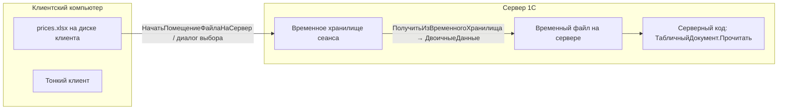
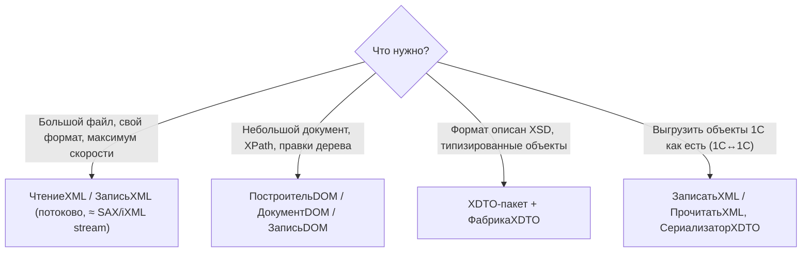
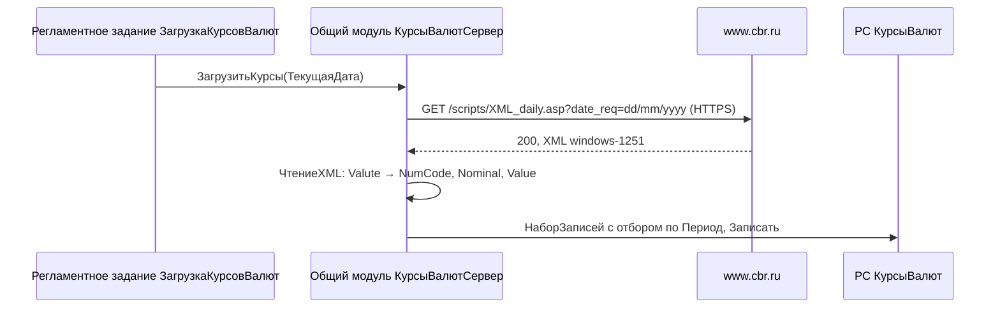
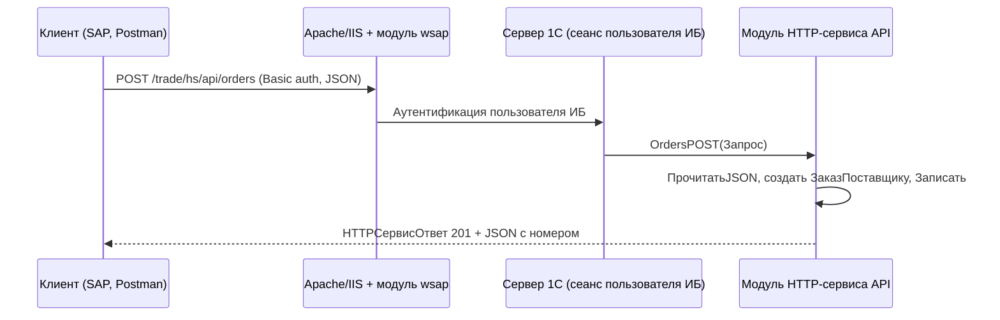
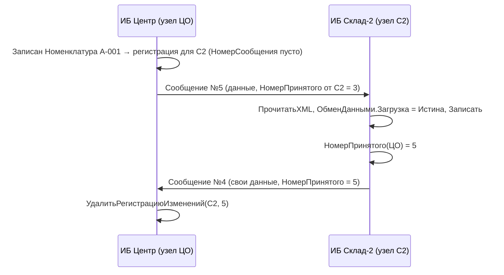
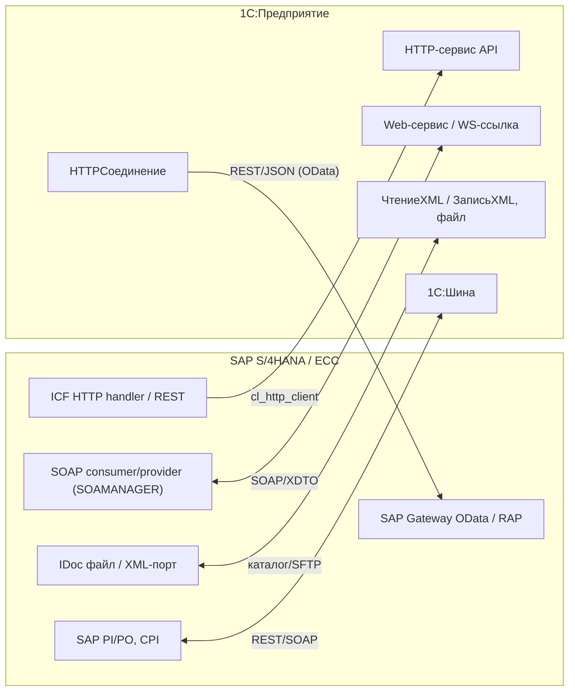

# Модуль 11. Интеграция: файлы, HTTP-клиент, HTTP-сервисы, Web-сервисы и XDTO, планы обмена и РИБ, внешние источники данных

> **Объём:** 18 ак. ч · **Неделя:** 13–14 · **Источники:** [Я] спринт 08 (текстовые файлы, Excel, Data Base File, XML, JSON, REST и SOAP, работа с API, получение курса валют, XDTO-пакеты и веб-сервис SOAP, REST-сервисы), спринт 13 (планы обмена, стандартные обработки обмена, основы обмена между конфигурациями); [ПР] модуль 2 (работа с файлами), модуль 5 (работа с файлами и картинками), модуль 6 (обмен между центральной базой и мобильным устройством); [ПР2] модуль 4 (БСП: загрузка внешних компонент, загрузка из файла, обмен данными), модуль 5 (планы обмена, РИБ, внешние источники данных, XDTO и XML-сериализация, обмен в режиме онлайн, файловые данные, двоичные данные), модуль 7 (1С:Исполнитель: файлы, почта, HTTP, JSON/XML); [К] модули 2, 13, 14, 16; [Т] модуль 8 (универсальные механизмы обмена, РИБ, XML-сериализация, Xbase, Automation Client/Server, внешние компоненты, электронная почта, ActiveX, Web-сервисы, форматы данных)
> **Нет в источниках (написано по документации платформы/опыту):** интеграция 1С ↔ SAP (все варианты); стандартный интерфейс OData платформы; 1С:Шина как средство интеграции (в источниках — только в контексте 1С:Исполнителя); WS-ссылки/WSПрокси как отдельная тема (в источниках — «Web-сервисы» в целом)

## Результат модуля

- Умеете читать и писать текст, Excel (через табличный документ), XML (потоково и DOM), JSON и выбирать нужный API под объём данных.
- Умеете вызывать внешние REST/XML API через `HTTPСоединение` и загружать курсы валют ЦБ РФ регламентным заданием.
- Умеете публиковать свой REST API (HTTP-сервис) и SOAP-сервис на XDTO и потреблять чужой SOAP через WS-ссылку.
- Понимаете планы обмена: регистрацию изменений, номера сообщений, квитирование, РИБ — и можете собрать двусторонний обмен.
- Можете выбрать вариант интеграции 1С ↔ SAP и обосновать его.

## Карта понятий SAP → 1С

| SAP | 1С | Ключевое отличие |
|---|---|---|
| `OPEN DATASET` / `cl_abap_conv_*` | `ЧтениеТекста`/`ЗаписьТекста`, `ТекстовыйДокумент`, `ДвоичныеДанные`, потоки | Файлы на **клиенте** и на **сервере** — разные машины; передача через временное хранилище |
| `cl_ixml`, `CALL TRANSFORMATION` | `ЧтениеXML`/`ЗаписьXML`, DOM, `ФабрикаXDTO`, `СериализаторXDTO` | XSLT в платформе есть (`ПреобразованиеXSL`), но основной путь — XDTO |
| `/ui2/cl_json`, `xco_cp_json` | `ЧтениеJSON`/`ЗаписьJSON`, `ПрочитатьJSON`/`ЗаписатьJSON` | JSON читается в `Структура`/`Соответствие`/`Массив` |
| `cl_http_client` | `HTTPСоединение` + `HTTPЗапрос` | Без SM59: хост/порт/прокси задаются в коде или настройках |
| ICF-сервис (SICF) / RAP-сервис | HTTP-сервис (объект метаданных) | Шаблоны URL и методы задаются в метаданных, публикация — через веб-сервер Apache/IIS |
| OData / SAP Gateway (SEGW) | Стандартный интерфейс OData (автоматический) или свой HTTP-сервис | OData платформы генерируется по метаданным, без кода |
| SOAP provider (SOAMANAGER) | Web-сервис + XDTO-пакет | WSDL генерируется платформой по XDTO |
| SOAP consumer (proxy SPROXY) | WS-ссылка → `WSПрокси` | Прокси динамический, без генерации классов |
| RFC/BAPI | HTTP-/Web-сервис; COM-соединение 1С↔1С (только Windows) | Аналога RFC-протокола нет |
| ALE/IDoc, BD64 модель распределения | План обмена (узлы) + сообщения XML | Узел плана обмена ≈ логическая система + партнёр |
| Change pointers (BDCP2, BD52) | Регистрация изменений в плане обмена (таблица `<Объект>.Изменения`) | Регистрация автоматическая по составу плана, с номерами сообщений и квитированием |
| SLT / DB connect | Внешние источники данных | Чтение (и ограниченная запись) таблиц внешней СУБД через ODBC в языке запросов |
| SAP PI/PO, CPI | 1С:Шина, конвертация данных, EnterpriseData | Отдельные продукты/форматы, не часть платформы |

## Теория

### Где выполняется код и где лежит файл



В файловой ИБ клиент и «сервер» на одной машине, поэтому код «работает» с путём `C:\...` — и ломается в клиент-серверном варианте и в веб-клиенте. Правило: на сервер передаются **двоичные данные** через временное хранилище, на сервере — `ПолучитьИмяВременногоФайла()` и `ДвоичныеДанные.Записать()`/`Новый ДвоичныеДанные(ИмяФайла)`.

На клиенте: `НачатьПомещениеФайлаНаСервер(ОписаниеОповещения, ..., ПараметрыДиалогаПомещенияФайлов, УникальныйИдентификатор)` → в обработчике оповещения получаете `ОписаниеФайла.Адрес` и передаёте адрес в серверную процедуру (код серверной части — в разделе про Excel).

> `НачатьПомещениеФайлаНаСервер` и `ПараметрыДиалогаПомещенияФайлов` появились в 8.3.18. На более старых версиях — `НачатьПомещениеФайла(...)` / `ПоместитьФайл(...)`. Точный порядок параметров сверьте в синтакс-помощнике своей версии.

### Текстовые файлы

| Задача | API |
|---|---|
| Небольшой файл целиком, построчный доступ по номеру | `ТекстовыйДокумент`: `Прочитать`, `Записать`, `КоличествоСтрок`, `ПолучитьСтроку`, `ДобавитьСтроку` |
| Большой файл, потоково | `ЧтениеТекста` (`ПрочитатьСтроку` → `Неопределено` в конце), `ЗаписьТекста` (`ЗаписатьСтроку`) |
| Бинарные данные, Base64, хеши | `ДвоичныеДанные`, `ПотокВПамяти`, `ФайловыеПотоки`, `ЧтениеДанных`/`ЗаписьДанных`, `Base64Строка()` |

```bsl
// CSV: Артикул;Цена — потоковое чтение
Чтение = Новый ЧтениеТекста(ИмяФайла, КодировкаТекста.UTF8);
Строка = Чтение.ПрочитатьСтроку();
Пока Строка <> Неопределено Цикл
	Части = СтрРазделить(Строка, ";");
	Если Части.Количество() >= 2 Тогда
		Артикул = СокрЛП(Части[0]);
		Цена    = Число(СтрЗаменить(Части[1], ",", "."));
		// ...
	КонецЕсли;
	Строка = Чтение.ПрочитатьСтроку();
КонецЦикла;
Чтение.Закрыть();
```

`Число("12,5")` в общем случае не сработает — преобразуйте разделитель явно и оборачивайте в `Попытка`. Для DBF (Data Base File) есть объект `XBase` — legacy, встречается в обменах с банковскими/старыми системами.

### Excel через табличный документ

`ТабличныйДокумент.Прочитать()` открывает xlsx/xls/ods **без установленного Excel** (на любом сервере, включая Linux):

```bsl
&НаСервереБезКонтекста
Процедура ЗагрузитьЦеныНаСервере(Адрес)

	ИмяФайла = ПолучитьИмяВременногоФайла("xlsx");
	ПолучитьИзВременногоХранилища(Адрес).Записать(ИмяФайла);

	ТД = Новый ТабличныйДокумент;
	ТД.Прочитать(ИмяФайла);
	УдалитьФайлы(ИмяФайла);

	Набор = РегистрыСведений.ЦеныНоменклатуры.СоздатьНаборЗаписей();
	Дата = НачалоДня(ТекущаяДатаСеанса());
	Набор.Отбор.Период.Установить(Дата);

	Для НомерСтроки = 2 По ТД.ВысотаТаблицы Цикл   // 1-я строка — заголовок
		Артикул = СокрЛП(ТД.Область(НомерСтроки, 1).Текст);
		ЦенаТекст = СтрЗаменить(СокрЛП(ТД.Область(НомерСтроки, 2).Текст), ",", ".");
		Номенклатура = Справочники.Номенклатура.НайтиПоРеквизиту("Артикул", Артикул);
		Если Номенклатура.Пустая() Тогда
			Продолжить;
		КонецЕсли;
		Запись = Набор.Добавить();
		Запись.Период = Дата;
		Запись.Номенклатура = Номенклатура;
		Запись.Цена = Число(ЦенаТекст);
	КонецЦикла;

	Набор.Записать();

КонецПроцедуры
```

Выгрузка: `ТД.Записать(ИмяФайла, ТипФайлаТабличногоДокумента.XLSX)`. Через COM (`Новый COMОбъект("Excel.Application")`) — только Windows и только при установленном Excel; на сервере так делать не надо.

### XML: потоково, DOM, XDTO



Потоковое чтение — см. загрузку курсов ЦБ ниже: цикл `Пока Чтение.Прочитать()`, ветвление по `ТипУзла` (`ТипУзлаXML.НачалоЭлемента`/`Текст`/`КонецЭлемента`), `Имя`, `Значение`, `ПолучитьАтрибут("ID")`. Запись:

```bsl
Запись = Новый ЗаписьXML;
Запись.УстановитьСтроку("UTF-8");       // или ОткрытьФайл(ИмяФайла, "UTF-8")
Запись.ЗаписатьОбъявлениеXML();
Запись.ЗаписатьНачалоЭлемента("Item");
Запись.ЗаписатьАтрибут("sku", "A-001");
Запись.ЗаписатьТекст(XMLСтрока(15));
Запись.ЗаписатьКонецЭлемента();
Текст = Запись.Закрыть();
```

DOM: `Документ = (Новый ПостроительDOM).Прочитать(ЧтениеXML)`, далее `Документ.ПолучитьЭлементыПоИмени("CharCode")` и `Узел.ТекстовоеСодержимое`; запись дерева — `ЗаписьDOM.Записать(Документ, ЗаписьXML)`. Для XPath у `ДокументDOM` есть `ВычислитьВыражениеXPath(...)` (нужен разыменователь пространств имён) — аналог `if_ixml_node` + XPath в ABAP.

`XMLСтрока()`/`XMLЗначение(Тип, Строка)` — каноническое XML-представление значений 1С (даты `2026-10-12T00:00:00`, числа с точкой, булево `true`). Всегда пишите значения через них, а не через `Строка()` (тот зависит от локали).

### XDTO и сериализация

XDTO — объектная модель XML-схем в платформе (аналог Simple Transformations + DDIC-типы прокси). **XDTO-пакет** — объект метаданных, импортируемый из XSD или описанный вручную; `ФабрикаXDTO` (глобальная — все пакеты конфигурации + платформенные) создаёт типизированные объекты.

```bsl
URI = "http://example.org/uchtorg/stock";
ТипОстаток = ФабрикаXDTO.Тип(URI, "StockItem");
Остаток = ФабрикаXDTO.Создать(ТипОстаток);
Остаток.sku = "A-001";
Остаток.qty = 15;

Запись = Новый ЗаписьXML;
Запись.УстановитьСтроку();
ФабрикаXDTO.ЗаписатьXML(Запись, Остаток);
Текст = Запись.Закрыть();

// обратно
Чтение = Новый ЧтениеXML;
Чтение.УстановитьСтроку(Текст);
Объект = ФабрикаXDTO.ПрочитатьXML(Чтение, ТипОстаток);
```

**XML-сериализация объектов 1С** (формат платформы, для обменов 1С↔1С с одинаковыми метаданными): `ЗаписатьXML(ЗаписьXML, Объект)` или `СериализаторXDTO.ЗаписатьXML(ЗаписьXML, Объект, НазначениеТипаXML.Явное)`. Чтение — `ПрочитатьXML(Чтение)` возвращает объект (`СправочникОбъект`), который нужно `Записать()`. Ссылки сериализуются как GUID — это обеспечивает идентичность объектов между базами одной конфигурации.

### JSON

```bsl
// Разбор в коллекции
Чтение = Новый ЧтениеJSON;
Чтение.УстановитьСтроку(ТекстJSON);
Данные = ПрочитатьJSON(Чтение, Истина);   // Истина — в Соответствие (ключи любые), Ложь — в Структура
Чтение.Закрыть();

Для Каждого Позиция Из Данные["items"] Цикл
	Артикул = Позиция["sku"];
	Количество = Позиция["qty"];
КонецЦикла;

// Формирование
Ответ = Новый Структура;
Ответ.Вставить("sku", "A-001");
Ответ.Вставить("qty", 15);
Ответ.Вставить("date", ТекущаяДатаСеанса());

Запись = Новый ЗаписьJSON;
Запись.УстановитьСтроку();
Настройки = Новый НастройкиСериализацииJSON;
Настройки.ФорматСериализацииДаты = ФорматДатыJSON.ISO;
ЗаписатьJSON(Запись, Ответ, Настройки);
Текст = Запись.Закрыть();
```

Особенности:

- `ПрочитатьJSON(..., Ложь)` в `Структура` падает на ключах, недопустимых как идентификаторы (`"order-id"`, `"1c"`). Для внешних API — `Соответствие`.
- Даты в JSON — строки; при чтении укажите имена свойств-дат параметром `ПрочитатьJSON` или конвертируйте `XMLЗначение(Тип("Дата"), ...)` вручную.
- Ссылки, `ТаблицаЗначений`, объекты `ЗаписатьJSON` не сериализует — только примитивы, `Структура`, `Соответствие` (со строковыми ключами), `Массив`, `ФиксированныеСтруктура`/`Массив`. Для объектов 1С — `СериализаторXDTO.ЗаписатьJSON(Запись, Значение, НазначениеТипаXML.Явное)` (формат платформы).
- Потоковый API: `ЗаписьJSON.ЗаписатьНачалоОбъекта()`, `ЗаписатьИмяСвойства()`, `ЗаписатьЗначение()`, `ЗаписатьКонецОбъекта()`; `ЧтениеJSON.Прочитать()` + `ТипТекущегоЗначения` (`ТипЗначенияJSON.НачалоОбъекта` …) + `ТекущееЗначение` — для больших ответов.

### HTTP-клиент: курсы валют ЦБ РФ

Ответ `https://www.cbr.ru/scripts/XML_daily.asp?date_req=12/10/2026` (кодировка windows-1251, десятичная запятая):

```xml
<ValCurs Date="12.10.2026" name="Foreign Currency Market">
  <Valute ID="R01235">
    <NumCode>840</NumCode>
    <CharCode>USD</CharCode>
    <Nominal>1</Nominal>
    <Name>Доллар США</Name>
    <Value>81,2345</Value>   <!-- числа условные -->
    <VunitRate>81,2345</VunitRate>
  </Valute>
</ValCurs>
```




```bsl
// Общий модуль КурсыВалютСервер (Сервер)
Процедура ЗагрузитьКурсы(Дата) Экспорт

	Соединение = Новый HTTPСоединение("www.cbr.ru", 443, , , , 30,
		Новый ЗащищенноеСоединениеOpenSSL);

	Ресурс = "/scripts/XML_daily.asp?date_req=" + Формат(Дата, "ДФ=dd/MM/yyyy");
	Заголовки = Новый Соответствие;
	Заголовки.Вставить("User-Agent", "UchebnayaTorgovlya/1.0");
	Запрос = Новый HTTPЗапрос(Ресурс, Заголовки);

	Ответ = Соединение.Получить(Запрос);
	Если Ответ.КодСостояния <> 200 Тогда
		ВызватьИсключение СтрШаблон("ЦБ РФ вернул код %1", Ответ.КодСостояния);
	КонецЕсли;

	// Кодировку берём из XML-декларации: читаем поток, а не строку
	Чтение = Новый ЧтениеXML;
	Чтение.ОткрытьПоток(Ответ.ПолучитьТелоКакДвоичныеДанные().ОткрытьПотокДляЧтения());

	Набор = РегистрыСведений.КурсыВалют.СоздатьНаборЗаписей();
	Набор.Отбор.Период.Установить(НачалоДня(Дата));

	ТекущийЭлемент = "";
	Значения = Новый Структура("NumCode, Nominal, Value");
	Пока Чтение.Прочитать() Цикл
		Если Чтение.ТипУзла = ТипУзлаXML.НачалоЭлемента Тогда
			ТекущийЭлемент = Чтение.Имя;
		ИначеЕсли Чтение.ТипУзла = ТипУзлаXML.Текст И Значения.Свойство(ТекущийЭлемент) Тогда
			Значения[ТекущийЭлемент] = Чтение.Значение;
		ИначеЕсли Чтение.ТипУзла = ТипУзлаXML.КонецЭлемента И Чтение.Имя = "Valute" Тогда
			Валюта = Справочники.Валюты.НайтиПоКоду(Значения.NumCode);
			Если ЗначениеЗаполнено(Валюта) Тогда
				Запись = Набор.Добавить();
				Запись.Период    = НачалоДня(Дата);
				Запись.Валюта    = Валюта;
				Запись.Курс      = Число(СтрЗаменить(Значения.Value, ",", "."));
				Запись.Кратность = Число(Значения.Nominal);
			КонецЕсли;
			Значения = Новый Структура("NumCode, Nominal, Value");
		ИначеЕсли Чтение.ТипУзла = ТипУзлаXML.КонецЭлемента Тогда
			ТекущийЭлемент = "";
		КонецЕсли;
	КонецЦикла;
	Чтение.Закрыть();

	Набор.Записать();

КонецПроцедуры
```

Ключевые моменты API:

Методы `HTTPСоединение`: `Получить` (GET), `ОтправитьДляОбработки` (POST), `Записать` (PUT), `Удалить` (DELETE), `ВызватьHTTPМетод("PATCH", Запрос)` (любой метод).

Конструктор: `Новый HTTPСоединение(Сервер, Порт, Пользователь, Пароль, Прокси, Таймаут, ЗащищенноеСоединение, ...)` — сервер **без** схемы `https://`; TLS включается объектом `ЗащищенноеСоединениеOpenSSL` (можно передать `СертификатыУдостоверяющихЦентровОС` для проверки сертификата). Прокси — `Новый ИнтернетПрокси`. Тело запроса — `Запрос.УстановитьТелоИзСтроки(Текст, КодировкаТекста.UTF8, ИспользованиеByteOrderMark.НеИспользовать)`; ответ — `ПолучитьТелоКакСтроку()`/`ПолучитьТелоКакДвоичныеДанные()`, `Заголовки` (Соответствие).

```abap
cl_http_client=>create_by_url( EXPORTING url = lv_url IMPORTING client = lo_client ).
lo_client->request->set_method( 'GET' ).
lo_client->send( ). lo_client->receive( ).
lv_xml = lo_client->response->get_cdata( ).
```

Регламентное задание `ЗагрузкаКурсовВалют` (метаданные: метод — `КурсыВалютСервер.ЗагрузкаКурсовВалютРегламент`, расписание — ежедневно) подробно — в [модуле 12](12-jobs-bp-admin-performance.md). Код регламентного задания выполняется на сервере без интерактивного пользователя: никаких `Сообщить`/диалогов, ошибки — в журнал регистрации (`ЗаписьЖурналаРегистрации`).

### HTTP-сервисы (свой REST API)

Объект метаданных **HTTP-сервис** `API`: корневой URL `api`, шаблоны URL и методы:

| Шаблон | Метод | Обработчик |
|---|---|---|
| `/stock` | GET | `StockGET` |
| `/stock/{sku}` | GET | `StockItemGET` |
| `/orders` | POST | `OrdersPOST` |

URL после публикации: `http(s)://<хост>/<имя публикации>/hs/api/stock?warehouse=...`. Публикация — Apache/IIS через конфигуратор («Администрирование → Публикация на веб-сервере») или `webinst`; создаётся `default.vrd`. Стенд — см. [lab](../lab/README.md).



```bsl
// Модуль HTTP-сервиса API
Функция StockGET(Запрос)

	Склад = Неопределено;
	КодСклада = Запрос.ПараметрыЗапроса.Получить("warehouse");
	Если КодСклада <> Неопределено Тогда
		Склад = Справочники.Склады.НайтиПоКоду(КодСклада);
	КонецЕсли;

	Запрос1С = Новый Запрос(
	"ВЫБРАТЬ РАЗРЕШЕННЫЕ
	|	О.Номенклатура.Артикул КАК sku,
	|	О.Склад.Код КАК warehouse,
	|	О.КоличествоОстаток КАК qty
	|ИЗ
	|	РегистрНакопления.ОстаткиТоваров.Остатки(, &БезОтбора ИЛИ Склад = &Склад) КАК О");
	Запрос1С.УстановитьПараметр("БезОтбора", Склад = Неопределено);
	Запрос1С.УстановитьПараметр("Склад", Склад);

	Позиции = Новый Массив;
	Выборка = Запрос1С.Выполнить().Выбрать();
	Пока Выборка.Следующий() Цикл
		Позиции.Добавить(Новый Структура("sku, warehouse, qty",
			Выборка.sku, Выборка.warehouse, Выборка.qty));
	КонецЦикла;

	Возврат ОтветJSON(200, Новый Структура("items", Позиции));

КонецФункции

Функция OrdersPOST(Запрос)

	Чтение = Новый ЧтениеJSON;
	Чтение.УстановитьСтроку(Запрос.ПолучитьТелоКакСтроку());
	Данные = ПрочитатьJSON(Чтение, Истина);

	Контрагент = Справочники.Контрагенты.НайтиПоРеквизиту("ИНН", Данные["vendorInn"]);
	Если Контрагент.Пустая() Тогда
		Возврат ОтветJSON(422, Новый Структура("error", "vendor not found"));
	КонецЕсли;

	Заказ = Документы.ЗаказПоставщику.СоздатьДокумент();
	Заказ.Дата = ТекущаяДатаСеанса();
	Заказ.Контрагент = Контрагент;
	Для Каждого Позиция Из Данные["items"] Цикл
		Стр = Заказ.Товары.Добавить();
		Стр.Номенклатура = Справочники.Номенклатура.НайтиПоРеквизиту("Артикул", Позиция["sku"]);
		Стр.Количество = Позиция["qty"];
	КонецЦикла;
	Заказ.Записать(РежимЗаписиДокумента.Запись);

	Возврат ОтветJSON(201, Новый Структура("number", Заказ.Номер));

КонецФункции

Функция ОтветJSON(Код, Данные)
	Запись = Новый ЗаписьJSON;
	Запись.УстановитьСтроку();
	ЗаписатьJSON(Запись, Данные);
	Ответ = Новый HTTPСервисОтвет(Код);
	Ответ.Заголовки.Вставить("Content-Type", "application/json; charset=utf-8");
	Ответ.УстановитьТелоИзСтроки(Запись.Закрыть(), КодировкаТекста.UTF8,
		ИспользованиеByteOrderMark.НеИспользовать);
	Возврат Ответ;
КонецФункции
```

`HTTPСервисЗапрос`: `HTTPМетод`, `БазовыйURL`, `ОтносительныйURL`, `ПараметрыURL` (из `{sku}` → `Запрос.ПараметрыURL["sku"]`), `ПараметрыЗапроса`, `Заголовки`, `ПолучитьТелоКакСтроку()`/`ПолучитьТелоКакДвоичныеДанные()`.

Свойства HTTP-сервиса: «Повторное использование сеансов» (не использовать / использовать / автоматически) и «Время жизни сеанса» — влияют на лицензии и производительность; «Использование» права в ролях — пользователь API должен иметь право `Использование` на сервис. Аутентификация — Basic с пользователем ИБ (или ОС/OpenID Connect по настройкам публикации).

Отдельно: **стандартный интерфейс OData** — платформа сама публикует выбранные объекты по адресу `/<публикация>/odata/standard.odata/` (состав задаётся `УстановитьСоставСтандартногоИнтерфейсаOData(МассивОбъектовМетаданных)`, публикация — флаг в настройках веб-публикации). Без кода, CRUD и фильтры `$filter`. Удобно для BI и простых интеграций, но формат и семантика — «как в метаданных», без бизнес-логики.

### Web-сервисы SOAP и XDTO

Свойства web-сервиса: пространство имён, список XDTO-пакетов, имя файла публикации (`NomenclatureService.1cws`). Каждая операция — имя, параметры (тип XDTO, направление), тип возвращаемого значения, «Процедура обработки» в модуле.

```bsl
// Модуль web-сервиса NomenclatureService
Функция CreateItem(sku, name)

	Тип = ФабрикаXDTO.Тип("http://example.org/uchtorg", "ItemResult");
	Результат = ФабрикаXDTO.Создать(Тип);

	Ссылка = Справочники.Номенклатура.НайтиПоРеквизиту("Артикул", sku);
	Если Ссылка.Пустая() Тогда
		Объект = Справочники.Номенклатура.СоздатьЭлемент();
		Объект.Артикул = sku;
		Объект.Наименование = name;
		Объект.Записать();
		Ссылка = Объект.Ссылка;
	КонецЕсли;

	Результат.code = Ссылка.Код;
	Результат.created = Истина;
	Возврат Результат;

КонецФункции
```

Потребление чужого SOAP:

```bsl
// Статически: WS-ссылка (метаданные, импорт WSDL при разработке)
Прокси = WSСсылки.NomenclatureWSDL.СоздатьWSПрокси(
	"http://example.org/uchtorg", "NomenclatureService", "NomenclatureServiceSoap");
Прокси.Пользователь = "api";
Прокси.Пароль = "***";
Ответ = Прокси.CreateItem("A-001", "Болт М8");

// Динамически: WSDL читается в рантайме
Определения = Новый WSОпределения("https://host/trade/ws/NomenclatureService.1cws?wsdl", "api", "***");
Прокси = Новый WSПрокси(Определения, "http://example.org/uchtorg",
	"NomenclatureService", "NomenclatureServiceSoap");
```

Имена сервиса и точки подключения берутся из WSDL (`wsdl:service`, `wsdl:port`). Сложные параметры создаются через `Прокси.ФабрикаXDTO`.

SOAP в 1С сегодня — в основном для интеграции с госсистемами и крупными ERP (SAP PI/PO). Для новых интеграций обычно выбирают HTTP-сервисы + JSON.

### Планы обмена

План обмена — объект метаданных, элементы которого — **узлы** (≈ логические системы ALE). Состав плана — объекты, изменения которых отслеживаются; для каждого — флаг «Авторегистрация».

Механика (аналог change pointers + IDoc с квитированием):

1. Пользователь записывает документ → платформа (при авторегистрации) пишет строку в таблицу изменений **для каждого узла** плана, кроме `ЭтотУзел()`. `НомерСообщения = NULL` — «ещё не отправлено». Ручная регистрация — `ПланыОбмена.ЗарегистрироватьИзменения(Узел, Данные)`; фильтрация по узлам — в подписке `ПередЗаписью` через `ОбменДанными.Получатели`.
2. Отправка: создаётся сообщение с номером `НомерОтправленного + 1`, в него пишутся изменения; выбранные строки регистрации получают этот номер.
3. Получатель загружает данные, запоминает `НомерПринятого` и в своём ответном сообщении сообщает его отправителю.
4. Отправитель, получив квитанцию (номер принятого), удаляет регистрацию с номерами ≤ этого номера: `ПланыОбмена.УдалитьРегистрациюИзменений(Узел, НомерСообщения)`. Неподтверждённые изменения уходят повторно.



Выгрузка:

```bsl
Процедура ВыгрузитьИзменения(Узел, ИмяФайла) Экспорт

	Запись = Новый ЗаписьXML;
	Запись.ОткрытьФайл(ИмяФайла, "UTF-8");

	ЗаписьСообщения = ПланыОбмена.СоздатьЗаписьСообщения();
	ЗаписьСообщения.НачатьЗапись(Запись, Узел);

	Выборка = ПланыОбмена.ВыбратьИзменения(Узел, ЗаписьСообщения.НомерСообщения);
	Пока Выборка.Следующий() Цикл
		Данные = Выборка.Получить();   // объект, набор записей или УдалениеОбъекта
		ЗаписатьXML(Запись, Данные);
	КонецЦикла;

	ЗаписьСообщения.ЗакончитьЗапись();
	Запись.Закрыть();

КонецПроцедуры
```

Загрузка:

```bsl
Процедура ЗагрузитьИзменения(ИмяФайла) Экспорт

	Чтение = Новый ЧтениеXML;
	Чтение.ОткрытьФайл(ИмяФайла);

	ЧтениеСообщения = ПланыОбмена.СоздатьЧтениеСообщения();
	ЧтениеСообщения.НачатьЧтение(Чтение);
	Отправитель = ЧтениеСообщения.Отправитель;

	// квитанция: всё, что Отправитель уже принял от нас, больше не отправляем
	ПланыОбмена.УдалитьРегистрациюИзменений(Отправитель, ЧтениеСообщения.НомерПринятого);

	Пока ВозможностьЧтенияXML(Чтение) Цикл
		Данные = ПрочитатьXML(Чтение);
		Данные.ОбменДанными.Загрузка = Истина;     // без проверок и бизнес-логики
		Данные.ОбменДанными.Отправитель = Отправитель; // не регистрировать обратно отправителю
		Данные.Записать();
	КонецЦикла;

	ЧтениеСообщения.ЗакончитьЧтение();   // фиксирует НомерПринятого у узла
	Чтение.Закрыть();

КонецПроцедуры
```

> `ОбменДанными.Загрузка = Истина` отключает не всё: обработчики `ПередЗаписью`/`ПриЗаписи` вызываются, поэтому в них первой строкой пишут `Если ОбменДанными.Загрузка Тогда Возврат; КонецЕсли;`. Документы при загрузке не проводятся — проведение либо выгружается движениями, либо выполняется отдельно после загрузки.

В запросах доступна таблица регистрации: `ВЫБРАТЬ Ссылка, НомерСообщения ИЗ Документ.РеализацияТоваров.Изменения ГДЕ Узел = &Узел` — аналог просмотра BDCP2.

**РИБ (распределённая ИБ)** — план обмена с флагом «Распределённая информационная база»: подчинённые узлы имеют **ту же конфигурацию**, изменения конфигурации распространяются только сверху вниз, начальный образ — `ПланыОбмена.СоздатьНачальныйОбраз(Узел, СтрокаСоединения)`; для обмена в РИБ используются `ПланыОбмена.ЗаписатьИзменения(ЗаписьСообщения, МаксЧисло)` и `ПланыОбмена.ПрочитатьИзменения(ЧтениеСообщения, МаксЧисло)`, переносящие и данные, и изменения конфигурации. В подчинённом узле `ПланыОбмена.ГлавныйУзел()` возвращает узел главной базы. Типовой сценарий — филиалы с плохой связью; аналога в SAP нет (ближе всего — отдельные клиенты с ALE-распределением мастер-данных).

### Универсальные механизмы обмена (обзор)

| Механизм | Что это | Когда |
|---|---|---|
| XML-сериализация + план обмена (выше) | Обмен 1С↔1С с **одинаковыми** метаданными | Свои конфигурации, РИБ без РИБ |
| «Универсальный обмен данными в формате XML» + правила из «Конвертации данных 2.x» | Обработка + правила конвертации (отдельная конфигурация КД) | Разные конфигурации, legacy-обмены типовых |
| EnterpriseData + «Конвертация данных 3.x» | Стандартный XDTO-формат для обмена между типовыми, менеджеры обмена в общих модулях | Обмены типовых конфигураций (БП ↔ УТ ↔ ERP) |
| Подсистема БСП «Обмен данными» | Транспорт (каталог, FTP, e-mail, web-сервис), расписания, сценарии синхронизации | Промышленные обмены в конфигурациях на БСП |
| 1С:Шина | Отдельный продукт — сервисная шина (≈ PI/PO, CPI) | Ландшафт из многих систем, маршрутизация, гарантированная доставка |

### Внешние источники данных

Объект метаданных «Внешний источник данных» описывает таблицы внешней СУБД (через ODBC); в конфигураторе таблицы можно импортировать из схемы. После этого таблицы доступны в языке запросов и СКД как обычные:

```bsl
Параметры = Новый ПараметрыСоединенияВнешнегоИсточникаДанных;
Параметры.СтрокаСоединения = "DRIVER={PostgreSQL Unicode};SERVER=dwh;PORT=5432;DATABASE=sap_replica;";
Параметры.АутентификацияСтандартная = Истина;
Параметры.ИмяПользователя = "reader";
Параметры.Пароль = "***";
ВнешниеИсточникиДанных.SAPReplica.УстановитьОбщиеПараметрыСоединения(Параметры);
ВнешниеИсточникиДанных.SAPReplica.УстановитьСоединение();

Запрос = Новый Запрос(
"ВЫБРАТЬ М.matnr, М.werks, М.labst
|ИЗ ВнешнийИсточникДанных.SAPReplica.Таблица.mard КАК М");
```

Ограничения: соединения с таблицами ИБ — на стороне сервера 1С (не СУБД), транзакционной целостности с ИБ нет. Аналог — DB Connect / secondary DB connection (`DBCON`) в SAP. Имена свойств `ПараметрыСоединенияВнешнегоИсточникаДанных` сверьте в синтакс-помощнике.

### COM, Automation, внешние компоненты, почта (legacy)

| Технология | API | Ограничения |
|---|---|---|
| COM-объекты (Excel, Word, 1С COM-коннектор) | `Новый COMОбъект("Excel.Application")`, `Новый COMОбъект("V83.COMConnector").Connect("File=""C:\Base"";Usr=...;")` | **Только Windows**; COM-соединение 1С↔1С — «внешнее соединение», требует права `ВнешнееСоединение` |
| Automation-сервер | `V83.Application` | Windows, запускает полноценный клиент — для интеграций не рекомендуется |
| ActiveX на формах | — | Только Windows, обычные формы — legacy |
| Внешние компоненты | `ПодключитьВнешнююКомпоненту(Местоположение, Имя, ТипВнешнейКомпоненты.Native)` / асинхронно `НачатьПодключениеВнешнейКомпоненты`, затем `Новый("AddIn.Имя.Класс")` | Native API (C++) — кроссплатформенно; COM-компоненты — Windows. Способ подключить, например, библиотеку SAP NCo нельзя — она .NET; нужна прослойка |
| Электронная почта | `ИнтернетПочтовыйПрофиль`, `ИнтернетПочтовоеСообщение`, `ИнтернетПочта` (SMTP/POP3/IMAP) | Работает, но в конфигурациях на БСП используют подсистему «Работа с почтовыми сообщениями» |

### Интеграция 1С ↔ SAP

> **В источниках этой темы нет.** Раздел основан на практике.



| Вариант | Как | Плюсы | Минусы |
|---|---|---|---|
| 1С → SAP OData | `HTTPСоединение` к Gateway-сервису, JSON (`$format=json`), CSRF-токен (`x-csrf-token: Fetch` при GET, затем передача в POST вместе с cookie) | Стандарт для S/4, без доработок SAP при наличии сервиса | CSRF/cookie надо обработать вручную |
| SAP → 1С REST | HTTP-сервис 1С, в SAP — `cl_http_client` + RFC-destination тип G в SM59 | Полный контроль формата на стороне 1С | Публикация 1С на веб-сервере, лицензии на сеансы |
| SOAP в обе стороны | Web-сервис 1С ↔ SOAMANAGER (consumer proxy из WSDL 1С) или WS-ссылка 1С на SOAP SAP | Строгие контракты, привычно для PI/PO | Тяжело отлаживать, XDTO-типы |
| Файлы (IDoc-XML, CSV) | Порт файла в WE21 / выгрузка в 1С; разбор `ЧтениеXML`/XDTO | Асинхронно, надёжно, просто | Задержки, нужен общий каталог/SFTP, квитирование вручную |
| Шина (1С:Шина, SAP PI/PO/CPI) | Маршрутизация, преобразование, гарантированная доставка | Масштабируется на много систем | Отдельный продукт, лицензии и сопровождение |
| RFC/BAPI напрямую | Нет нативной поддержки в 1С; только через прослойку (сервис на .NET/Java с NCo/JCo, вызываемый по HTTP) | Можно вызвать любой BAPI | Дополнительный компонент |

Практические советы: идентификаторы мастер-данных — таблица сопоставления (РС `СоответствиеОбъектовSAP`: Объект 1С ↔ ключ SAP), а не поле в справочнике; единицы измерения — ISO-коды (`T006-ISOCODE` ↔ ОКЕИ); даты/суммы — каноническое XML-представление; идемпотентность POST — ключ сообщения (GUID) в РС журнала обмена.

## Ловушки для ABAP-разработчика

1. **Путь к файлу ≠ файл на сервере.** `C:\data\prices.xlsx` в серверном коде — путь на сервере 1С (возможно Linux). Используйте временное хранилище.
2. **Кодировки.** ЦБ РФ отдаёт windows-1251; `ПолучитьТелоКакСтроку()` без указания кодировки при неверном заголовке даст «кракозябры». Читайте поток через `ЧтениеXML.ОткрытьПоток` или указывайте кодировку.
3. **Локаль чисел и дат.** `Строка(1234.5)` = `"1 234,5"`. Для обмена — `XMLСтрока`/`Формат(..., "ЧРД=.; ЧГ=0")`.
4. **`ПрочитатьJSON` в `Структура`** падает на ключах с дефисом/цифрой в начале. Для внешних API — `Соответствие`.
5. **HTTP-сервис работает от пользователя ИБ.** Нет прав или RLS — 403/500. Отдельный технический пользователь с минимальной ролью + `РАЗРЕШЕННЫЕ` в запросах.
6. **`ОбменДанными.Загрузка` не отключает обработчики** `ПередЗаписью`/`ПриЗаписи` — проверяйте флаг вручную, иначе при загрузке сработает бизнес-логика (и регистрация обратно).
7. **Регистрация «эхом».** Не указали `ОбменДанными.Отправитель` — загруженный объект зарегистрируется к отправке обратно отправителю, обмен «пинг-понгом».
8. **Без квитирования регистрация растёт бесконечно** — `УдалитьРегистрациюИзменений` по `НомерПринятого` обязательно.
9. **COM — только Windows.** Сервер 1С на Linux (типичный Docker-стенд) не создаст `COMОбъект`. Excel — через `ТабличныйДокумент`.
10. **Таймауты.** `HTTPСоединение` без таймаута в регламентном задании может «висеть» бесконечно — всегда задавайте таймаут.

## Практика (сквозной проект)

### M11-T1. Загрузка цен из Excel

Обработка «ЗагрузкаЦен»: выбор xlsx на клиенте, передача на сервер, запись в РС `ЦеныНоменклатуры` на дату из формы. Колонки: Артикул, Цена.

- [ ] Работает в клиент-серверной ИБ и в веб-клиенте (нет обращений к локальному пути на сервере).
- [ ] Неизвестные артикулы выводятся списком, остальные загружаются.
- [ ] Повторная загрузка на ту же дату перезаписывает цены (набор с отбором по периоду).

**Самопроверка:** `checks/M11-T1.sql.txt` — срез последних цен по загруженным артикулам.

### M11-T2. Выгрузка/загрузка номенклатуры XML и JSON

Две выгрузки справочника `Номенклатура` (с группами): (а) свой XML-формат через `ЗаписьXML` и (б) JSON-массив через `ЗаписатьJSON`. Обратная загрузка с поиском по `Артикул`.

- [ ] Выгрузка → очистка тестовой ИБ → загрузка восстанавливает справочник (включая иерархию).
- [ ] Числа и даты в файле — в каноническом формате (точка, ISO 8601).
- [ ] Загрузка JSON использует `Соответствие`.

### M11-T3. Курсы валют ЦБ РФ

Общий модуль `КурсыВалютСервер` + регламентное задание `ЗагрузкаКурсовВалют` (ежедневно) + команда «Загрузить курсы за период» в форме списка `КурсыВалют`.

- [ ] Курсы USD, EUR, CNY за выбранную дату совпадают с сайтом ЦБ (с учётом `Кратность` = `Nominal`).
- [ ] Ошибка сети/код ≠ 200 — запись в журнал регистрации, задание не падает молча.
- [ ] Таймаут соединения задан; повторный запуск идемпотентен.

**Самопроверка:** ручной запуск задания из консоли регламентных заданий / `РегламентныеЗадания.НайтиПредопределенное(...)`; запрос к `КурсыВалют.СрезПоследних`.

### M11-T4. HTTP-сервис API

HTTP-сервис `API`: `GET /stock` (параметр `warehouse`), `GET /stock/{sku}`, `POST /orders` (создаёт `ЗаказПоставщику`, ответ 201 с номером). Пользователь `api` с ролью `ИнтеграцияAPI` (право `Использование` на сервис, чтение остатков, добавление заказов). Публикация на Apache — по [lab](../lab/README.md).

- [ ] Коллекция Postman (или `curl`-скрипт в `checks/M11-T4.sh`) проходит: 200 для остатков, 404 для неизвестного `sku`, 201 для заказа, 422 для неизвестного поставщика.
- [ ] Без авторизации — 401.
- [ ] Ответы — `application/json; charset=utf-8`, без BOM.

### M11-T5. SOAP-сервис и WS-ссылка

XDTO-пакет `NomenclatureTypes` (тип `ItemResult`), web-сервис `NomenclatureService` с операцией `CreateItem(sku, name)`. Во второй (копии) ИБ — WS-ссылка по WSDL и обработка, вызывающая операцию.

- [ ] WSDL открывается по `/ws/NomenclatureService.1cws?wsdl`.
- [ ] Вызов из второй ИБ создаёт элемент, повторный — возвращает существующий код.
- [ ] Тот же вызов работает из SoapUI/Postman.

### M11-T6. План обмена Центр ↔ Склад

План обмена `ОбменСоСкладом` (состав: `Номенклатура`, `Склады`, `ЕдиницыИзмерения` — авторегистрация; `ПеремещениеТоваров` — авторегистрация). Обработка «Обмен через каталог»: выгрузить/загрузить сообщение, квитирование по номерам.

- [ ] Изменение номенклатуры в Центре попадает в Склад, ответное сообщение очищает регистрацию в Центре.
- [ ] Повторная загрузка того же сообщения не создаёт дублей и не регистрирует «эхо».
- [ ] Запрос к `Справочник.Номенклатура.Изменения` показывает `НомерСообщения` до и после квитанции.

**Самопроверка:** `checks/M11-T6.sql.txt` — запрос к таблице изменений по узлу.

### M11-T7*. РИБ, внешний источник данных или интеграция с «SAP»

Выберите одно:

- (а) переведите `ОбменСоСкладом` в РИБ, создайте начальный образ подчинённого узла, измените конфигурацию в главном узле и доставьте изменение в подчинённый;
- (б) внешний источник данных к PostgreSQL стенда (таблица «остатки во внешней системе», строка соединения — из константы) и отчёт на СКД «Сверка остатков 1С ↔ внешняя система»;
- (в) поднимите мок OData-сервиса «SAP» (например, JSON-сервер или любой публичный OData-демо) и реализуйте выгрузку `ЗаказПоставщику` в «SAP» с CSRF-токеном и журналом обмена (РС `ЖурналОбменаSAP`: GUID сообщения, статус, текст ошибки); повторная отправка не создаёт дублей.

- [ ] Сценарий описан в README ветки и воспроизводим.
- [ ] Для (в) — таблица соответствия объектов 1С ↔ ключей «SAP» хранится в отдельном регистре.

## Контрольные вопросы

1. Почему код `ТабличныйДокумент.Прочитать("C:\prices.xlsx")` в серверной процедуре работает в файловой ИБ и не работает в клиент-серверной? Как правильно?
2. Когда использовать `ЧтениеXML`, DOM, XDTO и `ЗаписатьXML`/`ПрочитатьXML`?
3. Какими методами `HTTPСоединение` выполняются GET, POST, PUT, PATCH? Как включить TLS?
4. Как устроен URL опубликованного HTTP-сервиса и как получить параметр из шаблона `/stock/{sku}`?
5. Чем web-сервис 1С отличается от HTTP-сервиса? Что такое XDTO-пакет и `ФабрикаXDTO`?
6. Как динамически вызвать SOAP-сервис без WS-ссылки?
7. Опишите цикл регистрации изменений, нумерации сообщений и квитирования в плане обмена. Что будет, если не удалять регистрацию?
8. Для чего `ОбменДанными.Загрузка` и `ОбменДанными.Отправитель`? Какие обработчики при загрузке всё равно вызываются?
9. Чем РИБ отличается от обычного плана обмена?
10. Какие варианты интеграции 1С ↔ SAP вы бы предложили для: (а) ежедневной передачи курсов, (б) онлайн-создания заказа из SAP в 1С, (в) вызова BAPI из 1С?

## Документация

- Документация платформы (разделы «Обмен данными», «Механизмы интернета», «XDTO», «HTTP-сервисы»): https://its.1c.ru/db/v83doc
- Методическая поддержка разработчиков (статьи об HTTP-сервисах, обмене, OData): https://its.1c.ru/db/metod8dev
- Стандарты разработки: https://its.1c.ru/db/v8std
- БСП, подсистема «Обмен данными»: https://its.1c.ru/db/bsp
- Сайт платформы: https://v8.1c.ru
- Репозитории 1С: https://github.com/1C-Company
- Курсы ЦБ РФ (XML): https://www.cbr.ru/scripts/XML_daily.asp
