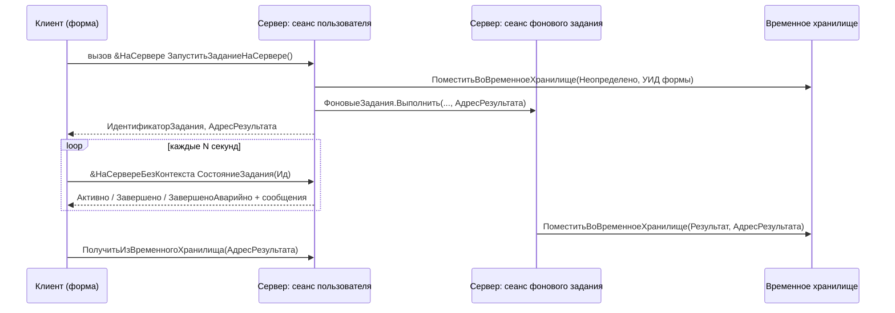
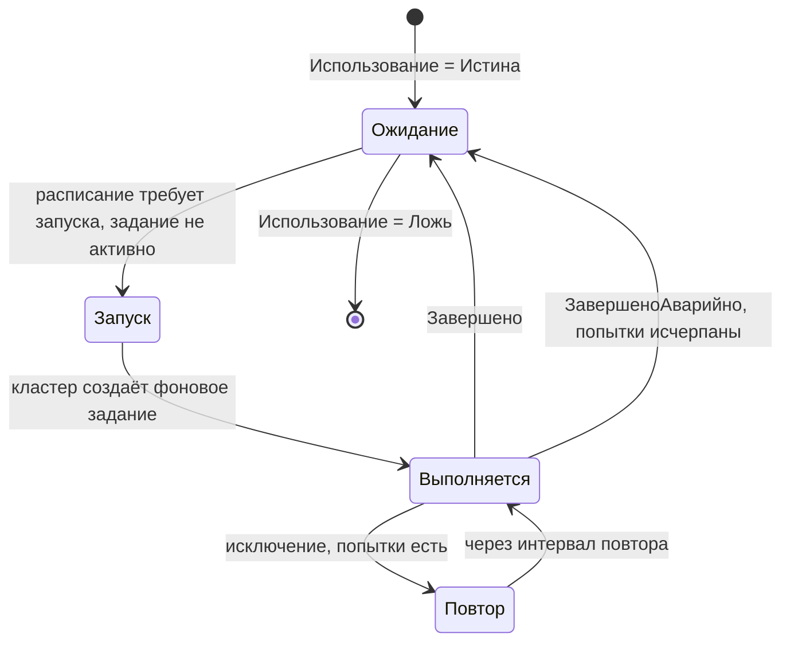
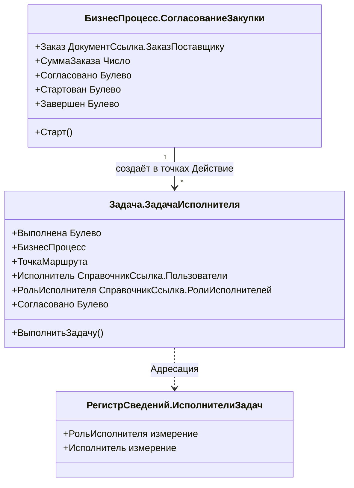
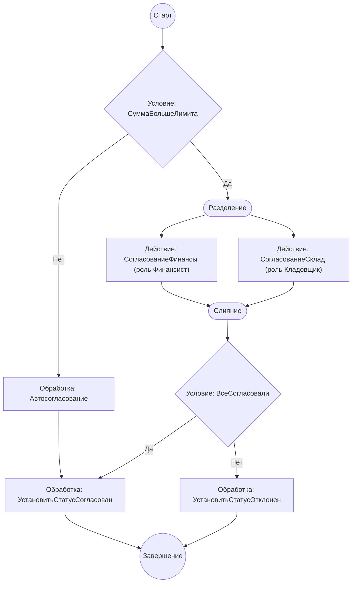
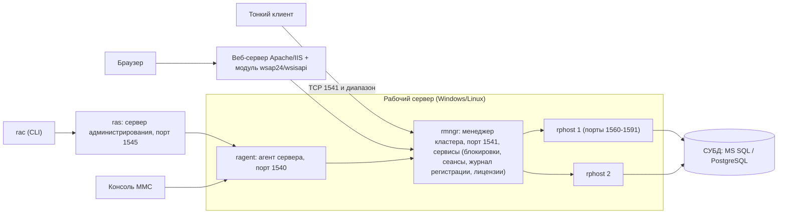

# Модуль 12. Фоновые и регламентные задания, бизнес-процессы, клиент-серверный вариант, администрирование и производительность

> **Объём:** 14 ак. ч · **Неделя:** 14 · **Источники:** [Я] спринт 09 (бизнес-процессы, задачи, регистр адресации, СУБД MS SQL, консоль администрирования серверов, создание серверной базы), [ПР] модуль 1 (основы администрирования), модуль 3 (основные причины неоптимальной работы запросов), модуль 4 (бизнес-процессы, задача, регистр адресации), [ПР2] модуль 4 (БСП: анализ журнала регистрации, оценка производительности, регламентные задания, центр мониторинга), модуль 8 (фоновые задания, журнал событий — в контексте 1С:Предприятие.Элемент), [К] модули 1, 5, 13, [Т] модуль 5 (замер производительности), модуль 6 (механизм объектных и управляемых блокировок)
> **Нет в источниках (написано по документации платформы/опыту):** API фоновых заданий платформы 8.3 (`ФоновыеЗадания.Выполнить`, ожидание, длительные операции БСП) — в источниках фоновые задания упомянуты только для Элемента; устройство кластера (rphost/rmngr/ragent, сеансы и соединения, rac/ras); PostgreSQL как СУБД для 1С (в [Я] спринт 09 название вебинара в тексте источника искажено, явно назван только MS SQL); **технологический журнал (ТЖ)**; **ЦУП (Центр управления производительностью, КИП) и APDEX** — в источниках есть только «оценка производительности» и «центр мониторинга» БСП в перечне [ПР2]/[К].

## Результат модуля

- Умеете вынести тяжёлую операцию в фоновое задание, передать ей параметры, получить прогресс и результат через временное хранилище, не блокируя клиента.
- Умеете описать регламентное задание (предопределённое и динамическое), задать и изменить расписание из кода, понимаете, кто и где его исполняет.
- Умеете спроектировать бизнес-процесс с картой маршрута (действие, условие, разделение/слияние, обработка), задачей и регистром адресации, и программно управлять им.
- Понимаете клиент-серверную архитектуру 1С (кластер, процессы, сеансы, соединения), умеете создать серверную ИБ на MS SQL / PostgreSQL и найти «висящий» сеанс.
- Умеете диагностировать тормоза: журнал регистрации, замер производительности, технологический журнал, типовые антипаттерны (запрос в цикле, блокировки, итоги).

## Карта понятий SAP → 1С

| SAP | 1С | Ключевое отличие |
|---|---|---|
| SM36 (фоновое задание, `JOB_OPEN`/`SUBMIT`/`JOB_CLOSE`) | `ФоновыеЗадания.Выполнить("Модуль.Процедура", Параметры)` | Запуск одной строкой, без вариантов программы. Запускается только экспортная процедура общего серверного модуля (или модуля менеджера). Нет шагов задания |
| SM37 | `ФоновыеЗадания.ПолучитьФоновыеЗадания(Отбор)`, обработка «Регламентные и фоновые задания» БСП | История фоновых заданий в памяти кластера ограничена; долговременной истории «из коробки» нет — пишите в журнал регистрации |
| Периодическое задание SM36 / класс задания | Объект метаданных **Регламентное задание** + `РасписаниеРегламентногоЗадания` | Задание — объект конфигурации (как программа), его расписание — данные ИБ. Предопределённое существует в каждой ИБ автоматически |
| `SUBMIT ... VIA JOB` с ожиданием, `aRFC` с `WAIT` | `ФоновоеЗадание.ОжидатьЗавершенияВыполнения(Таймаут)` на сервере / обработчик ожидания на клиенте | На клиенте ждать синхронно нельзя — только опрос через `ПодключитьОбработчикОжидания` |
| SAP Business Workflow (шаблон WF, шаг, контейнер, правило определения исполнителя) | Бизнес-процесс (карта маршрута) + Задача + регистр сведений адресации | Нет контейнера и биндингов — данные процесса лежат в реквизитах БП. Исполнитель определяется реквизитами адресации задачи, а не правилом-ФМ |
| Рабочий элемент (work item), SBWP | Элемент задачи, виртуальная таблица `ЗадачиПоИсполнителю` | Задача — обычный ссылочный объект в своей таблице, её можно читать запросом |
| Сервер приложений, диспетчер, рабочие процессы DIA/BTC | Кластер: `ragent` (агент), `rmngr` (менеджер кластера), `rphost` (рабочие процессы) | Нет типов рабочих процессов: любой `rphost` обслуживает и интерактивные вызовы, и фоновые |
| SM50 / SM66 / SM04 | Консоль «Администрирование серверов 1С:Предприятия», `rac process list`, `rac session list` | Сеанс ≠ соединение (см. ниже) |
| SM21 / SLG1 | Журнал регистрации, `ЗаписьЖурналаРегистрации` | Один журнал на ИБ, пишут и платформа, и прикладной код |
| ST05 (SQL trace), ST12, SAT | Технологический журнал (`logcfg.xml`), замер производительности отладчика | Включается файлом на сервере, а не транзакцией. Пишет всё по кластеру, фильтры — в XML |
| ST03N / EarlyWatch | ЦУП (КИП), APDEX через подсистему «Оценка производительности» БСП | Отдельный продукт, не в платформе |
| Lock table SM12 | Управляемые блокировки, сервис блокировок кластера, `TLOCK`/`TTIMEOUT`/`TDEADLOCK` в ТЖ | Список блокировок в консоли не смотрится — только через ТЖ |

## Теория

### 1. Фоновые задания

#### 1.1. Механика

Фоновое задание — вызов экспортной процедуры (или функции — результат игнорируется) в **отдельном сеансе** на сервере. У задания свой сеанс, своя транзакция, свои параметры сеанса (инициализируются заново через `УстановкаПараметровСеанса`), пользователь — тот же, что у запустившего сеанса.



Требования к вызываемому методу:

- экспортная процедура/функция **общего модуля** с флагом «Сервер» (не глобального) или модуля менеджера (`"Документы.РеализацияТоваров.Перепровести"`);
- параметры — `Массив` значений, которые сериализуются (ссылки, примитивы, `Структура`, `ТаблицаЗначений`, …); объект формы, `ДанныеФормыСтруктура`, `ДокументОбъект` с несохранёнными изменениями передавать бессмысленно — передавайте ссылки или помещайте данные во временное хранилище;
- результат возвращается **только** через временное хранилище (или через запись в ИБ). Адрес хранилища создаётся в сеансе пользователя с привязкой к `УникальныйИдентификатор` формы — тогда оно живёт, пока открыта форма.

Ключ задания (`Ключ`, третий параметр) — защита от параллельного запуска: если активно задание с тем же ключом и тем же методом, `Выполнить` вызовет исключение. Аналог проверки «job already running» руками в ABAP.

#### 1.2. Код: перепроведение документов в фоне

Общий модуль `ДлительныеОперацииУТ` (Сервер = Истина, Вызов сервера = Ложь):

```bsl
#Область ПрограммныйИнтерфейс

// Перепроводит реализации за период. Вызывается только в фоновом задании.
//
// Параметры:
//   ДатаНачала, ДатаОкончания - Дата
//   АдресРезультата - Строка - адрес временного хранилища для результата
//
Процедура ПерепровестиРеализации(ДатаНачала, ДатаОкончания, АдресРезультата) Экспорт
	Запрос = Новый Запрос(
	"ВЫБРАТЬ
	|	Р.Ссылка КАК Ссылка
	|ИЗ
	|	Документ.РеализацияТоваров КАК Р
	|ГДЕ
	|	Р.Проведен
	|	И Р.Дата МЕЖДУ &ДатаНачала И &ДатаОкончания
	|
	|УПОРЯДОЧИТЬ ПО
	|	Р.МоментВремени");
	Запрос.УстановитьПараметр("ДатаНачала", ДатаНачала);
	Запрос.УстановитьПараметр("ДатаОкончания", ДатаОкончания);
	Выборка = Запрос.Выполнить().Выбрать();
	Всего = Выборка.Количество();
	Обработано = 0;
	Ошибки = Новый Массив;
	Пока Выборка.Следующий() Цикл
		ДокументОбъект = Выборка.Ссылка.ПолучитьОбъект();
		Попытка
			ДокументОбъект.Записать(РежимЗаписиДокумента.Проведение);
		Исключение
			Ошибки.Добавить(СтрШаблон("%1: %2", Выборка.Ссылка,
				КраткоеПредставлениеОшибки(ИнформацияОбОшибке())));
		КонецПопытки;
		Обработано = Обработано + 1;
		Если Обработано % 50 = 0 Тогда
			Сообщение = Новый СообщениеПользователю;
			Сообщение.Текст = СтрШаблон("Обработано %1 из %2", Обработано, Всего);
			Сообщение.Сообщить(); // в фоне сообщение копится в задании
		КонецЕсли;
	КонецЦикла;
	ПоместитьВоВременноеХранилище(
		Новый Структура("Обработано, Ошибки", Обработано, Ошибки), АдресРезультата);
КонецПроцедуры

#КонецОбласти
```

Форма обработки `ПерепроведениеДокументов`; реквизиты формы: `ДатаНачала`, `ДатаОкончания` (Дата), `ИдентификаторЗадания` (УникальныйИдентификатор), `АдресРезультата` (Строка).

```bsl
&НаКлиенте
Процедура Перепровести(Команда)
	ЗапуститьЗаданиеНаСервере();
	ПодключитьОбработчикОжидания("ПроверитьВыполнение", 2, Ложь);
КонецПроцедуры

&НаСервере
Процедура ЗапуститьЗаданиеНаСервере()
	АдресРезультата = ПоместитьВоВременноеХранилище(Неопределено, УникальныйИдентификатор);
	ПараметрыЗадания = Новый Массив;
	ПараметрыЗадания.Добавить(ДатаНачала);
	ПараметрыЗадания.Добавить(КонецДня(ДатаОкончания));
	ПараметрыЗадания.Добавить(АдресРезультата);
	Задание = ФоновыеЗадания.Выполнить("ДлительныеОперацииУТ.ПерепровестиРеализации",
		ПараметрыЗадания, "ПерепроведениеРеализаций", НСтр("ru = 'Перепроведение реализаций'"));
	ИдентификаторЗадания = Задание.УникальныйИдентификатор;
КонецПроцедуры

&НаКлиенте
Процедура ПроверитьВыполнение()
	Инфо = СостояниеЗадания(ИдентификаторЗадания);
	Для Каждого Текст Из Инфо.Сообщения Цикл
		Состояние(Текст); // глобальный метод клиента: строка состояния
	КонецЦикла;
	Если Инфо.Статус = "Активно" Тогда
		Возврат;
	КонецЕсли;
	ОтключитьОбработчикОжидания("ПроверитьВыполнение");
	Если Инфо.Статус = "Завершено" Тогда
		ПоказатьРезультат(); // читает ПолучитьИзВременногоХранилища(АдресРезультата)
	Иначе
		ПоказатьПредупреждение(, Инфо.ТекстОшибки);
	КонецЕсли;
КонецПроцедуры

&НаСервереБезКонтекста
Функция СостояниеЗадания(Идентификатор)
	Результат = Новый Структура("Статус, ТекстОшибки, Сообщения", "", "", Новый Массив);
	Задание = ФоновыеЗадания.НайтиПоУникальномуИдентификатору(Идентификатор);
	Если Задание = Неопределено Тогда
		Результат.Статус = "НеНайдено";
		Возврат Результат;
	КонецЕсли;
	Для Каждого Сообщение Из Задание.ПолучитьСообщенияПользователю(Истина) Цикл
		Результат.Сообщения.Добавить(Сообщение.Текст);
	КонецЦикла;
	Если Задание.Состояние = СостояниеФоновогоЗадания.Активно Тогда
		Результат.Статус = "Активно";
	ИначеЕсли Задание.Состояние = СостояниеФоновогоЗадания.Завершено Тогда
		Результат.Статус = "Завершено";
	ИначеЕсли Задание.Состояние = СостояниеФоновогоЗадания.ЗавершеноАварийно Тогда
		Результат.Статус = "Ошибка";
		Результат.ТекстОшибки = ПодробноеПредставлениеОшибки(Задание.ИнформацияОбОшибке);
	Иначе // Отменено
		Результат.Статус = "Отменено";
	КонецЕсли;
	Возврат Результат;
КонецФункции
```

> Не называйте локальные переменные именами глобальных методов (`Состояние`, `Сообщить`, `Параметры` в форме) — переменная перекроет метод, и ошибка проявится только в рантайме.

Ожидание на сервере (регламентное запустило N фоновых «потоков» по складам и ждёт их): `ФоновыеЗадания.ОжидатьЗавершенияВыполнения(МассивЗаданий, ТаймаутСекунд)`. `ОжидатьЗавершенияВыполнения` появился в 8.3 взамен устаревшего `ОжидатьЗавершения` (последний при превышении таймаута бросал исключение). Есть и у объекта `ФоновоеЗадание`. На клиенте не существует — ждать на клиенте можно только опросом.

#### 1.3. Длительные операции БСП

В типовых и в конфигурациях на БСП ([модуль 13](13-typical-configs-bsp-extensions.md)) руками фоновые задания из форм не запускают: есть общий модуль `ДлительныеОперации` (сервер) и `ДлительныеОперацииКлиент`. Они делают ровно то, что выше, плюс: окно ожидания с прогрессом, отмена, перенос сообщений, выполнение «в том же сеансе» в файловой ИБ при отладке.

```bsl
&НаСервере
Функция НачатьПерепроведение()
	ПараметрыВыполнения = ДлительныеОперации.ПараметрыВыполненияВФоне(УникальныйИдентификатор);
	ПараметрыВыполнения.НаименованиеФоновогоЗадания = НСтр("ru = 'Перепроведение реализаций'");
	Возврат ДлительныеОперации.ВыполнитьФункцию(ПараметрыВыполнения,
		"ДлительныеОперацииУТ.ПерепровестиРеализацииФункция", ДатаНачала, ДатаОкончания);
КонецФункции

&НаКлиенте
Процедура Перепровести(Команда)
	ДлительнаяОперация = НачатьПерепроведение();
	ПараметрыОжидания = ДлительныеОперацииКлиент.ПараметрыОжидания(ЭтотОбъект);
	Оповещение = Новый ОписаниеОповещения("ПослеПерепроведения", ЭтотОбъект);
	ДлительныеОперацииКлиент.ОжидатьЗавершение(ДлительнаяОперация, Оповещение, ПараметрыОжидания);
КонецПроцедуры

&НаКлиенте
Процедура ПослеПерепроведения(Результат, ДополнительныеПараметры) Экспорт
	Если Результат = Неопределено Тогда // пользователь отменил
		Возврат;
	КонецЕсли;
	Если Результат.Статус = "Ошибка" Тогда
		ПоказатьПредупреждение(, Результат.КраткоеПредставлениеОшибки);
		Возврат;
	КонецЕсли;
	Итог = ПолучитьИзВременногоХранилища(Результат.АдресРезультата);
	// ...
КонецПроцедуры
```

В варианте `ВыполнитьФункцию` функция возвращает результат обычным `Возврат` — БСП сама кладёт его во временное хранилище. Сигнатуры зависят от версии БСП (до 3.0 был `ДлительныеОперации.ВыполнитьВФоне`) — сверяйтесь с документацией вашей редакции.

#### 1.4. Где реально выполняется фон

| Вариант | Кто исполняет фоновые задания | Кто исполняет регламентные |
|---|---|---|
| Клиент-серверный | Любой `rphost` кластера | Кластер по расписанию, если в свойствах ИБ **не** включена «Блокировка регламентных заданий» |
| Файловый | Процесс клиентского приложения (или веб-сервера), в отдельном потоке, эмуляция | Только пока открыт хотя бы один сеанс (толстый/тонкий клиент или публикация на веб-сервере). Нет клиента — нет регламентных |

### 2. Регламентные задания

#### 2.1. Метаданные и расписание

Объект метаданных «Регламентное задание» (`ЗагрузкаКурсовВалют`, появился в [модуле 11](11-integration.md)) задаёт:

**Имя метода** (`ОбщийМодуль.Процедура`, экспортная, серверный модуль); **Предопределённое** (экземпляр есть в каждой ИБ автоматически, удалить нельзя — только выключить); **Использование**; **Ключ** (различает непредопределённые экземпляры); **Расписание** по умолчанию; **количество и интервал повторов** при аварийном завершении.

Непредопределённых экземпляров может быть много, с разными `Параметры` (массив) — аналог одного ABAP-отчёта с несколькими вариантами в разных job'ах.



Регламентное задание в момент запуска порождает **обычное фоновое задание** (у него свойство `РегламентноеЗадание` заполнено). Поэтому всё из раздела 1 применимо.

#### 2.2. Код: работа с расписанием

```bsl
// Включить предопределённое задание и запускать каждый будний день в 9:05
Процедура НастроитьЗагрузкуКурсов() Экспорт
	Задание = РегламентныеЗадания.НайтиПредопределенное(Метаданные.РегламентныеЗадания.ЗагрузкаКурсовВалют);
	Расписание = Новый РасписаниеРегламентногоЗадания;
	Расписание.ПериодПовтораДней = 1;
	Расписание.ВремяНачала = Дата(1, 1, 1, 9, 5, 0);
	ДниНедели = Новый Массив;
	Для НомерДня = 1 По 5 Цикл
		ДниНедели.Добавить(НомерДня); // 1 = понедельник
	КонецЦикла;
	Расписание.ДниНедели = ДниНедели;

	Задание.Расписание = Расписание;
	Задание.Использование = Истина;
	Задание.Записать();
КонецПроцедуры

// Динамический экземпляр: ЦБ публикует курсы на завтра — догружаем их каждые 30 минут после обеда
Процедура СоздатьЗаданиеЗагрузкиНаЗавтра() Экспорт
	Задание = РегламентныеЗадания.СоздатьРегламентноеЗадание(Метаданные.РегламентныеЗадания.ЗагрузкаКурсовВалют);
	Задание.Наименование = НСтр("ru = 'Загрузка курсов на завтра'");
	Задание.Ключ = "НаЗавтра";
	ПараметрыЗадания = Новый Массив;
	ПараметрыЗадания.Добавить(1); // СмещениеДней
	Задание.Параметры = ПараметрыЗадания;
	Расписание = Новый РасписаниеРегламентногоЗадания;
	Расписание.ПериодПовтораДней = 1;
	Расписание.ВремяНачала = Дата(1, 1, 1, 14, 0, 0);
	Расписание.ВремяКонца = Дата(1, 1, 1, 20, 0, 0);
	Расписание.ПериодПовтораВТечениеДня = 1800; // секунды
	Задание.Расписание = Расписание;
	Задание.Использование = Истина;
	Задание.Записать();
КонецПроцедуры
```

Обработчик — имя метода в метаданных `КурсыВалютСервер.ЗагрузкаКурсовВалютРегламент` ([модуль 11](11-integration.md)):

```bsl
Процедура ЗагрузкаКурсовВалютРегламент(СмещениеДней = 0) Экспорт
	// В конфигурации на БСП первой строкой обязательно:
	// ОбщегоНазначения.ПриНачалеВыполненияРегламентногоЗадания(Метаданные.РегламентныеЗадания.ЗагрузкаКурсовВалют);
	Попытка
		ЗагрузитьКурсы(НачалоДня(ТекущаяДатаСеанса()) + СмещениеДней * 86400); // процедура из M11
	Исключение
		ЗаписьЖурналаРегистрации(НСтр("ru = 'Загрузка курсов валют'", ОбщийКодЯзыка()),
			УровеньЖурналаРегистрации.Ошибка, Метаданные.РегламентныеЗадания.ЗагрузкаКурсовВалют,,
			ПодробноеПредставлениеОшибки(ИнформацияОбОшибке()));
		ВызватьИсключение; // чтобы сработал повтор и статус «ЗавершеноАварийно»
	КонецПопытки;
КонецПроцедуры
```

`ОбщийКодЯзыка()` — функция БСП; без БСП используйте `"ru"`. Изменять регламентные задания может только пользователь с правом администрирования (или код в привилегированном режиме). Расписание и `Использование` — **данные ИБ**, а не конфигурации: после обновления конфигурации они не сбрасываются, а в копии продуктивной базы задания продолжат ходить во внешние системы (отключайте!).

### 3. Бизнес-процессы и задачи

#### 3.1. Объекты



- **Задача** (`ЗадачаИсполнителя`) — объект метаданных со стандартными реквизитами (`Выполнена`, `БизнесПроцесс`, `ТочкаМаршрута`), **реквизитами адресации** и свойством «Адресация» (регистр сведений). Один из реквизитов адресации — «основной» (`Исполнитель`), ему соответствует свойство «Текущий исполнитель» (тип: `СправочникСсылка.Пользователи`).
- **Регистр адресации** (`ИсполнителиЗадач`) — обычный непериодический регистр сведений; каждый реквизит адресации задачи связан с измерением регистра. Строка регистра «Роль = Закупщик-согласующий, Исполнитель = Петров» означает: Петров видит задачи, адресованные этой роли.
- **Бизнес-процесс** (`СогласованиеЗакупки`) — объект со своей таблицей, реквизитами, формой и **картой маршрута** (графическая схема). Связан с одной задачей (свойство «Задача»).

Справочники `Пользователи` и `РолиИсполнителей` и регистр `ИсполнителиЗадач` названы так же, как в БСП, — намеренно: в [модуле 13](13-typical-configs-bsp-extensions.md) при внедрении БСП они будут заменены объектами библиотеки.

Аналогия с SAP WF: роль исполнителя ≈ правило определения исполнителя (rule) с «container»-параметрами; регистр адресации ≈ таблица, которую читает ФМ правила; виртуальная таблица `ЗадачиПоИсполнителю` ≈ входящие SBWP.

#### 3.2. Карта маршрута

| Точка | Что делает | Событие в модуле БП |
|---|---|---|
| Старт | Вход | — |
| Действие | Создаёт задачу(и), ждёт выполнения | `ПередСозданиемЗадач`, `ПриСозданииЗадач`, `ПередВыполнением`, `ПриВыполнении`, `ПроверкаВыполнения` (групповые) |
| Условие | Ветвление Да/Нет | `ПроверкаУсловия(ТочкаМаршрутаБизнесПроцесса, Результат)` |
| Выбор варианта | Ветвление на N веток | `ВыборВарианта(ТочкаМаршрутаБизнесПроцесса, Результат)` |
| Разделение | Параллельные ветки (AND-split) | — |
| Слияние | Ожидание всех веток (AND-join) | — |
| Обработка | Код без задачи (≈ background step) | `ОбработкаВыполнения(ТочкаМаршрутаБизнесПроцесса)` |
| Вложенный бизнес-процесс | Запуск подпроцесса, ожидание его завершения | `ПередСозданиемВложенныхБизнесПроцессов`, `ПриСозданииВложенныхБизнесПроцессов` |
| Завершение | Выход, `Завершен = Истина` | `ПриЗавершении` |

Обработчики именуются `<ИмяТочки><Событие>` и создаются из палитры свойств точки, как обычные обработчики событий.

Сквозной процесс `СогласованиеЗакупки`:



#### 3.3. Код модуля бизнес-процесса

```bsl
// Модуль объекта БизнесПроцесс.СогласованиеЗакупки

Процедура СуммаБольшеЛимитаПроверкаУсловия(ТочкаМаршрутаБизнесПроцесса, Результат)
	Результат = СуммаЗаказа > Константы.ЛимитАвтосогласованияЗакупки.Получить();
КонецПроцедуры

Процедура СогласованиеФинансыПриСозданииЗадач(ТочкаМаршрутаБизнесПроцесса, ФормируемыеЗадачи, Отказ)
	Для Каждого Задача Из ФормируемыеЗадачи Цикл
		Задача.Наименование = СтрШаблон(НСтр("ru = 'Согласовать %1 (финансы)'"), Заказ);
		// Роль можно задать и свойством «Адресация» точки в карте маршрута
		Задача.РольИсполнителя = Справочники.РолиИсполнителей.Финансист;
	КонецЦикла;
КонецПроцедуры

Процедура СогласованиеФинансыПриВыполнении(ТочкаМаршрутаБизнесПроцесса, Задача, Отказ)
	// Задача — ЗадачаОбъект. Переносим результат в реквизит БП — «контейнер» процесса
	Если Не Задача.Согласовано Тогда
		Согласовано = Ложь;
	КонецЕсли;
КонецПроцедуры

Процедура ВсеСогласовалиПроверкаУсловия(ТочкаМаршрутаБизнесПроцесса, Результат)
	Результат = Согласовано;
КонецПроцедуры

Процедура УстановитьСтатусСогласованОбработкаВыполнения(ТочкаМаршрутаБизнесПроцесса)
	ЗаказОбъект = Заказ.ПолучитьОбъект();
	ЗаказОбъект.Статус = Перечисления.СтатусыЗаказов.Согласован; // перечисление из M05-T1
	ЗаказОбъект.Записать();
КонецПроцедуры
```

Старт и выполнение задачи:

```bsl
// Запуск из формы заказа (серверная процедура)
БП = БизнесПроцессы.СогласованиеЗакупки.СоздатьБизнесПроцесс();
БП.Дата = ТекущаяДатаСеанса();
БП.Заказ = Заказ;
БП.СуммаЗаказа = СуммаЗаказа;
БП.Согласовано = Истина; // станет Ложь, если кто-то отклонит
БП.Записать();
БП.Старт(); // движение по карте до первой точки Действие

// Выполнение задачи исполнителем (сервер)
ЗадачаОбъект = ЗадачаСсылка.ПолучитьОбъект();
ЗадачаОбъект.Согласовано = Решение;
ЗадачаОбъект.ВыполнитьЗадачу(); // Выполнена = Истина, запись, продвижение БП
```

Список «мои задачи» — запрос к виртуальной таблице:

```bsl
Запрос = Новый Запрос(
"ВЫБРАТЬ
|	З.Ссылка КАК Задача,
|	З.Наименование КАК Наименование,
|	З.БизнесПроцесс КАК БизнесПроцесс
|ИЗ
|	Задача.ЗадачаИсполнителя.ЗадачиПоИсполнителю(&Исполнитель) КАК З
|ГДЕ
|	НЕ З.Выполнена");
Запрос.УстановитьПараметр("Исполнитель", ТекущийПользователь); // СправочникСсылка.Пользователи
```

`ЗадачиПоИсполнителю` учитывает и прямую адресацию (`Исполнитель` = пользователь), и ролевую (через регистр адресации). Аналог WF-правила «агент по орг. единице» в 1С целиком выражен данными регистра.

Прохождение БП по точкам происходит **в транзакции записи** задачи/БП: ошибка в `ОбработкаВыполнения` откатит и выполнение задачи. Тяжёлую работу в «Обработке» не делайте — запустите фоновое задание или регламентное.

### 4. Клиент-серверный вариант

#### 4.1. Кластер



- **Агент** (`ragent`) — служба, хранит реестр кластеров, запускает менеджеры.
- **Менеджер кластера** (`rmngr`) — реестр ИБ кластера, сеансы, сервис управляемых блокировок, лицензии, журнал регистрации и прочие сервисы. Сервисы можно разнести по нескольким менеджерам и серверам («Требования назначения функциональности»).
- **Рабочий процесс** (`rphost`) — исполняет серверный код. Типов процессов (DIA/BTC/UPD) нет: каждый обслуживает любые вызовы любых ИБ. Количество процессов регулируется настройками рабочего сервера («Количество ИБ на процесс», «Количество соединений на процесс», лимиты памяти, «Безопасный расход памяти за один вызов»).
- **СУБД** — внешняя. 1С создаёт таблицы сама (`_Reference12`, `_Document34` …) по метаданным, ни DDIC, ни ручных индексов (кроме тех, что задаёт свойство «Индексировать»).

#### 4.2. Сеанс и соединение

**Сеанс** — логический контекст пользователя (параметры сеанса, временное хранилище, лицензия), живёт от входа до выхода; аналог пользовательского контекста SM04. **Соединение** — физическое подключение к `rphost`, у клиентского сеанса существует только на время серверного вызова, у фонового — на время выполнения; аналог занятого рабочего процесса SM50. Смотреть: консоль → ИБ → Сеансы (`rac session list`) и Рабочие процессы → Соединения (`rac connection list`).

Сеанс между вызовами может обслуживаться разными `rphost`. Поэтому «зависший» отчёт — это сеанс, у которого **есть** соединение с ненулевым «временем вызова»; сеанс без соединения ничего не грузит.

#### 4.3. Создание серверной ИБ и администрирование из командной строки

В консоли: Кластер → Информационные базы → Создать. Ключевые поля: имя ИБ в кластере, тип СУБД (`MSSQLServer`, `PostgreSQL`, `IBMDB2`, `OracleDatabase`), сервер БД, имя БД, пользователь/пароль СУБД, **смещение дат** (для MS SQL — 2000, т.к. 1С хранит даты с года 0001, а `datetime` начинается с 1753), флаг «Создать базу данных в случае её отсутствия», «Блокировка регламентных заданий включена».

```bash
# сервер администрирования (если не запущен как служба)
ras cluster --daemon
# список кластеров и ИБ
rac cluster list
rac infobase summary list --cluster=<uuid кластера>
# создать ИБ на PostgreSQL
rac infobase create --cluster=<uuid> --create-database \
    --name=uchtorg --dbms=PostgreSQL --db-server=localhost \
    --db-name=uchtorg --locale=ru --db-user=postgres --db-pwd=<пароль>
# сеансы (≈ SM04) и их завершение
rac session list --cluster=<uuid> --infobase=<uuid ИБ>
rac session terminate --cluster=<uuid> --session=<uuid сеанса>
# рабочие процессы (≈ SM50)
rac process list --cluster=<uuid>
```

Синтаксис `rac` и набор параметров зависят от версии платформы — проверяйте `rac help infobase`. Стенд с сервером 1С + PostgreSQL в Docker — см. [lab](../lab/README.md).

Из кода — ограниченный аналог SM04: `ПолучитьСеансыИнформационнойБазы()` (массив `СеансИнформационнойБазы` с `НомерСеанса`, `Пользователь`, `ИмяПриложения`, `НачалоСеанса`).

#### 4.4. MS SQL и PostgreSQL

| Аспект | MS SQL Server | PostgreSQL |
|---|---|---|
| Сборка | Штатная от Microsoft | Нужна сборка с патчами для 1С (дистрибутив от 1С или Postgres Pro) |
| Смещение дат | 2000 | Не требуется |
| Изоляция чтения | В режиме управляемых блокировок платформа включает версионирование строк (read committed snapshot) | MVCC «из коробки» |
| Типичные проблемы | Эскалация блокировок на уровне СУБД, статистика, фрагментация индексов | Autovacuum, `work_mem`, планы на временных таблицах |
| Обслуживание | Планы обслуживания: обновление статистики, реиндекс | `VACUUM ANALYZE`, `pg_stat_statements` |

Для прикладного кода разница почти нулевая: язык запросов 1С транслируется платформой. Но план выполнения, а значит и «тормоза», — разные. Сам перевод ИБ между СУБД делается выгрузкой/загрузкой `.dt` или `ibcmd`.

### 5. Журнал регистрации

Хранится в каталоге `1Cv8Log` ИБ (в клиент-серверном варианте — на сервере кластера в каталоге реестра ИБ), формат SQLite (`.lgd`) или старый текстовый (`.lgf`/`.lgp`). Платформа пишет туда входы/выходы, изменения данных (если уровень логирования позволяет), ошибки, события администрирования. Прикладной код — свои события:

```bsl
ЗаписьЖурналаРегистрации("УчебнаяТорговля.ОбменСБанком",
	УровеньЖурналаРегистрации.Предупреждение,
	Метаданные.Документы.ОплатаОтПокупателя,
	ДокументСсылка,
	НСтр("ru = 'Не найден договор по ИНН плательщика'"));
```

Чтение (≈ SLG1 по объекту):

```bsl
Отбор = Новый Структура("ДатаНачала, Уровень, Событие", НачалоДня(ТекущаяДатаСеанса()),
	УровеньЖурналаРегистрации.Ошибка, "УчебнаяТорговля.ОбменСБанком");
Таблица = Новый ТаблицаЗначений;
ВыгрузитьЖурналРегистрации(Таблица, Отбор);
```

Правила: имя события — иерархическое с точкой (`Подсистема.Операция`), чтобы фильтровать; в `Данные` — ссылку (тогда работает отбор по объекту); не пишите в ЖР в цикле по тысячам строк. В БСП есть обработка «Журнал регистрации» и регламентная выгрузка/очистка.

### 6. Производительность

#### 6.1. Инструменты

Порядок диагностики: воспроизводится у разработчика → замер производительности; только на проде → технологический журнал (длинный запрос → план СУБД; ожидание → `TLOCK`/`TTIMEOUT`; много коротких вызовов → `CALL`/`SDBL` с одинаковым `Context`) → исправление → контроль APDEX ключевых операций.

**Замер производительности** — в Конфигураторе «Отладка → Замер производительности» (в EDT — профилирование в перспективе отладки). Показывает время и число выполнений по строкам модулей, включая серверные. Ближайший аналог — SAT/SE30. Минус: замеряет только текущий сеанс.

**Технологический журнал** — **нет в источниках курса**. Включается файлом `logcfg.xml` в каталоге `conf` платформы на сервере (подхватывается без перезапуска, примерно за минуту):

```xml
<?xml version="1.0" encoding="UTF-8"?>
<config xmlns="http://v8.1c.ru/v8/tech-log">
  <log location="C:\1c_logs\sql" history="24">
    <event><eq property="name" value="DBMSSQL"/></event>
    <event><eq property="name" value="DBPOSTGRS"/></event>
    <event><eq property="name" value="TLOCK"/></event>
    <event><eq property="name" value="TTIMEOUT"/></event>
    <event><eq property="name" value="TDEADLOCK"/></event>
    <event><eq property="name" value="EXCP"/></event>
    <property name="all"/>
  </log>
  <plansql/>
</config>
```

Фильтр по длительности задаётся условием `<ge property="duration" value="..."/>`; единицы `duration` в 8.3 — микросекунды (в ранних версиях были десятитысячные доли секунды) — проверьте по документации вашей версии. `<plansql/>` добавляет планы запросов СУБД — **дорого**, только на время диагностики. `history` — часы хранения. Логи — текстовые файлы `ггммддчч.log` по процессам; анализ — grep/awk/скрипты или ЦУП. Основные события: `DBMSSQL`/`DBPOSTGRS` (SQL-запрос, текст `Sql`, `Context` — стек 1С-кода), `SDBL` (запрос на уровне языка 1С), `CALL`/`SCALL` (серверный вызов), `TLOCK` (управляемая блокировка), `TTIMEOUT` (таймаут ожидания), `TDEADLOCK` (взаимоблокировка), `EXCP` (исключения), `CONN`/`PROC` (соединения и процессы).

**ЦУП / APDEX** — **нет в источниках курса**. ЦУП — инструмент из «1С:Корпоративный инструментальный пакет» для мониторинга кластера и анализа ТЖ. APDEX = (довольные + терпящие/2) / все замеры, где «довольный» — операция быстрее целевого времени T, «терпящий» — до 4T. В конфигурациях на БСП ключевые операции замеряются подсистемой «Оценка производительности» (её [ПР2] модуль 4 упоминает), которая и считает APDEX.

#### 6.2. Типовые причины тормозов

| Причина | Симптом | Лечение | ABAP-аналог |
|---|---|---|---|
| Запрос в цикле | Тысячи коротких `DBMSSQL` с одним `Context` | Один запрос с временной таблицей / `В (&Массив)` | `SELECT` в `LOOP` → `FOR ALL ENTRIES` / JOIN |
| Обращение через точку `Ссылка.Реквизит` в цикле | То же: каждое разыменование — чтение объекта целиком | Получать поля запросом | `SELECT SINGLE` в цикле |
| Условие на виртуальную таблицу в `ГДЕ` вместо параметров | Долгий запрос к `Остатки()`: таблица итогов + полное движение | Отбор в параметрах виртуальной таблицы | Фильтр после чтения вместо `WHERE` |
| Отключены/не пересчитаны итоги | Остатки считаются по движениям за всё время | `ПересчитатьИтоги()`, периодические итоги, проверка `УстановитьИспользованиеИтогов` | — |
| Длинная транзакция проведения | `TTIMEOUT` у других пользователей (таймаут по умолчанию 20 с) | Блокировать позже и уже, запросы — до блокировки, тяжёлое — после транзакции | Долгий `ENQUEUE` до `COMMIT WORK` |
| Блокировка «на всю таблицу» | `TLOCK` с пустым набором полей, эскалация в СУБД | Указывать поля и значения в `БлокировкаДанных`; «Разделение итогов» у регистров | Блокировка без ключа |
| Серверные вызовы с клиента в цикле | Много `CALL` от одного сеанса | Собрать данные за один вызов `&НаСервере` | Много RFC вместо одного |
| Динамический список по сложному запросу | Медленное открытие формы | Упростить запрос, не использовать произвольный запрос без необходимости, ключ и индексы | ALV по тяжёлому view |
| Неиндексированный отбор | Сканы таблиц в плане | Свойство «Индексировать» / «Индексировать с доп. упорядочиванием» | Вторичный индекс в SE11 |

Подробно блокировки и итоги — [модуль 06](06-registers-posting.md), оптимизация запросов — [модуль 04](04-queries.md).

## Ловушки для ABAP-разработчика

1. **Фоновое задание не видит контекст формы.** Ни реквизитов, ни несохранённых данных объекта, ни клиентских переменных. Передавайте ссылки и примитивы, результат — только через временное хранилище с адресом, созданным **до** запуска с `УникальныйИдентификатор` формы.
2. **В файловой ИБ «сервера фона» нет.** Регламентные задания не выполняются, если никто не запущен. Отладив на файловой, не удивляйтесь иному поведению на сервере (и наоборот).
3. **Расписание — это данные.** Обновили конфигурацию с новым расписанием по умолчанию — в существующей ИБ ничего не поменялось. Скопировали прод в тест — тестовая ИБ начнёт ходить во внешние API. Включайте «Блокировку регламентных заданий» на копиях.
4. **`ВызватьИсключение` в обработчике регламентного обязательно,** если хотите видеть ошибку в списке заданий и получить автоповтор. Тихий `Попытка … Исключение … КонецПопытки` = «Завершено» при фактической ошибке.
5. **Параллельные фоновые задания и блокировки.** Запустили 8 потоков перепроведения — получили `TTIMEOUT` друг на друге по `ОстаткиТоваров`. Делите работу по непересекающимся измерениям (склад), а не по документам.
6. **Обработка в БП выполняется в транзакции выполнения задачи.** Исключение в `ОбработкаВыполнения` откатит нажатие «Выполнено» пользователем. Нет «шага в фоне с перезапуском» как в WF — делайте сами.
7. **Карта маршрута не версионируется.** Изменили карту — работающие экземпляры продолжат по новой схеме и могут «застрять» в точке, которой больше нет. Перед изменением карты завершите или мигрируйте активные процессы.
8. **Сеанс ≠ процесс.** «Убить процесс» `rphost` из консоли = оборвать вызовы всех сеансов всех ИБ на этом процессе. Завершайте сеанс, а не процесс.
9. **ТЖ с `<plansql/>` и без фильтров на проде** за час заполняет диск и заметно грузит сервер. Включайте точечно и с `history`.

## Практика (сквозной проект)

Ветка `module-12`. Предварительно: регламентное задание `ЗагрузкаКурсовВалют` и процедура загрузки из [модуля 11](11-integration.md); документ `ЗаказПоставщику` со `Статус` из [модуля 05](05-managed-forms.md).

### M12-T1. Регламентная загрузка курсов

Сделайте `ЗагрузкаКурсовВалют` предопределённым, обработчик — `КурсыВалютСервер.ЗагрузкаКурсовВалютРегламент` с параметром `СмещениеДней`; добавьте динамический экземпляр «на завтра». Расписание по умолчанию — будни, 9:05. Обработка `НастройкаРегламентныхЗаданий` (форма) позволяет включить/выключить задание и изменить время запуска.

- [ ] Обработчик пишет в ЖР событие `УчебнаяТорговля.ЗагрузкаКурсов` уровня «Информация» при успехе и «Ошибка» при сбое с `ВызватьИсключение`.
- [ ] Количество повторов при аварийном завершении = 3, интервал = 600 с.
- [ ] Изменение времени в форме сохраняется в `Расписание` и видно после перезапуска.

**Проверка:** в файловой ИБ установите время запуска на «через 2 минуты», держите открытым клиент, затем выполните `ВыгрузитьЖурналРегистрации` с отбором по событию (код сохраните в `checks/M12-T1.bsl.txt`). Запрос к `РегистрСведений.КурсыВалют` на текущую дату возвращает строки.

### M12-T2. Перепроведение в фоне

Обработка `ПерепроведениеДокументов`: период, список видов документов (`ПоступлениеТоваров`, `ПеремещениеТоваров`, `РеализацияТоваров`), запуск в фоне в хронологическом порядке, прогресс, итог с перечнем ошибок.

- [ ] Клиент не блокируется на время выполнения (можно открыть другой список).
- [ ] Повторный запуск при активном задании выдаёт понятное сообщение (используйте ключ задания).
- [ ] Ошибки проведения не прерывают обработку и выводятся списком.
- [ ] Порядок — по `МоментВремени` по всем видам документов единым запросом (`ОБЪЕДИНИТЬ ВСЕ`).

**Проверка:** сделайте заведомо непроводимую реализацию (количество больше остатка), запустите — в итоге 1 ошибка, остальные документы проведены; запрос остатков `ОстаткиТоваров` совпадает с эталоном до перепроведения.

### M12-T3. Бизнес-процесс согласования закупки

Создайте `Справочник.Пользователи` (связь с пользователем ИБ по `ИдентификаторПользователяИБ`), `Справочник.РолиИсполнителей` с предопределёнными `Финансист`, `Кладовщик`, `РегистрСведений.ИсполнителиЗадач`, задачу `ЗадачаИсполнителя` (реквизиты адресации `Исполнитель`, `РольИсполнителя`, реквизит `Согласовано`), БП `СогласованиеЗакупки` по схеме из раздела 3.2, константу `ЛимитАвтосогласованияЗакупки`; в перечисление `СтатусыЗаказов` (M05) добавьте значение `Отклонен`.

- [ ] Из формы `ЗаказПоставщику` командой «На согласование» стартует БП (повторный старт по тому же заказу запрещён, пока предыдущий не завершён).
- [ ] Заказы ниже лимита согласуются автоматически без задач.
- [ ] Выше лимита — две параллельные задачи по ролям, слияние ждёт обе.
- [ ] Отказ любого согласующего → статус «Отклонён».
- [ ] Рабочее место «Мои задачи»: список через `ЗадачиПоИсполнителю(&ТекущийПользователь)`, в форме задачи кнопки «Согласовать»/«Отклонить» вызывают `ВыполнитьЗадачу()` на сервере; пользователь с ролью `Финансист` видит только задачи своей роли.
- [ ] Выполнить чужую задачу по навигационной ссылке нельзя (проверка в `ПередВыполнением` точки).

**Проверка:** два пользователя ИБ в двух сеансах; сценарий из трёх заказов (ниже лимита / выше и оба согласовали / выше и один отклонил); запрос к `Задача.ЗадачаИсполнителя` с группировкой по `БизнесПроцесс` и `Выполнена` даёт ожидаемые количества; статусы заказов — ожидаемые.

### M12-T4. Серверная ИБ и администрирование

Разверните сервер 1С + PostgreSQL (Docker по [lab](../lab/README.md) или установка), создайте ИБ `uchtorg` через `rac`, загрузите конфигурацию из git.

- [ ] Команды создания ИБ сохранены в `checks/M12-T4.sh`.
- [ ] Запущен долгий отчёт; в консоли или `rac session list` найден его сеанс, по `rac connection list` / `rac process list` найден процесс; сеанс завершён `rac session terminate`.
- [ ] Регламентное задание из M12-T1 отработало без открытых клиентов (разница с файловым вариантом зафиксирована в README ветки).

**Проверка:** вывод `rac infobase summary list` и `rac session list` до/после приложен в `checks/M12-T4.out.txt`.

### M12-T5. Диагностика тормозов

В `ОбработкаПроведения` документа `РеализацияТоваров` намеренно сделайте «плохую» версию: в цикле по ТЧ — `Строка.Номенклатура.ВидНоменклатуры` и запрос цены из `ЦеныНоменклатуры.СрезПоследних` на каждую строку.

- [ ] Замер производительности показывает «горячие» строки; результаты (скриншот или экспорт) в `checks/M12-T5/`.
- [ ] На серверной ИБ включён ТЖ по `DBPOSTGRS` (или `DBMSSQL`) с фильтром по `Context`; число SQL-запросов на одно проведение документа из 100 строк зафиксировано до и после исправления.
- [ ] Исправленная версия делает фиксированное число запросов, не зависящее от числа строк.

**Проверка:** сравнение количества событий ТЖ до/после (команда подсчёта сохранена).

### M12-T6*. Параллельный пересчёт с замером APDEX

Регламентное задание `ПересчетПартий` запускает по фоновому заданию на каждый склад (`ФоновыеЗадания.Выполнить` с ключом = склад) и ждёт их `ОжидатьЗавершенияВыполнения`. Время каждой операции пишется в регистр сведений `ЗамерыОпераций` (Операция, Начало, Длительность мс — через `ТекущаяУниверсальнаяДатаВМиллисекундах()`); отчёт СКД считает APDEX с целевым временем как параметром.

- [ ] Нет `TTIMEOUT` в ТЖ при параллельной работе (блокировки по измерению `Склад`).
- [ ] Ошибка в одном потоке не останавливает остальные, но регламентное завершается аварийно с перечнем складов.
- [ ] APDEX считается по формуле (N_удовл + N_терп/2) / N.

**Проверка:** прогон на 3 складах, ТЖ по `TTIMEOUT`/`TDEADLOCK` пуст; отчёт APDEX сверен ручным расчётом.

## Контрольные вопросы

1. Какие требования к методу, вызываемому через `ФоновыеЗадания.Выполнить`? Почему нельзя передать в задание объект формы?
2. Как вернуть результат из фонового задания в форму, и почему адрес временного хранилища создают до запуска, с идентификатором формы?
3. Кто исполняет регламентные задания в файловом и клиент-серверном варианте? Что такое «Блокировка регламентных заданий»?
4. Чем предопределённое регламентное задание отличается от созданного `СоздатьРегламентноеЗадание`? Где хранится расписание?
5. Назовите точки карты маршрута и события, в которых можно определить исполнителя задачи. Как работает регистр адресации?
6. Что происходит с выполнением задачи, если в точке «Обработка» после неё возникло исключение?
7. Чем сеанс отличается от соединения? Почему один сеанс может обслуживаться разными рабочими процессами?
8. Зачем нужно смещение дат при создании ИБ на MS SQL?
9. Какие события технологического журнала включите для поиска причины ошибки «Конфликт блокировок при выполнении транзакции»? А для поиска запроса в цикле?

## Документация

- Документация платформы 8.3 (фоновые и регламентные задания, бизнес-процессы, администрирование, технологический журнал): https://its.1c.ru/db/v83doc
- Методическая поддержка разработчиков (длительные операции, производительность, блокировки): https://its.1c.ru/db/metod8dev
- Стандарты разработки: https://its.1c.ru/db/v8std
- Библиотека стандартных подсистем (длительные операции, регламентные задания, оценка производительности): https://its.1c.ru/db/bsp
- Сайт платформы: https://v8.1c.ru
