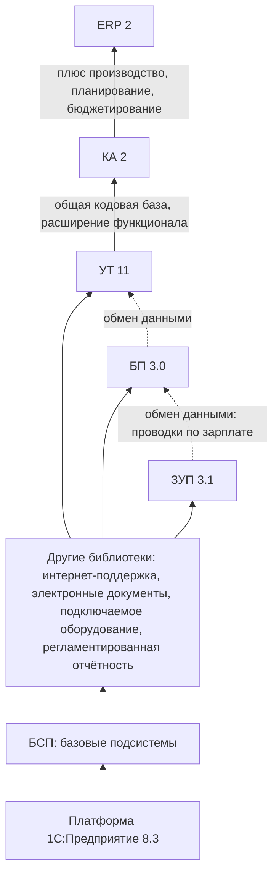
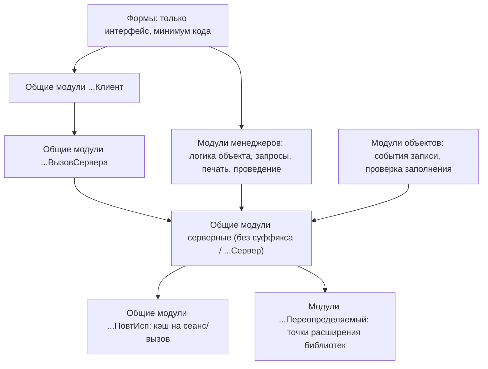
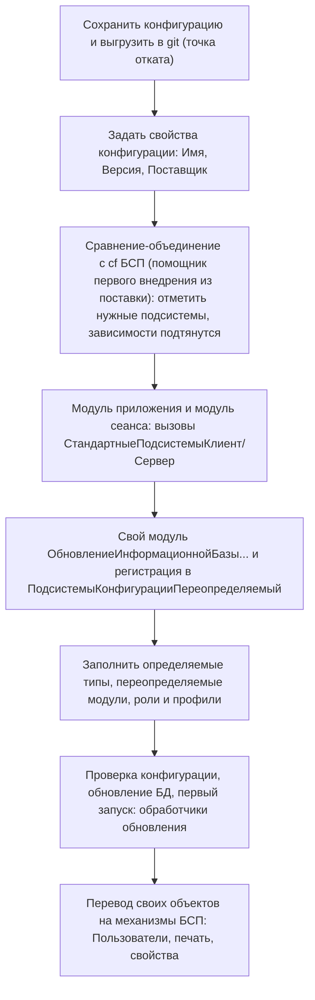
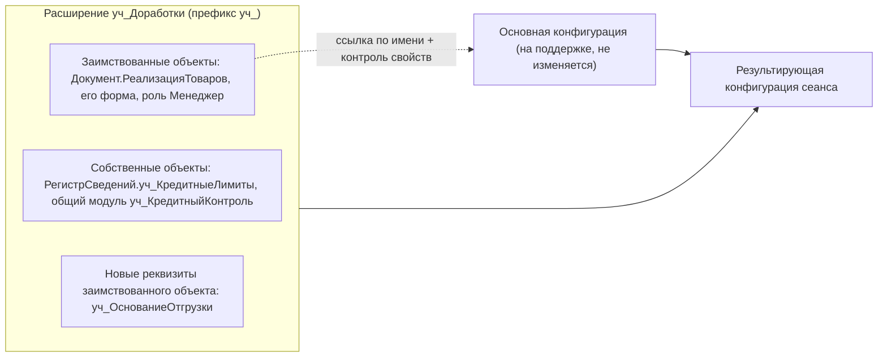
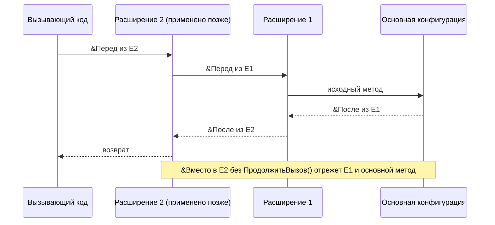
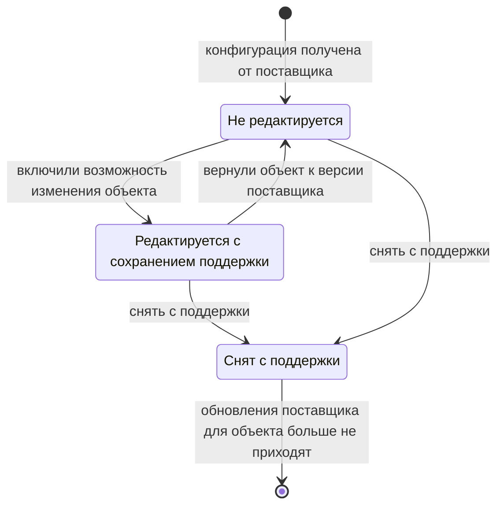
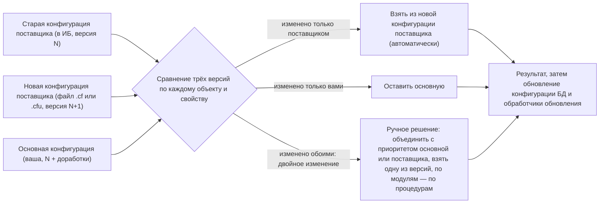
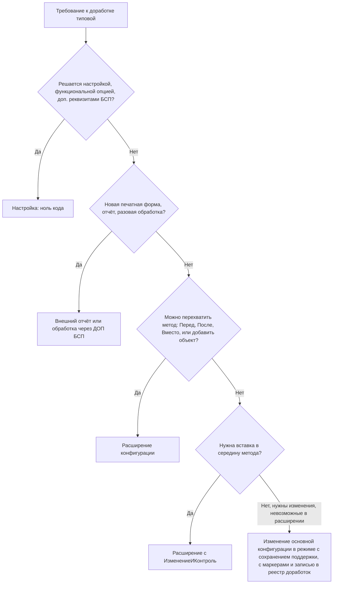

# Модуль 13. Типовые конфигурации, БСП, расширения конфигурации, внешние отчёты и обработки, поддержка и обновление типовых

> **Объём:** 24 ак. ч · **Неделя:** 15–16 · **Источники:** [Я] спринт 10 (основы работы с БСП, внедрение БСП, внешние отчёты и печатные формы), спринт 11 (типовые конфигурации, устройство и архитектура, расширения, дополнительные реквизиты и сведения, внешние отчёты и обработки, доработка без внесения изменений), спринт 12 (доработка печатных форм, обновление типовых, обновление модифицированной типовой), спринт 05 (воркшоп «Внешние отчёты и обработки»), [ПР] модуль 7 (внешние отчёты), [ПР2] модуль 2 (печатные формы), модуль 3 (механизм расширений), модуль 4 (технология разработки на основе БСП), [К] модули 11, 12, 13, [Т] модуль 5 (механизм расширения конфигурации, поддержка, поставка конфигурации, обновление конфигурации БД)
> **Нет в источниках (написано по документации платформы/опыту):** конкретные типовые (ERP, УТ, БП, ЗУП, КА) и их сравнение — источники говорят о «типовых конфигурациях» без перечня; соглашения об именах общих модулей (`…Клиент`, `…ВызовСервера`, `…ПовтИсп`, `…Переопределяемый`); подсистема БСП «Варианты отчётов» (в источниках — только «универсальный отчёт» и платформенные варианты отчётов); конкретные аннотации расширений `&Перед`/`&После`/`&Вместо`/`&ИзменениеИКонтроль` и порядок применения нескольких расширений (в источниках — «использование нескольких расширений» без деталей); трёхстороннее сравнение-объединение как механизм (в источниках — «обновление модифицированной типовой» заголовком).

## Результат модуля

- Ориентируетесь в линейке типовых (ERP/КА/УТ, БП, ЗУП), понимаете их слоистую архитектуру и соглашения об именовании модулей — быстро находите, где «живёт» нужная логика.
- Умеете внедрить БСП в собственную конфигурацию и пользоваться ключевым API (`ОбщегоНазначения`, `ОбщегоНазначенияКлиентСервер`, обновление ИБ, печать, свойства, регламентные задания).
- Умеете дорабатывать типовую без изменения основной конфигурации: расширения (заимствование, аннотации, формы, роли), внешние отчёты/обработки, дополнительные печатные формы и реквизиты.
- Умеете поставить конфигурацию на поддержку, внести изменения с сохранением поддержки и обновить доработанную типовую через трёхстороннее сравнение-объединение.
- Умеете выбрать способ доработки по принципу «минимум изменений в основной конфигурации» и обосновать выбор.

## Карта понятий SAP → 1С

| SAP | 1С | Ключевое отличие |
|---|---|---|
| Стандарт SAP S/4HANA, ECC | Типовая конфигурация (ERP, КА, УТ, БП, ЗУП) | Исходный код типовой полностью открыт и правится в том же Конфигураторе. «Ядро» = платформа, а не прикладной код |
| Basis-компоненты (SU01, BAL, ALV, GOS, CDHDR, классификация) | БСП — Библиотека стандартных подсистем | Не отдельный слой системы, а исходники, **влитые** в конфигурацию через сравнение-объединение |
| Enhancement Framework: BAdI, implicit/explicit enhancement points | Расширение конфигурации (`.cfe`): `&Перед`, `&После`, `&Вместо`, `&ИзменениеИКонтроль` | Можно «повиснуть» на любой процедуре модуля, не только на заранее объявленных точках |
| BAdI-точки, объявленные SAP | Модули `…Переопределяемый` БСП и типовых | Пустые процедуры, которые прикладник заполняет. Правка такого модуля — уже изменение основной конфигурации |
| Модификация (repair), Modification Assistant | Объект «на поддержке» в режиме «Редактируется с сохранением поддержки» | Нет ключа доступа — включить изменение может любой разработчик с доступом к Конфигуратору |
| SPAU / SPDD | Обновление конфигурации: трёхстороннее сравнение-объединение | Одна операция и для кода, и для структуры данных, реструктуризация БД — после |
| Пространство имён Z*/Y*, /NAMESPACE/ | Префикс имён расширения (`уч_`), маркеры в коде | Префикс навязывается для новых объектов и методов расширения |
| Smartforms/Adobe Forms, выходные сообщения NACE | Печать БСП, дополнительные печатные формы (внешние обработки) | Печатная форма может прийти **как данные** (файл `.epf` в справочнике), без поставки кода |
| Z-программа, загружаемая без транспорта | Внешний отчёт/обработка `.erf`/`.epf` | Исполняется в безопасном режиме, регистрируется в справочнике БСП |
| Classification (CT04/CL02), Z-поля в append | Подсистема «Свойства»: дополнительные реквизиты и сведения | Без изменения метаданных, хранится в ТЧ объекта или в регистре сведений |
| GOS-вложения | «Работа с файлами» (присоединённые файлы) | Справочник файлов на каждый тип владельца |
| Change documents (CDHDR/CDPOS) | «Версионирование объектов» | Хранит полную сериализацию объекта, а не дельту полей |
| XPRA, AFTER_IMP-методы | Обработчики обновления ИБ («Обновление версии ИБ») | Выполняются при первом запуске после обновления конфигурации |
| SU01 / PFCG, авторизационные объекты | «Пользователи», «Управление доступом»: профили групп доступа, группы доступа, RLS | Роли платформы собираются в профили, ограничения записей — по видам доступа |

## Теория

### 1. Типовые конфигурации

#### 1.1. Линейка

| Типовая | Назначение | Ближайший аналог в SAP |
|---|---|---|
| 1С:ERP Управление предприятием 2 | Крупный бизнес: производство, планирование, склад, продажи, закупки, финансы, регламентированный учёт, бюджетирование | S/4 (PP, MM, SD, FI/CO) |
| 1С:Комплексная автоматизация 2 (КА) | Средний бизнес, тот же код, что ERP, урезанный функционал | S/4 «облегчённый» |
| 1С:Управление торговлей 11 (УТ) | Торговля и склад, управленческий учёт, без бухгалтерии РСБУ | SD + MM + WM |
| 1С:Бухгалтерия предприятия 3.0 (БП) | Регламентированный бухгалтерский и налоговый учёт, отчётность | FI (локализация RU) |
| 1С:Зарплата и управление персоналом 3.1 (ЗУП) | Кадры, расчёт зарплаты, НДФЛ, взносы | HCM PA/PY |



Практическое следствие: УТ, КА и ERP разрабатываются из одного исходного дерева, поэтому прием, найденный в УТ, почти всегда работает в ERP. БП и ЗУП — отдельные кодовые базы, связь с УТ/ERP — через обмен данными (планы обмена, формат EnterpriseData). Типичный ландшафт внедрения: ERP/УТ + БП + ЗУП, как SAP-ландшафт с внешней системой HR.

#### 1.2. Архитектура: где искать логику



Соглашения об именах общих модулей (стандарт разработки «Правила создания общих модулей», https://its.1c.ru/db/v8std):

| Суффикс | Флаги модуля | Назначение | Пример из БСП |
|---|---|---|---|
| — (или `Сервер`, если есть одноимённый клиентский) | Сервер | Серверная логика, недоступна с клиента | `ОбщегоНазначения`, `СтандартныеПодсистемыСервер` |
| `Клиент` | Клиент (управляемое приложение) | Клиентская логика | `ОбщегоНазначенияКлиент` |
| `КлиентСервер` | Клиент + Сервер | Чистые функции без обращения к БД | `ОбщегоНазначенияКлиентСервер` |
| `ВызовСервера` | Сервер + Вызов сервера | Тонкий фасад для вызова с клиента | `ОбщегоНазначенияВызовСервера` |
| `ПовтИсп` | + Повторное использование возвращаемых значений | Кэш (на время вызова/сеанса) | `ОбщегоНазначенияПовтИсп` |
| `Глобальный` | Глобальный, Клиент | Обработчики ожидания, глобальные клиентские методы | `СтандартныеПодсистемыГлобальный` |
| `Переопределяемый` | любой | Процедуры-«крючки», которые заполняет прикладная конфигурация | `ОбщегоНазначенияПереопределяемый` |
| `ПолныеПрава` | + Привилегированный | Код, выполняемый без проверки прав | — (используйте осторожно) |

Правила поиска в типовой: начните с модуля менеджера объекта (печать, заполнение, проведение), затем — общие модули с именем подсистемы, затем модули `…Переопределяемый` (там прикладная настройка библиотек). Проведение в типовых обычно вынесено в модуль менеджера и общие модули — модуль объекта тонкий.

### 2. БСП

#### 2.1. Что это и как поставляется

БСП (https://its.1c.ru/db/bsp) — конфигурация-библиотека: набор подсистем, каждая из которых состоит из объектов метаданных (справочники, регистры, общие модули, роли, формы). Поставка: `.cf` с самой библиотекой, демо-конфигурация с примерами внедрения, документация с описанием API и порядком внедрения каждой подсистемы. Типовые 1С собраны на БСП — поэтому, освоив БСП, вы читаете любую типовую.

Ключевые понятия:

- **Программный интерфейс** — только процедуры в области `#Область ПрограммныйИнтерфейс` общих модулей. Остальное (`СлужебныйПрограммныйИнтерфейс`, `СлужебныеПроцедурыИФункции`) может меняться между версиями без предупреждения — как внутренние ФМ SAP без флага «released».
- **Переопределяемые модули** — точки настройки. Библиотека вызывает, например, `УправлениеПечатьюПереопределяемый.ПриОпределенииОбъектовСКомандамиПечати(СписокОбъектов)`, а конфигурация дописывает туда свои объекты.
- **Определяемые типы** (объект метаданных «Определяемый тип») — составные типы, которые конфигурация пополняет своими ссылками: так подсистема «узнаёт», какие объекты к ней подключены (например, владельцы присоединённых файлов), не зная их имён.
- **Подписки на события** библиотеки — тоже точки подключения: в состав источников подписки добавляются объекты конфигурации.

#### 2.2. Подсистемы, которые надо знать

| Подсистема | Что даёт | Ключевой API / точка подключения | Аналог SAP |
|---|---|---|---|
| Базовая функциональность | Общие функции, работа с метаданными, хранилища настроек, безопасное хранилище | `ОбщегоНазначения`, `ОбщегоНазначенияКлиентСервер`, `ОбщегоНазначенияКлиент`, `СтандартныеПодсистемыКлиент/Сервер` | Basis-утилиты, `CL_ABAP_*` |
| Пользователи | Справочник `Пользователи`, связь с пользователями ИБ, группы | `Пользователи.ТекущийПользователь()`, `Пользователи.ЭтоПолноправныйПользователь()` | SU01 |
| Управление доступом | Профили групп доступа, группы доступа, RLS по видам доступа | Профили (наборы ролей), шаблоны ограничений, `УправлениеДоступом` | PFCG, авторизационные объекты |
| Печать | Единая команда «Печать», форма «Печать документов», пользовательские макеты | Модуль менеджера: `ДобавитьКомандыПечати`, `Печать`; `УправлениеПечатью` | NACE + формы |
| Дополнительные отчёты и обработки | Регистрация внешних `.erf/.epf` как данных, назначение объектам | `СведенияОВнешнейОбработке()` во внешней обработке | Z-отчёты без транспорта |
| Варианты отчётов | Хранилище вариантов, панель отчётов, размещение в разделах | `ВариантыОтчетовПереопределяемый`, настройки в модуле отчёта | Варианты ALV/отчётов |
| Обновление версии ИБ | Обработчики обновления, первоначальное заполнение, отложенное обновление | `ПриДобавленииОбработчиковОбновления(Обработчики)` | XPRA |
| Свойства | Дополнительные реквизиты и сведения без изменения метаданных | ТЧ `ДополнительныеРеквизиты` объекта, `УправлениеСвойствами` в форме | Классификация |
| Работа с файлами (присоединённые файлы) | Файлы к любому объекту, хранение в томах или в ИБ | Справочник `<Владелец>ПрисоединенныеФайлы`, определяемые типы | GOS |
| Версионирование объектов | История изменений объектов, сравнение версий | Включение типа в подсистему и в настройках | Change documents |
| Регламентные задания | Управление заданиями из режима предприятия, работа с внешними ресурсами | `РегламентныеЗаданияСервер`, `ОбщегоНазначения.ПриНачалеВыполненияРегламентногоЗадания` | SM36/SM37 |
| Обмен данными | Сценарии синхронизации, правила конвертации, EnterpriseData | Планы обмена + `ОбменДаннымиСервер`, переопределяемые модули | ALE/IDoc |

#### 2.3. Базовая функциональность: функции, которые используются каждый день

```bsl
// Сервер. Значение реквизита без получения объекта целиком (один запрос)
Валюта = ОбщегоНазначения.ЗначениеРеквизитаОбъекта(Договор, "Валюта");
Реквизиты = ОбщегоНазначения.ЗначенияРеквизитовОбъекта(Договор, "Валюта, ВидДоговора, Владелец");

// Вызов модуля по имени без жёсткой зависимости от наличия подсистемы
Если ОбщегоНазначения.ПодсистемаСуществует("СтандартныеПодсистемы.Свойства") Тогда
	МодульУправлениеСвойствами = ОбщегоНазначения.ОбщийМодуль("УправлениеСвойствами");
	// МодульУправлениеСвойствами.<метод>(...)
КонецЕсли;

// Вариант ИБ
Если ОбщегоНазначения.ИнформационнаяБазаФайловая() Тогда
	// ...
КонецЕсли;

// Сервер (модуль объекта): сообщение с привязкой к полю формы, Отказ = Истина
ОбщегоНазначения.СообщитьПользователю(НСтр("ru = 'Не указан договор'"), ЭтотОбъект, "Договор", , Отказ);

// КлиентСервер: удобства для коллекций и форм
ОбщегоНазначенияКлиентСервер.УстановитьЭлементОтбораДинамическогоСписка(Список, "Склад", Склад,
	ВидСравненияКомпоновкиДанных.Равно, , ЗначениеЗаполнено(Склад));
Значение = ОбщегоНазначенияКлиентСервер.СвойствоСтруктуры(ПараметрыЗапуска, "Режим", "Просмотр");
Массив = ОбщегоНазначенияКлиентСервер.ЗначениеВМассиве(Номенклатура);
```

Почему это важно ABAP-разработчику: в типовой вы встретите эти вызовы на каждой странице. `ЗначениеРеквизитаОбъекта` — ответ на ловушку «обращение через точку» ([модуль 12](12-jobs-bp-admin-performance.md)): получает поле одним запросом, а не всем объектом. Точные сигнатуры смотрите в документации вашей версии БСП — между 2.x и 3.x менялись имена (`ОбщегоНазначенияКлиентСервер.СообщитьПользователю` → предпочтительно `ОбщегоНазначения.СообщитьПользователю` на сервере).

#### 2.4. Печать через БСП

```bsl
// Модуль менеджера Документ.РеализацияТоваров

#Область ПрограммныйИнтерфейс

Процедура ДобавитьКомандыПечати(КомандыПечати) Экспорт
	КомандаПечати = КомандыПечати.Добавить();
	КомандаПечати.Идентификатор = "Накладная";
	КомандаПечати.Представление = НСтр("ru = 'Накладная'");
КонецПроцедуры

Процедура Печать(МассивОбъектов, ПараметрыПечати, КоллекцияПечатныхФорм, ОбъектыПечати, ПараметрыВывода) Экспорт
	Если УправлениеПечатью.НужноПечататьМакет(КоллекцияПечатныхФорм, "Накладная") Тогда
		УправлениеПечатью.ВывестиТабличныйДокументВКоллекцию(КоллекцияПечатныхФорм, "Накладная",
			НСтр("ru = 'Накладная'"), СформироватьНакладную(МассивОбъектов, ОбъектыПечати), ,
			"Документ.РеализацияТоваров.ПФ_MXL_Накладная");
	КонецЕсли;
КонецПроцедуры

#КонецОбласти

#Область СлужебныеПроцедурыИФункции

Функция СформироватьНакладную(МассивОбъектов, ОбъектыПечати)
	ТабДок = Новый ТабличныйДокумент;
	Макет = УправлениеПечатью.МакетПечатнойФормы("Документ.РеализацияТоваров.ПФ_MXL_Накладная");
	// ... запрос по МассивОбъектов, вывод областей (см. модуль 07)
	Для Каждого Ссылка Из МассивОбъектов Цикл
		НомерСтрокиНачало = ТабДок.ВысотаТаблицы + 1;
		// ... вывод документа
		УправлениеПечатью.ЗадатьОбластьПечатиДокумента(ТабДок, НомерСтрокиНачало, ОбъектыПечати, Ссылка);
	КонецЦикла;
	Возврат ТабДок;
КонецФункции

#КонецОбласти
```

И регистрация объекта в переопределяемом модуле:

```bsl
// Общий модуль УправлениеПечатьюПереопределяемый
Процедура ПриОпределенииОбъектовСКомандамиПечати(СписокОбъектов) Экспорт
	СписокОбъектов.Добавить(Метаданные.Документы.РеализацияТоваров);
КонецПроцедуры
```

`УправлениеПечатью.МакетПечатнойФормы` (а не `ПолучитьМакет`) нужен для того, чтобы работали **пользовательские макеты**: пользователь правит макет в режиме предприятия, и он хранится в ИБ, а не в конфигурации. Имя макета по соглашению — `ПФ_MXL_…`. В новых версиях БСП (3.1+) часть настроек печати перенесена в `ПриОпределенииНастроекПечати` модуля менеджера — сверяйтесь с документацией версии. Табличный документ и макеты — [модуль 07](07-reports-skd-print.md).

#### 2.5. Обновление версии ИБ

```bsl
// Общий модуль ОбновлениеИнформационнойБазыУчебнаяТорговля (Сервер)

Процедура ПриДобавленииПодсистемы(Описание) Экспорт
	Описание.Имя = "УчебнаяТорговля";
	Описание.Версия = "1.0.2.1"; // = свойство «Версия» конфигурации
	Описание.ТребуемыеПодсистемы.Добавить("СтандартныеПодсистемы");
КонецПроцедуры

Процедура ПриДобавленииОбработчиковОбновления(Обработчики) Экспорт
	Обработчик = Обработчики.Добавить();
	Обработчик.Версия = "1.0.2.1";
	Обработчик.Процедура = "ОбновлениеИнформационнойБазыУчебнаяТорговля.ЗаполнитьВидНоменклатуры";
	Обработчик.РежимВыполнения = "Монопольно";

	Обработчик = Обработчики.Добавить();
	Обработчик.Версия = "*"; // при каждом обновлении
	Обработчик.Процедура = "ОбновлениеИнформационнойБазыУчебнаяТорговля.ОбновитьПредопределенные";
	Обработчик.РежимВыполнения = "Оперативно";

	Обработчик = Обработчики.Добавить();
	Обработчик.НачальноеЗаполнение = Истина; // только в пустой ИБ
	Обработчик.Процедура = "ОбновлениеИнформационнойБазыУчебнаяТорговля.ПервоначальноеЗаполнение";
КонецПроцедуры

Процедура ЗаполнитьВидНоменклатуры() Экспорт
	Запрос = Новый Запрос(
	"ВЫБРАТЬ
	|	Н.Ссылка КАК Ссылка
	|ИЗ
	|	Справочник.Номенклатура КАК Н
	|ГДЕ
	|	Н.ВидНоменклатуры = ЗНАЧЕНИЕ(Перечисление.ВидыНоменклатуры.ПустаяСсылка)
	|	И НЕ Н.ЭтоГруппа");
	Выборка = Запрос.Выполнить().Выбрать();
	Пока Выборка.Следующий() Цикл
		Объект = Выборка.Ссылка.ПолучитьОбъект();
		Объект.ВидНоменклатуры = Перечисления.ВидыНоменклатуры.Товар;
		ОбновлениеИнформационнойБазы.ЗаписатьОбъект(Объект); // запись без бизнес-логики и регистрации обмена
	КонецЦикла;
КонецПроцедуры
```

Модуль подключается в `ПодсистемыКонфигурацииПереопределяемый.ПриДобавленииПодсистем(МодулиПодсистем)`: `МодулиПодсистем.Добавить("ОбновлениеИнформационнойБазыУчебнаяТорговля");`. Обработчик срабатывает один раз при первом запуске, когда версия в ИБ (регистр `ВерсииПодсистем`) меньше версии обработчика. Режимы: `Монопольно` (до входа пользователей), `Оперативно` (без монопольного режима, быстро), `Отложенно` (в фоне после входа — для больших объёмов; требует описания блокируемых объектов и регистрации данных к обработке).

### 3. Внедрение БСП в собственную конфигурацию



Объединение выполняется в режиме «Сравнить, объединить с конфигурацией из файла» с отбором по подсистемам. Для первого внедрения в поставку БСП входит помощник (внешняя обработка; в текущих версиях — `ПервоеВнедрениеБСП.epf`, проверьте в комплекте своей версии), который помогает выбрать подсистемы с учётом зависимостей и формирует файл настроек сравнения.

Минимальные изменения в «ваших» модулях:

```bsl
// Модуль управляемого приложения
Процедура ПередНачаломРаботыСистемы()
	СтандартныеПодсистемыКлиент.ПередНачаломРаботыСистемы();
КонецПроцедуры

Процедура ПриНачалеРаботыСистемы()
	СтандартныеПодсистемыКлиент.ПриНачалеРаботыСистемы();
КонецПроцедуры

Процедура ПередЗавершениемРаботыСистемы(Отказ, ТекстПредупреждения)
	СтандартныеПодсистемыКлиент.ПередЗавершениемРаботыСистемы(Отказ, ТекстПредупреждения);
КонецПроцедуры

// Модуль сеанса
Процедура УстановкаПараметровСеанса(ИменаПараметровСеанса)
	СтандартныеПодсистемыСервер.УстановкаПараметровСеанса(ИменаПараметровСеанса);
КонецПроцедуры
```

Конфликт со сквозным проектом: в [модуле 12](12-jobs-bp-admin-performance.md) вы создали `Справочник.Пользователи`, `Справочник.РолиИсполнителей`, `РегистрСведений.ИсполнителиЗадач` и задачу. При объединении с БСП одноимённые объекты сопоставятся по имени: берите объекты БСП (правило «Взять из файла»), а свои уникальные реквизиты переносите вручную. Это ровно та ситуация, что и при обновлении доработанной типовой (раздел 6), только в миниатюре.

### 4. Расширения конфигурации

#### 4.1. Модель

Расширение — отдельная «мини-конфигурация» (`.cfe`), которая при запуске сеанса накладывается на основную. Основная конфигурация не меняется и остаётся на полной поддержке — обновление типовой не требует слияния ваших изменений (только проверки, что расширение ещё применяется).



Свойства расширения: **Префикс имён** (обязателен для новых объектов и методов, `уч_`), **Назначение** (`Исправление`, `Адаптация`, `Дополнение`), **Безопасный режим** и **Защита от опасных действий** (по умолчанию включены для расширений, загружаемых в режиме предприятия), режим совместимости. Если расширение добавляет реквизиты, таблицы или новые объекты с данными, оно **изменяет структуру данных** — его нельзя просто отключить без потери этих данных, а применение требует реструктуризации.

Где подключают: Конфигуратор → Конфигурация → Расширения конфигурации; в режиме предприятия — «Все функции → Стандартные → Управление расширениями конфигурации» (и форма БСП «Расширения»). Из командной строки конфигуратора — параметр `-Extension <Имя>` у команд загрузки/выгрузки конфигурации (сверьтесь со справкой по параметрам командной строки вашей версии).

#### 4.2. Заимствование и аннотации

Заимствовать объект — добавить его в расширение «по ссылке»: имя совпадает с исходным, свойства можно поставить на **контроль** (если в основной конфигурации тип/состав изменится, расширение не применится и сообщит об ошибке — защита от тихой поломки после обновления).

| Аннотация | Когда вызывается | Аналог ABAP |
|---|---|---|
| `&Перед("Метод")` | До исходного метода, параметры те же | Implicit enhancement в начале метода, pre-method |
| `&После("Метод")` | После исходного метода | Implicit enhancement в конце, post-method |
| `&Вместо("Метод")` | Вместо исходного; исходный — через `ПродолжитьВызов(...)` | Overwrite-method, BAdI с вызовом стандарта |
| `&ИзменениеИКонтроль("Метод")` | Тело метода копируется в расширение и правится маркерами `#Вставка`/`#Удаление` | Explicit enhancement section / ограниченная модификация |

Работают в модулях объектов, менеджеров, общих модулях, модулях форм, модулях команд. Метод с таким именем должен существовать в исходном модуле.

```bsl
// Расширение уч_Доработки. Модуль объекта заимствованного Документ.РеализацияТоваров

&После("ОбработкаПроверкиЗаполнения")
Процедура уч_ОбработкаПроверкиЗаполненияПосле(Отказ, ПроверяемыеРеквизиты)
	Если Отказ Тогда
		Возврат;
	КонецЕсли;
	Превышение = уч_КредитныйКонтроль.ПревышениеЛимита(Контрагент, Товары.Итог("Сумма"), Ссылка);
	Если Превышение > 0 Тогда
		ОбщегоНазначения.СообщитьПользователю(
			СтрШаблон(НСтр("ru = 'Превышен кредитный лимит на %1'"), Превышение), ЭтотОбъект, "Контрагент", , Отказ);
	КонецЕсли;
КонецПроцедуры

&Вместо("ОбработкаПроведения")
Процедура уч_ОбработкаПроведения(Отказ, РежимПроведения)
	ПродолжитьВызов(Отказ, РежимПроведения); // стандартные движения основной конфигурации
	Если Не Отказ И Не ЗначениеЗаполнено(уч_ОснованиеОтгрузки) Тогда
		// реквизит, добавленный расширением к заимствованному документу
		ОбщегоНазначения.СообщитьПользователю(НСтр("ru = 'Не указано основание отгрузки'"),
			ЭтотОбъект, "уч_ОснованиеОтгрузки", , Отказ);
	КонецЕсли;
КонецПроцедуры
```

```bsl
// Модуль менеджера заимствованного Документ.ПоступлениеТоваров

&ИзменениеИКонтроль("ЗаполнитьПоЗаказу")
Процедура уч_ЗаполнитьПоЗаказу(ДокументОбъект, Заказ)
	ДокументОбъект.Контрагент = Заказ.Контрагент;
	#Вставка
	ДокументОбъект.Договор = уч_КредитныйКонтроль.ОсновнойДоговор(Заказ.Контрагент);
	#КонецВставки
	#Удаление
	ДокументОбъект.Комментарий = "Создан на основании заказа";
	#КонецУдаления
	ЗаполнитьТоварыПоЗаказу(ДокументОбъект, Заказ); // служебная процедура того же модуля
КонецПроцедуры
```

`&ИзменениеИКонтроль` — самый «хрупкий» вариант: если поставщик изменит тело исходного метода, расширение не применится (платформа сравнивает текст с исходным). Это **намеренно**: вы узнаете о конфликте при обновлении, а не от пользователя. Используйте, когда нужна вставка в середину метода, а `&Перед`/`&После` не подходят.

Пример с `ЗаполнитьПоЗаказу` условный — имя метода из вашей реализации ввода на основании ([модуль 03](03-metadata-objects.md)).

#### 4.3. Формы, роли, собственные объекты

- **Формы.** Заимствованная форма показывает исходные элементы; новые элементы и реквизиты добавляются с префиксом. Для событий формы и элементов в палитре свойств выбирается тип вызова обработчика расширения: перед, после или вместо исходного; генерируется процедура вида `уч_ПриСозданииНаСервереПосле(Отказ, СтандартнаяОбработка)`. Если исходная форма изменится, «наложение» строится заново по именам элементов — переименование элемента поставщиком ломает расширение.
- **Роли.** В собственной роли расширения задаются права на собственные объекты расширения. Чтобы дать пользователям основной роли (`Менеджер`) права на новые объекты расширения, роль заимствуют и в ней отмечают права на объекты расширения. Права на объекты основной конфигурации расширение может только **добавлять** через собственные роли, а не отнимать у существующих.
- **Собственные объекты.** Справочники, документы, регистры, общие модули, отчёты, обработки, HTTP-сервисы и т.д. — с префиксом. Предопределённые элементы заимствованных справочников можно добавлять.
- **Новые реквизиты и табличные части** у заимствованных справочников и документов — допустимы (расширение начинает изменять структуру данных).

Ограничения (полный и актуальный список — в документации платформы, раздел о расширениях; он меняется от версии к версии): нельзя удалить или переименовать объект/реквизит основной конфигурации; нельзя менять типы существующих реквизитов; часть видов объектов и свойств не заимствуется или заимствуется только для чтения; расширения в безопасном режиме не могут выполнять опасные операции (файлы, COM, внешние компоненты) без разрешений.

#### 4.4. Несколько расширений

Расширения применяются последовательно: сначала по назначению (`Исправление` → `Адаптация` → `Дополнение`), внутри одного назначения — в порядке регистрации в ИБ. Каждое следующее «оборачивает» результат предыдущего, поэтому перехватчики выстраиваются «матрёшкой»:



Практика: держите одно «большое» расширение для доработок проекта плюс отдельные расширения-исправления (`Исправление`) для срочных патчей. Не делайте `&Вместо` без `ПродолжитьВызов` в двух расширениях на один метод.

### 5. Внешние отчёты и обработки, дополнительные печатные формы

Платформенный способ (без БСП):

```bsl
&НаКлиенте
Процедура ОткрытьВнешнююОбработку(Команда)
	Оповещение = Новый ОписаниеОповещения("ПослеПомещенияФайла", ЭтотОбъект);
	НачатьПомещениеФайла(Оповещение, , "", Истина, УникальныйИдентификатор);
КонецПроцедуры

&НаКлиенте
Процедура ПослеПомещенияФайла(Помещен, Адрес, ВыбранноеИмяФайла, ДополнительныеПараметры) Экспорт
	Если Не Помещен Тогда
		Возврат;
	КонецЕсли;
	ИмяОбработки = ПодключитьНаСервере(Адрес);
	ОткрытьФорму("ВнешняяОбработка." + ИмяОбработки + ".Форма");
КонецПроцедуры

&НаСервере
Функция ПодключитьНаСервере(Адрес)
	Возврат ВнешниеОбработки.Подключить(Адрес, , Истина); // Истина — безопасный режим
КонецФункции
```

В БСП внешние отчёты и обработки — это **данные**: файл загружается в справочник «Дополнительные отчёты и обработки», где указывается назначение (к каким объектам), разделы, пользователи, расписание (для обработок, выполняемых по расписанию). Чтобы обработка регистрировалась, в её модуле объекта обязательна функция `СведенияОВнешнейОбработке`:

```bsl
// Модуль объекта внешней обработки «Накладная с подписями» (.epf)

Функция СведенияОВнешнейОбработке() Экспорт
	ПараметрыРегистрации = ДополнительныеОтчетыИОбработки.СведенияОВнешнейОбработке("3.1.10.1"); // версия БСП, по которой написано
	ПараметрыРегистрации.Вид = ДополнительныеОтчетыИОбработкиКлиентСервер.ВидОбработкиПечатнаяФорма();
	ПараметрыРегистрации.Версия = "1.0.1";
	ПараметрыРегистрации.Назначение.Добавить("Документ.РеализацияТоваров");
	ПараметрыРегистрации.БезопасныйРежим = Истина;

	Команда = ПараметрыРегистрации.Команды.Добавить();
	Команда.Представление = НСтр("ru = 'Накладная с подписями'");
	Команда.Идентификатор = "НакладнаяСПодписями";
	Команда.Использование = ДополнительныеОтчетыИОбработкиКлиентСервер.ТипКомандыВызовСерверногоМетода();
	Команда.Модификатор = "ПечатьMXL";
	Возврат ПараметрыРегистрации;
КонецФункции

Процедура Печать(МассивОбъектов, КоллекцияПечатныхФорм, ОбъектыПечати, ПараметрыВывода) Экспорт
	Если УправлениеПечатью.НужноПечататьМакет(КоллекцияПечатныхФорм, "НакладнаяСПодписями") Тогда
		УправлениеПечатью.ВывестиТабличныйДокументВКоллекцию(КоллекцияПечатныхФорм, "НакладнаяСПодписями",
			НСтр("ru = 'Накладная с подписями'"), СформироватьПечатнуюФорму(МассивОбъектов, ОбъектыПечати));
	КонецЕсли;
КонецПроцедуры
```

После регистрации команда «Накладная с подписями» появляется в подменю «Печать» формы документа без изменения конфигурации. Другие виды: `ВидОбработкиДополнительнаяОбработка`, `ВидОбработкиДополнительныйОтчет`, `ВидОбработкиЗаполнениеОбъекта`, `ВидОбработкиОтчет`, `ВидОбработкиСозданиеСвязанныхОбъектов` — все в `ДополнительныеОтчетыИОбработкиКлиентСервер`.

Когда что выбирать:

| Задача | Внешняя обработка (ДОП) | Расширение |
|---|---|---|
| Новая печатная форма | Да — идеальный случай | Можно, но избыточно |
| Разовая загрузка/исправление данных | Да | Нет |
| Изменение логики проведения/проверки | Нет | Да |
| Новые реквизиты, регистры | Нет (кроме доп. реквизитов БСП) | Да |
| Поставка без доступа к Конфигуратору | Да (загружает пользователь с правами) | Да (тоже загружается в режиме предприятия) |

### 6. Поддержка и обновление доработанной типовой

#### 6.1. Режимы поддержки

Поставщик в настройке поставки задаёт правило для объектов: изменения разрешены / не рекомендуются / не разрешены. Потребитель после «Включить возможность изменения» (Конфигурация → Поддержка → Настройка поддержки) управляет режимом на уровне объекта:



- **Не редактируется** — обновление заменяет объект автоматически. Аналог: стандартный объект SAP без модификаций.
- **Редактируется с сохранением поддержки** — вы правите, при обновлении изменения поставщика и ваши сливаются (с вашим участием). Аналог: модификация через Modification Assistant.
- **Снят с поддержки** — объект ваш, обновления к нему не применяются. Аналог: копия стандарта в Z-объект, только с тем же именем.

Хранилище поддержки: в ИБ лежит копия «конфигурации поставщика» той версии, на которой вы стоите. Без неё трёхстороннее сравнение невозможно — не теряйте её (не «снимайте с поддержки» всю конфигурацию).

#### 6.2. Трёхстороннее сравнение-объединение



Это аналог SPDD + SPAU в одном окне: и структура (реквизиты, типы, формы), и код. Для модулей доступно объединение по процедурам и построчно; для форм — по элементам. Двойные изменения подсвечиваются отдельно — их и надо разбирать.

Файлы поставки: **`.cf`** — полная конфигурация (обновление с любой версии, но сравнение тяжелее); **`.cfu`** — файл обновления, применим только к перечисленным в нём предыдущим версиям. Пропустили релизы — обновляйтесь цепочкой через промежуточные или полным `.cf`. Готовые релизы типовых и порядок их применения — на сайте обновлений 1С (раздел пользователя ИТС).

#### 6.3. Процесс обновления доработанной типовой

1. Копия ИБ, выгрузка текущей конфигурации в git (ветка `vendor` с чистыми релизами поставщика полезна для анализа `diff`).
2. Проверить, что все расширения и внешние обработки описаны (реестр доработок).
3. Конфигурация → Поддержка → Обновить конфигурацию → выбор `.cf/.cfu`.
4. Разобрать двойные изменения; для модулей — по процедурам, сохраняя маркеры ваших правок.
5. Обновить конфигурацию БД (реструктуризация), запустить в режиме предприятия — отработают обработчики обновления поставщика.
6. Проверить применимость расширений (ошибки контроля `&ИзменениеИКонтроль`, контролируемые свойства), повторно зарегистрировать внешние печатные формы при изменении API.
7. Регресс-тесты ([модуль 14](14-team-dev-quality.md)), затем перенос на прод.

Маркеры изменений в основной конфигурации — общепринятая практика, чтобы при объединении отличать свой код:

```bsl
// УчебнаяТорговля++ Иванов 2026-10-12 Задача 123: контроль кредитного лимита
Если уч_КредитныйКонтроль.ЛимитПревышен(Контрагент) Тогда
	Отказ = Истина;
КонецЕсли;
// УчебнаяТорговля--
```

#### 6.4. Стратегия «минимум изменений в основной конфигурации»



Аналогия с SAP прямая: «Customizing → BAdI/enhancement → modification» — и стоимость обновления растёт в том же порядке.

## Ловушки для ABAP-разработчика

1. **Использовать служебные процедуры БСП.** Вызов чего-либо вне области `ПрограммныйИнтерфейс` = поломка при следующем обновлении БСП. Аналог — вызов неосвобождённой ФМ SAP.
2. **Править `…Переопределяемый` модули и считать, что «основная конфигурация не тронута».** Это изменение основной конфигурации: при обновлении модуль попадёт в двойные изменения. Если возможно — заполняйте переопределяемые процедуры из расширения через `&После`.
3. **`&Вместо` без `ПродолжитьВызов`.** Полностью отключает стандартную логику, включая будущие исправления поставщика. Это фактически модификация без контроля.
4. **Ожидать, что расширение «переживёт» любое обновление.** Переименование элемента формы, процедуры или реквизита поставщиком ломает заимствование. После каждого обновления — проверка применимости и тесты.
5. **Отключить расширение, изменяющее структуру данных.** Данные в новых реквизитах станут недоступны, а при удалении — потеряются. Это не «выключатель», как Switch Framework.
6. **Снять с поддержки всю конфигурацию «чтобы было удобно».** Трёхстороннее сравнение превращается в двустороннее, каждое обновление — ручной анализ всех различий.
7. **Использовать `ПолучитьМакет` вместо `УправлениеПечатью.МакетПечатнойФормы`.** Пользовательские макеты, исправленные в режиме предприятия, перестают работать.
8. **Запись объектов в обработчиках обновления обычным `Записать()`.** Срабатывают подписки, регистрация изменений для обмена, бизнес-проверки. Используйте `ОбновлениеИнформационнойБазы.ЗаписатьОбъект` / `ЗаписатьДанные`.
9. **Внешние обработки без безопасного режима «потому что надо писать файлы».** Это исполнение произвольного кода с правами сервера; в БСП для таких случаев есть запрос разрешений на внешние ресурсы.
10. **Обновление через `.cfu` с пропуском релизов.** `.cfu` применим только к перечисленным в нём версиям; пропуск релиза = отказ или обновление через полный `.cf` с тяжёлым сравнением.

## Практика (сквозной проект)

Ветка `module-13`. Для заданий T6–T7 понадобится демо-база БСП или учебная версия типовой из [lab](../lab/README.md); если её нет, роль «типовой» играет `УчебнаяТорговля` версии 1.0, поставленная на поддержку (см. T7).

### M13-T1. Внедрение БСП

Внедрите в `УчебнаяТорговля` подсистемы: Базовая функциональность, Пользователи, Обновление версии ИБ, Печать, Свойства, Дополнительные отчёты и обработки, Регламентные задания.

- [ ] Свойства конфигурации: Имя `УчебнаяТорговля`, Версия `1.0.2.1`, Поставщик заполнен.
- [ ] Модули приложения и сеанса вызывают `СтандартныеПодсистемыКлиент/Сервер`.
- [ ] Свои `Пользователи`/`РолиИсполнителей`/`ИсполнителиЗадач` из M12 заменены объектами БСП, БП `СогласованиеЗакупки` работает.
- [ ] Роли M10 (`Кладовщик`, `Менеджер`, `Бухгалтер`) включены в профили групп доступа.
- [ ] Синтаксический контроль и проверка конфигурации — без ошибок.

**Проверка:** чистая файловая ИБ: первый запуск без ошибок, создан первый пользователь-администратор, в регистре `ВерсииПодсистем` есть строка `УчебнаяТорговля` = `1.0.2.1`. Diff в git показывает добавленные объекты БСП отдельным коммитом.

### M13-T2. Обработчики обновления

Модуль `ОбновлениеИнформационнойБазыУчебнаяТорговля`: начальное заполнение (единицы измерения, основная валюта, склад по умолчанию), обработчик `1.0.3.1`, заполняющий пустой `ВидНоменклатуры` значением `Товар`.

- [ ] В пустой ИБ после первого запуска справочники заполнены.
- [ ] В ИБ с тестовыми данными (`project/testdata`) после поднятия версии до `1.0.3.1` пустых видов номенклатуры нет.
- [ ] Повторный запуск не выполняет обработчик повторно.

**Проверка:** запрос `checks/M13-T2.sql.txt` — количество элементов `Номенклатура` с пустым `ВидНоменклатуры` = 0.

### M13-T3. Печать через БСП

Переведите печатную форму накладной `РеализацияТоваров` из [модуля 07](07-reports-skd-print.md) на подсистему «Печать».

- [ ] Команда в подменю «Печать» формы документа и списка.
- [ ] Макет переименован в `ПФ_MXL_Накладная`, получается через `УправлениеПечатью.МакетПечатнойФормы`.
- [ ] Пакетная печать нескольких документов, каждый с новой страницы.
- [ ] Пользователь изменяет макет в режиме предприятия («Макеты печатных форм») — печать использует изменённый.

**Проверка:** ручной сценарий из 4 шагов, оформленный в `checks/M13-T3.md` как чек-лист (в M14 он станет сценарием Vanessa-Automation).

### M13-T4. Дополнительные реквизиты

Подключите подсистему «Свойства» к `Номенклатура` и `Контрагенты`: ТЧ `ДополнительныеРеквизиты`, вызовы `УправлениеСвойствами` в форме, набор свойств.

- [ ] Пользователь в режиме предприятия создаёт доп. реквизит «Страна происхождения» (тип — строка) для номенклатуры и заполняет его.
- [ ] Доп. реквизит доступен в отчёте на СКД из M07 (поле `[Страна происхождения (Номенклатура)]` или через подключение набора).

**Проверка:** запрос к ТЧ `Справочник.Номенклатура.ДополнительныеРеквизиты` возвращает заполненные значения.

### M13-T5. Внешняя печатная форма

Создайте внешнюю обработку «Накладная с подписями» по образцу раздела 5, зарегистрируйте в «Дополнительных отчётах и обработках».

- [ ] Безопасный режим включён, обработка работает.
- [ ] Команда видна только у `РеализацияТоваров`.
- [ ] Обработка хранится в git в виде исходников (выгрузка в файлы), а `.epf` собирается из них.

**Проверка:** печать из формы документа; конфигурация не изменялась (git diff по `src/` пуст).

### M13-T6. Расширение «Кредитный контроль»

Расширение `уч_КредитныйКонтроль` (назначение «Дополнение», префикс `уч_`): регистр сведений `уч_КредитныеЛимиты` (Контрагент → Лимит), общий модуль с функцией превышения (сумма долга по `Взаиморасчеты` + сумма документа − лимит), `&После("ОбработкаПроверкиЗаполнения")` в `РеализацияТоваров`, новый реквизит `уч_ОснованиеОтгрузки` и его поле в заимствованной форме, заимствованная роль `Менеджер` с правами на `уч_КредитныеЛимиты`.

- [ ] Основная конфигурация не изменена.
- [ ] Реализация сверх лимита не проводится с сообщением, привязанным к полю `Контрагент`.
- [ ] Пользователь с ролью `Менеджер` видит и редактирует лимиты.
- [ ] Расширение выгружено в `src-ext/уч_КредитныйКонтроль` и загружается из файлов.

**Проверка:** YAxUnit-тест появится в M14; пока — запрос остатков `Взаиморасчеты` + лимит по тестовому контрагенту и ручная попытка проведения (результат в `checks/M13-T6.md`).

### M13-T7*. Обновление доработанной «типовой»

Имитация жизненного цикла поставщик/клиент:

1. Ветка `vendor`: `УчебнаяТорговля` версии `1.0.3.1` — сохраните `.cf` как «релиз поставщика».
2. Новая ИБ «клиента»: загрузите `.cf` как конфигурацию на поддержке (через «Обновить конфигурацию» на пустой / создание из шаблона), включите возможность изменения, в `РеализацияТоваров.ОбработкаПроведения` внесите правку с маркерами, в `Номенклатура` добавьте реквизит.
3. В `vendor` выпустите `1.0.4.1`: измените ту же процедуру проведения (другие строки), добавьте новый регистр, создайте `.cf` и `.cfu` (Конфигурация → Поставка конфигурации → Создать файлы поставки и обновления).
4. Обновите ИБ клиента через `.cfu`.

- [ ] В отчёте сравнения: регистр — «изменён только поставщиком», реквизит — «только основная», процедура проведения — «двойное изменение».
- [ ] После объединения в процедуре есть и правка поставщика, и ваш фрагмент с маркерами.
- [ ] Расширение `уч_КредитныйКонтроль` применяется к обновлённой конфигурации; если нет — исправлено и описано.

**Проверка:** выгрузка конфигурации клиента после обновления в git, `diff` против `vendor 1.0.4.1` содержит только ваши помеченные изменения.

### M13-T8*. Два расширения на один метод

Добавьте расширение `уч_Исправления` (назначение «Исправление») с `&Перед("ОбработкаПроверкиЗаполнения")` в `РеализацияТоваров`, пишущим в журнал регистрации.

- [ ] По записям в ЖР (или точкам останова) установлен фактический порядок вызова перехватчиков двух расширений и исходного метода.
- [ ] Результат сопоставлен со схемой раздела 4.4 и задокументирован.

**Проверка:** `ВыгрузитьЖурналРегистрации` с отбором по событию — порядок записей.

## Контрольные вопросы

1. Чем отличаются УТ, КА и ERP с точки зрения кодовой базы? Как связаны с ними БП и ЗУП?
2. Какие флаги у общего модуля с суффиксом `ВызовСервера`? `ПовтИсп`? Почему в `КлиентСервер` нельзя обращаться к базе данных?
3. Что такое переопределяемый модуль и определяемый тип в БСП? Как с их помощью подключить объект к подсистеме?
4. Какие режимы выполнения обработчиков обновления существуют и когда нужен отложенный?
5. Чем `&Вместо` отличается от `&ИзменениеИКонтроль`? Когда расширение с `&ИзменениеИКонтроль` перестанет применяться?
6. Как выдать пользователю основной роли права на объект, добавленный расширением?
7. В каком порядке применяются несколько расширений и как это влияет на порядок вызова перехватчиков?
8. Опишите три исхода трёхстороннего сравнения для объекта. Что такое двойное изменение?
9. Чем `.cf` отличается от `.cfu`? Что делать, если пропущены два релиза типовой?
10. Заказчик просит новую печатную форму счёта и изменение алгоритма списания себестоимости в типовой. Какими механизмами вы это реализуете и почему?

## Документация

- Библиотека стандартных подсистем (описание подсистем, порядок внедрения, API): https://its.1c.ru/db/bsp
- Стандарты разработки (общие модули, расширения, доработка типовых): https://its.1c.ru/db/v8std
- Документация платформы 8.3 (расширения конфигурации, поддержка, сравнение и объединение, поставка): https://its.1c.ru/db/v83doc
- Методическая поддержка разработчиков: https://its.1c.ru/db/metod8dev
- Сайт платформы и линейка решений: https://v8.1c.ru
