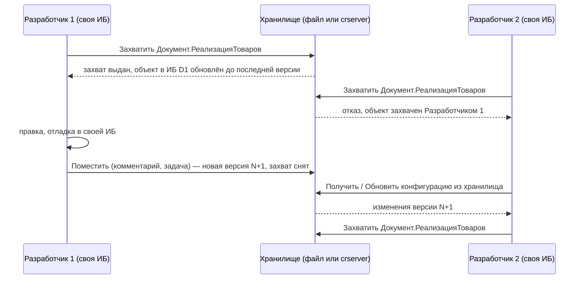
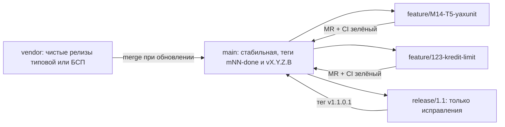
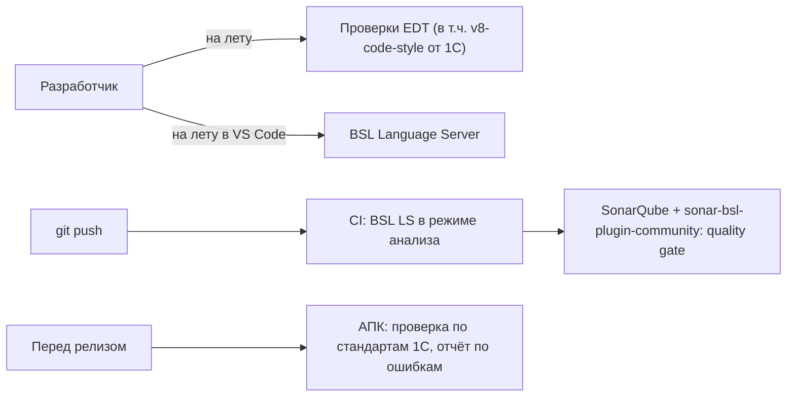
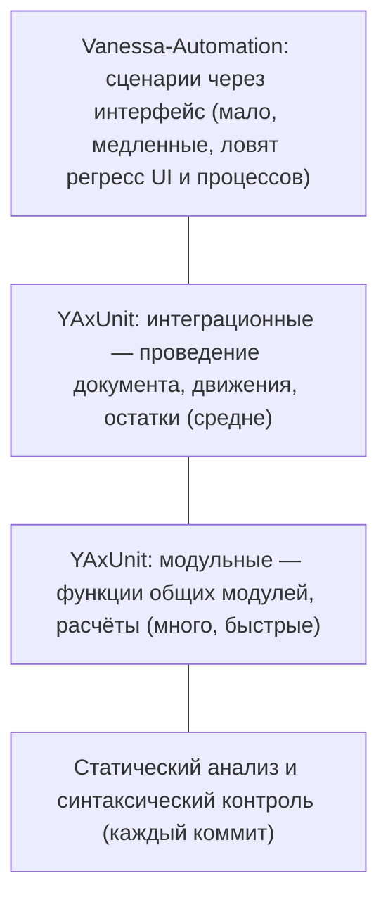
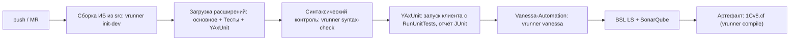
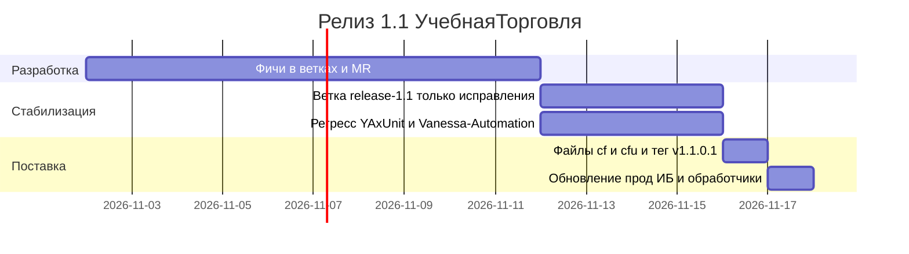

# Модуль 14. Командная разработка и качество: хранилище конфигурации, EDT + git, стандарты, проверка кода, тестирование, поставка

> **Объём:** 12 ак. ч · **Неделя:** 17 · **Источники:** [ПР2] модуль 6 и [К] модуль 15 (тестирование и создание документации с использованием Vanessa-Automation), [Т] модуль 5 (групповая разработка, поставка конфигурации, поддержка), [Я] спринт 09 (воркшоп «Хранилище конфигурации»), спринт 13 («Релизный цикл и стандарты разработки», «Особенности тестирования типовых конфигураций» — только заголовками тем), [ПР2] модуль 8 (git в 1С:Предприятие.Элемент — для платформы 8.3 неприменимо)
> **Нет в источниках (написано по документации платформы/опыту):** EDT + git (формат проекта, ветвление, конфликты в `Form.form`/XML); GitSync; содержание стандартов https://its.1c.ru/db/v8std (в источниках — только словосочетание «стандарты разработки»); АПК; SonarQube + BSL Language Server; проверки EDT (v8-code-style); YAxUnit; vanessa-runner и CI; детали релизного цикла (в источниках есть лишь «Поставка конфигурации» и «Релизный цикл» заголовками).

## Результат модуля

- Умеете работать в команде через хранилище конфигурации (захват, помещение, версии, метки) и понимаете его ограничения по сравнению с git.
- Умеете вести конфигурацию в git: формат EDT и формат выгрузки Конфигуратора, стратегия веток, разрешение конфликтов в XML форм и метаданных; знаете, как связать хранилище с git через GitSync.
- Знаете ключевые правила стандартов 1С и умеете автоматически проверять код: проверки EDT, BSL Language Server + SonarQube, АПК.
- Умеете писать модульные тесты YAxUnit в расширении и сценарные тесты Vanessa-Automation на Gherkin, запускать их из командной строки через vanessa-runner.
- Умеете выпустить релиз: версия, файлы поставки `.cf`/`.cfu`, тег, обновление целевой ИБ.

## Карта понятий SAP → 1С

| SAP | 1С | Ключевое отличие |
|---|---|---|
| CTS: транспортный запрос, блокировка объектов в запросе | Хранилище конфигурации: **захват** объекта | Захват — пессимистическая блокировка на уровне объекта метаданных (вплоть до модуля формы), а не набор объектов в запросе. Нет понятия «запрос» и маршрута DEV→QAS→PRD |
| Версии объекта (SE38 → версии) | История хранилища, версии и метки | Версия — снимок всей конфигурации на момент помещения, с комментарием |
| abapGit | EDT + git / выгрузка в файлы Конфигуратора + git | В 1С git — основной инструмент только в EDT; Конфигуратор умеет выгрузку/загрузку XML |
| ChaRM / Solution Manager | Нет штатного. Трекер задач + git (ветки на задачу) + CI | Процесс собирается из внешних инструментов |
| ATC / Code Inspector / SLIN | АПК, BSL Language Server + SonarQube, проверки EDT | Правила взяты из стандартов https://its.1c.ru/db/v8std; в платформе только синтаксический контроль и «Проверка конфигурации» |
| ABAP Unit | YAxUnit (тесты в расширении) | Тесты — отдельное расширение, не часть продуктивного кода |
| eCATT / CBTA / Tricentis | Vanessa-Automation (Gherkin, клиент тестирования) | Сценарии на русском Gherkin, тот же сценарий генерирует видеоинструкцию |
| Транспорт в целевую систему (STMS import) | Обновление ИБ из `.cf`/`.cfu`, загрузка `.cfe`; в CI — vanessa-runner | Перенос — это объединение конфигураций, а не импорт объектов |
| SAP Note + SNOTE | Релиз-обновление `.cfu` / расширение с назначением «Исправление» | Патч точечно — расширением, без изменения основной конфигурации |

## Теория

### 1. Хранилище конфигурации

#### 1.1. Механика

Хранилище — централизованная база версий конфигурации. Каждый разработчик работает в своей ИБ, «подключённой к хранилищу». Изменять можно только **захваченные** объекты.



Варианты размещения: каталог (файловое хранилище, общий сетевой ресурс), сервер хранилища `crserver` (TCP, по умолчанию порт 1542, адрес `tcp://host/repo`), публикация через веб-сервер (HTTP). Ключевые операции: подключение, захват (с рекурсией по подчинённым), помещение (с опцией «оставить захват»), отмена захвата, получение, история, сравнение версий, метки версий, сохранение версии в `.cf`, администрирование пользователей и прав.

Детали, которые нужно знать:

- Гранулярность захвата — объект метаданных; модули и формы объекта захватываются вместе с ним (форма — отдельный объект в дереве). Корень конфигурации захватывают, чтобы добавить новые объекты верхнего уровня, — поэтому его держат как можно меньше.
- Новые объекты появляются в хранилище только после помещения **корня** (или родителя).
- Веток нет. Параллельная разработка релизов = несколько хранилищ (например, `main` и `release-1.1`) с ручным переносом изменений через «Сравнить, объединить».
- Хранилище есть и для расширений (своё хранилище на каждое расширение).
- Автоматизация — пакетный режим Конфигуратора: `/ConfigurationRepositoryF <путь>`, `/ConfigurationRepositoryN <пользователь>`, `/ConfigurationRepositoryP <пароль>`, `/ConfigurationRepositoryUpdateCfg`, `/ConfigurationRepositoryReport`, `/ConfigurationRepositoryDumpCfg` (точный список и ключи — справка по параметрам командной строки в https://its.1c.ru/db/v83doc).

#### 1.2. Хранилище против git

| Аспект | Хранилище | git |
|---|---|---|
| Модель | Централизованная, пессимистическая блокировка | Распределённая, оптимистическая, слияние |
| Ветки | Нет (отдельные хранилища) | Да |
| Код-ревью | Нет | Pull/merge request |
| CI | Через выгрузку версии в файлы | Нативно |
| Конфликты | Невозможны (захват) | Возможны, особенно в XML форм |
| Порог входа для команды «из Конфигуратора» | Низкий | Требует EDT или дисциплины выгрузки |

Компромисс многих команд — хранилище для разработки в Конфигураторе + GitSync для истории в git и CI.

### 2. EDT и git

#### 2.1. Форматы исходников

Два файловых представления конфигурации:

| | Выгрузка Конфигуратора (`/DumpConfigToFiles`) | Проект EDT |
|---|---|---|
| Корень | `Configuration.xml`, `ConfigDumpInfo.xml` | `DT-INF/PROJECT.PMF`, `src/Configuration/Configuration.mdo` |
| Справочник | `Catalogs/Номенклатура.xml` + `Catalogs/Номенклатура/Ext/ObjectModule.bsl` | `src/Catalogs/Номенклатура/Номенклатура.mdo` + `ObjectModule.bsl` |
| Форма | `…/Forms/ФормаЭлемента/Ext/Form.xml` + `Ext/Form/Module.bsl` | `…/Forms/ФормаЭлемента/Form.form` + `Module.bsl` |
| Кто использует | Конфигуратор, vanessa-runner, GitSync | EDT |

Конвертация EDT ↔ XML — средствами EDT (импорт/экспорт, командный интерфейс `1cedtcli`; в старых версиях — утилита `ring`). Сквозной проект хранится в `src/` в одном из форматов (см. [lab](../lab/README.md)); для CI нужен формат выгрузки Конфигуратора — либо храните его, либо конвертируйте на сборке.

`ConfigDumpInfo.xml` содержит хеши версий объектов и меняется почти при каждой выгрузке — частый источник «пустых» конфликтов; при инкрементальной выгрузке он нужен, при полной его обычно игнорируют в `.gitignore`.

#### 2.2. Стратегия веток для 1С



Правила, специфичные для 1С:

- **Одна форма — один владелец в момент времени.** `Form.form`/`Form.xml` — это дерево элементов с числовыми идентификаторами; два параллельных изменения формы почти всегда дают конфликт, который руками не разрешить корректно. Договаривайтесь или выносите доработки формы в отдельную ветку с быстрым слиянием.
- **Конфликт в `Configuration.mdo` / `Configuration.xml`** (список дочерних объектов) обычно разрешается объединением обоих списков. Конфликты в `.mdo` объекта — по смыслу (реквизиты, типы), затем открыть проект в EDT и проверить.
- **Конфликт в форме:** возьмите версию одной ветки целиком, затем повторите изменения второй ветки в редакторе формы. Не правьте идентификаторы руками.
- **Кодировка и переводы строк:** `.bsl` — UTF-8 (с BOM в выгрузке Конфигуратора); настройте `.gitattributes`, чтобы git не менял окончания строк в XML/BSL.
- **Не коммитьте ИБ** (`*.1CD`), логи, `ConfigDumpInfo.xml` (при полной выгрузке), собранные `.cf`/`.epf` — только исходники.

```gitattributes
*.bsl  text eol=crlf
*.xml  text eol=crlf
*.mdo  text eol=crlf
*.form text eol=crlf
*.cf   binary
*.cfe  binary
*.epf  binary
*.erf  binary
```

#### 2.3. GitSync

GitSync (https://github.com/oscript-library/gitsync) — утилита на OneScript: проходит по версиям хранилища и для каждой делает коммит в git с выгрузкой конфигурации в файлы. Автор коммита берётся из файла соответствия `AUTHORS` (пользователь хранилища → имя и e-mail), номер последней выгруженной версии — из файла `VERSION`. Типовой запуск — по расписанию на сервере сборки (`gitsync sync <путь к хранилищу> <рабочий каталог git>`; набор параметров — `gitsync help`). Результат: разработчики продолжают захватывать/помещать в Конфигураторе, а в git появляется полная история для ревью, статического анализа и CI.

### 3. Стандарты разработки

Стандарты 1С (https://its.1c.ru/db/v8std) — аналог ABAP Programming Guidelines, но с большей обязательностью: на них построены проверки АПК и EDT, и по ним сертифицируется «Совместимо! 1С:Предприятие». Ключевые правила, которые проверяются в каждом ревью:

| Правило | Суть | ABAP-аналог |
|---|---|---|
| Структура модуля | Области `ПрограммныйИнтерфейс`, `СлужебныйПрограммныйИнтерфейс`, `СлужебныеПроцедурыИФункции`, в формах — `ОбработчикиСобытийФормы`, `ОбработчикиКомандФормы` и т.д. | Порядок секций класса |
| Описание экспортных методов | Комментарий перед методом: назначение, `Параметры:`, `Возвращаемое значение:` в установленном формате | ABAP Doc |
| Запросы в цикле запрещены | Получать данные одним запросом / пакетом | `SELECT` в `LOOP` |
| Обращение к реквизитам через точку | Не разыменовывать ссылки в цикле, не читать объект ради одного поля | `SELECT SINGLE` в цикле |
| Транзакции | `НачатьТранзакцию()` перед `Попытка`, в `Исключение` — `ОтменитьТранзакцию()` и `ВызватьИсключение`, без «проглатывания» | `COMMIT`/`ROLLBACK` дисциплина |
| Строки интерфейса | Только через `НСтр("ru = '...'")`, без конкатенации — `СтрШаблон` | Text symbols |
| Привилегированный режим | Минимальный участок, с обоснованием | `AUTHORITY-CHECK` bypass |
| Безопасный режим | Для внешнего кода и `Выполнить()`/`Вычислить()` — `УстановитьБезопасныйРежим(Истина)` | — |
| Клиент-сервер | Минимум серверных вызовов, без передачи объектов с клиента | Число RFC |
| Имена | Говорящие, CamelCase без подчёркиваний (кроме префиксов расширений), общие модули — по суффиксам ([модуль 13](13-typical-configs-bsp-extensions.md)) | Naming conventions |
| Модальность | Без модальных вызовов: `Показать…`/`Начать…` + `ОписаниеОповещения` | — |

Образец транзакции по стандарту:

```bsl
НачатьТранзакцию();
Попытка
	Блокировка = Новый БлокировкаДанных;
	Элемент = Блокировка.Добавить("РегистрСведений.уч_КредитныеЛимиты");
	Элемент.УстановитьЗначение("Контрагент", Контрагент);
	Блокировка.Заблокировать();
	// ... чтение и запись
	ЗафиксироватьТранзакцию();
Исключение
	ОтменитьТранзакцию();
	ЗаписьЖурналаРегистрации(НСтр("ru = 'Кредитный контроль.Изменение лимита'", "ru"),
		УровеньЖурналаРегистрации.Ошибка, , , ПодробноеПредставлениеОшибки(ИнформацияОбОшибке()));
	ВызватьИсключение;
КонецПопытки;
```

### 4. Автоматическая проверка кода



- **Проверки EDT** — встроены в среду, плюс открытый плагин `v8-code-style` (https://github.com/1C-Company/v8-code-style), реализующий стандарты. Ошибки видны в редакторе и в панели «Ошибки конфигурации».
- **BSL Language Server** (https://github.com/1c-syntax/bsl-language-server) — open source анализатор: более сотни диагностик (сложность, запросы в цикле, неиспользуемые переменные, пустые `Исключение`, длина строки…), работает в VS Code и как CLI для CI. Настройки — файл `.bsl-language-server.json` в корне проекта.
- **SonarQube** + `sonar-bsl-plugin-community` (https://github.com/1c-syntax/sonar-bsl-plugin-community) — хранит историю, считает технический долг, блокирует MR по quality gate. Аналог ATC с центральной базой результатов.
- **АПК** («1С:Автоматизированная проверка конфигураций») — отдельная конфигурация 1С: загружает выгрузку проверяемой конфигурации и проверяет её по правилам стандартов, включая метаданные и формы (то, чего BSL LS не видит). Используется 1С для сертификации и командами типовых.

Минимальная настройка анализа в репозитории (имена параметров сверяйте с документацией версии плагина):

```properties
# sonar-project.properties
sonar.projectKey=uchtorg
sonar.projectName=УчебнаяТорговля
sonar.sources=src
sonar.sourceEncoding=UTF-8
sonar.inclusions=**/*.bsl
```

```json
{
  "language": "ru",
  "diagnostics": {
    "parameters": {
      "LineLength": { "maxLineLength": 150 },
      "CognitiveComplexity": { "complexityThreshold": 15 }
    }
  }
}
```

### 5. Тестирование

#### 5.1. Пирамида



Особенность 1С: большая часть логики живёт в проведении и запросах, поэтому «модульный» тест в 1С обычно интеграционный — создаёт данные в ИБ и проверяет движения. Держите тестовую ИБ отдельно и создавайте данные в каждом тесте (или откатывайте транзакцию).

#### 5.2. YAxUnit

YAxUnit (https://github.com/bia-technologies/yaxunit) — фреймворк модульных тестов: движок ставится как расширение `YAxUnit`, тесты пишутся в **отдельном расширении** (`Тесты`) в общих модулях с префиксом `ОМ_`. Тестовый модуль регистрирует тесты в `ИсполняемыеСценарии()`, тест — экспортная процедура.

```bsl
// Расширение «Тесты», общий модуль ОМ_ПроведениеРеализации (Сервер)

#Область СлужебныйПрограммныйИнтерфейс

Процедура ИсполняемыеСценарии() Экспорт
	ЮТТесты
		.ДобавитьТест("ПроведениеБезОстатка_Отказ")
		.ДобавитьТест("ПроведениеВПределахОстатка_ОстатокУменьшается");
КонецПроцедуры

#КонецОбласти

#Область Тесты

Процедура ПроведениеБезОстатка_Отказ() Экспорт
	Номенклатура = ЮТест.Данные().СоздатьЭлемент(Справочники.Номенклатура, "Тест-товар");
	Склад = ЮТест.Данные().СоздатьЭлемент(Справочники.Склады, "Тест-склад");

	Реализация = НоваяРеализация(Склад, Номенклатура, 5);
	Проведен = Истина;
	Попытка
		Реализация.Записать(РежимЗаписиДокумента.Проведение);
	Исключение
		Проведен = Ложь;
	КонецПопытки;

	ЮТест.ОжидаетЧто(Проведен, "Реализация сверх остатка не должна проводиться").ЭтоЛожь();
КонецПроцедуры

Процедура ПроведениеВПределахОстатка_ОстатокУменьшается() Экспорт
	Номенклатура = ЮТест.Данные().СоздатьЭлемент(Справочники.Номенклатура, "Тест-товар");
	Склад = ЮТест.Данные().СоздатьЭлемент(Справочники.Склады, "Тест-склад");
	ОприходоватьТовар(Склад, Номенклатура, 10);

	НоваяРеализация(Склад, Номенклатура, 4).Записать(РежимЗаписиДокумента.Проведение);

	ЮТест.ОжидаетЧто(Остаток(Склад, Номенклатура)).Равно(6);
КонецПроцедуры

#КонецОбласти

#Область СлужебныеПроцедурыИФункции

Функция НоваяРеализация(Склад, Номенклатура, Количество)
	Документ = Документы.РеализацияТоваров.СоздатьДокумент();
	Документ.Дата = ТекущаяДатаСеанса();
	Документ.Склад = Склад;
	Документ.Контрагент = ЮТест.Данные().СоздатьЭлемент(Справочники.Контрагенты, "Тест-покупатель");
	// Договор, Организация — по обязательным реквизитам вашей реализации
	Строка = Документ.Товары.Добавить();
	Строка.Номенклатура = Номенклатура;
	Строка.Количество = Количество;
	Строка.Цена = 100;
	Строка.Сумма = Количество * 100;
	Возврат Документ;
КонецФункции

Функция Остаток(Склад, Номенклатура)
	Запрос = Новый Запрос(
	"ВЫБРАТЬ
	|	ЕСТЬNULL(СУММА(О.КоличествоОстаток), 0) КАК Количество
	|ИЗ
	|	РегистрНакопления.ОстаткиТоваров.Остатки(, Склад = &Склад И Номенклатура = &Номенклатура) КАК О");
	Запрос.УстановитьПараметр("Склад", Склад);
	Запрос.УстановитьПараметр("Номенклатура", Номенклатура);
	Выборка = Запрос.Выполнить().Выбрать();
	Выборка.Следующий();
	Возврат Выборка.Количество;
КонецФункции

// ОприходоватьТовар — аналогично через Документы.ПоступлениеТоваров

#КонецОбласти
```

Запуск: клиент 1С с параметром `/C RunUnitTests=<путь к JSON-конфигурации>` (в конфигурации — фильтры тестов, формат и путь отчёта, закрытие после выполнения). Отчёт формируется в формате JUnit — CI его понимает. Изоляция: тест можно выполнять в транзакции с откатом (настройка теста/набора — см. документацию YAxUnit), иначе тестовые данные остаются в ИБ — используйте отдельную тестовую ИБ, пересоздаваемую в CI.

Расширение с тестами компилируется относительно основной конфигурации, а не других расширений: тестировать код расширения `уч_КредитныйКонтроль` проще через поведение объектов основной конфигурации (проведение отклоняется) или тестами внутри самого расширения.

#### 5.3. Vanessa-Automation

Vanessa-Automation (https://github.com/Pr-Mex/vanessa-automation) — внешняя обработка, которая управляет клиентом 1С через механизм клиента тестирования (менеджер тестирования запускается с ключом `/TESTMANAGER`, тестируемый клиент — с `/TESTCLIENT`). Сценарии — `.feature`-файлы на Gherkin с русскими ключевыми словами. Те же сценарии используются для генерации документации и видеоинструкций — это и есть «создание документации» из [ПР2] модуль 6.

```gherkin
# language: ru

@tree

Функционал: Контроль остатков при реализации
	Как менеджер по продажам
	Я хочу, чтобы реализация сверх остатка не проводилась
	Чтобы склад не уходил в минус

Контекст:
	Дано Я открыл новый сеанс TestClient или подключил уже существующий

Сценарий: Реализация сверх остатка не проводится
	И я закрываю все окна клиентского приложения
	И я открываю навигационную ссылку "e1cib/list/Документ.РеализацияТоваров"
	И я нажимаю на кнопку с именем 'ФормаСоздать'
	Тогда открылось окно 'Реализация товаров (создание)'
	И из выпадающего списка с именем 'Контрагент' я выбираю по строке 'Ромашка'
	И из выпадающего списка с именем 'Склад' я выбираю по строке 'Основной'
	И в таблице 'Товары' я нажимаю на кнопку с именем 'ТоварыДобавить'
	И в таблице 'Товары' из выпадающего списка с именем 'ТоварыНоменклатура' я выбираю по строке 'Тест-товар'
	И в таблице 'Товары' в поле с именем 'ТоварыКоличество' я ввожу текст '1000'
	И я нажимаю на кнопку с именем 'ФормаПровести'
	Тогда в логе сообщений TestClient есть строка 'Недостаточно'
```

Тексты шагов должны **точно** совпадать с библиотекой шагов VA вашей версии — не пишите их по памяти, используйте поиск шагов и запись действий («Записать действия пользователя») в самой обработке. Имена элементов (`ФормаСоздать`, `ТоварыКоличество`) — имена элементов формы; поэтому переименование элемента ломает тест, как и расширение.

### 6. CI: vanessa-runner

vanessa-runner (`vrunner`, https://github.com/vanessa-opensource/vanessa-runner) — OneScript-обёртка над пакетным режимом 1С: собрать ИБ из исходников, обновить, загрузить расширение, запустить тесты, собрать `.cf`. Настройки по умолчанию — в `env.json`, переопределяются параметрами.



```bash
# ИБ для тестов из исходников (формат выгрузки Конфигуратора)
vrunner init-dev --src src/cf --ibconnection /F./build/ib
# расширения из исходников
vrunner compileext src/cfe/Тесты Тесты --ibconnection /F./build/ib
# синтаксический контроль
vrunner syntax-check --ibconnection /F./build/ib
# модульные тесты YAxUnit
vrunner run --command "RunUnitTests=./tests/yaxunit.json" --ibconnection /F./build/ib
# сценарные тесты Vanessa-Automation
vrunner vanessa --settings ./tests/va-params.json --ibconnection /F./build/ib
# сборка cf
vrunner compile --src src/cf --out build/1Cv8.cf
```

Команды и ключи меняются между версиями vanessa-runner — сверяйте с `vrunner help <команда>`. Для CI нужен агент с установленной платформой 1С и лицензией (для сценарных тестов — ещё и графическая среда или виртуальный дисплей на Linux).

### 7. Релизный цикл и поставка

Версия конфигурации — четыре числа `Редакция.Подредакция.Версия.Сборка` (`1.1.0.1`), хранится в свойстве «Версия» и в БСП сравнивается с версией в ИБ для запуска обработчиков обновления ([модуль 13](13-typical-configs-bsp-extensions.md)).



Поставка (Конфигурация → Поставка конфигурации):

1. **Настройка поставки** — поставщик, правила поддержки для объектов (изменения разрешены / не рекомендуются / не разрешены), состав файлов комплекта.
2. **Создать файлы поставки и обновления** — `.cf` (полная) и `.cfu` (обновление с перечисленных предыдущих версий; для каждой версии нужен её `.cf`). Пакетный режим — `/CreateDistributionFiles` с ключами `-cffile`, `-cfufile`, `-f` (предыдущая версия); детали — в справке по командной строке.
3. **Комплект поставки** (`.efd`, установщик шаблонов) — для распространения через каталог шаблонов; для внутренних проектов обычно достаточно `.cf/.cfu` + `.cfe`.
4. Тег в git, артефакты в хранилище артефактов CI, заметки о выпуске.

Срочное исправление в продуктиве без релиза — расширение с назначением «Исправление» (≈ SAP Note), которое удаляется после выхода штатного релиза с тем же исправлением.

## Ловушки для ABAP-разработчика

1. **Захват корня конфигурации «на всякий случай».** Блокирует добавление объектов всей команде. Захватывайте корень на минуты, только для добавления объекта, и сразу помещайте.
2. **Ожидать от хранилища веток и транспортных маршрутов.** Их нет. Перенос между хранилищами — «Сравнить, объединить», это ручная работа.
3. **Параллельная правка одной формы в двух git-ветках.** Конфликт в `Form.form`/`Form.xml` на идентификаторах элементов; «объединить обе стороны» даёт битую форму. Одна форма — один владелец.
4. **Коммитить `ConfigDumpInfo.xml` при полной выгрузке** — постоянные конфликты без смысла. Но при инкрементальной выгрузке он нужен.
5. **Тесты в продуктивной конфигурации.** Тестовый код и YAxUnit — только в отдельных расширениях, которые в прод не попадают.
6. **Тесты, зависящие от данных базы** (конкретный контрагент «Ромашка»). В CI база пустая. Создавайте данные в тесте или фикстурой.
7. **Шаги Vanessa-Automation «по памяти».** Шаг, не найденный в библиотеке, — ошибка сценария. Только из поиска/записи действий.
8. **Статический анализ «потом».** Включённый на большом наследии BSL LS выдаст тысячи замечаний. Включайте quality gate по **новому** коду с первого дня.
9. **`.cfu` без `.cf` предыдущих версий.** Файл обновления строится от конкретных версий; не сохранили `.cf` релиза 1.0 — не сделаете `.cfu` 1.0→1.1.

## Практика (сквозной проект)

Ветка `module-14`. Нужна установленная EDT или Конфигуратор с выгрузкой в файлы, OneScript (для vrunner/GitSync), YAxUnit и Vanessa-Automation (версии — по [lab](../lab/README.md)).

### M14-T1. Хранилище конфигурации

Создайте файловое хранилище `УчебнаяТорговля`, двух пользователей, подключите две ИБ разработчиков.

- [ ] Пользователь 1 захватил `Документ.РеализацияТоваров`; пользователь 2 получил отказ при захвате.
- [ ] Пользователь 1 поместил изменения с комментарием `M14-T1: ...`, пользователь 2 получил их «Обновить конфигурацию из хранилища».
- [ ] Новый справочник добавлен с захватом корня; корень освобождён сразу после помещения.
- [ ] Поставлена метка версии `m14-t1`.

**Проверка:** отчёт по истории хранилища (или `/ConfigurationRepositoryReport`) сохранён в `checks/M14-T1.txt`.

### M14-T2. Git и конфликт формы

Настройте `.gitignore` и `.gitattributes`. В двух ветках одновременно: (а) добавьте поле `Комментарий` на форму `ЗаказПоставщику`, (б) переместите группу шапки этой же формы. Слейте ветки.

- [ ] Конфликт получен и разрешён по правилу «одна сторона целиком + повтор второй в редакторе».
- [ ] После слияния проект открывается в EDT/Конфигураторе без ошибок, форма работает.
- [ ] В README ветки описано, что именно конфликтовало.

**Проверка:** `git log --graph` с merge-коммитом; загрузка `src` в чистую ИБ проходит.

### M14-T3. GitSync

Синхронизируйте хранилище из M14-T1 в отдельный git-репозиторий через GitSync с файлом `AUTHORS`.

- [ ] Каждая версия хранилища — отдельный коммит с правильным автором и комментарием.
- [ ] Повторный запуск выгружает только новые версии (`VERSION`).

**Проверка:** `git log --format='%an %s'` сопоставлен с историей хранилища.

### M14-T4. Статический анализ

Подключите BSL Language Server (VS Code или CLI) и SonarQube (Docker), проанализируйте `src`.

- [ ] Отчёт получен, quality gate настроен на новый код (0 новых ошибок уровня «Блокирующий» и «Критичный»).
- [ ] Исправлены все замечания категории «Запрос в цикле» и «Пустой блок Исключение» в собственном коде (код БСП — исключён из анализа через `sonar.exclusions`).
- [ ] Проект открыт в EDT, ошибки проверки v8-code-style по собственным модулям устранены или обоснованы.

**Проверка:** скриншот или экспорт дашборда SonarQube «до/после» в `checks/M14-T4/`.

### M14-T5. YAxUnit

Расширение `Тесты` (префикс `тст_`), модули `ОМ_ПроведениеРеализации`, `ОМ_Партии`, `ОМ_Взаиморасчеты`.

- [ ] Не менее 8 тестов: контроль остатков, списание партий ФИФО ([модуль 06](06-registers-posting.md)), взаиморасчёты после оплаты, отказ проведения при превышении кредитного лимита (через поведение `РеализацияТоваров`, M13-T6).
- [ ] Тесты независимы от данных ИБ и от порядка выполнения.
- [ ] Запуск из командной строки даёт отчёт JUnit.

**Проверка:** отчёт `build/junit.xml`, все тесты зелёные; намеренная поломка проведения делает красными ожидаемые тесты.

### M14-T6. Vanessa-Automation

Сценарии `features/КонтрольОстатков.feature` и `features/ПечатьНакладной.feature` (чек-лист M13-T3), фоновые данные — в отдельном сценарии подготовки.

- [ ] Сценарии проходят на чистой ИБ после подготовки данных.
- [ ] Шаги записаны средствами VA (запись действий), а не вручную.
- [ ] Из сценария печати сгенерирована инструкция для пользователя (документация VA).

**Проверка:** отчёт VA (Allure или JUnit) в `build/`.

### M14-T7*. Конвейер CI

Pipeline (GitLab CI, GitHub Actions на self-hosted раннере или Jenkins) по схеме раздела 6.

- [ ] На каждый MR: сборка ИБ, расширения, синтаксический контроль, YAxUnit, BSL LS; на `main` дополнительно — Vanessa-Automation и SonarQube.
- [ ] Красный тест блокирует слияние.
- [ ] Артефакт — `1Cv8.cf` и `.cfe` с номером версии в имени.

**Проверка:** ссылка на успешный и на намеренно упавший прогон в README ветки.

### M14-T8. Релиз 1.1

Подготовьте релиз `УчебнаяТорговля 1.1.0.1` от `1.0.4.1` (M13-T7).

- [ ] Версия в свойствах и в `ОбновлениеИнформационнойБазыУчебнаяТорговля` совпадают; есть обработчик обновления `1.1.0.1`.
- [ ] Созданы `.cf` и `.cfu` (от `1.0.4.1`), тег `v1.1.0.1`.
- [ ] Копия ИБ версии `1.0.4.1` обновлена через `.cfu`, обработчики выполнены, тесты M14-T5 зелёные на обновлённой ИБ.

**Проверка:** регистр `ВерсииПодсистем` показывает `1.1.0.1`; журнал регистрации — событие обновления ИБ без ошибок.

## Контрольные вопросы

1. Что происходит при захвате объекта в хранилище, и почему захват корня конфигурации — узкое место команды?
2. Как организовать параллельную разработку двух релизов при работе через хранилище? А через git?
3. Чем формат проекта EDT отличается от выгрузки Конфигуратора? Какой нужен для vanessa-runner?
4. Почему конфликты в файлах форм нельзя разрешать «объединением обеих сторон»? Как их разрешать?
5. Что делает GitSync и какую проблему команды он решает?
6. Назовите пять правил стандартов 1С, нарушение которых чаще всего ловит статический анализ.
7. Чем АПК отличается от BSL Language Server по охвату проверок?
8. Где размещаются тесты YAxUnit и почему не в основной конфигурации? Как обеспечить независимость тестов от данных?
9. Почему шаги Vanessa-Automation нельзя писать по памяти? Что ломает сценарии при доработке форм?
10. Чем `.cf` отличается от `.cfu`, и что нужно сохранить при каждом релизе, чтобы выпустить следующий `.cfu`?

## Документация

- Стандарты и методики разработки: https://its.1c.ru/db/v8std
- Документация платформы 8.3 (хранилище, групповая разработка, поставка, параметры командной строки): https://its.1c.ru/db/v83doc
- 1C:Enterprise Development Tools: https://edt.1c.ru
- Проверки EDT по стандартам: https://github.com/1C-Company/v8-code-style
- Методическая поддержка разработчиков: https://its.1c.ru/db/metod8dev
- Vanessa-Automation: https://github.com/Pr-Mex/vanessa-automation
- YAxUnit: https://github.com/bia-technologies/yaxunit
- vanessa-runner: https://github.com/vanessa-opensource/vanessa-runner
- GitSync: https://github.com/oscript-library/gitsync
- BSL Language Server: https://github.com/1c-syntax/bsl-language-server
- SonarQube BSL plugin: https://github.com/1c-syntax/sonar-bsl-plugin-community
