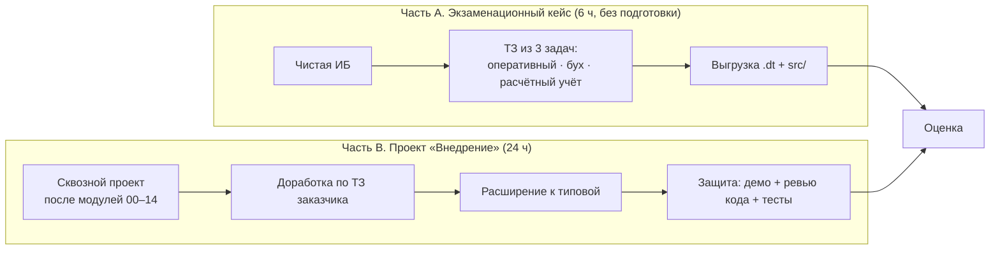

# Модуль 15. Итоговый проект

> **Объём:** 30 ак. ч · **Недели:** 17–18 · **Источники:** [Я] «Итоговый проект» (базовый и расширенный тарифы), [ПР]/[К] «Итоговая аттестация» (кейс-задача на 6 ч, критерии оценки), [К] модуль 18 (методика экзаменационных задач)
> **Нет в источниках:** конкретное ТЗ ниже, автотесты как обязательный критерий приёмки, ревью по стандартам its.1c.ru/db/v8std

## Формат

Итоговый проект состоит из двух частей. Обе части используют одну и ту же технику, отличается режим работы.

* **Часть A** повторяет формат итоговой аттестации «1С-Образования» и экзамена «1С:Специалист по платформе»: 6 часов, пустая база, нужно спроектировать метаданные и написать проведение. Проверяет, насколько быстро вы проектируете регистры и пишете проведение без подсказок.
* **Часть B** соответствует итоговому проекту Практикума, но приближена к реальной работе SAP-консультанта, который пришёл в 1С: доработать существующую систему, не сломав её, и сдать с тестами.

---

## Часть A. Экзаменационный кейс (6 часов)

Работайте в **новой** пустой ИБ без копирования кода из сквозного проекта. Можно пользоваться синтакс-помощником и документацией платформы.

### Задача A1. Оперативный учёт: аренда инструмента (≈ 2,5 ч)

Прокатная компания сдаёт инструмент в аренду. Инструмент учитывается поштучно, у каждого экземпляра есть инвентарный номер.

1. Документ «Выдача в аренду»: клиент, склад, табличная часть «Инструмент», плановая дата возврата, ставка за сутки. Нельзя выдать экземпляр, которого нет на складе. Сообщение об ошибке должно называть конкретный экземпляр.
2. Документ «Возврат из аренды»: вводится на основании выдачи. Можно вернуть часть инструмента. Сумма к оплате = ставка × фактическое число суток (неполные сутки считаются полными).
3. Отчёт «Инструмент у клиентов на дату»: клиент, экземпляр, дата выдачи, просрочка в днях.

**Требования к решению:** «новая» методика контроля остатков с управляемыми блокировками, никаких запросов в цикле, движения формируются одним запросом.

### Задача A2. Бухгалтерский учёт (≈ 2 ч)

1. План счетов с субконто «Клиенты», «Инструмент» (количественный учёт по счёту «Инструмент в аренде»).
2. Документы из A1 должны формировать проводки: выдача — Дт «Инструмент в аренде» Кт «Инструмент на складе» (количественно), возврат — обратная проводка и Дт 62 Кт 90.01 на сумму аренды.
3. Отчёт «Оборотно-сальдовая ведомость по счёту 62 в разрезе клиентов» на СКД.

### Задача A3. Расчёт (≈ 1,5 ч)

Менеджерам начисляется оклад пропорционально отработанным дням и премия 5 % от выручки по аренде, которую они оформили за месяц. Оклад вытесняется больничным. Больничный считается по среднему за 2 предыдущих месяца.

### Критерии оценки части A

Шкала взята из итоговой аттестации [ПР]/[К] и адаптирована.

| Оценка | Условие |
|---|---|
| Отлично | Все три задачи работают, не больше 1 недочёта |
| Хорошо | Всё работает, есть 1 негрубая ошибка и 1 недочёт либо 2 недочёта |
| Удовлетворительно | Сделано не меньше половины, или есть ≤ 2 грубые ошибки |
| Не сдано | Сделано меньше половины |

**Грубые ошибки:** неверная структура регистра (например, ресурс вместо измерения или регистр остатков вместо оборотов), запрос в цикле в проведении, отсутствие контроля остатков, проведение «по объектной модели» поверх десятков строк, отсутствие блокировок при «новой» методике.
**Недочёты:** лишние серверные вызовы с формы, хардкод строк вместо предопределённых, отсутствие `ОбработкаПроверкиЗаполнения`.

---

## Часть B. Проект «Внедрение» (24 часа)

### Легенда

Заказчик «УчебнаяТорговля» эксплуатирует вашу конфигурацию после модулей 00–14. Он присылает пакет требований (аналог change request в SAP). Часть требований нужно реализовать в основной конфигурации, часть — **только расширением**, потому что так решил архитектор: «основная конфигурация — это поставка вендора».

```mermaid
gantt
    title Часть B — план работ (24 ак. ч)
    dateFormat X
    axisFormat %s ч
    section Анализ
    Разбор ТЗ и проектирование метаданных :a1, 0, 3
    section Основная конфигурация
    B1 Возвраты и сторно партий :b1, 3, 8
    B2 Резервирование под заказы :b2, 8, 12
    section Расширения
    B3 Скидки :c1, 12, 16
    B4 Интеграция REST с WMS :c2, 16, 20
    section Качество
    Тесты YAxUnit и сценарий Vanessa :d1, 20, 23
    Защита :d2, 23, 24
```

### Требования

**B1. Возвраты от покупателей (основная конфигурация)**
* Документ `ВозвратОтПокупателя` вводится на основании `РеализацияТоваров`. Нельзя вернуть больше, чем было продано по этому документу; учитываются ранее оформленные возвраты.
* Возвращённый товар приходуется **той же партией и по той же себестоимости**, по которой списывался. Для этого нужно хранить связь «реализация → партии», подумайте, какой регистр или измерение для этого добавить.
* `Продажи`: возврат уменьшает выручку и себестоимость периода возврата. Это сторно, как в SAP SD через credit memo.
* Проводки: Дт 41 Кт 90.02 по себестоимости, Дт 90.01 Кт 62 по выручке.

**B2. Резервирование (основная конфигурация)**
* Новый документ `ЗаказПокупателя` резервирует товар на складе (новый регистр остатков `ТоварыВРезерве`).
* `РеализацияТоваров`, введённая на основании заказа, снимает резерв.
* Контроль при реализации без заказа: свободный остаток = остаток − резерв.
* Аналог в SAP — ATP-проверка и резервирование (`RESB`).

**B3. Скидки (только расширение `Скидки`)**
* В расширении: регистр сведений `СкидкиКонтрагентов` (периодический): контрагент, группа номенклатуры → процент.
* В заимствованной форме `РеализацияТоваров` есть колонка «Скидка %». При выборе номенклатуры процент заполняется автоматически.
* Проведение основной конфигурации **не меняется**, сумма строки уже учитывает скидку. Используйте `&После`/`&ИзменениеИКонтроль` только там, где это необходимо, и обоснуйте выбор.
* Отключение расширения не должно ломать основную конфигурацию.

**B4. Интеграция с внешним WMS (расширение `ИнтеграцияWMS`)**
* HTTP-сервис `wms`, метод `POST /wms/v1/shipments`: принимает JSON с отгрузкой (номер заказа, строки с фактическим количеством). Создаёт и проводит `РеализацияТоваров` на основании заказа. Ответ — `201` с GUID документа, `409`, если отгрузка по этому заказу уже есть (идемпотентность по внешнему номеру), `422`, если остатка не хватило, с текстом ошибки.
* Регламентное задание раз в 10 минут отправляет в WMS (заглушка — любой mock-сервер, например `python -m http.server` с логированием, или Postman Mock) новые заказы через `HTTPСоединение`. Используйте план обмена или регистр сведений «очередь» (≈ IDoc outbound с change pointers).

### Нефункциональные требования

1. Код соответствует стандартам its.1c.ru/db/v8std: области модулей, комментарии к экспортным методам, нет запросов в цикле, клиент-серверные вызовы минимальны.
2. Права: новые объекты включены в роли `Менеджер` / `Кладовщик`, RLS по складам для `Кладовщик` (из модуля 10) действует и для новых документов.
3. Тесты:
   * YAxUnit: не меньше **8** тестов. Обязательные: возврат больше проданного, возврат по партиям, свободный остаток с резервом, идемпотентность HTTP-сервиса, расчёт скидки.
   * Vanessa-Automation: один сквозной сценарий «заказ → реализация → возврат» через интерфейс.
4. Репозиторий: ветка на каждое требование, merge-коммиты, тег `final`. `scripts/check.*` проходит с чистой ИБ.

### Защита (1 ч)

1. Демо, 15 мин: сценарий по требованиям B1–B4.
2. Ревью кода, 20 мин: ревьюер (ментор или коллега) выбирает 3 модуля и задаёт вопросы по стандартам, блокировкам и клиент-серверным вызовам.
3. Прогон `check` на чистой ИБ при ревьюере, 10 мин.
4. Вопросы, 15 мин: из контрольных вопросов модулей 03–14.

### Чек-лист приёмки части B

- [ ] Все документы проводятся, перепроводятся и отменяют проведение без ошибок; движения не дублируются.
- [ ] Возврат приходует партии по исходной себестоимости (проверка: отчёт по `ПартииТоваров` до продажи и после возврата совпадает).
- [ ] Свободный остаток учитывает резерв, параллельное проведение двух реализаций на последний товар не уводит остаток в минус (проверьте в двух сеансах с точкой останова).
- [ ] Расширение `Скидки` отключается без ошибок в основной конфигурации.
- [ ] `POST /wms/v1/shipments`: повторный вызов возвращает `409`, документ не дублируется.
- [ ] Регламентное задание не отправляет один заказ дважды.
- [ ] ≥ 8 зелёных тестов YAxUnit, один зелёный сценарий Vanessa.
- [ ] Нет предупреждений `CheckModules`. Если подключали SonarQube/BSL LS (модуль 14) — нет блокеров.

---

## Что дальше

* Сертификация «1С:Специалист по платформе» и «1С:Специалист-консультант» по типовым: см. [факультатив](90-optional.md), подготовка по [К] модуль 18.
* Типовые конфигурации: возьмите учебную версию «1С:Управление торговлей» или «1С:Бухгалтерия» и сделайте в них требования B3 и B4 расширением. Это ближе всего к реальной первой задаче на проекте.
