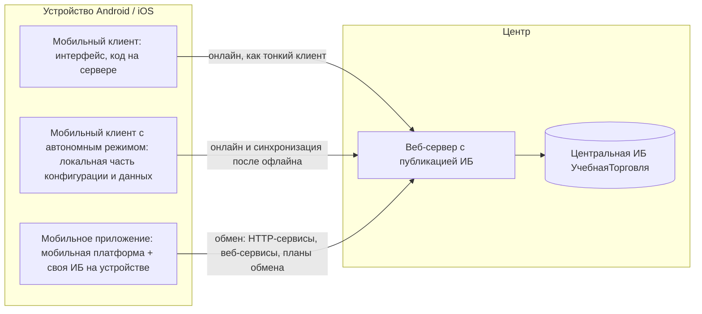
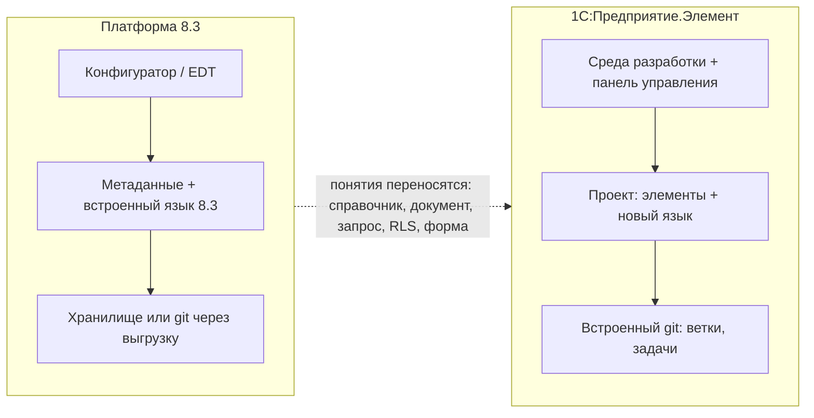
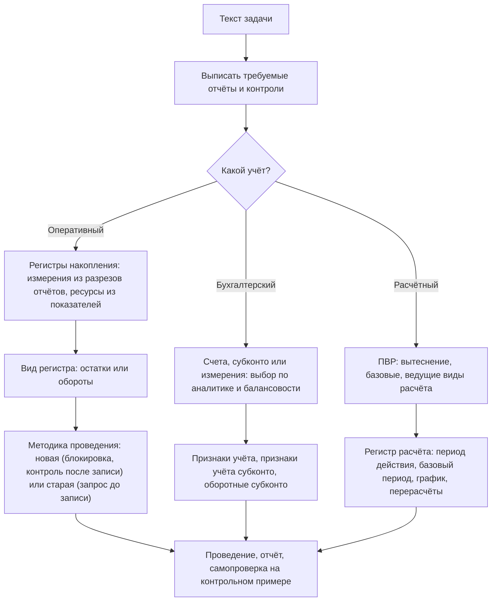

# Модуль 90. Факультатив: мобильная платформа, 1С:Исполнитель, 1С:Предприятие.Элемент, подготовка к «1С:Специалист», карьерный трек

> **Объём:** вне основного плана. Ориентир по источникам: мобильная разработка — [Я] спринт 07 (часть из 30 ч) и спринт 08 (часть из 38 ч), [ПР] модуль 6 / [К] модуль 6 — 32 ак. ч; 1С:Исполнитель — [ПР2] модуль 7 / [К] модуль 16 — 24 ак. ч; 1С:Предприятие.Элемент — [ПР2] модуль 8 / [К] модуль 17 — 48 ак. ч; подготовка к экзамену «1С:Специалист по платформе» — [К] модуль 18 — 60 ак. ч; карьерный трек — [Я] (3 ч + 20 ч + сопровождение 2–8 мес.) · **Неделя:** после курса · **Источники:** [Я] спринты 07, 08, 13 и «Карьерный трек», [ПР] модуль 6, [ПР2] модули 7, 8, [К] модули 6, 16, 17, 18, [Т] модули 2, 3, 5, 8
> **Нет в источниках (написано по документации платформы/опыту):** конкретное API мобильной платформы и автономного режима мобильного клиента (в источниках — перечни тем); синтаксис и стандартная библиотека 1С:Исполнителя и 1С:Предприятие.Элемент (в источниках — перечни тем); формат и правила сертификационного экзамена (в источниках — методика решения задач и рекомендованный сборник задач).

Модуль устроен иначе, чем основные: по каждому блоку — суть для ABAP-разработчика, план изучения и 1–2 задания. Сквозной проект используется только там, где это естественно.

## Результат модуля

- Понимаете варианты мобильной разработки на 1С (мобильный клиент, автономный режим, мобильное приложение) и умеете выбрать вариант под задачу.
- Знаете, зачем нужны 1С:Исполнитель и 1С:Предприятие.Элемент, и чем они отличаются от платформы 8.3 — чтобы осознанно решить, тратить ли на них время.
- Знаете методику решения экзаменационных задач «1С:Специалист по платформе» по трём направлениям и можете уложиться в лимит времени.
- Можете упаковать опыт SAP + этот курс в резюме и портфолио 1С-разработчика.

## Карта понятий SAP → 1С

| SAP | 1С | Ключевое отличие |
|---|---|---|
| SAP Mobile Services / Fiori Client, SAP Mobile Development Kit | Мобильный клиент 1С, мобильная платформа + сборщик мобильных приложений | Тот же язык и метаданные, что и у основной конфигурации; приложение собирается из конфигурации |
| Offline OData (offline store) | Автономный режим мобильного клиента / собственная ИБ мобильного приложения + обмен | Синхронизация — штатные механизмы обмена (планы обмена, HTTP-сервисы), а не OData-дельты |
| Скрипты администрирования (shell, PowerShell, SAP GUI scripting), ABAP-отчёты для Basis | 1С:Исполнитель | Отдельная среда исполнения скриптов, не требует ИБ |
| SAP BTP ABAP Environment, SAP Build Apps | 1С:Предприятие.Элемент | Облачная технология 1С с git «из коробки», новый язык и модель проекта |
| SAP Certified Development Associate | 1С:Специалист по платформе | Практический экзамен: решить задачу в конфигураторе и защитить решение, а не тест |

## Блок 1. Мобильная платформа

### 1.1. Варианты



| Вариант | Когда выбирать | Цена |
|---|---|---|
| Мобильный клиент | Есть связь, нужен доступ к существующей конфигурации с телефона | Минимальная: адаптировать формы под малый экран |
| Мобильный клиент с автономным режимом | Связь бывает не всегда, логика должна совпадать с центральной | Нужно выделить автономную часть и продумать синхронизацию |
| Мобильное приложение (мобильная платформа) | Отдельный продукт для полевых сотрудников/клиентов, свой UX, офлайн по умолчанию | Отдельная конфигурация, обмен с центром пишется вами |

[ПР] модуль 6 различает **однокомпонентные** и **многокомпонентные** мобильные приложения, но не раскрывает эти термины. Точное определение сверьте в документации мобильной платформы на ИТС (раздел о сборке мобильных приложений). В курсе важнее архитектурное различие: приложение работает **автономно** только с локальной базой на устройстве, либо **в связке с центральной базой** (через веб-сервер и HTTP-/Web-сервисы) и обменивается с ней данными. Задание M90-T2 — второй вариант. Отдельная тема источника — «универсальные прикладные решения для МУ и ПК»: одна конфигурация, работающая и на компьютере, и на мобильной платформе (свойство конфигурации «Назначения использования»).

Ограничения мобильной платформы: подмножество объектов метаданных и методов (в синтакс-помощнике у каждого метода указана доступность на мобильной платформе), локальная СУБД (файловая ИБ), нет внешних компонент произвольного вида, интерфейс — управляемые формы с адаптацией под экран. Специфические для устройства средства (геопозиционирование, мультимедиа, уведомления) — отдельные объекты глобального контекста, доступность проверяйте в синтакс-помощнике.

### 1.2. Обмен с центральной базой

Два штатных подхода ([модуль 11](11-integration.md)):

1. **HTTP-сервис центральной базы** — мобильное приложение отправляет/получает JSON через `HTTPСоединение`. Просто, контролируете формат; аналог собственного OData-сервиса.
2. **Планы обмена на обеих сторонах** — регистрация изменений и сериализация XML. Надёжно для двусторонней синхронизации; аналог ALE с change pointers.

```bsl
// На стороне отправителя (устройство или центр): выгрузка изменений для узла
Процедура ВыгрузитьИзменения(Узел, ЗаписьXML) Экспорт
	ЗаписьСообщения = ПланыОбмена.СоздатьЗаписьСообщения();
	ЗаписьСообщения.НачатьЗапись(ЗаписьXML, Узел);
	Выборка = ПланыОбмена.ВыбратьИзменения(Узел, ЗаписьСообщения.НомерСообщения);
	Пока Выборка.Следующий() Цикл
		ЗаписатьXML(ЗаписьXML, Выборка.Получить());
	КонецЦикла;
	ЗаписьСообщения.ЗакончитьЗапись();
КонецПроцедуры
```

Транспорт — тело HTTP-запроса к HTTP-сервису центральной базы; приём на другой стороне — `ПланыОбмена.СоздатьЧтениеСообщения()`, `ПрочитатьXML` и запись объектов с `ОбменДанными.Загрузка = Истина`.

Приём сообщения на другой стороне:

```bsl
Процедура ЗагрузитьИзменения(ЧтениеXML) Экспорт
	ЧтениеСообщения = ПланыОбмена.СоздатьЧтениеСообщения();
	ЧтениеСообщения.НачатьЧтение(ЧтениеXML);
	// подтверждение: всё, что получатель уже принял, больше не отправляем
	ПланыОбмена.УдалитьРегистрациюИзменений(ЧтениеСообщения.Отправитель, ЧтениеСообщения.НомерПринятого);
	Пока ВозможностьЧтенияXML(ЧтениеXML) Цикл
		Данные = ПрочитатьXML(ЧтениеXML);
		Данные.ОбменДанными.Отправитель = ЧтениеСообщения.Отправитель; // не регистрировать обратно
		Данные.ОбменДанными.Загрузка = Истина; // без проверок и бизнес-логики
		Данные.Записать();
	КонецЦикла;
	ЧтениеСообщения.ЗакончитьЧтение();
КонецПроцедуры
```

Вариант с HTTP-сервисом и идемпотентным приёмом документа (центральная база, метод `POST /inventory` HTTP-сервиса `API`): устройство генерирует `УникальныйИдентификатор` документа и передаёт его в JSON; центр создаёт документ с той же ссылкой, а повторная отправка ничего не дублирует.

```bsl
Функция InventoryPOST(Запрос)
	Чтение = Новый ЧтениеJSON;
	Чтение.УстановитьСтроку(Запрос.ПолучитьТелоКакСтроку());
	Данные = ПрочитатьJSON(Чтение); // Структура
	Чтение.Закрыть();

	Ссылка = Документы.ПересчетТоваров.ПолучитьСсылку(Новый УникальныйИдентификатор(Данные.id));
	Если Ссылка.ПолучитьОбъект() <> Неопределено Тогда
		Возврат Новый HTTPСервисОтвет(200); // уже принят ранее
	КонецЕсли;

	Документ = Документы.ПересчетТоваров.СоздатьДокумент();
	Документ.УстановитьСсылкуНового(Ссылка);
	Документ.Дата = ТекущаяДатаСеанса();
	// ... заполнение склада и строк из Данные
	Документ.Записать(РежимЗаписиДокумента.Запись);
	Возврат Новый HTTPСервисОтвет(201);
КонецФункции
```

### 1.3. Сборка и отладка

Цикл разработки: конфигурация с назначением «Мобильное устройство» → публикация на веб-сервере → мобильная платформа разработчика (или эмулятор Android) загружает конфигурацию по URL → отладка (в том числе с компьютера) → **сборщик мобильных приложений** (отдельная конфигурация 1С) собирает установочный пакет из мобильной платформы и вашей конфигурации (для Android нужны Android SDK и JDK, для iOS — macOS с Xcode).

### 1.4. План изучения

| Шаг | Тема | Источник |
|---|---|---|
| 1 | Поддерживаемые ОС, ограничения, мобильный клиент vs приложение | [ПР] м. 6, [Я] спринт 07 |
| 2 | Веб-сервер, эмулятор, мобильная платформа разработчика | [Я] спринт 07 |
| 3 | Первое приложение, адаптация форм | [Я] спринт 07 |
| 4 | Обмен с центральной базой: HTTP-сервис, аутентификация | [Я] спринт 08, [ПР] м. 6 |
| 5 | Сборка и установка на Android | [Я] спринт 07 |

### 1.5. Задания

**M90-T1. Мобильный клиент кладовщика.** Опубликуйте `УчебнаяТорговля` на веб-сервере, подключитесь мобильным клиентом, адаптируйте форму `ПеремещениеТоваров` под экран телефона (группировка и видимость элементов для мобильного клиента — по документации платформы).
- [ ] Документ создаётся и проводится с телефона пользователем с ролью `Кладовщик`.
- [ ] Форма читается без горизонтальной прокрутки.

**M90-T2. Приложение «Инвентаризация» (в связке с центральной базой).** Мобильное приложение со справочником `Номенклатура` (только чтение) и документом `ПересчетТоваров`; номенклатура загружается из центральной базы через `GET /stock` HTTP-сервиса `API` ([модуль 11](11-integration.md)), документы пересчёта выгружаются новым методом `POST /inventory`.
- [ ] Работает без сети, синхронизация по команде.
- [ ] Повторная отправка одного документа не создаёт дубль в центральной базе (идемпотентность по уникальному идентификатору).
- [ ] Собран установочный пакет для Android.

## Блок 2. 1С:Исполнитель

### 2.1. Суть

1С:Исполнитель — среда исполнения скриптов от 1С для задач автоматизации и администрирования: работа с файлами и ZIP-архивами, электронной почтой, HTTP-запросами, JSON и XML ([ПР2] модуль 7). Скрипт не требует информационной базы и платформы 8.3. Язык — статически типизированный, родственный языку 1С:Предприятие.Элемент, синтаксически заметно отличается от встроенного языка 8.3. Источник называет применение: администрирование баз 1С и 1С:Шины.

Для ABAP-разработчика это ниша «Basis-скриптов»: ночные выгрузки, проверки доступности сервисов, развёртывание. В экосистеме 1С ту же нишу давно занимает open source OneScript (на нём написаны vanessa-runner и GitSync из [модуля 14](14-team-dev-quality.md)) — он использует язык 8.3 и проще для старта; Исполнитель — официальный продукт 1С.

| Инструмент | Язык | Нужна ИБ/платформа 8.3 | Типичное применение |
|---|---|---|---|
| Пакетный режим Конфигуратора, `ibcmd`, `rac` | Параметры командной строки | Да | Выгрузка/загрузка, обновление, администрирование кластера |
| OneScript | Встроенный язык 8.3 (подмножество) | Нет | CI (vanessa-runner, GitSync), утилиты разработчика |
| 1С:Исполнитель | Язык Исполнителя/Элемента | Нет | Скрипты администрирования, интеграционные сценарии, 1С:Шина |

Обычно скрипт Исполнителя/OneScript **оркестрирует** пакетный режим и `rac`, а не заменяет их.

### 2.2. План изучения

| Шаг | Тема ([ПР2] модуль 7) |
|---|---|
| 1 | Знакомство с технологией, первый скрипт, запуск |
| 2 | Основы языка: типы данных, методы |
| 3 | Стандартная библиотека и коллекции |
| 4 | Файлы и ZIP-архивы |
| 5 | Электронная почта: отправка и получение |
| 6 | HTTP-запросы, JSON и XML |
| 7 | Сценарии администрирования баз 1С и 1С:Шины |

Синтаксис изучайте по официальной документации и примерам из поставки — в этом курсе код Исполнителя не приводится, чтобы не путать его со встроенным языком 8.3.

### 2.3. Задания

**M90-T3. Ночное резервное копирование.** Скрипт: выгрузка серверной ИБ `uchtorg` (из [модуля 12](12-jobs-bp-admin-performance.md)) в `.dt` утилитой `ibcmd` или пакетным режимом Конфигуратора, упаковка в ZIP с датой в имени, удаление архивов старше 14 дней, письмо администратору с результатом.
- [ ] Ошибка выгрузки приводит к письму с текстом ошибки и ненулевому коду возврата.

**M90-T4. Мониторинг API.** Скрипт раз в 5 минут вызывает `GET /stock` HTTP-сервиса `API`, проверяет код ответа, время и валидность JSON, пишет результат в файл журнала.
- [ ] Сравните объём кода с аналогом на OneScript и опишите выводы в README.

## Блок 3. 1С:Предприятие.Элемент

### 3.1. Суть

1С:Предприятие.Элемент — технология 1С для разработки (в том числе облачных) приложений с новой моделью проекта: разработка в среде с панелью управления, проект в **встроенном git-репозитории** (ветки, задачи, разработчики), клиент-серверная модель, свой встроенный язык и язык запросов, RLS, HTTP-сервисы, фоновые задания, стандартное хранилище настроек, мобильный клиент, проекты-библиотеки ([ПР2] модуль 8). Аналитика — 1С:Аналитика.



Что переносится из этого курса: прикладные понятия (справочники, документы, виртуальные таблицы, динамический список, RLS, HTTP-сервисы, фоновые задания), клиент-серверное мышление, командная работа через git. Что не переносится: синтаксис языка, модель проекта, большая часть инструментов 8.3. Рынок вакансий по Элементу на момент написания курса существенно меньше, чем по платформе 8.3 — оценивайте перед вложением 48 часов.

| Аспект | Платформа 8.3 | 1С:Предприятие.Элемент |
|---|---|---|
| Среда разработки | Конфигуратор, EDT (локально) | Среда разработки с панелью управления |
| Версионирование | Хранилище конфигурации или git через выгрузку/EDT | Встроенный git-репозиторий, ветки и задачи в среде |
| Язык | Встроенный язык 8.3, динамическая типизация | Новый язык со статической типизацией (общий с 1С:Исполнителем) |
| Развёртывание | Файловая или клиент-серверная ИБ, публикация на веб-сервере | Через панель управления (в том числе облако) |
| Повторное использование | БСП влита в конфигурацию | Проекты-библиотеки, подключаемые к проекту |

### 3.2. План изучения ([ПР2] модуль 8)

| Шаг | Тема |
|---|---|
| 1 | Концепция, панель управления, среда разработки, структура проекта |
| 2 | Справочники, документы, клиентское приложение, формы объекта и списка |
| 3 | Встроенный язык, клиент-серверная модель, обработчики, язык запросов, отладка |
| 4 | Интерфейс, импорт проекта, жизненный цикл обновления |
| 5 | Git: ветки, задачи, разработчики, интерфейс git в среде |
| 6 | Виртуальные таблицы, динамический список, глобальное клиентское событие |
| 7 | RLS, отчёты, панель отчётов, 1С:Аналитика |
| 8 | Проект-библиотека, подключение и интеграция библиотеки |
| 9 | Фоновые задания, СХН, HTTP-сервисы, API панели управления, журнал событий |
| 10 | Мобильный клиент и его сборка |

### 3.3. Задания

**M90-T5. Мини-склад на Элементе.** Перенесите ядро `УчебнаяТорговля`: `Номенклатура`, `Склады`, `ПоступлениеТоваров`, `РеализацияТоваров`, регистр остатков с контролем остатков при проведении, отчёт по остаткам.
- [ ] Разработка в ветке встроенного git, слияние через задачу.
- [ ] Таблица соответствия «объект/приём 8.3 → Элемент» с отличиями (10+ строк).

**M90-T6*. HTTP-интеграция двух миров.** Элемент-приложение получает остатки из `УчебнаяТорговля` (8.3) через `GET /stock` и показывает их в своём отчёте; ограничение доступа (RLS) по складу пользователя.

## Блок 4. Подготовка к экзамену «1С:Специалист по платформе»

### 4.1. Формат и методика

Экзамен практический: кандидат получает задачу (по оперативному, бухгалтерскому или расчётному учёту), реализует её в конфигураторе за ограниченное время и защищает решение перед экзаменатором. Оценивается не только «работает», но и выбор объектов, структура регистров, эффективность запросов и проведения. Актуальные правила допуска и регламент — в центре сертификации 1С; сборник задач с примерами решений указан в списке литературы [ПР]/[К] («Комплект вопросов сертификационного экзамена… Версия 8.3»).

Методика [К] модуль 18:



Связь с курсом: оперативный учёт — [модуль 06](06-registers-posting.md) (две методики проведения, партии, контроль остатков), бухгалтерский — [модуль 08](08-accounting.md), расчётный — [модуль 09](09-periodic-calculations.md), отчёты — [модуль 07](07-reports-skd-print.md), запросы — [модуль 04](04-queries.md).

Пример разбора (оперативный учёт, типовая формулировка «учёт товаров по партиям, списание ФИФО, отчёт о валовой прибыли по покупателям»):

| Что требуется | Решение | Почему так |
|---|---|---|
| Остатки по партиям и складам | РН остатков `ПартииТоваров`: измерения `Номенклатура`, `Склад`, `Партия`; ресурсы `Количество`, `Сумма` | Нужен остаток в стоимостном выражении по партии |
| Контроль остатка | По `ПартииТоваров` в разрезе `Номенклатура`, `Склад` (без партии) или отдельный РН `ОстаткиТоваров` | Отрицательный остаток недопустим при любой партии |
| Валовая прибыль по покупателям | РН оборотов `Продажи`: измерения `Номенклатура`, `Контрагент`; ресурсы `Количество`, `Выручка`, `Себестоимость` | Оборотный регистр без остатков — быстрее и проще |
| Порядок ФИФО | Сортировка по `Партия.МоментВремени` в запросе остатков | Не нужен отдельный регистр очередей |
| Проведение | Новая методика: запись движений, затем контроль отрицательных остатков, управляемая блокировка по `Номенклатура`+`Склад` | Меньше конфликтов блокировок, проще код |

Это ровно структура регистров сквозного проекта ([README проекта](../project/README.md)) — экзаменационные задачи по оперативному учёту почти всегда сводятся к ней с вариациями.

Чек-лист решения задачи:

1. Сначала структура регистров на бумаге — от требуемых отчётов, а не от документов.
2. Минимум объектов: каждый лишний регистр/реквизит — вопрос на защите.
3. Проведение одним запросом на документ, без обращений через точку в цикле; блокировки — только на нужные измерения.
4. Контрольный пример из условия прогоните полностью, включая проведение задним числом, если оно в условии.
5. Остаток времени — на отчёт и на проверку граничных случаев (пустые остатки, сторно, перерасчёт).

### 4.2. План подготовки

| Неделя | Направление | Что делать |
|---|---|---|
| 1 | Оперативный учёт | Универсальный подход к проектированию регистров накопления; две методики проведения; 5 задач на время |
| 2 | Бухгалтерский учёт | Устройство регистра бухгалтерии, выбор счета/субконто/измерения, признаки учёта; 4 задачи |
| 3 | Расчётный учёт | Работа со временем, перерасчёты и дополнения, вытеснение; 4 задачи |
| 4 | Смешанные | Пробные экзамены с таймером, разбор решений, отработка защиты |

### 4.3. Задания

**M90-T7. Три задачи на время.** Решите по одной задаче каждого направления из сборника в чистой базе, строго с таймером.
- [ ] Для каждой — запись: время, ошибки на контрольном примере, что исправили бы.

**M90-T8. Защита.** Объясните решение коллеге (или запишите видео) в формате экзамена: структура регистров, почему такая, как проводится, как работает отчёт.
- [ ] Ответы на вопросы «почему не регистр сведений», «почему не обороты», «что будет при проведении задним числом».

## Блок 5. Карьерный трек

[Я] предлагает карьерный трек: анализ рынка и стратегия (3 ч), подготовка к поиску (20 ч: резюме, портфолио, сопроводительное письмо, собеседования), активный поиск с консультантами (2–8 мес.). Для ABAP-разработчика отличие от новичка в том, что продаёте вы не «знание 1С с нуля», а перенос опыта SAP.

Акценты:

- **Резюме.** Таблица соответствия навыков: ALV → СКД, BAPI/RFC → HTTP-сервисы, enhancement/BAdI → расширения, транспорт → хранилище/git, MM/SD/FI → оперативный/бухгалтерский учёт. Проекты на 1С — сквозной проект этого курса.
- **Портфолио.** Репозиторий `УчебнаяТорговля` с ветками модулей, тегами, тестами и CI ([модуль 14](14-team-dev-quality.md)), README с архитектурой (схемы из модулей). Итоговый проект — [модуль 15](15-final-project.md).
- **Собеседование.** Технические вопросы по 1С — контрольные вопросы модулей 03–14; живое задание — обычно запрос или проведение документа с контролем остатков.
- **Сегмент.** Интеграция 1С ↔ SAP, крупные внедрения ERP, проекты миграции — места, где опыт SAP даёт преимущество.

**M90-T9. Резюме и портфолио.** Резюме с блоком соответствия SAP → 1С и публичный (или доступный по ссылке) репозиторий проекта с README.
- [ ] Каждый пункт опыта на 1С подтверждён ссылкой на код/коммит в портфолио.

## Ловушки для ABAP-разработчика

1. **Писать мобильное приложение «как полноценную конфигурацию».** Мобильная платформа поддерживает подмножество объектов и методов — проверяйте доступность в синтакс-помощнике до проектирования, а не после.
2. **Обмен без подтверждения приёма.** Без `УдалитьРегистрациюИзменений` по номеру принятого сообщения данные будут пересылаться бесконечно; без идемпотентности — дублироваться при обрыве связи.
3. **Путать Исполнитель/Элемент со встроенным языком 8.3.** Похожие слова, другой синтаксис и типизация; навык не переносится напрямую.
4. **Готовиться к экзамену чтением.** Экзамен проверяет скорость и выбор структуры регистров; без решения задач с таймером результат непредсказуем.
5. **На экзамене «как в SAP» вводить лишние объекты** (статусные таблицы, промежуточные регистры). Каждый лишний объект — вопрос на защите и потерянное время.
6. **Портфолио без тестов и истории.** Репозиторий с одним коммитом «initial» не подтверждает опыт; история веток модулей и CI — подтверждает.

## Что сознательно исключено из основного курса и почему

| Тема | Где есть в источниках | Почему исключена | Если всё же понадобится |
|---|---|---|---|
| Обычные формы, редактор обычных форм, толстый клиент в режиме обычного приложения | [Т] модуль 3 («Редактор обычных форм») | Устаревшая технология, в новых разработках и актуальных типовых не используется. Встретится только при поддержке старых конфигураций | Документация платформы, раздел об обычном приложении; принципы событий и модулей те же, что в [модуле 05](05-managed-forms.md), но без клиент-серверного разделения |
| Работа с Xbase (DBF) | [Т] модуль 8, [Я] спринт 08 («Работа с Data Base File») | Устаревший формат обмена; в интеграциях вытеснен XML/JSON/HTTP ([модуль 11](11-integration.md)) | Объект `XBase` в синтакс-помощнике |
| Automation Client/Server (COM) | [Т] модуль 8 | Только Windows, не работает на Linux-сервере и в веб-клиенте, проблемы безопасности и стабильности. Замена — HTTP-сервисы, веб-сервисы, внешние компоненты | Документация платформы, раздел о COM |
| Элементы ActiveX | [Т] модуль 8 | Только Windows и только в обычных формах/толстом клиенте | — |
| HTML-редактор | [Т] модуль 2 | Узкий инструмент редактирования HTML-макетов; поле HTML-документа на форме при необходимости осваивается по документации | Документация платформы |
| Редактор географической схемы | [Т] модуль 2 | Редкая прикладная задача | Документация платформы |
| Редактор графической схемы (как самостоятельная тема) | [Т] модуль 2 | Практически используется в виде карты маршрута бизнес-процесса — разобрано в [модуле 12](12-jobs-bp-admin-performance.md) | Документация платформы |
| Редактор картинок | [Т] модуль 3 | Не требует обучения | — |
| Алгоритмические собеседования | [Я] спринт 13 («Подготовка к собеседованию. Алгоритмические собеседования») | Аудитория — опытные разработчики; алгоритмы не являются спецификой 1С | Любой общий курс по алгоритмам |

## Контрольные вопросы

1. Чем мобильный клиент отличается от мобильного приложения на мобильной платформе? Когда нужен автономный режим?
2. Какие механизмы обмена с центральной базой доступны мобильному приложению и как обеспечить идемпотентность приёма документов?
3. Что нужно для сборки мобильного приложения под Android и iOS?
4. Для каких задач 1С:Исполнитель подходит лучше, чем пакетный режим Конфигуратора или OneScript?
5. Что из навыков разработки на 8.3 переносится на 1С:Предприятие.Элемент, а что нет?
6. Опишите универсальный подход к проектированию регистров накопления по тексту экзаменационной задачи.
7. Как выбрать между счётом, субконто и измерением регистра бухгалтерии?
8. Почему обычные формы и COM исключены из курса, и в каких проектах вы с ними всё же столкнётесь?
9. Как приёмник сообщения обмена подтверждает отправителю получение данных, и зачем устанавливать `ОбменДанными.Загрузка = Истина`?
10. Какие вопросы зададут на защите экзаменационной задачи по структуре регистров и как на них отвечать?

## Документация

- Документация платформы 8.3 (мобильная платформа, мобильный клиент, обмен данными): https://its.1c.ru/db/v83doc
- Методическая поддержка разработчиков: https://its.1c.ru/db/metod8dev
- Стандарты разработки (в том числе для мобильных приложений): https://its.1c.ru/db/v8std
- Сайт платформы (технологии, мобильная платформа, Исполнитель, Элемент): https://v8.1c.ru
- Открытые проекты 1С: https://github.com/1C-Company
