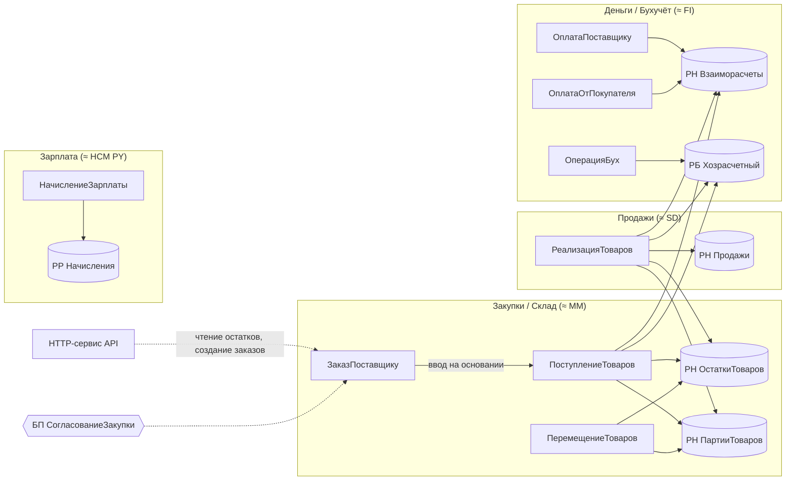

# Сквозной проект «УчебнаяТорговля»

Все практические задания курса выполняются в **одной** конфигурации, которая растёт от модуля к модулю — как реальный проект в SAP-ландшафте растёт от MM к SD, FI и HR. К концу курса это мини-ERP торгово-складской компании.

## Домен и аналог в SAP

## Справочник метаданных (единые имена для всех модулей)

| Вид объекта | Имя | Ключевые реквизиты / измерения | Появляется в модуле |
|---|---|---|---|
| Справочник | `Номенклатура` (иерархия групп) | Артикул, ЕдиницаИзмерения, ВидНоменклатуры | 03 |
| Справочник | `ЕдиницыИзмерения` | Код по ОКЕИ | 03 |
| Справочник | `Контрагенты` | ИНН, ВидКонтрагента | 03 |
| Справочник | `ДоговорыКонтрагентов` (подчинён `Контрагенты`) | Валюта, ВидДоговора | 03 |
| Справочник | `Склады` | — | 03 |
| Справочник | `Организации` | ИНН | 03 |
| Справочник | `Сотрудники` | Оклад (через РС) | 09 |
| Справочник | `Валюты` | — | 03 |
| Перечисление | `ВидыНоменклатуры` | Товар, Услуга | 03 |
| Перечисление | `СпособыСписания` | ФИФО, Средняя | 06 |
| Константа | `ОсновнаяВалюта`, `СпособСписанияСебестоимости` | — | 03 / 06 |
| Документ | `ПоступлениеТоваров` | Склад, Контрагент, Договор, ТЧ Товары (Номенклатура, Количество, Цена, Сумма) | 03 |
| Документ | `РеализацияТоваров` | то же | 03 |
| Документ | `ПеремещениеТоваров` | СкладОтправитель, СкладПолучатель, ТЧ Товары | 06 |
| Документ | `ЗаказПоставщику` | Контрагент, ТЧ Товары, Статус | 05 |
| Документ | `ОплатаПоставщику`, `ОплатаОтПокупателя` | Контрагент, Договор, Сумма | 06 |
| Документ | `ОперацияБух` | ручные проводки | 08 |
| Документ | `НачислениеЗарплаты` | ТЧ Начисления | 09 |
| Регистр сведений | `ЦеныНоменклатуры` (периодический, день) | изм. Номенклатура; рес. Цена | 03 |
| Регистр сведений | `КурсыВалют` (периодический, день) | изм. Валюта; рес. Курс, Кратность | 11 |
| Регистр сведений | `ОкладыСотрудников` (периодический) | изм. Сотрудник; рес. Оклад | 09 |
| Регистр накопления | `ОстаткиТоваров` (остатки) | изм. Номенклатура, Склад; рес. Количество | 06 |
| Регистр накопления | `ПартииТоваров` (остатки) | изм. Номенклатура, Склад, Партия (ДокументСсылка.ПоступлениеТоваров); рес. Количество, Сумма | 06 |
| Регистр накопления | `Продажи` (обороты) | изм. Номенклатура, Контрагент; рес. Количество, Выручка, Себестоимость | 06 |
| Регистр накопления | `Взаиморасчеты` (остатки) | изм. Контрагент, Договор; рес. Сумма | 06 |
| План видов характеристик | `ВидыСубконто` | — | 08 |
| План счетов | `Хозрасчетный` | 10, 41, 60, 62, 90, 51, 70, 26 | 08 |
| Регистр бухгалтерии | `Хозрасчетный` | изм. Организация; рес. Сумма, Количество | 08 |
| План видов расчёта | `ОсновныеНачисления` | Оклад, Больничный, Премия | 09 |
| Регистр расчёта | `Начисления` | изм. Сотрудник; рес. Результат | 09 |
| Бизнес-процесс | `СогласованиеЗакупки` + задача `ЗадачаИсполнителя` | — | 12 |
| HTTP-сервис | `API` | `GET /stock`, `POST /orders` | 11 |
| Регламентное задание | `ЗагрузкаКурсовВалют` | — | 11–12 |
| Роли | `Администратор`, `Кладовщик`, `Менеджер`, `Бухгалтер` | — | 10 |
| Подсистемы | `Склад`, `Продажи`, `Финансы`, `Зарплата`, `Администрирование` | — | 05/10 |

## Правила работы с проектом

1. Исходники конфигурации живут в git — каталог `src/` (формат выгрузки конфигуратора или EDT, см. [lab/](../lab/README.md)).
2. Каждый модуль — отдельная ветка `module-NN`, по завершении — merge в `main` и тег `mNN-done`.
3. Каждое задание имеет ID вида `M06-T3`, критерии приёмки и способ проверки. Если проверка — запрос, его текст сохраняется в `checks/MNN-Tk.sql.txt` (язык запросов 1С), если тест — в расширении с тестами YAxUnit (см. модуль 14).
4. Тестовые данные — `project/testdata/` (обработка заполнения создаётся в модуле 03, задание M03-T6).

Итоговый проект — [модуль 15](../modules/15-final-project.md).
